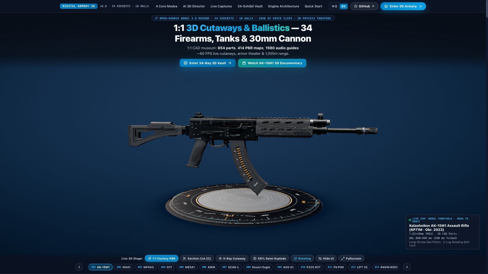
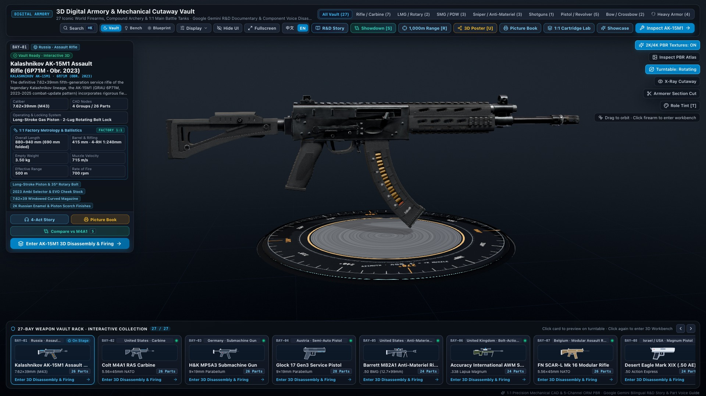
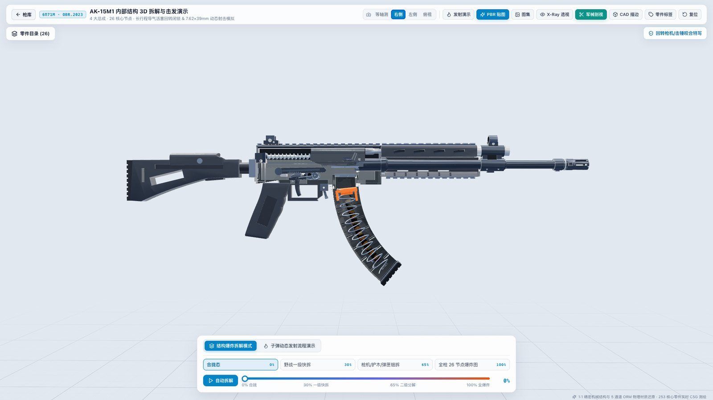
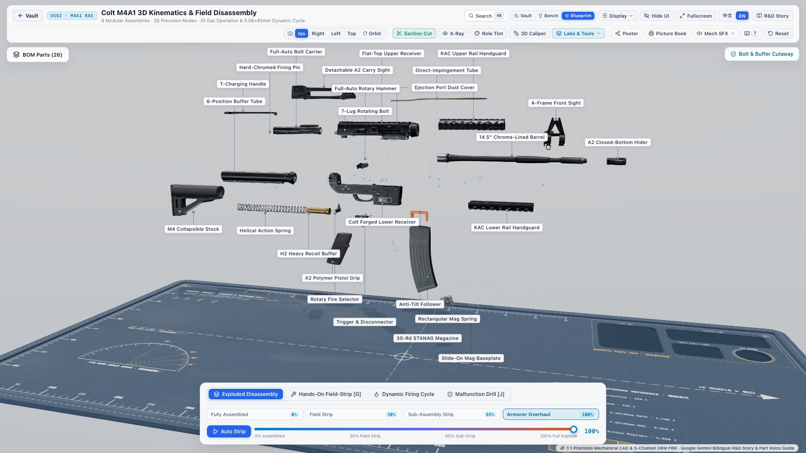
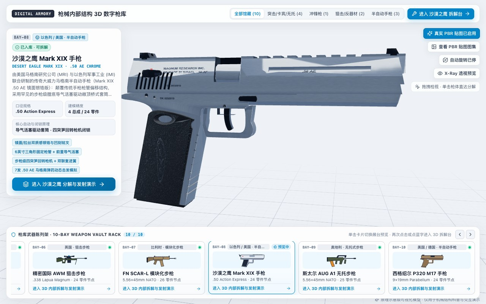
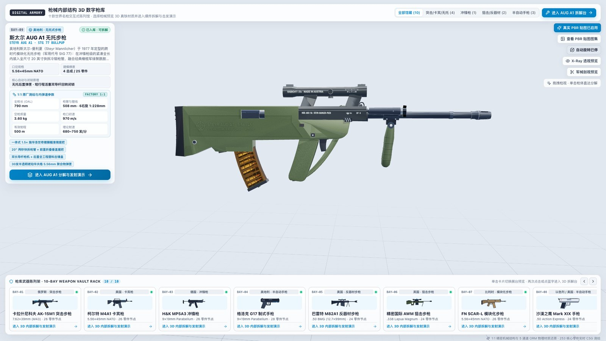

<div align="center">

<p>
  <strong>English</strong>
  &nbsp;·&nbsp;
  <a href="README.zh-CN.md">简体中文</a>
</p>

# Digital Armory 3D · v2.0

**The Browser-Native Open-Source 3D Firearms Mechanical Museum & Interactive Engineering Encyclopedia**

[](https://github.com/zhoujingkun1989-arch/digital-armory-3d/actions/workflows/ci.yml)
[](https://zhoujingkun1989-arch.github.io/digital-armory-3d/showcase.html?lang=en)
[](https://www.typescriptlang.org/)
[](https://threejs.org/)
[](LICENSE)

<h3>
  <a href="https://zhoujingkun1989-arch.github.io/digital-armory-3d/showcase.html?lang=en">✦ Interactive Live Showcase</a>
  &nbsp;·&nbsp;
  <a href="https://zhoujingkun1989-arch.github.io/digital-armory-3d/?screen=armory&lang=en">🚀 Enter 19-Bay 3D Vault</a>
  &nbsp;·&nbsp;
  <a href="https://zhoujingkun1989-arch.github.io/digital-armory-3d/?screen=ballistics&lang=en">🎯 1,000m External Ballistics Lab</a>
  &nbsp;·&nbsp;
  <a href="https://zhoujingkun1989-arch.github.io/digital-armory-3d/?screen=cartridges&lang=en">🧪 11-Caliber 1:1 Cutaway Lab</a>
  &nbsp;·&nbsp;
  <a href="https://zhoujingkun1989-arch.github.io/digital-armory-3d/?weapon=ak15&screen=workbench&lang=en">🔧 Open AK-15M1 Disassembly Bench</a>
</h3>

</div>

---

> Built with **React 18 + TypeScript + Three.js (`@react-three/fiber` / Web Worker `three-bvh-csg` / Web Audio API)** — with **zero external `.glb` / `.gltf` mesh files** and a **`<800 kB` zero-warning split bundle**.
>
> Every single one of the **480 moving components across 19 iconic world firearms & compound archery systems (17 legendary firearms including FN M249 SAW, Luger P08, KRISS Vector `.45 ACP`, Colt Python `.357`, Benelli M4 `M1014`, and U.S. Rifle M1 Garand `.30-06`, plus Mathews LIFT 33 & Ravin R500)** is synthesized procedurally via manifold boolean CSG in a background Web Worker, paired with **112 2K 5-channel Packed ORM WebP maps**, and streamed zero-copy to WebGL 2.0. Combine **1,000m RK4 G1/G7 External Ballistics & FFP Reticle DOPE Lab (`[R]`)**, **Armorer Blind Qualification Exam & Unknown Stoppage Triage (`[G] / [J]`)**, **Instant HD 3D Cutaway Social Poster Studio (`[U]`)**, **3-Axis Mechanism Showdown (`[S]`)**, **11-Caliber SAAMI/CIP Cartridge & Shotshell Cutaway Lab (`[B]`)**, **Two-Pass Stencil Solid Cross-Section Cutaways (`[C]`)**, **6-Role Functional Color-Coding & 60fps Propellant Gas-Flow Streamlines (`[T]`)**, **SAAMI/CIP Chamber Pressure $P(t)$ & Bore Velocity $V(t)$ Oscilloscope Telemetry**, **Interactive `SAFE / SEMI / AUTO` Fire-Control & Press-Check (`[P] / [V] / [F]`)**, **17-Plate Collector Monograph & Kids Picture Book Print Studio (`[Ctrl/Cmd+P]`)**, **iPad/Mobile Coarse-Pointer Touch Ergonomics**, and **1,112 Bilingual `Charon` (`gemini-3.8-flash-tts`) Voiceovers** with automated **3D Documentary Camera Choreography**.





---

## Why Digital Armory 3D Stands Out

| Inspiration Benchmark | What We Synthesize & Advance |
| :--- | :--- |
| **Matt Rittman 3D Cutaway Animations** | Real-time interactive **6-role functional color-coding (`[T]`)**, dynamic **high-pressure bore & gas-port flow streamlines**, and synchronized 3D documentary camera choreography — pause, orbit, slice, or inspect any part at any millisecond. |
| **World of Guns: Gun Disassembly** | **Hands-on military field-strip DAGs & Timed Blind Armorer Qualification Exams (`[G]`)**, **Mystery Stoppage Triage (`[J]`)**, `SAFE / SEMI / AUTO` sear/disconnector mechanics, `S / A / B / C` rank certification, and zero client downloads or paywalls. |
| **Bartosz Ciechanowski (`ciechanow.ski`)** | Instant browser load, direct 3D slide/bolt manipulation, **1,000m RK4 3-DOF external ballistics & crosswind DOPE solver (`[R]`)**, and 1:1 coupling between **SAAMI/CIP internal ballistics curves ($P(t)$, $V(t)$)** and 7-stage kinematics at 60 FPS with zero React re-renders. |
| **Smithsonian 3D & Royal Armouries** | Bilingual (`EN / 中文`) 4-act R&D histories, factory `1:1` CAD metrology (`1 unit = 1 cm`), **HD 3D Cutaway Share Posters (`[U]`)**, and MIT-licensed procedural geometry & PBR pipelines. |

---

## Key Engineering Capabilities (v2.0)

- **✦ 1,000m RK4 G1/G7 External Ballistics, Crosswind & FFP Reticle DOPE Lab (`[R]` / `?screen=ballistics`, `WP-14`)**: Pure Zero-GC 4th-order Runge-Kutta 3-DOF exterior ballistics engine across all **13 projectile profiles** (all 11 SAAMI/CIP/NATO metallic & 9-pellet `12 Gauge` buckshot loads including `.45 ACP 230gr FMJ`, plus `400 gr` carbon bow arrow & crossbow bolt). Models ICAO/ISA altitude & temperature air density $\rho(h, T)$, monotone-cubic BRL G1/G7 transonic drag curves $C_d(M)$, exact Sight-In Zero Elevation solver (`< 0.02 cm` error), Mach 1.0 transonic crossing detection, interactive First-Focal-Plane (FFP) MIL Christmas-tree scope reticle, and 7-row `MIL / MOA` Sniper DOPE Drop Cards.
- **✦ Armorer Blind Qualification Exam & Unknown Stoppage Triage (`[G] / [J]`, `WP-13`)**: Put your mechanical mastery to the test without hints or labels! **Blind Field-Strip Exam (`[G]`)** locks hints and auto-solve while timing full `0 → N → 0` topological disassembly & reverse reassembly (`-75 pts` per interference click without leaking prerequisite names). **Mystery Stoppage Triage (`[J]`)** freezes the 3D action in an unannounced jam, suppresses causal highlights until you diagnose the stoppage (`-120 pts` wrong guess), and scrambles clearing steps (`-60 pts` out-of-order) to award persistent `S / A / B / C` Armorer Qualification ranks in `localStorage`.
- **✦ Instant HD 3D Cutaway Social Poster Studio (`[U]`) & Coarse-Pointer Touch UX (`WP-16`)**: One-click Canvas 2D high-DPI compositor (`1920×1080` `16:9` & `1080×1350` `4:5` across `Obsidian Tactical Gold`, `Blueprint Engineering White`, and `Cyber Cyan Cutaway` themes) combining a live WebGL cutaway capture, bilingual exhibit plaque, 4-cell `1:1` metrology, $P(t)/V(t)$ signature curve, earned `S/A/B/C` Armorer Rank Seal, collector callsign, and scannable ISO/IEC 18004 QR deep-link (`?screen=workbench&weapon=<id>&cut=1`). Paired with `@media (pointer: coarse)` 44×44 px touch targets and responsive tablet/mobile drawers.
- **✦ 3-Axis Mechanism Showdown & Dual-Exhibit Comparison Lab (`[S]`, `WP-11`)**: Interactive museum taxonomy mapping all **19 exhibits** across **7 Operating Drives, 7 Breech Locking Systems (incl. knee-joint toggle & Super V off-axis cam), and 7 Feed Architectures (incl. disintegrating M27 belt shuttle)**, paired with 13 curated classic rivalries (`AK-15 vs M4A1`, `M249 SAW vs M4A1`, `Luger P08 vs Glock 17`, `KRISS Vector vs MP5A3`, `AK-15 vs M1 Garand`, `Colt Python vs Desert Eagle`), overlaid $P(f)$ / $V(f)$ ballistic traces, and one-click cutaway workbench jump.
- **✦ Functional Role Tint (`[T]`) & 60fps Propellant Gas-Flow Streamlines (`WP-05`)**: Color-codes all **480 parts** across **Locking & Breech, Gas Tap & Piston, Carrier & Slide, Fire Control & Striker, Energy Springs, and Receiver & Magazine** with **zero WebGL shader recompilation** (synchronizing Stencil cutaway hatching). Watch live propellant plasma expand down the bore and tap into AK/M249/SCAR/AUG/Benelli M4 ARGO pistons, M1 Garand's muzzle gas cylinder, M4A1's Stoner BCG chamber, or Desert Eagle's forward gas duct.
- **✦ Hands-On Guided Military Field-Strip (`[G]`, `WP-07`) & Malfunction Diagnostics (`[J]`, `WP-09`)**: Authentic 5–6 step Directed Acyclic Graphs (DAGs) and 4 stoppage drills (**Stovepipe `FTE`**, **Type-3 Double-Feed**, **Light-Strike**, **Out-of-Battery `OOB`** + revolver & archery diagnostics) across all 19 exhibits.
- **✦ 11-Caliber SAAMI / CIP 1:1 Cartridge & Shotshell Cutaway Lab (`[B]` / `?screen=cartridges`, `WP-06`)**: Dedicated ammunition museum hall displaying `9×19mm`, `.45 ACP`, `5.7×28mm`, `.357 Magnum`, `.50 AE`, `12 Gauge (00 Buckshot)`, `7.62×39mm`, `5.56 NATO`, `.30-06 Springfield`, `.338 Lapua`, and `.50 BMG` side-by-side at exact `1:1` CAD scale (`29.69 mm` to `138.43 mm`) with `180°` cutaways and axial explode slider.
- **✦ 1:1 3D Armorer Vernier Caliper (`[K]`, `WP-10`) & Two-Pass Stencil Solid Cutaway (`[C]`)**: Measure exact millimeter spans (`1 world unit = 1 cm = 10 mm`) directly through ISO 128 hatched Stencil cross-sections via `sectionAwareMeshRaycast`.
- **✦ 17-Plate Collector Monograph & Kids Picture Book Print Studio (`[Ctrl/Cmd+P]`) & Clean Fullscreen (`[H]`)**: Offscreen WebGL capture rig renders 17 high-resolution plates into A4/Letter vector **Kids 3D Picture Books** (`8p` / `4p`) or **Collector Engineering Monographs** (`Obsidian` / `Blueprint`).
- **✦ 4-Act AI R&D Documentaries, 1,112 `Charon` Voiceovers & Waveguide Acoustics (`WP-01 ~ WP-03`)**: 19 bilingual 4-act R&D stories + **1,112** `gemini-3.8-flash-tts` (`Charon`) MP3 clips verified by SHA-256 hash manifests, 3D Story Director choreography, and stereo convolution IR + Euler-Bernoulli dispersive steel waveguide acoustics (including M1 Garand `"PING!"` ring, M249 belt shuttle clatter, P08 toggle snap, and Vector 1,200 RPM `.45 ACP` bursts).
- **✦ `<800 kB` Zero-Warning Code-Split Architecture & Subpath Hardening (`Pillar 0`)**: Acyclic Vite chunk splitting (`main`, `vendor-three`, `vendor-three-postfx`, `armory-specs`, `armory-i18n`, plus 19 lazy weapon/CSG chunks) and idempotent `VITE_BASE_PATH` URL resolution for root (`/`) and GitHub Pages (`/digital-armory-3d/`).

---

## Live WebGL 2.0 Gallery

| AK-15M1 Longitudinal Stencil Cutaway (`[C]`) & Internal Lockup | Barrett M82A1 `.50 BMG` Short-Recoil & Arrowhead Brake Shockwave |
| :---: | :---: |
|  |  |

| Colt M4A1 100% Exploded BOM & Obstacle-Aware Hairline Callouts | Desert Eagle Mark XIX `.50 AE` Brushed Chrome & Forward Gas Piston |
| :---: | :---: |
|  |  |

| Steyr AUG A1 Swarovski Optic & Translucent Waffle Magazine | Built-In 2K 5-Channel Packed ORM PBR Texture Atlas Inspector |
| :---: | :---: |
|  |  |

---

## 19-Exhibit Collection Matrix (480 Procedural / CSG Parts)

| Bay | Exhibit | Origin / Class | Caliber / Projectile | Operating & Locking Mechanism | Parts | Live Bench |
| :--- | :--- | :--- | :--- | :--- | :---: | :---: |
| `BAY-01` | **Kalashnikov AK-15M1 (6P71M)** | Russia · Assault Rifle | `7.62×39mm (M43)` | Long-stroke gas piston · 2-lug 35° rotating bolt | 26 | [Inspect](https://zhoujingkun1989-arch.github.io/digital-armory-3d/?weapon=ak15&screen=workbench&lang=en) |
| `BAY-02` | **Colt M4A1 Carbine** | USA · Carbine | `5.56×45mm NATO` | Stoner direct impingement (internal BCG piston) · 7-lug bolt | 26 | [Inspect](https://zhoujingkun1989-arch.github.io/digital-armory-3d/?weapon=m4a1&screen=workbench&lang=en) |
| `BAY-03` | **Heckler & Koch MP5A3** | Germany · SMG | `9×19mm Parabellum` | Dual Ø8mm roller-delayed blowback (4:1 ratio) · Fluted chamber | 26 | [Inspect](https://zhoujingkun1989-arch.github.io/digital-armory-3d/?weapon=mp5&screen=workbench&lang=en) |
| `BAY-04` | **Glock 17 Gen3** | Austria · Service Pistol | `9×19mm Parabellum` | Browning short-recoil tilting barrel · Safe Action triple safety | 28 | [Inspect](https://zhoujingkun1989-arch.github.io/digital-armory-3d/?weapon=g17&screen=workbench&lang=en) |
| `BAY-05` | **Barrett M82A1** | USA · Anti-Materiel | `.50 BMG (12.7×99mm)` | Short-recoil 29" fluted barrel · Accelerator lever & 3-lug bolt | 24 | [Inspect](https://zhoujingkun1989-arch.github.io/digital-armory-3d/?weapon=m82a1&screen=workbench&lang=en) |
| `BAY-06` | **Accuracy International AWM** | UK · Sniper Rifle | `.338 Lapua Magnum` | Manual 60° 6-lug anti-icing bolt action · Bonded alloy chassis | 24 | [Inspect](https://zhoujingkun1989-arch.github.io/digital-armory-3d/?weapon=awm&screen=workbench&lang=en) |
| `BAY-07` | **FN SCAR-L Mk 16 Mod 0** | Belgium · Modular Rifle | `5.56×45mm NATO` | Short-stroke gas tappet · 7-lug rotating bolt & monolithic upper | 26 | [Inspect](https://zhoujingkun1989-arch.github.io/digital-armory-3d/?weapon=scar&screen=workbench&lang=en) |
| `BAY-08` | **Desert Eagle Mark XIX** | Israel/USA · Pistol | `.50 Action Express` | Forward under-barrel gas piston · 4-lug rotating bolt & dual rods | 24 | [Inspect](https://zhoujingkun1989-arch.github.io/digital-armory-3d/?weapon=deagle&screen=workbench&lang=en) |
| `BAY-09` | **Steyr AUG A1 (StG 77)** | Austria · Bullpup Rifle | `5.56×45mm NATO` | Offset short-stroke piston · Twin guide rods & polymer hammer pack | 25 | [Inspect](https://zhoujingkun1989-arch.github.io/digital-armory-3d/?weapon=aug&screen=workbench&lang=en) |
| `BAY-10` | **SIG Sauer P320 M17** | USA/Germany · Pistol | `9×19mm Parabellum` | Serialized removable stainless FCU chassis · Tilting-barrel striker | 24 | [Inspect](https://zhoujingkun1989-arch.github.io/digital-armory-3d/?weapon=p320&screen=workbench&lang=en) |
| `BAY-11` | **FN P90 PDW** | Belgium · PDW | `5.7×28mm FN SS190` | Top horizontal 50-rd magazine · 90° helical feed ramp & bottom eject | 25 | [Inspect](https://zhoujingkun1989-arch.github.io/digital-armory-3d/?weapon=p90&screen=workbench&lang=en) |
| `BAY-12` | **Mathews LIFT 33** | USA · Compound Bow | `400 gr Carbon Arrow (348 FPS)` | SwitchWeight-X binary cams · 85% let-off & QAD drop-away rest | 24 | [Inspect](https://zhoujingkun1989-arch.github.io/digital-armory-3d/?weapon=lift33&screen=workbench&lang=en) |
| `BAY-13` | **Ravin R500** | USA · Compound Crossbow | `400 gr Carbon Bolt (500 FPS)` | HexCoil 360° helical cams · VersaDrive screw crank & Trac-Trigger sled | 25 | [Inspect](https://zhoujingkun1989-arch.github.io/digital-armory-3d/?weapon=r500&screen=workbench&lang=en) |
| `BAY-14` | **Colt Python 6" (.357 Mag)** | USA · DA/SA Revolver | `.357 Magnum (9×33mmR)` | DA/SA hand-tuned V-mainspring clockwork · 60° ratchet & stop-bolt | 25 | [Inspect](https://zhoujingkun1989-arch.github.io/digital-armory-3d/?weapon=python&screen=workbench&lang=en) |
| `BAY-15` | **Benelli M4 (M1014)** | Italy · Combat Shotgun | `12 Gauge (00 Buckshot)` | Twin chamber-mounted ARGO short-stroke pistons · 2-lug bolt & carrier elevator | 26 | [Inspect](https://zhoujingkun1989-arch.github.io/digital-armory-3d/?weapon=benellim4&screen=workbench&lang=en) |
| `BAY-16` | **U.S. Rifle M1 Garand** | USA · Battle Rifle | `.30-06 Springfield M2` | Muzzle gas cylinder & curved long-stroke op-rod · 2-lug bolt & 8-rd en-bloc clip | 26 | [Inspect](https://zhoujingkun1989-arch.github.io/digital-armory-3d/?weapon=garand&screen=workbench&lang=en) |
| `BAY-17` | **FN M249 SAW (Minimi PIP)** | Belgium/USA · Belt-Fed LMG | `5.56×45mm NATO (M27 / STANAG)` | Open-bolt long-stroke gas piston · 2-lug bolt, dual-pawl M27 shuttle & STANAG well | 26 | [Inspect](https://zhoujingkun1989-arch.github.io/digital-armory-3d/?weapon=m249&screen=workbench&lang=en) |
| `BAY-18` | **DWM Luger P08 (1917)** | Germany · Service Pistol | `9×19mm Parabellum` | 6.5mm short-recoil forked receiver · Over-center 2-bar knee-joint toggle lock | 25 | [Inspect](https://zhoujingkun1989-arch.github.io/digital-armory-3d/?weapon=p08&screen=workbench&lang=en) |
| `BAY-19` | **KRISS Vector SMG Gen II** | USA/Switzerland · SMG | `.45 ACP (11.43×23mm)` | Patented Super V `-65°` off-axis tungsten slider delayed blowback · Sub-hand bore | 25 | [Inspect](https://zhoujingkun1989-arch.github.io/digital-armory-3d/?weapon=vector&screen=workbench&lang=en) |

---

## Keyboard Shortcuts & Deep Links

### URL Deep-Link Parameters
- Interactive Product Showcase: `/showcase.html?lang=en` or `/?screen=showcase&lang=en`
- 19-Bay Armory Turntable: `/?screen=armory&weapon=m249&lang=en`
- 1,000m RK4 External Ballistics & Reticle DOPE Lab: `/?screen=ballistics&caliber=338_lapua&lang=en`
- 11-Caliber 1:1 Cartridge & Shotshell Cutaway Lab: `/?screen=cartridges&caliber=45_acp&lang=en`
- Direct Cutaway / Live-Firing Workbench: `/?weapon=vector&screen=workbench&cut=1&lang=en`

### Workbench & Vault Hotkeys
| Key | Action |
| :---: | :--- |
| `Space` | Play / pause staged explosion or 7-phase live firing cycle |
| `C` | Toggle Two-Pass WebGL Stencil longitudinal solid cross-section cutaway |
| `T` | Toggle **6-Role Engineering Functional Color-Coding** & cutaway cap tint |
| `G` | Toggle **Hands-On Guided Field-Strip & Blind Timed Qualification Exam (DAG)** |
| `J` | Toggle **Malfunction Cutaway & Mystery Stoppage Triage Exam** (`Stovepipe / Double-Feed / Light-Strike / OOB`) |
| `K` | Toggle **1:1 3D Armorer Vernier Caliper** (`mm`) & 3D envelope scale ruler |
| `R` | Open / return from **1,000m RK4 External Ballistics, Wind Drift & FFP Reticle DOPE Lab** |
| `U` | Open / close **Instant HD 3D Cutaway Social Poster Studio** (`16:9 / 4:5` + QR + Rank Seal) |
| `B` | Open / exit standalone **11-Caliber SAAMI/CIP 1:1 Cartridge & Shotshell Cutaway Lab** |
| `S` | Open / close **3-Axis Mechanism Showdown & Dual-Exhibit Comparison Lab** (Armory Vault) |
| `X` | Toggle optical X-Ray translucent receiver / slide / magazine housings |
| `P` | Retract slide / bolt 28% for armorer **Press-Check** chamber inspection |
| `V` | Cycle fire-control selector mode (`SAFE` → `SEMI` → `AUTO`) |
| `F` | Hold to pull trigger through sear break; release to reset disconnector |
| `E` | Toggle industrial CAD hard-edge wireframe overlay |
| `L` | Show / hide obstacle-aware 3D hairline leader callouts |
| `M` | Mute / unmute procedural Web Audio mechanical & ballistic acoustics |
| `H` | Hide / restore all UI chrome for **Clean Fullscreen Showcase** |
| `Ctrl/Cmd + P` | Open **17-Plate Collector Monograph & Kids Picture Book Print Studio** |
| `Shift + R` | Reset to `0%` assembled state and default isometric framing |
| `Esc` | Minimize open story/inspector drawer → deselect part → return to Armory Vault |

---

## Quick Start & Quality Gates

### Prerequisites
- **Node.js** `>= 20`
- *(Optional, only if regenerating offline PBR textures)* **Python** `>= 3.10` + `numpy` + `Pillow`

### Commands

```bash
# 1. Install dependencies
npm install

# 2. Start local Vite dev server (serves both / and /showcase.html)
npm run dev

# 3. Run all 4 engineering quality gates (strict TS, ESLint, Vitest contracts, <800 kB multi-entry build)
npm run typecheck
npm run lint
npm test
npm run build
```

### Optional: Regenerate 2K 5-Channel Packed ORM WebP Textures

All 112 `.webp` textures (`Albedo + Normal + Packed ORM`) ship pre-baked in `public/textures/`. To tweak metallurgy conversion-coating curves or knurling parameters:

```bash
python3 -B -m scripts.pbr_core.selftest
npm run textures:build
```

---

## Architecture Overview

```text
digital-armory-3d/
├── index.html                     # Primary 3D Vault & Disassembly Workbench entry
├── showcase.html                  # Standalone interactive bilingual Showcase entry
├── public/
│   ├── audio/                     # 1,112 bilingual 4-act R&D & part voiceovers (Charon Gemini TTS MP3)
│   ├── narrations/                # 19 structured zh/en R&D documentaries & part engineering JSONs
│   ├── showcase/                  # Live WebGL 2.0 showcase gallery captures (WebP)
│   └── textures/                  # 112 pre-baked 2K 5-Channel Packed ORM WebP textures
├── scripts/
│   ├── narrations/.cache/         # 19 SHA-256 content-addressed Charon TTS verification manifests
│   ├── pbr_core/                  # Procedural Worley, knurling, normal-integrated AO & curvature
│   ├── pbr/                       # Per-weapon PBR generators (generate_*_pbr.py)
│   └── build_textures.py          # Batch texture baker & WebP encoder CLI
├── src/
│   ├── app/                       # Bidirectional URL sync (?cut=1 / ?screen=ballistics), hotkeys & ErrorBoundary
│   ├── engine/
│   │   ├── actors/                # PartActor, StencilSectionCap, BallisticsSystem, GasFlowVisualizer
│   │   ├── audio/                 # Stereo convolution IR + waveguide gunsmith & archery Web Audio engine
│   │   ├── callout/               # ResizeObserver HUD obstacle cache & 60fps hairline callouts
│   │   ├── canvas/                # ArmoryViewport, GunsmithStageMat & GTAO/Bloom/AgX PostFX
│   │   ├── caliper/               # 1:1 3D Vernier caliper (`1u = 10mm`) & envelope metrology
│   │   ├── cartridges/            # 11-caliber exact 1:1 SAAMI/CIP standing cutaway lathe specs
│   │   ├── clock/                 # Transient 60Hz playbackClock (zero React re-renders)
│   │   ├── exam/                  # Armorer Blind Field-Strip & Unknown Stoppage Triage grading store
│   │   ├── fieldstrip/            # 19-exhibit military field-strip DAG specs & Zero-GC runtime
│   │   ├── geometry/              # Off-thread Web Worker CSG, cut-aware raycast & LRU pool
│   │   ├── interaction/           # Direct 3D slide drag, Press-Check & SAFE/SEMI/AUTO FCG
│   │   ├── kinematics/            # Zero-GC keyframe & multi-stage pose evaluators
│   │   ├── malfunctions/          # 4-stoppage diagnostic profiles & clearing drill state machine
│   │   ├── materials/             # Custom GLSL armoryShader, 6-role functional tint & PBR LRU
│   │   ├── physics/               # SAAMI/CIP internal ballistics + 1,000m RK4 G1/G7 external ballistics
│   │   └── utils/                 # Subpath-safe VITE_BASE_PATH asset & deep-link URL resolvers
│   ├── features/                  # Modular UI views (showcase / armory / workbench / ballistics / share / monograph / cartridges / story / atlas)
│   ├── i18n/                      # Strictly parity-checked zh/en dictionaries & fallbacks
│   ├── narration/                 # Audio queue, speechSynthesis fallback & 3D Story Director
│   ├── store/                     # Strongly typed Zustand store (useAppStore)
│   └── weapons/                   # 19 lazy-loaded self-contained weapon & archery plugins (CSG + kinematics)
└── tests/                         # 19 Vitest geometry, UV, kinematics, ballistics, Exam, Share, DAG & i18n suites
```

---

## Educational Disclaimer

All 3D models in this repository are **schematic / educational visualizations** created strictly to illustrate mechanical engineering principles, operating systems, internal & external ballistics, and armorer safety procedures. They **do not contain manufacturing tolerances, chambering blueprints, or 3D-printable dimensions**.

---

## License

Released under the [MIT License](LICENSE).
