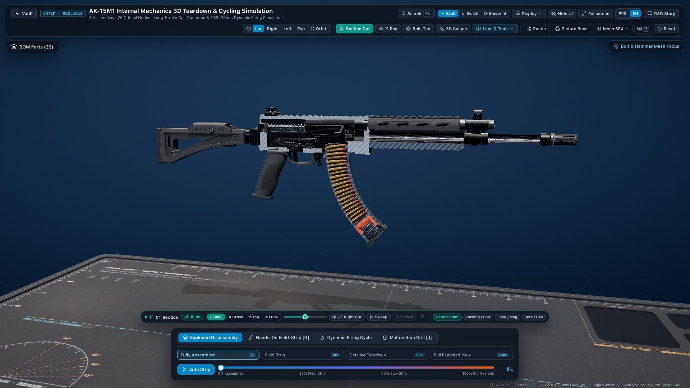
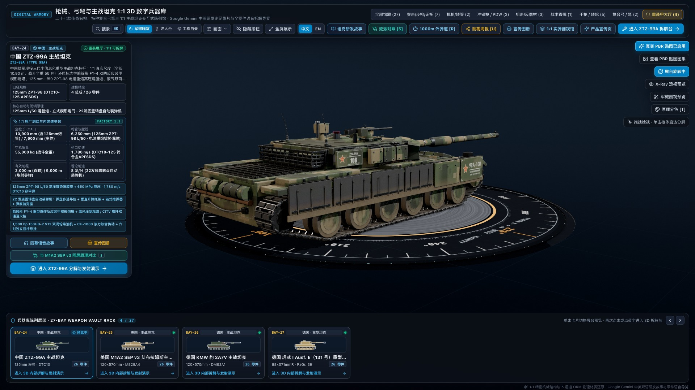
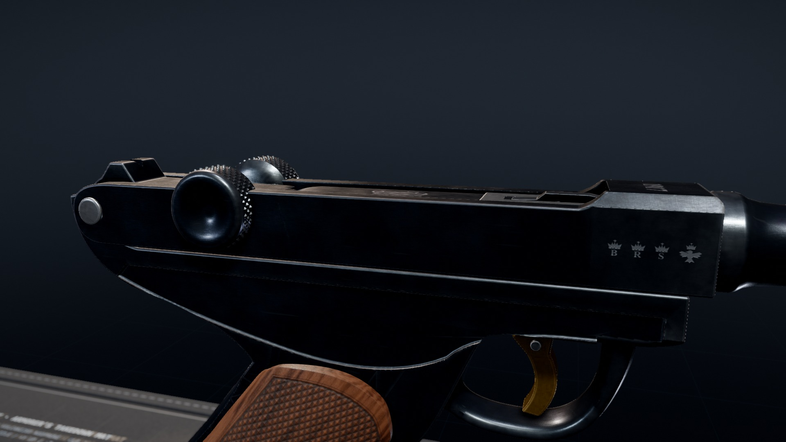
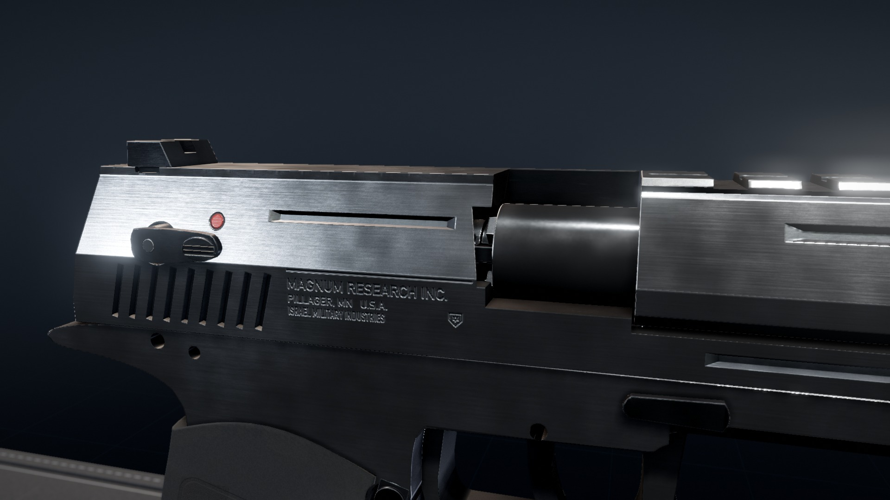
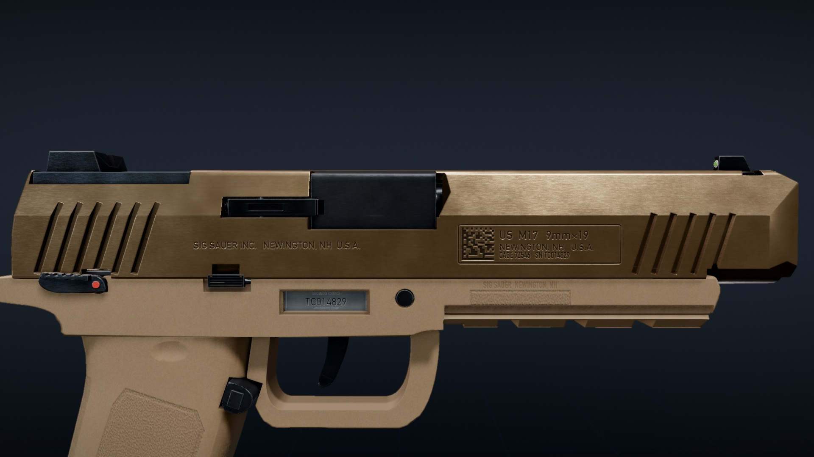

<div align="center">

<p>
  <strong>English</strong>
  &nbsp;·&nbsp;
  <a href="README.zh-CN.md">简体中文</a>
  &nbsp;·&nbsp;
  <a href="CONTRIBUTING.md">Contributing Guide</a>
</p>

# Digital Armory 3D · v5.0 Split-Screen, Armor Penetration & Classic Lineage Edition

**The World's First Browser-Native Open-Source 3D Firearms & Heavy Armor Mechanical Museum · Interactive Engineering Encyclopedia**

[](https://github.com/zhoujingkun1989-arch/digital-armory-3d/actions/workflows/ci.yml)
[](https://zhoujingkun1989-arch.github.io/digital-armory-3d/showcase.html?lang=en)
[](https://www.typescriptlang.org/)
[](https://threejs.org/)
[](scripts/blender/)
[](LICENSE)

<h3>
  <a href="https://zhoujingkun1989-arch.github.io/digital-armory-3d/showcase.html?lang=en">✦ Interactive Live Showcase</a>
  &nbsp;·&nbsp;
  <a href="https://zhoujingkun1989-arch.github.io/digital-armory-3d/?screen=armory&lang=en">🚀 Enter 29-Bay 3D Vault</a>
  &nbsp;·&nbsp;
  <a href="https://zhoujingkun1989-arch.github.io/digital-armory-3d/?screen=workbench&mode=split&weapon=ztz99a&splitWeapon=m1a2&cut=1&lang=en">⚔️ Linked Split-Screen Showdown</a>
  &nbsp;·&nbsp;
  <a href="https://zhoujingkun1989-arch.github.io/digital-armory-3d/?weapon=ztz99a&screen=workbench&cut=1&lang=en">🛡️ 1:1 Heavy Armor Cutaway</a>
  &nbsp;·&nbsp;
  <a href="https://zhoujingkun1989-arch.github.io/digital-armory-3d/?screen=ballistics&lang=en">🎯 1,000m External Ballistics Lab</a>
  &nbsp;·&nbsp;
  <a href="https://zhoujingkun1989-arch.github.io/digital-armory-3d/?screen=cartridges&lang=en">🧪 16+3 Ordnance Cutaway Lab</a>
</h3>

</div>

---



> Built with **React 18 + TypeScript 5.6 + Three.js (`@react-three/fiber` / Dual-Track Blender 5.2 Draco `.glb` + Web Worker `three-bvh-csg` / Web Audio API)** — zero installs, instant browser launch, and a **`<800 kB` zero-warning split bundle**.
>
> Explore **731 moving CAD components across 29 legendary exhibits** (**23 firearms incl. Winchester Model 1894 Lever-Action & Remington Model 870 Pump + 2 compound archery systems + 4 1:1 full-scale Main Battle Tanks** under the dedicated **Heavy Armor Hall**: **ZTZ-99A**, **M1A2 SEP v3 Abrams**, **KMW Leopard 2A7V**, and **Tiger I Ausf. E "131"**), powered by our **29/29 (100%) Blender 5.2 Cycles-baked photorealistic Grand Slam** (**`667` watertight solid Draco `.glb` parts + `64` dynamic CSG `aSpringParam` GPU-deforming springs, recoil recuperators, flexible quad-limbs & bowstrings = `731/731` total parts**, `1.25–11.27 MB` per exhibit including `9.94–11.27 MB` 4K MBT bundles), **369 2K/4K 5-channel Packed ORM & micro-detail WebP textures (`0` PNGs, `86` PBR suites incl. `24` 4K tank exterior maps + `512×512` seamless RHA/CARC triplanar detail maps)**, **4 Cycles 32-bit `.hdr` environments** (3 studio lightboxes + dedicated `1:1` **Heavy Armor Assembly Hangar HDRI**), **Blackbody Barrel Thermal Glow & Powder Fouling / Jimenez Multi-Bounce AO / Lagarde Specular Occlusion / Optical AR Multi-Coating Fresnel**, **Weathered & Edge-Feathered `18 m × 12 m` Heavy Armor Concrete Hangar Floor** (`1 world unit = 1 cm`, `4096×4096` Ultra shadows), **Global `Cmd+K` Bilingual Command Palette**, **Linked Dual-Viewport Split-Screen Comparison (`?mode=split`)**, **1:1 Composite Armor & Kinetic Penetrator Lab (`Lanz-Odermatt / De Marre`)**, **3-Axis Live Draggable CT-Scan Cutaway Plane (`[C]`, `Z Long / X Cross / Y Top`, `±25 mm` small arms / `±1,800 mm` MBTs with volumetric slice beams)**, **1,000m RK4 G1/G7 External Ballistics & FFP Reticle DOPE Lab (`[R]`) across 21 ballistic profiles**, **Armorer Blind Qualification & Speedrun Leaderboard (`[G] / [J]`)**, **19 SAAMI/CIP/NATO/PLA/WWII 1:1 Ordnance Cutaways (`[B]`, 16 small arms + 3 tank cannon rounds)**, **9×9×9 3-Axis Mechanism Showdown (`[S]`, 21 rivalries)**, **HD 3D Share Poster Studio (`[U]`)**, **17-Plate Monograph & DK Encyclopedia Print Studio (`[Ctrl/Cmd+P]`)**, and **1,694 Bilingual `Charon` (`gemini-3.8-flash-tts`) Voiceovers** with automated **3D Documentary Camera Choreography** and **4-Venue Euler-Bernoulli Waveguide Audio**.

---

## v5.0 Flagship Physics, Split-Viewport & Cross-Era Classics (`WP-19 ~ WP-25b` · Live WebGL 2.0)

| **⚔️ Linked Dual-Viewport Split-Screen (`?mode=split`) · ZTZ-99A vs M1A2 Cutaway** | **🛡️ 1:1 Composite Armor & Kinetic Penetrator Lab (`WP-20` Lanz-Odermatt / De Marre)** |
| :---: | :---: |
|  |  |

| **🤠 BAY-28 Winchester Model 1894 (`.30-30 Win`) vs 🦅 BAY-29 Remington Model 870 (`12 Ga`) · Dual-Screen Cutaway** |
| :---: |
|  |

---

## v5.0 Heavy Armor Hall · 1:1 Main Battle Tanks (`BAY-24 ~ BAY-27` · Live WebGL 2.0)

*Strictly engineered at exact **`1 world unit = 1 cm = 10 mm`** full-scale dimensions (`8.45–10.97 m` OAL, `55–66.8 tonnes`) on our weathered, edge-feathered **`18 m × 12 m` Heavy Armor Concrete Hangar Floor** under a dedicated **`1:1` 32-bit Cycles Heavy Armor Hangar HDRI** & `4096×4096` Ultra shadows, with **`4096×4096` exterior Cycles PBR atlases**, **512px seamless RHA/CARC triplanar RNM micro-detail**, **individual articulated sagged track links** (`74–96` sculpted shoes/side), **Optical AR Fresnel lenses**, automatic `near = 2.0 / far = 9000` optics, hollow armored hulls & turrets sliced cleanly by our `±1,800 mm` Live CT-Scan Cutaway (`45° ISO 128` cross-hatching), and 7-stage cannon recoil/autoloader/blast-door firing physics. Every frame below is an unretouched live `1920×1080` Chromium WebGL 2.0 capture.*

| **🇨🇳 ZTZ-99A (`125mm ZPT-98 L/50`) · 4K Camo, 86-Link Tracks & FY-4 ERA (`10.27 MB`)** | **🇨🇳 ZTZ-99A Live CT Cutaway (`[C]`) · 22-Rd Carousel Autoloader & 150HB V12** |
| :---: | :---: |
|  |  |

| **🇺🇸 M1A2 SEP v3 Abrams (`120mm M256 L/44`) · 4K Desert CARC, T158 Tracks & CITV/CROWS (`9.94 MB`)** | **🇺🇸 M1A2 SEP v3 Live CT Cutaway (`[C]`) · Blast Doors, Bustle & AGT1500 Turbine** |
| :---: | :---: |
|  |  |

| **🇩🇪 KMW Leopard 2A7V (`120mm Rh-120 L/55A1`) · 4K NATO 3-Tone, Diehl 570FT Tracks & Wedges (`11.27 MB`)** | **🇩🇪 Leopard 2A7V Live CT Cutaway (`[C]`) · Hollow Wedges, Rh-120 Breech & MTU V12** |
| :---: | :---: |
|  |  |

| **🇩🇪 Tiger I Ausf. E "131" (`88mm KwK 36 L/56`) · 4K Zimmerit, 96-Link Kgs 63 Tracks & Feifel (`10.32 MB`)** | **🇩🇪 Tiger 131 Live CT Cutaway (`[C]`) · Krupp Horizontal Wedge Breech & Maybach HL230 V12** |
| :---: | :---: |
|  |  |

| **Heavy Armor Hall (`?screen=armory`) · 4 Bespoke MBT Silhouettes & Hangar Plaques** | **1:1 Tank Ordnance Cutaway Lab (`[B]`) · `88mm PzGr.39`, `120mm NATO APFSDS` & `125mm DTC10-125`** |
| :---: | :---: |
|  |  |

---

## v5.0 Photorealistic Small-Arms & Archery Flagship Gallery (29/29 Blender 5.2 Grand Slam · 100% Live WebGL 2.0)

*Every image below is an unretouched real-time 1920×1080 Chromium WebGL 2.0 capture powered by our reproducible open-source **Blender 5.2 LTS headless Draco `.glb` + Cycles 2K Packed ORM** pipeline and **32-bit studio `.hdr`** lighting.*

| **Kalashnikov AK-15M1 (`7.62×39mm`)** · *Stamped Phosphate & Windowed 30-Rd Mag (`3.90 MB`)* | **DWM 1917 Luger P08 (`9×19mm`)** · *Knurled Toggle, `1917`/`B·R·S` Proofs, 240°C Straw-Gold & 20-LPI Walnut (`3.39 MB`)* |
| :---: | :---: |
|  |  |

| **Desert Eagle Mark XIX (`.50 AE`)** · *Brushed Satin 416 Stainless, Slanted Serrations & 4-Lug Rotating Bolt (`7.05 MB`)* | **Colt M4A1 SOPMOD (`5.56 NATO`)** · *7075-T6 Upper/Lower Anodize, Rampant Pony, KAC RAS & STANAG (`3.53 MB`)* |
| :---: | :---: |
|  |  |

| **Colt Python 6" (`.357 Magnum`)** · *Liquid "Royal Blue" Steel, Cylinder Drag Line & 24K Gold Medallion Walnut (`2.13 MB`)* | **U.S. Rifle M1 Garand (`.30-06 Springfield`)** · *Linseed-Oil Black Walnut, `S.A./NFR` & Ordnance Wheel Cartouche, T105 Drum (`2.72 MB`)* |
| :---: | :---: |
|  |  |

| **Heckler & Koch MP5A3 (`9×19mm`)** · *Baked Black Enamel Receiver, Navy Bullet Pictograms, Tropical Forend & A3 Rails (`3.18 MB`)* | **Accuracy International AWM (`.338 Lapua Mag`)** · *British OD-Green Thumbhole Chassis, S&B PM II `5-25×56` & 6-Lug Chrome Bolt (`3.68 MB`)* |
| :---: | :---: |
|  |  |

| **Barrett M82A1 / M107 (`.50 BMG`)** · *Manganese-Parkerized Ribbed Receivers, Leupold Mark 4 Gold Ring & 10-Rd Mag (`3.49 MB`)* | **Glock 17 Gen 5 (`9×19mm`)** · *Satin nDLC Bullnose Slide, Ferlach Proofs, Sculpted RTF4 Frame & GMB Hood (`2.28 MB`)* |
| :---: | :---: |
|  |  |

| **FN SCAR-L Mk 16 Mod 0 (`5.56 NATO`)** · *Fifty Shades of FDE Monolithic Upper, SOCOM UID Matrix, Torx Crossbolts & Folding Stock (`3.41 MB`)* | **Steyr AUG A1 / StG 77 (`5.56 NATO`)** · *Alpine OD-Green PA66 Stock, Integral 1.5× Swarovski Optic & Smoked-Amber Waffle Mag (`3.62 MB`)* |
| :---: | :---: |
|  |  |

| **SIG Sauer P320 / U.S. Army M17 (`9×19mm`)** · *Two-Tone Coyote PVD Slide, MIL-STD-130 UID & Serialized Stainless FCU (`2.53 MB`)* | **FN Herstal P90 PDW (`5.7×28mm`)** · *Smoked-Amber 50-Rd Horizontal Mag, 90° Helical Ramp & MC-10-80 Ring Sight (`2.17 MB`)* |
| :---: | :---: |
|  |  |

| **Benelli M4 Super 90 / USMC M1014 (`12 Gauge`)** · *Type-III Charcoal Receiver, Gardone `PSF/CIP` Proofs, Twin ARGO Pistons & LPA Ghost-Ring (`2.47 MB`)* | **FN M249 SAW (`5.56×45mm NATO`)** · *Riveted Phosphate Steel Receiver, M855 Green-Tip / M856 Tracer M27 Belt & OD-Green 200-Rd Box (`3.64 MB`)* |
| :---: | :---: |
|  |  |

| **KRISS Vector SMG Gen II (`.45 ACP`)** · *Two-Tone Combat FDE / Charcoal Super V Chassis, CNC Slider & 66° MagEx2 25-Rd Mag (`2.18 MB`)* | **Mathews LIFT 33 Compound Bow (`348 FPS`)** · *SwitchWeight-X Bronze Binary Cams, Bridged Truss Riser, Harmonic Dampeners & CSG Quad-Limbs (`3.37 MB`)* |
| :---: | :---: |
|  |  |

| **Ravin R500 Crossbow (`500 FPS`)** · *360° Copper-Bronze HexCoil Helical Cams, VersaDrive Leadscrew & 1–8×24 Speed-Ring Scope (`3.53 MB`)* | **Luger P08 Two-Pass Stencil Solid Cutaway (`[C]`)** · *ISO 128 45° Metal Hatching, 8× 9mm Stack & Helical Springs* |
| :---: | :---: |
|  |  |

| **H&K G11 K2 (`4.73×33mm DM11` Caseless)** · *90° Chrome Rotary Breech, Swiss-Watch Clockwork Gears, 2,100 RPM Floating Action & Hensoldt Optic (`2.06 MB`)* | **VSS Vintorez (`9×39mm` Subsonic)** · *414mm Integral 6-Stage Baffle Suppressor, TOZ Cyrillic Receiver, PSO-1M2-1 Optic & Birchwood Stock (`2.23 MB`)* |
| :---: | :---: |
|  |  |

| **GE / Dillon Aero M134D Minigun (`7.62×51mm NATO`)** · *6-Barrel 3,000 RPM Rotary Cluster, 28V DC Motor, 360° Helical Cam Track & Delinker (`3.31 MB`)* | **Nikonov AN-94 "Abakan" (`5.45×39mm 7N6`)** · *Pulley-Cable 1,800 RPM Delayed-Recoil Hyperburst, 15°-Canted Plum Mag & Figure-8 Brake (`2.92 MB`)* |
| :---: | :---: |
|  |  |

### 15-Caliber 1:1 SAAMI/CIP Cutaway Lab Panorama (`[B]`) · *`9×19mm` (`29.69 mm`) through Square `4.73×33mm DM11 Caseless` to `.50 BMG` (`138.43 mm`)*


---

## v5.0 Flagship Architecture & UX Highlights

| **Global `Cmd+K` / `Ctrl+K` Bilingual Instant Command Palette** | **29-Bay Interactive 3D Digital Vault & Museum Showcase** |
| :---: | :---: |
|  |  |

- **✦ Dual-Track Blender 5.2 Draco `.glb` + Web Worker CSG Engine (`PR-02` ~ `PR-04`, `WP-17` ~ `WP-25b`)**:
  - **29/29 (100%) Photorealistic Grand Slam**: Every single exhibit in the museum (`23` firearms, `2` compound archery systems, and `4` 1:1 Main Battle Tanks: `ztz99a`, `m1a2`, `leopard2a7`, `tiger1`) is procedurally sculpted and Cycles-baked via MIT-licensed headless Python scripts (`scripts/blender/build_*_photoreal.py`) into compact Draco `.glb` bundles (`667` watertight solid CAD meshes, `1.25–11.27 MB` total each including `9.94–11.27 MB` 4K MBT bundles with `74–96` individual articulated sagged track links per side, `100%` manifold, exact `1u = 1cm` coordinates) backed by `369` 2K/4K 5-channel Packed ORM & detail WebP maps (`121` albedo / `124` normal / `124` ORM & detail roughness, `86` PBR suites with `24` 4K tank exterior maps + `512×512` seamless RHA/CARC detail maps, `0` PNGs) plus an optional offline KTX2 UASTC/ETC1S transcoding pipeline (`scripts/build_ktx2_textures.mjs`).
  - **Zero-Compromise Dynamic Springs, Limbs & Bowstrings**: `64` helical recoil, tubular-magazine follower, cannon recuperator, breech, buffer, striker, magazine, barrel-return, sear, clutch, feeder, and V-leaf springs plus flexing compound quad-limbs, cam axles, bowstrings, and power cables across all 29 exhibits stay on the procedural CSG Web Worker track so per-vertex `aSpringParam` GPU compression and elastic flex remain physically exact at 60 FPS (with seamless CSG offline/headless fallback).
  - **Adaptive Real-Time Studio & Heavy Armor Hangar Optics (`PR-01`, `WP-18`, `WP-21`, `WP-24`)**: 4 Cycles-rendered 32-bit `.hdr` environments (3 tabletop studio lightboxes + dedicated `1:1` `heavy_armor_hangar.hdr` armored depot bay), weathered & C2-quintic edge-feathered `18 m × 12 m` Heavy Armor Concrete Hangar Floor (`Y = -120.0 cm`) with self-leveled dark hydraulic oil sheen, `Ø 9.6 m` steel turntable pit ring, `4096×4096` Ultra tight-frustum tank shadows & `near = 2.0 / far = 9000` optics, Direct-Light Micro-Shadowing + Jimenez multi-bounce AO + Lagarde Specular Occlusion, 512px triplanar RNM RHA/CARC micro-detail, Optical AR multi-coating Fresnel iridescence, Specular AA, Blackbody Barrel Thermal Emission (up to `1,100K`) & dynamic carbon fouling, real-time Service Wear Patina (`Factory New / Field-Oiled / Battle-Worn`), Macro Bokeh DOF, GTAO + AgX post-processing, and 3-tier GPU quality (`Ultra / Balanced / Eco`).
- **✦ Linked Dual-Viewport Split-Screen (`?mode=split`, `WP-19`) & `1:1` Composite Armor Penetration Lab (`WP-20`)**: Synchronized side-by-side WebGL viewports pairing any 2 of 29 exhibits with lockstep orbit, synchronized cutaway/firing/explode traces, and an integrated Lanz-Odermatt / De Marre armor-defeat solver across ERA, ceramic NERA, depleted-uranium, and RHA layers (`500–3,500 m`).
- **✦ 3-Axis Live Draggable CT-Scan Section Plane (`[C]`, `Z Long / X Cross / Y Top`, `PR-04`, `WP-18`, `WP-21`, `WP-24`)**: Sweep a real-time `±25 mm` (small arms) or `±1,800 mm` (1:1 MBTs) orthogonal section plane across any exhibit (`Z Long / X Cross / Y Top`) with `+Z / -Z` flip, tilted local-Z plane support for canted magazines (such as AN-94's 15°-canted plum mag), volumetric slice beams, and 60 FPS continuous CT auto-sweep—zero shader recompilation, synchronized Two-Pass WebGL Stencil 45° ISO 128 cross-hatching, and through-cutaway raycast picking (`sectionAwareMeshRaycast`).
- **✦ Global `Cmd+K` / `Ctrl+K` Command Palette & Decluttered Museum HUD (`PR-04`)**: Instant multi-token EN/ZH fuzzy search from any screen across all **29 exhibits**, **731 CAD parts**, **Split-Screen Comparison**, **1:1 Composite Armor Penetration Lab**, **Heavy Armor Hall**, **1:1 Tank Ordnance Lab**, **simulation labs**, and **studio controls**, paired with streamlined `Display` and `Labs & Tools` glassmorphic popovers.
- **✦ 1,000m RK4 G1/G7 External Ballistics, Crosswind & FFP Reticle DOPE Lab (`[R]`)**: Zero-GC 4th-order Runge-Kutta 3-DOF solver across all **21 projectile profiles** (`16` metallic/caseless/shotshell incl. `.30-30 Win 170gr` + `2` archery + `3` 1:1 tank cannon rounds under `category: 'armor'` & the `heavy_armor_cannons` preset), ICAO altitude/temperature air density $\rho(h, T)$, BRL G1/G7 transonic drag $C_d(M)$, exact Sight-In Zero solver (`< 0.02 cm`), Mach 1.0 crossing detection, First-Focal-Plane MIL Christmas-tree scope reticle, and 7-row `MIL / MOA` DOPE drop cards.
- **✦ Armorer Blind Qualification & Speedrun Leaderboard (`[G]`, `WP-22`) & Mystery Stoppage Triage (`[J]`)**: Hands-on guided military field-strip DAGs across all **29 exhibits** plus timed blind `0 → N → 0` teardown/reassembly exams (with Bronze/Silver/Gold/Armorer tier speedrun records) and unannounced malfunction diagnostics (`Stovepipe`, `Double Feed`, `Light Strike`, `Out-of-Battery`) awarding persistent `S / A / B / C` Armorer Qualification ranks.
- **✦ 6-Role Functional Color-Coding (`[T]`), Propellant Gas-Flow Streamlines & SAAMI/CIP/STANAG/GJB Telemetry**: Real-time $P(t)$ (`MPa`), $V(t)$ (`m/s`), and `J / MJ` energy oscilloscope curves coupled 1:1 to 7-stage firing kinematics (including cannon recoil/autoloader/blast-door and lever/pump cycles), interactive `SAFE / SEMI / AUTO` selector (`[V]`), Press-Check (`[P]`), and trigger break/reset (`[F]`).
- **✦ 16+3 1:1 Ordnance Cutaway Lab (`[B]`), 9×9×9 3-Axis Mechanism Showdown (`[S]`) & 3D Vernier Caliper (`[K]`)**: Side-by-side `1:1` scale cross-sections across **16 small-arms calibers** (`9×19mm` and `.30-30 Win` through square `4.73×33mm DM11 Caseless` to `.50 BMG`) plus a dedicated **Tank Ordnance (3)** gallery (`88mm PzGr.39`, `120mm NATO APFSDS`, `125mm DTC10-125`), **21 classic mechanical rivalries** across 9 Drive × 9 Locking × 9 Feed lineages (incl. `ZTZ-99A vs M1A2`, `Leopard 2A7V vs ZTZ-99A`, `M1A2 vs Tiger 131`, `Winchester 1894 vs M1 Garand`, `Remington 870 vs Benelli M4`) with overlaid $P(f)/V(f)$ traces & direct split-screen launch, and millimeter-accurate 3D point-to-point surface metrology.
- **✦ 4-Act Bilingual AI Documentaries, 1,694 `Charon` Voiceovers, HD Share Posters (`[U]`) & 29/29 Cycles 17-Plate Monographs (`[Ctrl/Cmd+P]`)**: Automated 3D Story Director camera choreography, 4-venue stereo convolution IR + Euler-Bernoulli steel waveguide Web Audio acoustics (including M1 Garand `"PING!"`, M134D 3,000 RPM rotary buzz, VSS baffled hush, Winchester 1894 lever clack, Remington 870 dual-bar `"CHK-CHK"` pump, and 120/125/88mm main-gun concussion + turbine/V12/carousel acoustics), `16:9 / 4:5` QR-linked share cards, and A4/Letter DK Visual Encyclopedia & Kids picture book print studio backed by 29/29 Cycles-rendered 2880×1800 transparent DK master plates (`public/plates/`).

---

## Why Digital Armory 3D Stands Out

| Inspiration Benchmark | What We Synthesize & Advance |
| :--- | :--- |
| **Matt Rittman 3D Cutaway Animations** | Real-time **Live CT-Scan Section Plane (`[C]`)**, **6-role functional color-coding (`[T]`)**, dynamic propellant gas-flow streamlines, and automated 3D documentary choreography—pause, orbit, slice, or inspect any part at any millisecond. |
| **World of Guns: Gun Disassembly** | **Hands-on military field-strip DAGs & Timed Blind Qualification Exams (`[G]`)**, **Mystery Stoppage Triage (`[J]`)**, `SAFE / SEMI / AUTO` sear/disconnector physics, and `S / A / B / C` certification—100% open-source in the browser with zero downloads or paywalls. |
| **Bartosz Ciechanowski (`ciechanow.ski`)** | Instant web launch, direct 3D slide/bolt manipulation, **1,000m RK4 3-DOF external ballistics (`[R]`)**, and 1:1 coupling between **SAAMI/CIP internal ballistics curves ($P(t)$, $V(t)$)** and 7-stage kinematics at 60 FPS with zero React re-renders. |
| **Smithsonian 3D & Royal Armouries** | Bilingual (`EN / 中文`) 4-act R&D histories, factory `1:1` CAD metrology (`1u = 1cm`), museum-grade **Blender 5.2 Cycles PBR exhibits**, and MIT-licensed reproducible asset pipelines. |

---

## 29-Exhibit Collection Matrix (731 Moving CAD Parts · 29/29 Blender 5.2 Grand Slam)

| Bay | Exhibit | Pipeline | Caliber / Projectile | Operating & Locking Mechanism | Parts | Live Bench |
| :--- | :--- | :---: | :--- | :--- | :---: | :---: |
| `BAY-01` | **Kalashnikov AK-15M1 (6P71M)** | `GLB v3` | `7.62×39mm (M43)` | Long-stroke gas piston · 2-lug 35° rotating bolt | 26 | [Inspect](https://zhoujingkun1989-arch.github.io/digital-armory-3d/?weapon=ak15&screen=workbench&lang=en) |
| `BAY-02` | **Colt M4A1 SOPMOD Carbine** | `GLB v3` | `5.56×45mm NATO` | Stoner direct impingement (internal BCG piston) · 7-lug bolt | 26 | [Inspect](https://zhoujingkun1989-arch.github.io/digital-armory-3d/?weapon=m4a1&screen=workbench&lang=en) |
| `BAY-03` | **Heckler & Koch MP5A3** | `GLB v3` | `9×19mm Parabellum` | Dual Ø8mm roller-delayed blowback (4:1 ratio) · Fluted chamber | 26 | [Inspect](https://zhoujingkun1989-arch.github.io/digital-armory-3d/?weapon=mp5&screen=workbench&lang=en) |
| `BAY-04` | **Glock 17 Gen 5** | `GLB v3` | `9×19mm Parabellum` | Browning short-recoil tilting barrel · Safe Action triple safety | 28 | [Inspect](https://zhoujingkun1989-arch.github.io/digital-armory-3d/?weapon=g17&screen=workbench&lang=en) |
| `BAY-05` | **Barrett M82A1** | `GLB v3` | `.50 BMG (12.7×99mm)` | Short-recoil 29" fluted barrel · Accelerator lever & 3-lug bolt | 24 | [Inspect](https://zhoujingkun1989-arch.github.io/digital-armory-3d/?weapon=m82a1&screen=workbench&lang=en) |
| `BAY-06` | **Accuracy International AWM** | `GLB v3` | `.338 Lapua Magnum` | Manual 60° 6-lug anti-icing bolt action · Bonded alloy chassis | 24 | [Inspect](https://zhoujingkun1989-arch.github.io/digital-armory-3d/?weapon=awm&screen=workbench&lang=en) |
| `BAY-07` | **FN SCAR-L Mk 16 Mod 0** | `GLB v3` | `5.56×45mm NATO` | Short-stroke gas tappet · 7-lug rotating bolt & monolithic upper | 26 | [Inspect](https://zhoujingkun1989-arch.github.io/digital-armory-3d/?weapon=scar&screen=workbench&lang=en) |
| `BAY-08` | **Desert Eagle Mark XIX** | `GLB v3` | `.50 Action Express` | Forward under-barrel gas piston · 4-lug rotating bolt & dual rods | 24 | [Inspect](https://zhoujingkun1989-arch.github.io/digital-armory-3d/?weapon=deagle&screen=workbench&lang=en) |
| `BAY-09` | **Steyr AUG A1 (StG 77)** | `GLB v3` | `5.56×45mm NATO` | Offset short-stroke piston · Twin guide rods & polymer hammer pack | 25 | [Inspect](https://zhoujingkun1989-arch.github.io/digital-armory-3d/?weapon=aug&screen=workbench&lang=en) |
| `BAY-10` | **SIG Sauer P320 M17** | `GLB v3` | `9×19mm Parabellum` | Serialized removable stainless FCU chassis · Tilting-barrel striker | 24 | [Inspect](https://zhoujingkun1989-arch.github.io/digital-armory-3d/?weapon=p320&screen=workbench&lang=en) |
| `BAY-11` | **FN P90 PDW** | `GLB v3` | `5.7×28mm FN SS190` | Top horizontal 50-rd magazine · 90° helical feed ramp & bottom eject | 25 | [Inspect](https://zhoujingkun1989-arch.github.io/digital-armory-3d/?weapon=p90&screen=workbench&lang=en) |
| `BAY-12` | **Mathews LIFT 33** | `GLB v3` | `400 gr Carbon Arrow (348 FPS)` | SwitchWeight-X binary cams · 85% let-off & QAD drop-away rest | 24 | [Inspect](https://zhoujingkun1989-arch.github.io/digital-armory-3d/?weapon=lift33&screen=workbench&lang=en) |
| `BAY-13` | **Ravin R500** | `GLB v3` | `400 gr Carbon Bolt (500 FPS)` | HexCoil 360° helical cams · VersaDrive screw crank & Trac-Trigger sled | 25 | [Inspect](https://zhoujingkun1989-arch.github.io/digital-armory-3d/?weapon=r500&screen=workbench&lang=en) |
| `BAY-14` | **Colt Python 6" (.357 Mag)** | `GLB v3` | `.357 Magnum (9×33mmR)` | DA/SA hand-tuned V-mainspring clockwork · 60° ratchet & stop-bolt | 25 | [Inspect](https://zhoujingkun1989-arch.github.io/digital-armory-3d/?weapon=python&screen=workbench&lang=en) |
| `BAY-15` | **Benelli M4 (M1014)** | `GLB v3` | `12 Gauge (00 Buckshot)` | Twin chamber-mounted ARGO short-stroke pistons · 2-lug bolt & elevator | 26 | [Inspect](https://zhoujingkun1989-arch.github.io/digital-armory-3d/?weapon=benellim4&screen=workbench&lang=en) |
| `BAY-16` | **U.S. Rifle M1 Garand** | `GLB v3` | `.30-06 Springfield M2` | Muzzle gas cylinder & curved long-stroke op-rod · 2-lug bolt & 8-rd clip | 26 | [Inspect](https://zhoujingkun1989-arch.github.io/digital-armory-3d/?weapon=garand&screen=workbench&lang=en) |
| `BAY-17` | **FN M249 SAW (Minimi PIP)** | `GLB v3` | `5.56×45mm NATO (M27 / STANAG)` | Open-bolt long-stroke gas piston · 2-lug bolt & dual-pawl M27 shuttle | 26 | [Inspect](https://zhoujingkun1989-arch.github.io/digital-armory-3d/?weapon=m249&screen=workbench&lang=en) |
| `BAY-18` | **DWM Luger P08 (1917)** | `GLB v3` | `9×19mm Parabellum` | 6.5mm short-recoil forked receiver · Over-center 2-bar knee-joint toggle | 25 | [Inspect](https://zhoujingkun1989-arch.github.io/digital-armory-3d/?weapon=p08&screen=workbench&lang=en) |
| `BAY-19` | **KRISS Vector SMG Gen II** | `GLB v3` | `.45 ACP (11.43×23mm)` | Patented Super V `-65°` off-axis tungsten slider delayed blowback | 25 | [Inspect](https://zhoujingkun1989-arch.github.io/digital-armory-3d/?weapon=vector&screen=workbench&lang=en) |
| `BAY-20` | **H&K G11 K2** | `GLB v3` | `4.73×33mm DM11 Caseless` | 90° rotary breech cylinder · Swiss clockwork gears & 2,100 RPM floating action | 24 | [Inspect](https://zhoujingkun1989-arch.github.io/digital-armory-3d/?weapon=g11&screen=workbench&lang=en) |
| `BAY-21` | **VSS Vintorez (6P29)** | `GLB v3` | `9×39mm SP-5/SP-6 Subsonic` | Radial-ported barrel + 6-stage slanted baffle suppressor · 6-lug bolt & linear striker | 24 | [Inspect](https://zhoujingkun1989-arch.github.io/digital-armory-3d/?weapon=vss&screen=workbench&lang=en) |
| `BAY-22` | **GE / Dillon Aero M134D Minigun** | `GLB v3` | `7.62×51mm NATO (M13 Belt)` | 28V DC electric 6-barrel rotary cluster · 360° sinusoidal cam track & delinker (3,000 RPM) | 25 | [Inspect](https://zhoujingkun1989-arch.github.io/digital-armory-3d/?weapon=m134&screen=workbench&lang=en) |
| `BAY-23` | **Nikonov AN-94 "Abakan" (6P33)** | `GLB v3` | `5.45×39mm 7N6` | Floating barreled action + internal steel pulley-cable · 1,800 RPM 2-rd hyperburst & 15° mag | 26 | [Inspect](https://zhoujingkun1989-arch.github.io/digital-armory-3d/?weapon=an94&screen=workbench&lang=en) |
| `BAY-24` | **🇨🇳 ZTZ-99A Main Battle Tank** | `GLB v3` | `125mm DTC10-125 APFSDS` | 125mm ZPT-98 L/50 smoothbore · 22-rd floor carousel autoloader, FY-4 ERA & 150HB 1,500 hp V12 | 26 | [Inspect](https://zhoujingkun1989-arch.github.io/digital-armory-3d/?weapon=ztz99a&screen=workbench&lang=en) |
| `BAY-25` | **🇺🇸 M1A2 SEP v3 Abrams MBT** | `GLB v3` | `120×570mm NATO M829A4` | 120mm M256 L/44 smoothbore · Sliding blast doors, 36-rd bustle blow-off panels & AGT1500 turbine | 26 | [Inspect](https://zhoujingkun1989-arch.github.io/digital-armory-3d/?weapon=m1a2&screen=workbench&lang=en) |
| `BAY-26` | **🇩🇪 KMW Leopard 2A7V MBT** | `GLB v3` | `120×570mm NATO DM63A1` | 6.6m Rh-120 L/55A1 smoothbore · Hollow spaced arrowhead wedges & MTU MB 873 V12 EuroPowerpack | 26 | [Inspect](https://zhoujingkun1989-arch.github.io/digital-armory-3d/?weapon=leopard2a7&screen=workbench&lang=en) |
| `BAY-27` | **🇩🇪 Tiger I Ausf. E "131" Heavy Tank** | `GLB v3` | `88×571mmR PzGr.39 APCBC` | 88mm KwK 36 L/56 rifled gun · Krupp horizontal wedge breech, 48 interleaved wheels & Maybach HL230 V12 | 26 | [Inspect](https://zhoujingkun1989-arch.github.io/digital-armory-3d/?weapon=tiger1&screen=workbench&lang=en) |
| `BAY-28` | **🇺🇸 Winchester Model 1894 Carbine** | `GLB v3` | `.30-30 Winchester (.30 WCF)` | Browning finger-lever 4-bar linkage · Rising/dropping locking bolt & vertical tubular cartridge elevator | 24 | [Inspect](https://zhoujingkun1989-arch.github.io/digital-armory-3d/?weapon=winchester1894&screen=workbench&lang=en) |
| `BAY-29` | **🇺🇸 Remington Model 870 Police Magnum** | `GLB v3` | `12 Gauge (2¾" / 3" Magnum)` | Billet-steel receiver & twin action bars · Tilting locking block & dual shell-latch carrier elevator | 24 | [Inspect](https://zhoujingkun1989-arch.github.io/digital-armory-3d/?weapon=rem870&screen=workbench&lang=en) |

---

## Keyboard Shortcuts & Deep Links

### URL Deep-Link Parameters
- Interactive Product Showcase: `/showcase.html?lang=en` or `/?screen=showcase&lang=en`
- 29-Bay Armory Turntable & Heavy Armor Hall: `/?screen=armory&weapon=ztz99a&lang=en`
- Linked Dual-Viewport Split-Screen Workbench: `/?screen=workbench&mode=split&weapon=winchester1894&splitWeapon=rem870&cut=1&lang=en`
- Live Cutaway Workbench (Small Arms / 1:1 MBTs): `/?weapon=ztz99a&screen=workbench&cut=1&lang=en`
- 1,000m RK4 External Ballistics & Reticle DOPE Lab: `/?screen=ballistics&caliber=125mm_apfsds&lang=en`
- 16+3 1:1 Ordnance Cutaway Lab (Small Arms & Tank Cannon Rounds): `/?screen=cartridges&caliber=125mm_apfsds&lang=en`

### Global & Workbench Hotkeys
| Key | Action |
| :---: | :--- |
| `Cmd / Ctrl + K` | Open **Global Bilingual Instant Command Palette** (29 exhibits, 731 parts, Split-Screen, Armor Lab, Heavy Armor Hall & controls) |
| `Space` | Play / pause staged explosion or 7-phase live firing cycle |
| `C` | Toggle **3-Axis Live Draggable CT-Scan Cutaway** (`Z Long / X Cross / Y Top`, `±25 mm` small arms / `±1,800 mm` MBTs, `+Z/-Z` flip, ISO 128 cap) |
| `T` | Toggle **6-Role Engineering Functional Color-Coding** & cutaway cap tint (small-arms & armor-specific roles) |
| `G` | Toggle **Hands-On Guided Field-Strip, Speedrun Leaderboard & Blind Timed Exam (DAG)** |
| `J` | Toggle **Malfunction Cutaway & Mystery Stoppage Triage Exam** (`Stovepipe / Double-Feed / Light-Strike / OOB`) |
| `K` | Toggle **1:1 3D Armorer Vernier Caliper** (`mm`) & 3D envelope scale ruler |
| `R` | Open / return from **1,000m RK4 External Ballistics, Wind Drift & FFP Reticle DOPE Lab** (21 profiles) |
| `U` | Open / close **Instant HD 3D Cutaway Social Poster Studio** (`16:9 / 4:5` + QR + Rank Seal) |
| `B` | Open / exit standalone **16+3 1:1 Small-Arms & Tank Ordnance Cutaway Lab** |
| `S` | Open / close **9×9×9 3-Axis Mechanism Showdown & Dual-Exhibit Comparison Lab** (21 rivalries + instant Split-Screen launch) |
| `X` | Toggle optical X-Ray translucent receiver / slide / magazine housings |
| `P / V / F` | Armorer **Press-Check** (`P`) · Cycle `SAFE / SEMI / AUTO` selector (`V`) · Hold trigger (`F`) |
| `E / L / M / H` | CAD Hard-Edges (`E`) · 3D Callouts (`L`) · Web Audio Mute (`M`) · **Clean Fullscreen** (`H`) |
| `Ctrl/Cmd + P` | Open **17-Plate Collector Monograph & Kids Picture Book Print Studio** |
| `Shift + R / Esc` | Reset to `0%` assembled state & default framing / Dismiss overlay or return to Vault |

---

## Quick Start & Quality Gates

### Prerequisites
- **Node.js** `>= 20`
- *(Optional — legacy PBR baker)* **Python** `>= 3.10` + `numpy` + `Pillow`
- *(Optional — photorealistic `.glb` rebuilds)* **Blender 5.2 LTS** (headless CLI)

```bash
# 1. Install dependencies
npm ci

# 2. Start local Vite dev server (serves both / and /showcase.html)
npm run dev

# 3. Run all 4 mandatory engineering quality gates (0 errors, 0 warnings, all chunks < 800 kB)
npm run typecheck
npm run lint
npm test
npm run build
```

### Optional: Rebuild Photorealistic Blender 5.2 `.glb` or Legacy PBR Maps

```bash
# Re-generate any Blender 5.2 Draco GLB + Cycles 2K Packed ORM suite headlessly (all 29 exhibits):
blender --factory-startup --background --python scripts/blender/build_p08_photoreal.py
blender --factory-startup --background --python scripts/blender/build_ak15_photoreal.py
blender --factory-startup --background --python scripts/blender/build_deagle_photoreal.py
blender --factory-startup --background --python scripts/blender/build_m4a1_photoreal.py
blender --factory-startup --background --python scripts/blender/build_python_photoreal.py
blender --factory-startup --background --python scripts/blender/build_garand_photoreal.py
blender --factory-startup --background --python scripts/blender/build_mp5_photoreal.py
blender --factory-startup --background --python scripts/blender/build_awm_photoreal.py
blender --factory-startup --background --python scripts/blender/build_m82a1_photoreal.py
blender --factory-startup --background --python scripts/blender/build_g17_photoreal.py
blender --factory-startup --background --python scripts/blender/build_scar_photoreal.py
blender --factory-startup --background --python scripts/blender/build_aug_photoreal.py
blender --factory-startup --background --python scripts/blender/build_p320_photoreal.py
blender --factory-startup --background --python scripts/blender/build_p90_photoreal.py
blender --factory-startup --background --python scripts/blender/build_benellim4_photoreal.py
blender --factory-startup --background --python scripts/blender/build_m249_photoreal.py
blender --factory-startup --background --python scripts/blender/build_vector_photoreal.py
blender --factory-startup --background --python scripts/blender/build_lift33_photoreal.py
blender --factory-startup --background --python scripts/blender/build_r500_photoreal.py
blender --factory-startup --background --python scripts/blender/build_g11_photoreal.py
blender --factory-startup --background --python scripts/blender/build_vss_photoreal.py
blender --factory-startup --background --python scripts/blender/build_m134_photoreal.py
blender --factory-startup --background --python scripts/blender/build_an94_photoreal.py
blender --factory-startup --background --python scripts/blender/build_ztz99a_photoreal.py
blender --factory-startup --background --python scripts/blender/build_m1a2_photoreal.py
blender --factory-startup --background --python scripts/blender/build_leopard2a7_photoreal.py
blender --factory-startup --background --python scripts/blender/build_tiger1_photoreal.py
blender --factory-startup --background --python scripts/blender/build_winchester1894_photoreal.py
blender --factory-startup --background --python scripts/blender/build_rem870_photoreal.py

# Or rebuild procedural legacy 2K Packed ORM WebP maps:
python3 -B -m scripts.pbr_core.selftest
npm run textures:build
```

---

## Architecture Overview

```text
digital-armory-3d/
├── index.html                     # Primary 3D Vault & Disassembly Workbench entry
├── showcase.html                  # Standalone interactive bilingual Showcase entry
├── public/
│   ├── audio/                     # 1,694 bilingual 4-act R&D & part voiceovers (Charon Gemini TTS MP3)
│   ├── draco/                     # Self-hosted Three.js WebAssembly Draco mesh decoders
│   ├── hdri/                      # 4 Cycles-rendered 32-bit .hdr domes (Vault / Bench / Daylight + 1:1 Heavy Armor Hangar)
│   ├── models/                    # All 29 Blender 5.2 Draco-compressed .glb exhibits (100% vault coverage: 23 firearms + 2 archery + 4 1:1 MBTs)
│   ├── narrations/                # 29 structured zh/en R&D documentaries & part engineering JSONs
│   ├── plates/                    # All 29/29 Blender 5.2 Cycles 2880×1800 transparent RGBA DK master plates (290 WebPs + manifest.json)
│   ├── showcase/                  # Live WebGL 2.0 showcase gallery captures (WebP)
│   └── textures/                  # 369 pre-baked 2K/4K 5-Channel Packed ORM & micro-detail WebP textures (121 albedo / 124 normal / 124 ORM & detail, 86 suites + 24 4K MBT exterior maps + 512px RHA/CARC detail maps, 0 PNGs)
├── scripts/
│   ├── blender/                   # 29 MIT headless Blender 5.2 sculpt/Cycles bake scripts (build_*_photoreal.py) + studio/hangar HDRI & DK plate renderers
│   ├── narrations/.cache/         # 29 SHA-256 content-addressed Charon TTS verification manifests
│   ├── pbr_core/ & pbr/           # Procedural Worley, knurling, 512px seamless RHA/CARC detail maps, normal-integrated AO & legacy PBR bakers
│   ├── build_ktx2_textures.mjs    # KTX2 UASTC/ETC1S texture compression manifest & encoder CLI
│   └── build_textures.py          # Batch texture baker & WebP encoder CLI
├── src/
│   ├── app/                       # Bidirectional URL sync (?cut=1 / ?mode=split / ?screen=ballistics / ?screen=cartridges), hotkeys & ErrorBoundary
│   ├── engine/
│   │   ├── actors/                # PartActor, 3-axis StencilSectionCap + volumetric slice beams, BallisticsSystem, GasFlowVisualizer
│   │   ├── audio/                 # 4-venue stereo convolution IR + waveguide gunsmith, lever/pump, archery & main-gun/V12/turbine Web Audio engine
│   │   ├── callout/               # ResizeObserver HUD obstacle cache & 60fps hairline callouts
│   │   ├── canvas/                # ArmoryViewport, studioHdriManager, GunsmithStageMat (Mat + feathered 18×12m Armor Hangar & 4096 shadows) & GTAO/DOF/AgX PostFX
│   │   ├── caliper/               # 1:1 3D Vernier caliper (`1u = 10mm`) & envelope metrology
│   │   ├── cartridges/            # 19 exact 1:1 standing cutaway specs (16 small arms + 3 tank cannon rounds: 88mm/120mm/125mm)
│   │   ├── clock/                 # Transient 60Hz playbackClock (zero React re-renders)
│   │   ├── exam/                  # Armorer Blind Field-Strip, Speedrun Leaderboard & Unknown Stoppage Triage grading store
│   │   ├── fieldstrip/            # 29-exhibit military field-strip DAG specs & Zero-GC runtime
│   │   ├── geometry/              # Dual-Track Draco GLB loader (glbAssetService) + Web Worker CSG & raycast
│   │   ├── interaction/           # Direct 3D slide/lever drag, Press-Check & SAFE/SEMI/AUTO FCG
│   │   ├── kinematics/            # Zero-GC keyframe & multi-stage pose evaluators
│   │   ├── malfunctions/          # 4-stoppage diagnostic profiles & clearing drill state machine (29 exhibits)
│   │   ├── materials/             # Custom GLSL armoryShader (Thermal Glow / Fouling / Micro-Shadowing / Jimenez AO / Lagarde SO / RNM / AR Fresnel / Specular AA / Patina), 6-role tint & KTX2 asset tiers
│   │   ├── physics/               # Internal ballistics (16 small arms + 2 archery + 3 tank cannons), 1:1 Armor Penetration (Lanz-Odermatt/De Marre) & 1,000m RK4 external ballistics (21 profiles)
│   │   └── utils/                 # Subpath-safe VITE_BASE_PATH asset & deep-link URL resolvers
│   ├── features/                  # Modular UI views (showcase / armory / workbench / split / armor / Cmd+K / ballistics / share / monograph / cartridges / story / atlas)
│   ├── i18n/                      # Strictly parity-checked zh/en dictionaries (0 CJK leaks in EN)
│   ├── narration/                 # Audio queue, speechSynthesis fallback & 3D Story Director
│   ├── store/                     # Strongly typed Zustand store (useAppStore)
│   └── weapons/                   # 29 lazy-loaded self-contained exhibit plugins (23 firearms + 2 archery + 4 1:1 MBTs)
└── tests/                         # 29 Vitest geometry, split-viewport, penetration, GLB, Cmd+K, CT-section, UV, kinematics, ballistics, Exam & i18n suites (221 tests)
```

---

## Contributing & Community

Contributions are welcome! Please read our bilingual [**Contributing Guide (`CONTRIBUTING.md`)**](CONTRIBUTING.md) before opening a PR — it covers local setup, the 4 mandatory quality gates, Blender 5.2 headless `.glb` pipeline contracts, and our strict educational safety policy.

---

## Educational Disclaimer

All 3D models in this repository are **schematic / educational visualizations** created strictly to illustrate mechanical engineering principles, operating systems, internal & external ballistics, and armorer safety procedures. They **do not contain manufacturing tolerances, chambering blueprints, or 3D-printable dimensions**.

---

## License

Released under the [MIT License](LICENSE).
