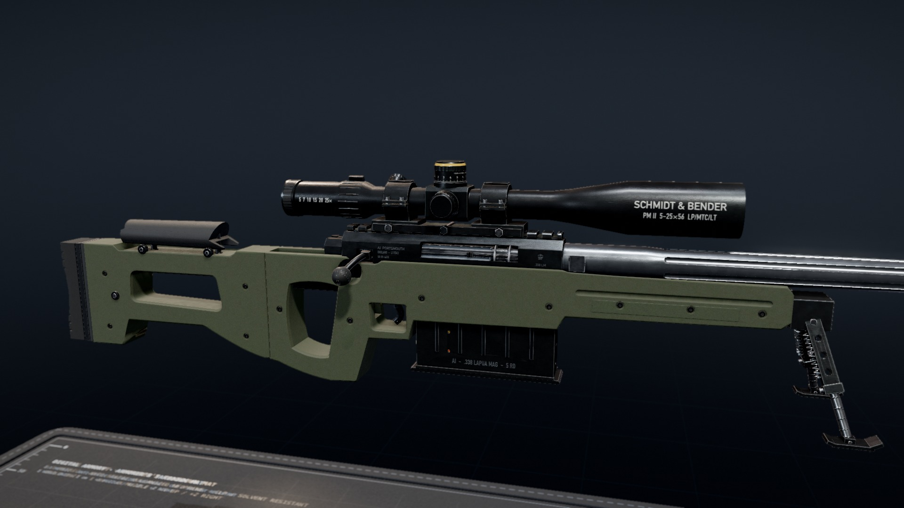
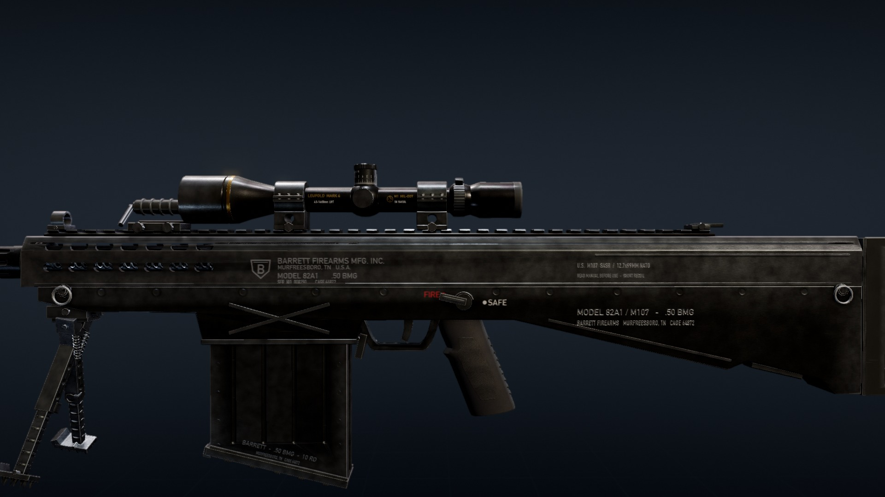
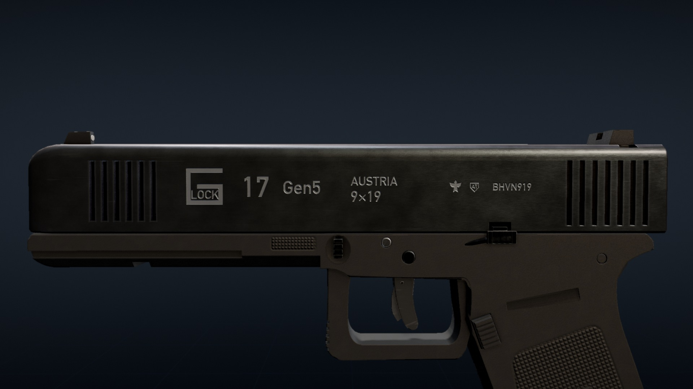

<div align="center">

<p>
  <strong>English</strong>
  &nbsp;·&nbsp;
  <a href="README.zh-CN.md">简体中文</a>
  &nbsp;·&nbsp;
  <a href="CONTRIBUTING.md">Contributing Guide</a>
</p>

# Digital Armory 3D · v3.0 Photorealism Edition

**The World's First Browser-Native Open-Source 3D Firearms Mechanical Museum & Interactive Engineering Encyclopedia**

[](https://github.com/zhoujingkun1989-arch/digital-armory-3d/actions/workflows/ci.yml)
[](https://zhoujingkun1989-arch.github.io/digital-armory-3d/showcase.html?lang=en)
[](https://www.typescriptlang.org/)
[](https://threejs.org/)
[](scripts/blender/)
[](LICENSE)

<h3>
  <a href="https://zhoujingkun1989-arch.github.io/digital-armory-3d/showcase.html?lang=en">✦ Interactive Live Showcase</a>
  &nbsp;·&nbsp;
  <a href="https://zhoujingkun1989-arch.github.io/digital-armory-3d/?screen=armory&lang=en">🚀 Enter 19-Bay 3D Vault</a>
  &nbsp;·&nbsp;
  <a href="https://zhoujingkun1989-arch.github.io/digital-armory-3d/?weapon=ak15&screen=workbench&cut=1&lang=en">🔪 Live CT-Scan Cutaway</a>
  &nbsp;·&nbsp;
  <a href="https://zhoujingkun1989-arch.github.io/digital-armory-3d/?screen=ballistics&lang=en">🎯 1,000m External Ballistics Lab</a>
  &nbsp;·&nbsp;
  <a href="https://zhoujingkun1989-arch.github.io/digital-armory-3d/?screen=cartridges&lang=en">🧪 11-Caliber 1:1 Cutaway Lab</a>
</h3>

</div>

---


> Built with **React 18 + TypeScript 5.6 + Three.js (`@react-three/fiber` / Dual-Track Blender 5.2 Draco `.glb` + Web Worker `three-bvh-csg` / Web Audio API)** — zero installs, instant browser launch, and a **`<800 kB` zero-warning split bundle**.
>
> Explore **480 moving CAD components across 19 legendary firearms & compound archery systems**, powered by **14/19 museum-grade Blender 5.2 Cycles-baked photorealistic flagship exhibits (`AK-15M1`, `Luger P08`, `Desert Eagle .50 AE`, `Colt M4A1 SOPMOD`, `Colt Python 6" .357`, `U.S. Rifle M1 Garand`, `H&K MP5A3`, `AI AWM .338 LM`, `Barrett M82A1 .50 BMG`, `Glock 17 Gen 5`, `FN SCAR-L Mk 16`, `Steyr AUG A1`, `SIG Sauer P320 M17`, `FN P90 PDW` — `331` watertight solid GLB parts + `23` dynamic CSG `aSpringParam` springs)**, **232 2K 5-channel Packed ORM WebP textures (`0` PNGs)**, **3 Cycles 32-bit studio `.hdr` lightboxes**, **Global `Cmd+K` Bilingual Command Palette**, **Live Draggable CT-Scan Cutaway Plane (`[C]`)**, **1,000m RK4 G1/G7 External Ballistics & FFP Reticle DOPE Lab (`[R]`)**, **Armorer Blind Qualification Exam (`[G] / [J]`)**, **11-Caliber SAAMI/CIP 1:1 Cutaway Lab (`[B]`)**, **3-Axis Mechanism Showdown (`[S]`)**, **HD 3D Share Poster Studio (`[U]`)**, **17-Plate Monograph Print Studio (`[Ctrl/Cmd+P]`)**, and **1,112 Bilingual `Charon` (`gemini-3.8-flash-tts`) Voiceovers** with automated **3D Documentary Camera Choreography**.

---

## v3.0 Photorealistic Flagship Gallery (14/19 Blender 5.2 Exhibits · 100% Live WebGL 2.0)

*Every image below is an unretouched real-time 1920×1080 Chromium WebGL 2.0 capture powered by our reproducible open-source **Blender 5.2 LTS headless Draco `.glb` + Cycles 2K Packed ORM** pipeline and **32-bit studio `.hdr`** lighting.*

| **Kalashnikov AK-15M1 (`7.62×39mm`)** · *Stamped Phosphate & Windowed 30-Rd Mag (`3.90 MB`)* | **DWM 1917 Luger P08 (`9×19mm`)** · *Knurled Toggle, `1917`/`B·R·S` Proofs, 240°C Straw-Gold & 20-LPI Walnut (`3.39 MB`)* |
| :---: | :---: |
|  |  |

| **Desert Eagle Mark XIX (`.50 AE`)** · *Brushed Satin 416 Stainless, Slanted Serrations & 4-Lug Rotating Bolt (`7.05 MB`)* | **Colt M4A1 SOPMOD (`5.56 NATO`)** · *7075-T6 Upper/Lower Anodize, Rampant Pony, KAC RAS & STANAG (`3.53 MB`)* |
| :---: | :---: |
|  |  |

| **Colt Python 6" (`.357 Magnum`)** · *Liquid "Royal Blue" Steel, Cylinder Drag Line & 24K Gold Medallion Walnut (`2.13 MB`)* | **U.S. Rifle M1 Garand (`.30-06 Springfield`)** · *Linseed-Oil Black Walnut, `S.A./NFR` & Ordnance Wheel Cartouche, T105 Drum (`2.72 MB`)* |
| :---: | :---: |
|  |  |

| **Heckler & Koch MP5A3 (`9×19mm`)** · *Baked Black Enamel Receiver, Navy Bullet Pictograms, Tropical Forend & A3 Rails (`3.18 MB`)* | **Accuracy International AWM (`.338 Lapua Mag`)** · *British OD-Green Thumbhole Chassis, S&B PM II `5-25×56` & 6-Lug Chrome Bolt (`3.68 MB`)* |
| :---: | :---: |
|  |  |

| **Barrett M82A1 / M107 (`.50 BMG`)** · *Manganese-Parkerized Ribbed Receivers, Leupold Mark 4 Gold Ring & 10-Rd Mag (`3.49 MB`)* | **Glock 17 Gen 5 (`9×19mm`)** · *Satin nDLC Bullnose Slide, Ferlach Proofs, Sculpted RTF4 Frame & GMB Hood (`2.28 MB`)* |
| :---: | :---: |
|  |  |

| **FN SCAR-L Mk 16 Mod 0 (`5.56 NATO`)** · *Fifty Shades of FDE Monolithic Upper, SOCOM UID Matrix, Torx Crossbolts & Folding Stock (`3.41 MB`)* | **Steyr AUG A1 / StG 77 (`5.56 NATO`)** · *Alpine OD-Green PA66 Stock, Integral 1.5× Swarovski Optic & Smoked-Amber Waffle Mag (`3.62 MB`)* |
| :---: | :---: |
|  |  |

| **SIG Sauer P320 / U.S. Army M17 (`9×19mm`)** · *Two-Tone Coyote PVD Slide, MIL-STD-130 UID & Serialized Stainless FCU (`2.53 MB`)* | **FN Herstal P90 PDW (`5.7×28mm`)** · *Smoked-Amber 50-Rd Horizontal Mag, 90° Helical Ramp & MC-10-80 Ring Sight (`2.17 MB`)* |
| :---: | :---: |
|  |  |

| **Luger P08 Two-Pass Stencil Solid Cutaway (`[C]`)** · *ISO 128 45° Metal Hatching, 8× 9mm Stack & Helical Springs* |
| :---: |
|  |

---

## v3.0 Flagship Architecture & UX Highlights

| **Global `Cmd+K` / `Ctrl+K` Bilingual Instant Command Palette** | **19-Bay Interactive 3D Digital Vault & Museum Showcase** |
| :---: | :---: |
|  |  |

- **✦ Dual-Track Blender 5.2 Draco `.glb` + Web Worker CSG Engine (`PR-02` ~ `PR-04`)**:
  - **14/19 Photorealistic Flagship Exhibits** (`ak15`, `p08`, `deagle`, `m4a1`, `python`, `garand`, `mp5`, `awm`, `m82a1`, `g17`, `scar`, `aug`, `p320`, `p90`) are procedurally sculpted and Cycles-baked via MIT-licensed headless Python scripts (`scripts/blender/build_*_photoreal.py`) into compact Draco `.glb` bundles (`331` watertight solid CAD meshes, `2.13–7.05 MB` total each, `100%` manifold, exact `1u = 1cm` coordinates) backed by `232` 2K 5-channel Packed ORM WebP maps (`0` PNGs).
  - **Zero-Compromise Dynamic Springs**: `23` helical recoil, buffer, striker, magazine, barrel-return, and V-leaf springs across the 14 flagships stay on the procedural CSG track so per-vertex `aSpringParam` GPU compression remains physically exact at 60 FPS, while the remaining 5 exhibits (`benellim4`, `m249`, `vector`, `lift33`, `r500` — scheduled for Wave 4) stream zero-copy from the background CSG Web Worker.
  - **Real-Time Studio Optics (`PR-01`)**: 3 Cycles-rendered 32-bit studio `.hdr` domes (`Tactical Vault`, `Gunsmith Bench`, `Blueprint Daylight`), Specular AA, real-time Service Wear Patina (`Factory New / Field-Oiled / Battle-Worn`), Macro Bokeh DOF, GTAO + AgX post-processing, and 3-tier GPU quality (`Ultra / Balanced / Eco`).
- **✦ Live Draggable CT-Scan Section Plane (`[C]`, `PR-04`)**: Sweep a real-time `±25 mm` longitudinal section plane across any weapon with `+Z / -Z` flip and 60 FPS continuous CT auto-sweep—zero shader recompilation, synchronized Two-Pass WebGL Stencil 45° ISO 128 cross-hatching, and through-cutaway raycast picking (`sectionAwareMeshRaycast`).
- **✦ Global `Cmd+K` / `Ctrl+K` Command Palette & Decluttered Museum HUD (`PR-04`)**: Instant multi-token EN/ZH fuzzy search from any screen across all **19 exhibits**, **480 CAD parts**, **simulation labs**, and **studio controls**, paired with streamlined `Display` and `Labs & Tools` glassmorphic popovers.
- **✦ 1,000m RK4 G1/G7 External Ballistics, Crosswind & FFP Reticle DOPE Lab (`[R]`)**: Zero-GC 4th-order Runge-Kutta 3-DOF solver across all **13 projectile profiles** (11 metallic/shotshell + 2 archery), ICAO altitude/temperature air density $\rho(h, T)$, BRL G1/G7 transonic drag $C_d(M)$, exact Sight-In Zero solver (`< 0.02 cm`), Mach 1.0 crossing detection, First-Focal-Plane MIL Christmas-tree scope reticle, and 7-row `MIL / MOA` DOPE drop cards.
- **✦ Armorer Blind Qualification Exam (`[G]`) & Mystery Stoppage Triage (`[J]`)**: Hands-on guided military field-strip DAGs plus timed blind `0 → N → 0` teardown/reassembly exams and unannounced malfunction diagnostics (`Stovepipe`, `Double Feed`, `Light Strike`, `Out-of-Battery`) awarding persistent `S / A / B / C` Armorer Qualification ranks.
- **✦ 6-Role Functional Color-Coding (`[T]`), Propellant Gas-Flow Streamlines & SAAMI/CIP Telemetry**: Real-time $P(t)$ (`MPa`) and $V(t)$ (`m/s`) oscilloscope curves coupled 1:1 to 7-stage firing kinematics, interactive `SAFE / SEMI / AUTO` selector (`[V]`), Press-Check (`[P]`), and trigger break/reset (`[F]`).
- **✦ 11-Caliber 1:1 Cartridge Cutaway Lab (`[B]`), 3-Axis Mechanism Showdown (`[S]`) & 3D Vernier Caliper (`[K]`)**: Side-by-side `1:1` scale SAAMI/CIP cross-sections (`9×19mm` to `.50 BMG`), 13 classic mechanical rivalries with overlaid $P(f)/V(f)$ traces, and millimeter-accurate 3D point-to-point surface metrology.
- **✦ 4-Act Bilingual AI Documentaries, 1,112 `Charon` Voiceovers, HD Share Posters (`[U]`) & 17-Plate Monographs (`[Ctrl/Cmd+P]`)**: Automated 3D Story Director camera choreography, stereo convolution IR + Euler-Bernoulli steel waveguide Web Audio acoustics (including M1 Garand `"PING!"`), `16:9 / 4:5` QR-linked share cards, and A4/Letter vector picture book & monograph print studio.

---

## Why Digital Armory 3D Stands Out

| Inspiration Benchmark | What We Synthesize & Advance |
| :--- | :--- |
| **Matt Rittman 3D Cutaway Animations** | Real-time **Live CT-Scan Section Plane (`[C]`)**, **6-role functional color-coding (`[T]`)**, dynamic propellant gas-flow streamlines, and automated 3D documentary choreography—pause, orbit, slice, or inspect any part at any millisecond. |
| **World of Guns: Gun Disassembly** | **Hands-on military field-strip DAGs & Timed Blind Qualification Exams (`[G]`)**, **Mystery Stoppage Triage (`[J]`)**, `SAFE / SEMI / AUTO` sear/disconnector physics, and `S / A / B / C` certification—100% open-source in the browser with zero downloads or paywalls. |
| **Bartosz Ciechanowski (`ciechanow.ski`)** | Instant web launch, direct 3D slide/bolt manipulation, **1,000m RK4 3-DOF external ballistics (`[R]`)**, and 1:1 coupling between **SAAMI/CIP internal ballistics curves ($P(t)$, $V(t)$)** and 7-stage kinematics at 60 FPS with zero React re-renders. |
| **Smithsonian 3D & Royal Armouries** | Bilingual (`EN / 中文`) 4-act R&D histories, factory `1:1` CAD metrology (`1u = 1cm`), museum-grade **Blender 5.2 Cycles PBR exhibits**, and MIT-licensed reproducible asset pipelines. |

---

## 19-Exhibit Collection Matrix (480 Moving CAD Parts · 14/19 Blender 5.2 Flagships)

| Bay | Exhibit | Pipeline | Caliber / Projectile | Operating & Locking Mechanism | Parts | Live Bench |
| :--- | :--- | :---: | :--- | :--- | :---: | :---: |
| `BAY-01` | **Kalashnikov AK-15M1 (6P71M)** | `GLB v3` | `7.62×39mm (M43)` | Long-stroke gas piston · 2-lug 35° rotating bolt | 26 | [Inspect](https://zhoujingkun1989-arch.github.io/digital-armory-3d/?weapon=ak15&screen=workbench&lang=en) |
| `BAY-02` | **Colt M4A1 SOPMOD Carbine** | `GLB v3` | `5.56×45mm NATO` | Stoner direct impingement (internal BCG piston) · 7-lug bolt | 26 | [Inspect](https://zhoujingkun1989-arch.github.io/digital-armory-3d/?weapon=m4a1&screen=workbench&lang=en) |
| `BAY-03` | **Heckler & Koch MP5A3** | `GLB v3` | `9×19mm Parabellum` | Dual Ø8mm roller-delayed blowback (4:1 ratio) · Fluted chamber | 26 | [Inspect](https://zhoujingkun1989-arch.github.io/digital-armory-3d/?weapon=mp5&screen=workbench&lang=en) |
| `BAY-04` | **Glock 17 Gen 5** | `GLB v3` | `9×19mm Parabellum` | Browning short-recoil tilting barrel · Safe Action triple safety | 28 | [Inspect](https://zhoujingkun1989-arch.github.io/digital-armory-3d/?weapon=g17&screen=workbench&lang=en) |
| `BAY-05` | **Barrett M82A1** | `GLB v3` | `.50 BMG (12.7×99mm)` | Short-recoil 29" fluted barrel · Accelerator lever & 3-lug bolt | 24 | [Inspect](https://zhoujingkun1989-arch.github.io/digital-armory-3d/?weapon=m82a1&screen=workbench&lang=en) |
| `BAY-06` | **Accuracy International AWM** | `GLB v3` | `.338 Lapua Magnum` | Manual 60° 6-lug anti-icing bolt action · Bonded alloy chassis | 24 | [Inspect](https://zhoujingkun1989-arch.github.io/digital-armory-3d/?weapon=awm&screen=workbench&lang=en) |
| `BAY-07` | **FN SCAR-L Mk 16 Mod 0** | `GLB v3` | `5.56×45mm NATO` | Short-stroke gas tappet · 7-lug rotating bolt & monolithic upper | 26 | [Inspect](https://zhoujingkun1989-arch.github.io/digital-armory-3d/?weapon=scar&screen=workbench&lang=en) |
| `BAY-08` | **Desert Eagle Mark XIX** | `GLB v3` | `.50 Action Express` | Forward under-barrel gas piston · 4-lug rotating bolt & dual rods | 24 | [Inspect](https://zhoujingkun1989-arch.github.io/digital-armory-3d/?weapon=deagle&screen=workbench&lang=en) |
| `BAY-09` | **Steyr AUG A1 (StG 77)** | `GLB v3` | `5.56×45mm NATO` | Offset short-stroke piston · Twin guide rods & polymer hammer pack | 25 | [Inspect](https://zhoujingkun1989-arch.github.io/digital-armory-3d/?weapon=aug&screen=workbench&lang=en) |
| `BAY-10` | **SIG Sauer P320 M17** | `GLB v3` | `9×19mm Parabellum` | Serialized removable stainless FCU chassis · Tilting-barrel striker | 24 | [Inspect](https://zhoujingkun1989-arch.github.io/digital-armory-3d/?weapon=p320&screen=workbench&lang=en) |
| `BAY-11` | **FN P90 PDW** | `GLB v3` | `5.7×28mm FN SS190` | Top horizontal 50-rd magazine · 90° helical feed ramp & bottom eject | 25 | [Inspect](https://zhoujingkun1989-arch.github.io/digital-armory-3d/?weapon=p90&screen=workbench&lang=en) |
| `BAY-12` | **Mathews LIFT 33** | `CSG` | `400 gr Carbon Arrow (348 FPS)` | SwitchWeight-X binary cams · 85% let-off & QAD drop-away rest | 24 | [Inspect](https://zhoujingkun1989-arch.github.io/digital-armory-3d/?weapon=lift33&screen=workbench&lang=en) |
| `BAY-13` | **Ravin R500** | `CSG` | `400 gr Carbon Bolt (500 FPS)` | HexCoil 360° helical cams · VersaDrive screw crank & Trac-Trigger sled | 25 | [Inspect](https://zhoujingkun1989-arch.github.io/digital-armory-3d/?weapon=r500&screen=workbench&lang=en) |
| `BAY-14` | **Colt Python 6" (.357 Mag)** | `GLB v3` | `.357 Magnum (9×33mmR)` | DA/SA hand-tuned V-mainspring clockwork · 60° ratchet & stop-bolt | 25 | [Inspect](https://zhoujingkun1989-arch.github.io/digital-armory-3d/?weapon=python&screen=workbench&lang=en) |
| `BAY-15` | **Benelli M4 (M1014)** | `CSG` | `12 Gauge (00 Buckshot)` | Twin chamber-mounted ARGO short-stroke pistons · 2-lug bolt & elevator | 26 | [Inspect](https://zhoujingkun1989-arch.github.io/digital-armory-3d/?weapon=benellim4&screen=workbench&lang=en) |
| `BAY-16` | **U.S. Rifle M1 Garand** | `GLB v3` | `.30-06 Springfield M2` | Muzzle gas cylinder & curved long-stroke op-rod · 2-lug bolt & 8-rd clip | 26 | [Inspect](https://zhoujingkun1989-arch.github.io/digital-armory-3d/?weapon=garand&screen=workbench&lang=en) |
| `BAY-17` | **FN M249 SAW (Minimi PIP)** | `CSG` | `5.56×45mm NATO (M27 / STANAG)` | Open-bolt long-stroke gas piston · 2-lug bolt & dual-pawl M27 shuttle | 26 | [Inspect](https://zhoujingkun1989-arch.github.io/digital-armory-3d/?weapon=m249&screen=workbench&lang=en) |
| `BAY-18` | **DWM Luger P08 (1917)** | `GLB v3` | `9×19mm Parabellum` | 6.5mm short-recoil forked receiver · Over-center 2-bar knee-joint toggle | 25 | [Inspect](https://zhoujingkun1989-arch.github.io/digital-armory-3d/?weapon=p08&screen=workbench&lang=en) |
| `BAY-19` | **KRISS Vector SMG Gen II** | `CSG` | `.45 ACP (11.43×23mm)` | Patented Super V `-65°` off-axis tungsten slider delayed blowback | 25 | [Inspect](https://zhoujingkun1989-arch.github.io/digital-armory-3d/?weapon=vector&screen=workbench&lang=en) |

---

## Keyboard Shortcuts & Deep Links

### URL Deep-Link Parameters
- Interactive Product Showcase: `/showcase.html?lang=en` or `/?screen=showcase&lang=en`
- 19-Bay Armory Turntable: `/?screen=armory&weapon=p08&lang=en`
- Live Cutaway Workbench: `/?weapon=ak15&screen=workbench&cut=1&lang=en`
- 1,000m RK4 External Ballistics & Reticle DOPE Lab: `/?screen=ballistics&caliber=338_lapua&lang=en`
- 11-Caliber 1:1 Cartridge & Shotshell Cutaway Lab: `/?screen=cartridges&caliber=45_acp&lang=en`

### Global & Workbench Hotkeys
| Key | Action |
| :---: | :--- |
| `Cmd / Ctrl + K` | Open **Global Bilingual Instant Command Palette** (19 exhibits, 480 parts, labs & studio controls) |
| `Space` | Play / pause staged explosion or 7-phase live firing cycle |
| `C` | Toggle **Live Draggable CT-Scan Solid Cross-Section Cutaway** (`±25 mm` sweep, `+Z/-Z` flip, ISO 128 cap) |
| `T` | Toggle **6-Role Engineering Functional Color-Coding** & cutaway cap tint |
| `G` | Toggle **Hands-On Guided Field-Strip & Blind Timed Qualification Exam (DAG)** |
| `J` | Toggle **Malfunction Cutaway & Mystery Stoppage Triage Exam** (`Stovepipe / Double-Feed / Light-Strike / OOB`) |
| `K` | Toggle **1:1 3D Armorer Vernier Caliper** (`mm`) & 3D envelope scale ruler |
| `R` | Open / return from **1,000m RK4 External Ballistics, Wind Drift & FFP Reticle DOPE Lab** |
| `U` | Open / close **Instant HD 3D Cutaway Social Poster Studio** (`16:9 / 4:5` + QR + Rank Seal) |
| `B` | Open / exit standalone **11-Caliber SAAMI/CIP 1:1 Cartridge & Shotshell Cutaway Lab** |
| `S` | Open / close **3-Axis Mechanism Showdown & Dual-Exhibit Comparison Lab** |
| `X` | Toggle optical X-Ray translucent receiver / slide / magazine housings |
| `P / V / F` | Armorer **Press-Check** (`P`) · Cycle `SAFE / SEMI / AUTO` selector (`V`) · Hold trigger (`F`) |
| `E / L / M / H` | CAD Hard-Edges (`E`) · 3D Callouts (`L`) · Web Audio Mute (`M`) · **Clean Fullscreen** (`H`) |
| `Ctrl/Cmd + P` | Open **17-Plate Collector Monograph & Kids Picture Book Print Studio** |
| `Shift + R / Esc` | Reset to `0%` assembled state & default framing / Dismiss overlay or return to Vault |

---

## Quick Start & Quality Gates

### Prerequisites
- **Node.js** `>= 20`
- *(Optional — legacy PBR baker)* **Python** `>= 3.10` + `numpy` + `Pillow`
- *(Optional — photorealistic `.glb` rebuilds)* **Blender 5.2 LTS** (headless CLI)

```bash
# 1. Install dependencies
npm ci

# 2. Start local Vite dev server (serves both / and /showcase.html)
npm run dev

# 3. Run all 4 mandatory engineering quality gates (0 errors, 0 warnings, all chunks < 800 kB)
npm run typecheck
npm run lint
npm test
npm run build
```

### Optional: Rebuild Photorealistic Blender 5.2 `.glb` or Legacy PBR Maps

```bash
# Re-generate any flagship Blender 5.2 Draco GLB + Cycles 2K Packed ORM suite headlessly (14 exhibits):
blender --factory-startup --background --python scripts/blender/build_p08_photoreal.py
blender --factory-startup --background --python scripts/blender/build_ak15_photoreal.py
blender --factory-startup --background --python scripts/blender/build_deagle_photoreal.py
blender --factory-startup --background --python scripts/blender/build_m4a1_photoreal.py
blender --factory-startup --background --python scripts/blender/build_python_photoreal.py
blender --factory-startup --background --python scripts/blender/build_garand_photoreal.py
blender --factory-startup --background --python scripts/blender/build_mp5_photoreal.py
blender --factory-startup --background --python scripts/blender/build_awm_photoreal.py
blender --factory-startup --background --python scripts/blender/build_m82a1_photoreal.py
blender --factory-startup --background --python scripts/blender/build_g17_photoreal.py
blender --factory-startup --background --python scripts/blender/build_scar_photoreal.py
blender --factory-startup --background --python scripts/blender/build_aug_photoreal.py
blender --factory-startup --background --python scripts/blender/build_p320_photoreal.py
blender --factory-startup --background --python scripts/blender/build_p90_photoreal.py

# Or rebuild procedural legacy 2K Packed ORM WebP maps:
python3 -B -m scripts.pbr_core.selftest
npm run textures:build
```

---

## Architecture Overview

```text
digital-armory-3d/
├── index.html                     # Primary 3D Vault & Disassembly Workbench entry
├── showcase.html                  # Standalone interactive bilingual Showcase entry
├── public/
│   ├── audio/                     # 1,112 bilingual 4-act R&D & part voiceovers (Charon Gemini TTS MP3)
│   ├── draco/                     # Self-hosted Three.js WebAssembly Draco mesh decoders
│   ├── hdri/                      # 3 Cycles-rendered 32-bit studio .hdr domes (Vault / Bench / Daylight)
│   ├── models/                    # 14 Blender 5.2 Draco-compressed flagship .glb exhibits (p08/ak15/deagle/m4a1/python/garand/mp5/awm/m82a1/g17/scar/aug/p320/p90)
│   ├── narrations/                # 19 structured zh/en R&D documentaries & part engineering JSONs
│   ├── showcase/                  # Live WebGL 2.0 showcase gallery captures (WebP)
│   └── textures/                  # 232 pre-baked 2K 5-Channel Packed ORM WebP textures (76 albedo / 78 normal / 78 ORM, 0 PNGs)
├── scripts/
│   ├── blender/                   # Reproducible MIT headless Blender 5.2 sculpt, Cycles bake & HDRI scripts
│   ├── narrations/.cache/         # 19 SHA-256 content-addressed Charon TTS verification manifests
│   ├── pbr_core/ & pbr/           # Procedural Worley, knurling, normal-integrated AO & legacy PBR bakers
│   └── build_textures.py          # Batch texture baker & WebP encoder CLI
├── src/
│   ├── app/                       # Bidirectional URL sync (?cut=1 / ?screen=ballistics), hotkeys & ErrorBoundary
│   ├── engine/
│   │   ├── actors/                # PartActor, Live StencilSectionCap, BallisticsSystem, GasFlowVisualizer
│   │   ├── audio/                 # Stereo convolution IR + waveguide gunsmith & archery Web Audio engine
│   │   ├── callout/               # ResizeObserver HUD obstacle cache & 60fps hairline callouts
│   │   ├── canvas/                # ArmoryViewport, studioHdriManager, GunsmithStageMat & GTAO/DOF/AgX PostFX
│   │   ├── caliper/               # 1:1 3D Vernier caliper (`1u = 10mm`) & envelope metrology
│   │   ├── cartridges/            # 11-caliber exact 1:1 SAAMI/CIP standing cutaway lathe specs
│   │   ├── clock/                 # Transient 60Hz playbackClock (zero React re-renders)
│   │   ├── exam/                  # Armorer Blind Field-Strip & Unknown Stoppage Triage grading store
│   │   ├── fieldstrip/            # 19-exhibit military field-strip DAG specs & Zero-GC runtime
│   │   ├── geometry/              # Dual-Track Draco GLB loader (glbAssetService) + Web Worker CSG & raycast
│   │   ├── interaction/           # Direct 3D slide drag, Press-Check & SAFE/SEMI/AUTO FCG
│   │   ├── kinematics/            # Zero-GC keyframe & multi-stage pose evaluators
│   │   ├── malfunctions/          # 4-stoppage diagnostic profiles & clearing drill state machine
│   │   ├── materials/             # Custom GLSL armoryShader (Specular AA / Wear Patina), 6-role tint & PBR LRU
│   │   ├── physics/               # SAAMI/CIP internal ballistics + 1,000m RK4 G1/G7 external ballistics
│   │   └── utils/                 # Subpath-safe VITE_BASE_PATH asset & deep-link URL resolvers
│   ├── features/                  # Modular UI views (showcase / armory / workbench / Cmd+K / ballistics / share / monograph / cartridges / story / atlas)
│   ├── i18n/                      # Strictly parity-checked zh/en dictionaries (0 CJK leaks in EN)
│   ├── narration/                 # Audio queue, speechSynthesis fallback & 3D Story Director
│   ├── store/                     # Strongly typed Zustand store (useAppStore)
│   └── weapons/                   # 19 lazy-loaded self-contained weapon & archery plugins (CSG + kinematics)
└── tests/                         # 25 Vitest geometry, GLB, Cmd+K, CT-section, UV, kinematics, ballistics, Exam & i18n suites
```

---

## Contributing & Community

Contributions are welcome! Please read our bilingual [**Contributing Guide (`CONTRIBUTING.md`)**](CONTRIBUTING.md) before opening a PR — it covers local setup, the 4 mandatory quality gates, Blender 5.2 headless `.glb` pipeline contracts, and our strict educational safety policy.

---

## Educational Disclaimer

All 3D models in this repository are **schematic / educational visualizations** created strictly to illustrate mechanical engineering principles, operating systems, internal & external ballistics, and armorer safety procedures. They **do not contain manufacturing tolerances, chambering blueprints, or 3D-printable dimensions**.

---

## License

Released under the [MIT License](LICENSE).
