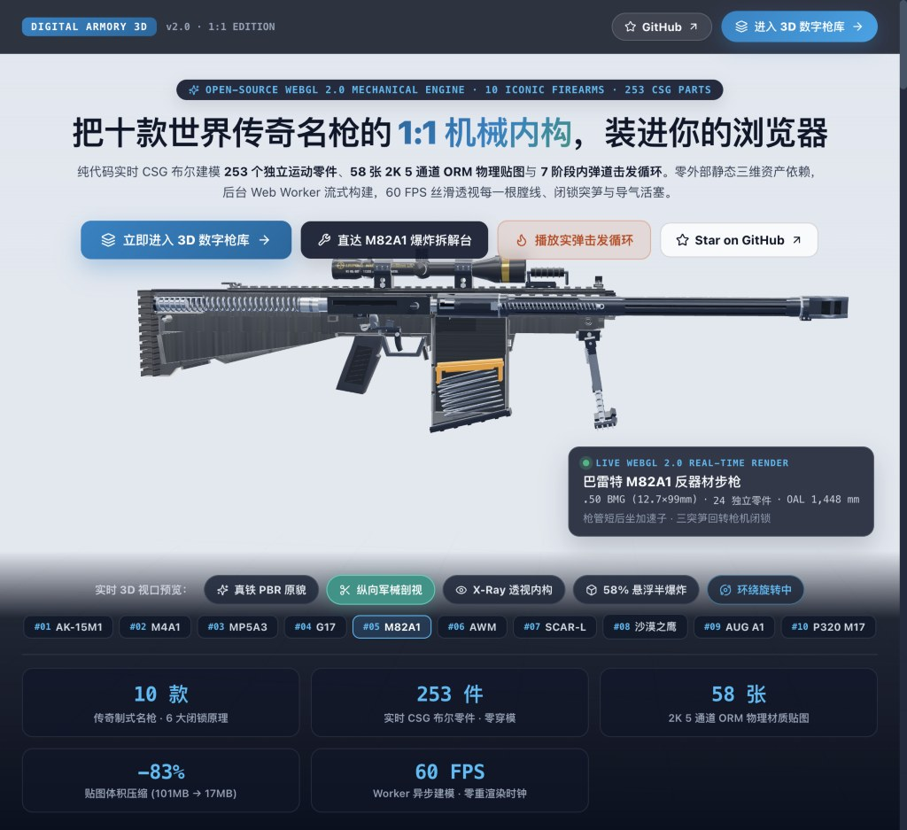
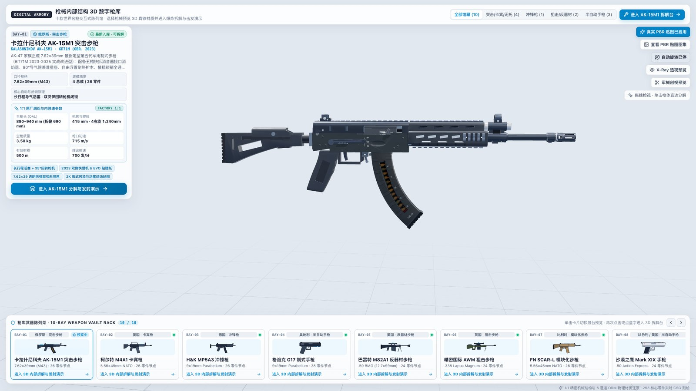
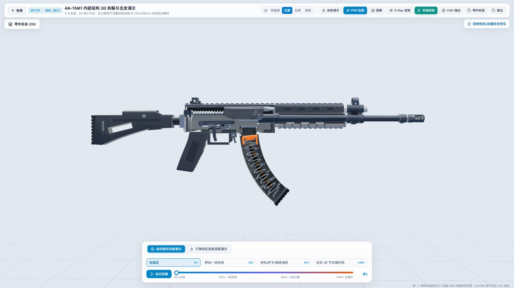
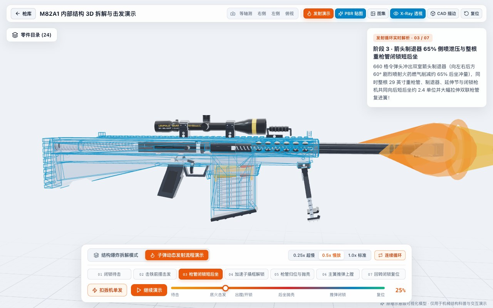
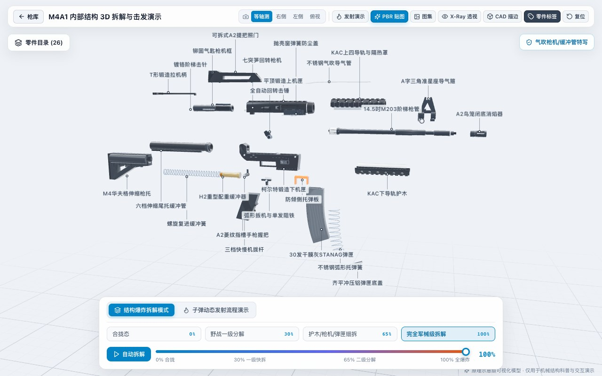
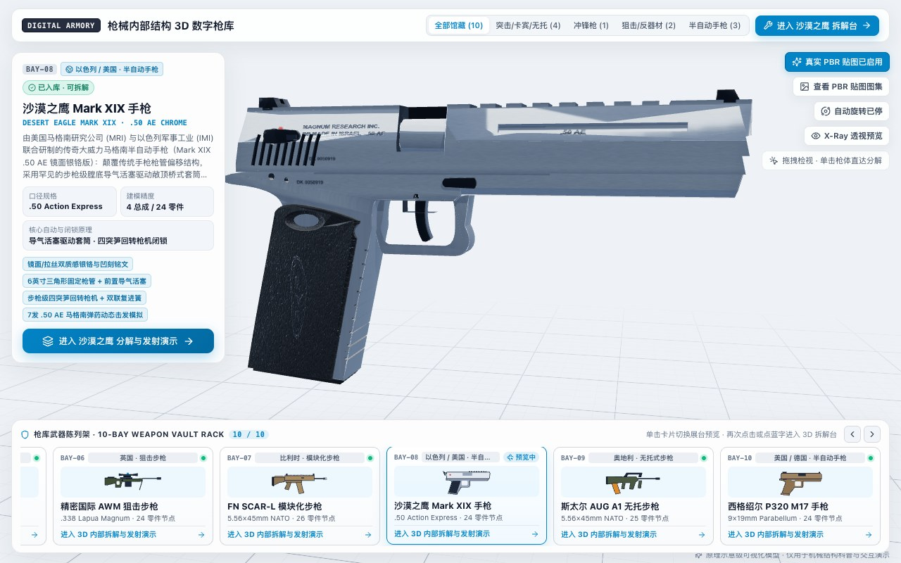
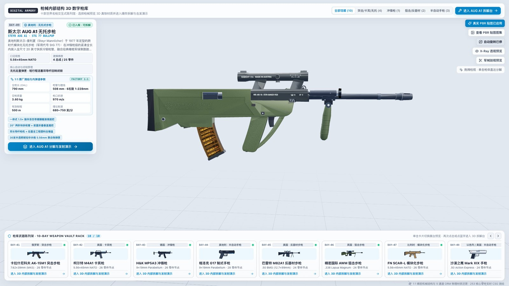

<div align="center">

# Digital Armory 3D · 枪械内部结构 3D 数字仓库

**把十款世界传奇名枪的 1:1 机械内构，装进你的浏览器**

[](https://github.com/zhoujingkun1989-arch/digital-armory-3d/actions/workflows/ci.yml)
[](https://zhoujingkun1989-arch.github.io/digital-armory-3d/showcase.html)
[](https://www.typescriptlang.org/)
[](https://threejs.org/)
[](LICENSE)

<h3>
  <a href="https://zhoujingkun1989-arch.github.io/digital-armory-3d/showcase.html">✦ 访问官方交互式宣传主页 (Showcase)</a>
  &nbsp;·&nbsp;
  <a href="https://zhoujingkun1989-arch.github.io/digital-armory-3d/">🚀 直接进入 10 槽 3D 数字枪库</a>
  &nbsp;·&nbsp;
  <a href="https://zhoujingkun1989-arch.github.io/digital-armory-3d/?weapon=ak15&screen=workbench">🔧 直达 AK-15M1 拆解台</a>
</h3>

</div>

---

> 基于 **React 18 + TypeScript + Three.js (`@react-three/fiber` / Web Worker `three-bvh-csg` / Web Audio API)** 构建的工业级浏览器端交互式 **十大世界经典名枪 1:1 机械内构拆解、双语 AI 四幕研发纪录片（3D 导演自动运镜）、GPU 纵向军械剖视与 7 阶段声画内弹道仿真博物馆**。
>
> A zero-external-mesh WebGL 2.0 3D Firearms Mechanical Museum featuring **10 self-contained weapon plugins**, **253 procedurally & CSG-modeled moving parts** streamed from a background Web Worker, **58 2K 5-channel Packed ORM WebP textures**, **586 bilingual Google Gemini TTS voiceovers**, automated **3D Story Director choreography** with synced click-to-seek captions, longitudinal GPU section-cut (`C`), and a **procedural Web Audio 6-caliber & 7-stage gunsmith acoustic engine**.





---

## 核心亮点 | Highlights

- **✦ 全站中英双语（`中文 / EN`）与实时交互宣传页（Live 3D Showcase v3.0）**：支持通过 `showcase.html`、`?screen=showcase` 或 `?lang=en` 打开双语全景产品发布页，首屏内嵌 **60 FPS 实时 WebGL 3D 检视窗**，无需跳转即可在宣传页切换 10 款名枪、体验「真铁 PBR / 纵向剖视 / X-Ray 透视 / 悬浮半爆炸」或一键启动 3D 导演纪录片。
- **✦ AI 四幕研发纪录片 &「3D 导演自动运镜模式」**：全馆藏内置 **586 段双语语音导览**（40 段四幕研发史配音 + 506 段独立零件中英讲解，支持 `speechSynthesis` 离线兜底）。开启 **3D 导演运镜** 后，随旁白自动切入拆解工作台、飞跃聚焦核心零件、按剧情节拍切换纵向剖视 `C` / X-Ray / `52%` 二级分解与 `0.25x` 超慢放实弹循环，并配套可点击跳转的逐句滚动高亮字幕与悬浮影院字幕条。
- **✦ 程序化 Web Audio 军械机械声效 & 6 口径实弹声场**：零外部音频膨胀，与 `playbackClock` 7 阶段击发相位硬绑定——`1.0x` 标准射速清晰区分 `.50 BMG` 38Hz 超低频震波与 `9×19mm` 清脆爆响；`0.25x` 超慢放精准分离阻铁释放、击针撞底火、导气/后坐、凸轮开锁、旋转黄铜弹壳清鸣与复进簧闭锁声，并在语音播报时自动执行 `-12.4 dB` 智能闪避（Audio Ducking）。
- **10 展位 3D 数字枪库与 1:1 原厂测绘铭牌**：支持按「全部馆藏 / 突击·卡宾·无托 / 冲锋枪 / 狙击·反器材 / 半自动手枪」分类筛选，配备原厂全枪长 (OAL)、枪管缠距、空枪质量、初速与射程铭牌，支持卡片悬停预热加载与一键直达拆解台。
- **GPU 纵向中轴军械剖视（`C`）与剖面穿透拾取**：按下 `C` 键即可沿枪膛纵轴实时剖开右侧机匣、套筒与弹匣壳体，原色直视内部膛线、闭锁突笋、导气活塞、复进簧与实弹托弹簧；定制 `sectionAwareMeshRaycast` 让鼠标直接穿透虚空切面点选内部火控构件。
- **5 通道 Packed ORM 物理材质与双侧掠射柔光棚**：基于 `scripts/pbr_core/` 离线烘焙 `Albedo + Normal + ORM (R:高度积分AO · G:微粗糙度 · B:逐纹素金属度)` 共 **58 张 `.webp` 贴图**（`101.35 MB → 17.25 MB`，缩减 **83%**）；配合 ACES Filmic 双侧 `±Z` 掠射柔光箱与磷化转化膜 + 枪油清漆层曲线，清晰分离锰系磷化钢、硬质阳极铝、CNC 导轨倒角、玻纤尼龙与硫化橡胶五级深色质感。
- **7 阶段耦合运动学与 6 口径 SAAMI/CIP 实弹内弹道**：完整还原长/短行程导气活塞、斯通纳气吹、MP5 `4:1` 双滚柱延迟、巴雷特整管短后坐加速子、AWM `60°` 六突笋防冰栓动及布朗宁闭锁下倾，含 Boxer 底火击发凹坑与 `.50 BMG` 双室箭头制退侧喷冲击波。
- **Web Worker 零拷贝 CSG 流式建模 & 60Hz 零重渲染时钟**：重度 `three-bvh-csg` 布尔运算隔离在后台 Worker 并以 `Transferable Float32Array` 流式回传，配合非受控瞬态时钟 `playbackClock.ts` 与有界 LRU 几何/纹理显存池，恒定丝滑 60 FPS。

---

## 实机渲染画廊 | Live WebGL 2.0 Gallery

| AK-15M1 纵向中轴军械剖视 (`C`) 与内部供弹/击发咬合 | Barrett M82A1 `.50 BMG` 整管短后坐与 60° 箭头制退冲击波 |
| :---: | :---: |
|  |  |

| Colt M4A1 军械级 100% 全零件爆炸图与防遮挡引线 | Desert Eagle Mark XIX `.50 AE` 拉丝硬铬与正向导气活塞 |
| :---: | :---: |
|  |  |

| Steyr AUG A1 施华洛世奇瞄具与半透明琥珀弹匣 | 内置 2K 三通道 PBR 贴图图集检视器 (Albedo / Normal / ORM) |
| :---: | :---: |
|  |  |

---

## 馆藏十款经典名枪矩阵 | 10-Weapon Roster

| 展位 | 型号 | 国家 / 类型 | 口径 | 核心自动与闭锁机构 | 零件数 | 在线直达 |
| :--- | :--- | :--- | :--- | :--- | :---: | :---: |
| `BAY-01` | **Kalashnikov AK-15M1 (6П71М)** | 俄罗斯 · 突击步枪 | `7.62×39mm (M43)` | 长行程导气活塞 · 双突笋 35° 回转枪机闭锁 | 26 | [拆解](https://zhoujingkun1989-arch.github.io/digital-armory-3d/?weapon=ak15&screen=workbench) |
| `BAY-02` | **Colt M4A1 Carbine** | 美国 · 卡宾枪 | `5.56×45mm NATO` | 斯通纳气吹式导气 (DI) · 七突笋回转枪机 + 尾托缓冲簧 | 26 | [拆解](https://zhoujingkun1989-arch.github.io/digital-armory-3d/?weapon=m4a1&screen=workbench) |
| `BAY-03` | **Heckler & Koch MP5A3** | 德国 · 冲锋枪 | `9×19mm Parabellum` | 双 Ø8mm 滚柱 + 45° 闭锁楔 4:1 延迟半自由枪机 | 26 | [拆解](https://zhoujingkun1989-arch.github.io/digital-armory-3d/?weapon=mp5&screen=workbench) |
| `BAY-04` | **Glock 17 Gen3** | 奥地利 · 半自动手枪 | `9×19mm Parabellum` | 枪管短后坐偏移下倾闭锁 · Safe Action 三重保险击针 | 28 | [拆解](https://zhoujingkun1989-arch.github.io/digital-armory-3d/?weapon=g17&screen=workbench) |
| `BAY-05` | **Barrett M82A1** | 美国 · 反器材步枪 | `.50 BMG (12.7×99mm)` | 29" 开槽重枪管短后坐 · 加速子撬动三突笋枪机 + 箭头制退 | 24 | [拆解](https://zhoujingkun1989-arch.github.io/digital-armory-3d/?weapon=m82a1&screen=workbench) |
| `BAY-06` | **Accuracy International AWM** | 英国 · 狙击步枪 | `.338 Lapua Magnum` | 手动 60° 六突笋防冰槽旋转后拉枪机 · 铝合金贯穿底盘 | 24 | [拆解](https://zhoujingkun1989-arch.github.io/digital-armory-3d/?weapon=awm&screen=workbench) |
| `BAY-07` | **FN SCAR-L Mk 16 Mod 0** | 比利时 · 模块化步枪 | `5.56×45mm NATO` | 短行程导气活塞 · 七突笋回转枪机 + 一体铝挤 FDE 上机匣 | 26 | [拆解](https://zhoujingkun1989-arch.github.io/digital-armory-3d/?weapon=scar&screen=workbench) |
| `BAY-08` | **Desert Eagle Mark XIX** | 以色列/美国 · 半自动手枪 | `.50 Action Express` | 固定枪管膛底正向三环导气活塞 · 四突笋回转枪机 + 双复进簧 | 24 | [拆解](https://zhoujingkun1989-arch.github.io/digital-armory-3d/?weapon=deagle&screen=workbench) |
| `BAY-09` | **Steyr AUG A1 (StG 77)** | 奥地利 · 无托步枪 | `5.56×45mm NATO` | 无托后置弹匣 · 短行程活塞双长导杆 + 贯通双连杆全塑击锤包 | 25 | [拆解](https://zhoujingkun1989-arch.github.io/digital-armory-3d/?weapon=aug&screen=workbench) |
| `BAY-10` | **SIG Sauer P320 M17** | 美国/德国 · 半自动手枪 | `9×19mm Parabellum` | 模块化可拆不锈钢 FCU 火控内胆 · 布朗宁闭锁下倾平移击针 | 24 | [拆解](https://zhoujingkun1989-arch.github.io/digital-armory-3d/?weapon=p320&screen=workbench) |

---

## 键盘快捷键与深度链接 | Shortcuts & Deep Links

- **多入口与深度链接**：
  - 官方双语宣传页：`/showcase.html`、`/?screen=showcase` 或 `/showcase.html?lang=en`
  - 10 槽数字枪库：`/?weapon=ak15` 或 `/?weapon=ak15&lang=en`
  - 直达拆解/击发台：`/?weapon=m82a1&screen=workbench&mode=firing`
- **全局工程快捷键**：
  - `Space`：播放 / 暂停自动拆解或实弹击发循环演示
  - `C`：开启 / 关闭 1:1 纵向中轴军械剖视切面（`军械剖视`）
  - `X`：开启 / 关闭机匣与套筒外壳 X-Ray 半透明透视
  - `M`：开启 / 静音 Web Audio 军械机械咬合声与 6 口径实弹声场
  - `E`：开启 / 关闭工业 CAD 硬边轮廓线
  - `L`：显示 / 隐藏 3D 空间零件编号引出标签（拆解模式）
  - `R`：一键重置回默认合拢态与默认等轴测视角
  - `Esc`：依次收起全屏抽屉为悬浮字幕条 → 取消当前选中零件 → 返回 3D 数字枪库

---

## 快速启动与质量门禁 | Quick Start & Verification

### 环境要求 | Prerequisites
- **Node.js** `>= 20`
- （可选，仅在重新离线烘焙 PBR 贴图时需要）**Python** `>= 3.10` + `numpy` + `Pillow`

### 常用命令 | Commands

```bash
# 1. 安装依赖
npm install

# 2. 启动本地开发服务器 (同时支持 / 与 /showcase.html)
npm run dev

# 3. 执行全量静态检查与 10 武器 253 零件契约测试
npm run typecheck
npm run lint
npm test

# 4. 生产环境多入口分包构建
npm run build
```

### 重新烘焙 5 通道 Packed ORM WebP 贴图（可选）

仓库 `public/textures/` 目录已内置全部 58 张高画质 `.webp` 贴图，开箱即用。如需调整表面转化膜色温、滚印或磨损参数：

```bash
# 运行 Python PBR 算子自测 + 重新生成全部 10 款武器贴图
python3 -B -m scripts.pbr_core.selftest
npm run textures:build
```

---

## 项目架构目录 | Project Architecture

```text
digital-armory-3d/
├── index.html                     # 3D 数字枪库与拆解工作台主入口
├── showcase.html                  # 官方交互式产品宣传页独立入口
├── public/
│   ├── audio/                     # 586 段双语四幕研发史与全零件 Gemini TTS MP3 语音
│   ├── narrations/                # 10 款武器结构化双语研发故事与零件工程档案 JSON
│   ├── showcase/                  # 实机 WebGL 2.0 高清宣传页画廊资产 (WebP)
│   └── textures/                  # 58 张 2K / Seamless 5-Ch ORM WebP 贴图
├── scripts/
│   ├── pbr_core/                  # Python 共享 Worley/滚花/法线积分AO/曲率提亮算子库
│   ├── pbr/                       # 10 款武器独立贴图生成器 (generate_*_pbr.py)
│   └── build_textures.py          # 统一贴图生成与 WebP 编码流水线 CLI
├── src/
│   ├── app/                       # URL 双向深度链接、语言标题同步、快捷键与 ErrorBoundary
│   ├── engine/                    # 通用 3D 机械拆解、剖视、内弹道与程序化声学引擎层
│   │   ├── actors/                # PartActor (转化膜+清漆层 PBR) + BallisticsSystem
│   │   ├── audio/                 # Web Audio 6 口径实弹声浪、8 点机械咬合与 TTS 闪避引擎
│   │   ├── callout/               # ResizeObserver 零回流避障与 60fps 引线投影器
│   │   ├── canvas/                # ArmoryViewport 双侧掠射柔光棚与阻尼相机飞跃控制
│   │   ├── clock/                 # playbackClock 60fps 瞬态时钟 (零 React 重渲染)
│   │   ├── geometry/              # Web Worker 异步 CSG、剖视穿透射线与 LRU 几何池
│   │   ├── kinematics/            # 零 GC 分配关键帧插值与运动学纯函数库
│   │   └── materials/             # BASE_URL 自适应 WebP PBR 加载与 LRU 纹理池
│   ├── i18n/                      # 全站与宣传页中英双语词典及武器元数据兜底表
│   ├── narration/                 # 语音播放队列、speechSynthesis 兜底与 3D 导演编排器
│   ├── weapons/                   # 10 款自包含武器插件包 (支持 Rollup 独立分包懒加载)
│   ├── features/                  # 模块化视图层 (showcase / armory / workbench / story / atlas)
│   ├── store/                     # useAppStore 强类型交互状态库
│   └── styles/                    # 设计令牌与按视图模块拆分的样式体系
├── tests/                         # Vitest 253 零件几何/UV/运动学/防死黑契约测试
└── .github/workflows/             # CI 门禁 (ci.yml) + GitHub Pages 自动部署 (deploy-pages.yml)
```

---

## 声明 | Disclaimer

本项目所有三维模型均为**原理示意级（Schematic / Educational Level）**浏览器端机械科普与交互可视化开源作品，重点展示机械自动原理、闭锁方式与运动学配合关系，**不包含任何真实工业制造公差、CAD 加工图纸或可打印构件尺寸**。

---

## 开源协议 | License

本项目基于 [MIT License](LICENSE) 开源。
