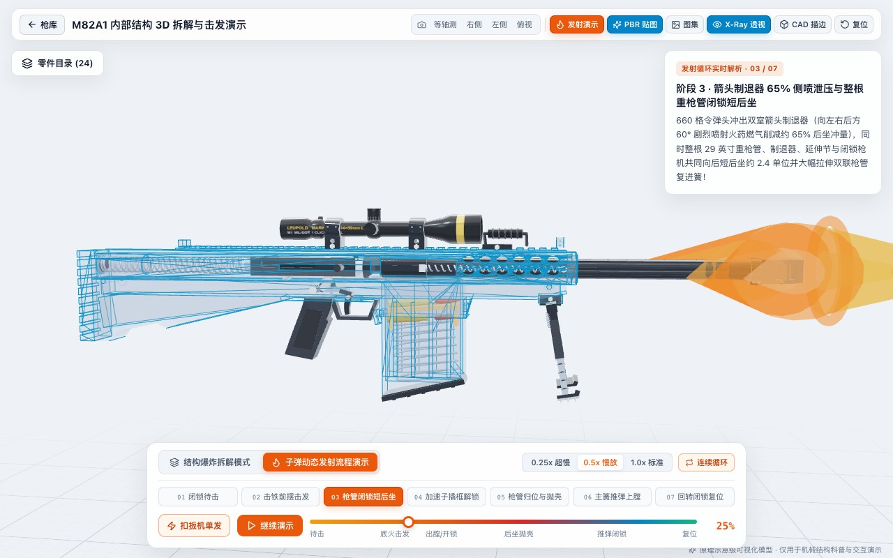
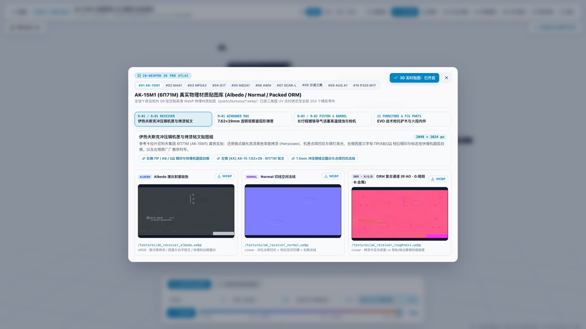

<div align="center">

<p>
  <strong>English</strong>
  &nbsp;·&nbsp;
  <a href="README.zh-CN.md">简体中文</a>
</p>

# Digital Armory 3D

**The Browser-Native Open-Source 3D Firearms Mechanical Museum & Interactive Engineering Encyclopedia**

[](https://github.com/zhoujingkun1989-arch/digital-armory-3d/actions/workflows/ci.yml)
[](https://zhoujingkun1989-arch.github.io/digital-armory-3d/showcase.html?lang=en)
[](https://www.typescriptlang.org/)
[](https://threejs.org/)
[](LICENSE)

<h3>
  <a href="https://zhoujingkun1989-arch.github.io/digital-armory-3d/showcase.html?lang=en">✦ Interactive Live Showcase</a>
  &nbsp;·&nbsp;
  <a href="https://zhoujingkun1989-arch.github.io/digital-armory-3d/?screen=armory&lang=en">🚀 Enter 13-Bay 3D Vault</a>
  &nbsp;·&nbsp;
  <a href="https://zhoujingkun1989-arch.github.io/digital-armory-3d/?screen=cartridges&lang=en">🧪 1:1 Cartridge Cutaway Lab</a>
  &nbsp;·&nbsp;
  <a href="https://zhoujingkun1989-arch.github.io/digital-armory-3d/?weapon=ak15&screen=workbench&lang=en">🔧 Open AK-15M1 Disassembly Bench</a>
</h3>

</div>

---

> Built with **React 18 + TypeScript + Three.js (`@react-three/fiber` / Web Worker `three-bvh-csg` / Web Audio API)** — with **zero external `.glb` / `.gltf` mesh files**.
>
> Every single one of the **327 moving components across 13 iconic world firearms & compound archery systems (including Mathews LIFT 33 & Ravin R500)** is synthesized procedurally via manifold boolean CSG in a background Web Worker, paired with **76 2K 5-channel Packed ORM textures**, and streamed zero-copy to WebGL 2.0. Combine **Two-Pass Stencil Solid Cross-Section Cutaways (`[C]`)**, **6-Role Functional Color-Coding & 60fps Propellant Gas-Flow Streamlines (`[T]`)**, **Hands-On Military Field-Strip DAG Disassembly (`[G]`)**, **SAAMI/CIP Chamber Pressure $P(t)$ & Bore Velocity $V(t)$ Oscilloscope Telemetry**, **Interactive `SAFE / SEMI / AUTO` Fire-Control & Press-Check (`[P] / [V] / [F]`)**, **17-Plate Collector Monograph & Kids Picture Book Print Studio (`[Ctrl/Cmd+P]`)**, **Clean Fullscreen Showcase (`[H]`)**, and **758 Bilingual Google Gemini TTS Voiceovers** with automated **3D Documentary Camera Choreography**.


---

## Why Digital Armory 3D Stands Out

| Inspiration Benchmark | What We Synthesize & Advance |
| :--- | :--- |
| **Matt Rittman 3D Cutaway Animations** | Real-time interactive **6-role functional color-coding (`[T]`)**, dynamic **high-pressure bore & gas-port flow streamlines**, and synchronized 3D documentary camera choreography — pause, orbit, slice, or inspect any part at any millisecond. |
| **World of Guns: Gun Disassembly** | **Hands-on military field-strip & reverse-reassembly DAGs (`[G]`)** with real mechanical interference diagnostics, `SAFE / SEMI / AUTO` sear/disconnector mechanics, and zero client downloads or paywalls. |
| **Bartosz Ciechanowski (`ciechanow.ski`)** | Instant browser load, direct 3D slide/bolt manipulation, and 1:1 coupling between **SAAMI/CIP internal ballistics curves ($P(t)$, $V(t)$)** and 7-stage mechanical kinematics at 60 FPS with zero React re-renders. |
| **Smithsonian 3D & Royal Armouries** | Bilingual (`EN / 中文`) 4-act R&D histories, factory `1:1` CAD metrology (`1 unit = 1 cm`), and MIT-licensed procedural geometry & PBR pipelines. |

---

## Key Engineering Capabilities

- **✦ Functional Role Tint (`[T]`) & 60fps Propellant Gas-Flow Streamlines (`WP-05`)**: Color-codes all 327 parts across **Locking & Breech, Gas Tap & Piston, Carrier & Slide, Fire Control & Striker, Energy Springs, and Receiver & Magazine** with **zero WebGL shader recompilation** (preserving CNC edge-silvering and synchronizing Stencil cutaway hatching). Click any role chip to spotlight that subsystem, and watch live propellant plasma expand down the bore, tap through the gas port, strike AK/SCAR/AUG pistons, pressurize the Stoner M4A1 internal BCG chamber, or duct forward beneath the Desert Eagle barrel.
- **✦ Hands-On Guided Military Field-Strip & Reverse Reassembly (`[G]`, `WP-07`)**: Authentic 5–6 step Directed Acyclic Graphs (DAGs) for all 13 exhibits (11 firearms + Mathews LIFT 33 compound bow & Ravin R500 helical-cam crossbow, e.g., `Drop Magazine → Remove Dust Cover → Extract Recoil Spring → Withdraw Carrier → Rotate & Strip Bolt → Release Gas Tube`). Click parts directly in the 3D viewport to strip (`0 → 100%`) and reinstall in strict reverse topological order (`100% → 0%`). Out-of-order clicks trigger crimson/amber interference pulses on blocking prerequisites, dry mechanical block audio, and armorer manual notes.
- **✦ Classic Malfunction Cutaway & Clearing Diagnostics (`[J]`, `WP-09`)**: Interactive stoppage simulator across all 13 exhibits covering **Stovepipe (`FTE`)**, **Type-3 Double-Feed**, **Shallow Primer Light-Strike**, and **Out-of-Battery (`OOB`) Safety Interception** (plus archery vane, nock, latch, and anti-dry-fire diagnostics on LIFT 33 & Ravin R500). Visualizes upright pinched brass, wedged dual rounds, shallow primer indents, and `3.8 mm` breech lockup gaps while pulsing causal components and guiding step-by-step `Tap-Rack` or `Lock-Rip-Work-Reload` clearing drills.
- **✦ 17-Plate Collector Monograph & Kids Picture Book Print Studio (`[Ctrl/Cmd+P]`) & Clean Fullscreen (`[H]`)**: Built-in offscreen WebGL capture rig renders 17 high-resolution studio plates (`cover_hero`, three-view turnaround, X-Ray, Stencil cutaway, 6-role tint, 100% exploded BOM with numbered pins, 4 isolated sub-assemblies, 4-panel firing/uncoil comic strip, and breech macro) directly into A4/Letter vector-styled **Kids 3D Picture Books** (`8-page` / `4-page` modes) or **Collector Engineering Monographs** (`Obsidian` / `Blueprint` editions). Press `H` (or use the stage fullscreen control) for an unobstructed Clean Fullscreen showcase.
- **✦ 1:1 3D Armorer Vernier Caliper & Envelope Scale Ruler (`[K]`, `WP-10`)**: Pick any two 3D surface points (including internal sear/bolt faces right through Stencil cutaway planes) to measure exact millimeter spans (`1 world unit = 1 cm = 10 mm`), orthogonal `|ΔX| / |ΔY| / |ΔZ|` deltas, 60fps live hover preview, 1-click CAD datum benchmarks (overall length, barrel bore length, bolt/slide span), and a toggleable 3D full-weapon bounding envelope ruler.
- **✦ 7-Caliber SAAMI / CIP 1:1 Cartridge Cutaway Lab (`[B]` / `?screen=cartridges`, `WP-06`)**: Dedicated ammunition museum hall displaying `9×19mm`, `5.7×28mm`, `.50 AE`, `7.62×39mm`, `5.56 NATO`, `.338 Lapua`, and `.50 BMG` side-by-side at exact `1:1` CAD scale (`29.69 mm` vs `138.43 mm`, `518 J` vs `18,050 J`) with `180°` longitudinal cutaways, an axial component explode slider (brass web & flash hole, Boxer primer cup, anvil, propellant charge, copper jacket, steel penetrator & core), and a quantitative comparison matrix.
- **✦ Quantitative SAAMI / CIP Internal Ballistics HUD & Rigid-Body Brass (`WP-04`)**: Live 60fps zero-redraw oscilloscope plotting chamber pressure $P(t)$ (`MPa`), projectile bore velocity $V(t)$ (`m/s`), gas-port uncover timing, and safe bolt-unlock blowdown windows across 7 calibers (`9×19mm`, `5.7×28mm`, `5.56 NATO`, `7.62×39mm`, `.50 AE`, `.338 Lapua`, `.50 BMG`) plus compound bow/crossbow power-stroke thrust curves — with reverse scrubbing, 2nd-order spring-damper recoil climb, 220 Hz barrel whip, floor-bouncing spent brass, and Stefan-Boltzmann $T^4$ barrel blackbody thermal glow.
- **✦ Direct 3D Action Manipulation, Press-Check (`[P]`) & `SAFE / SEMI / AUTO` FCG (`WP-08`)**: Drag slides or charging handles directly in 3D, press `P` for a 28% armorer Press-Check exposing chambered brass, cycle `SAFE / SEMI / AUTO` (`V`), and hold the trigger (`F`) to feel safety sear block, semi-auto disconnector trap & reset, and full-auto out-of-battery sear release.
- **✦ Two-Pass WebGL Stencil Solid Cross-Section (`[C]`) & Cut-Plane Raycasting**: Caps sliced receiver, slide, and magazine walls with anti-aliased `±45°` ISO 128 engineering section hatching while `sectionAwareMeshRaycast` lets pointers pick internal firing pins, locking rollers, and sears straight through the cut plane.
- **✦ 4-Act AI R&D Documentaries, 758 Voiceovers & Waveguide Acoustics (`WP-01 ~ WP-03`)**: Automatic browser locale detection (`en` / `zh`, overridable via `?lang=en|zh`), 3D Story Director camera choreography with click-to-seek captions, and a procedural Web Audio engine pairing 3 stereo convolution IR rooms (`bench_close`, `tactical_hall`, `indoor_range`) with Euler-Bernoulli dispersive steel waveguides, compound bowstring/cam dampener synthesis, and `-12.4 dB` TTS audio ducking.
- **✦ Zero-External-Mesh Web Worker CSG & 60Hz Zero-GC Architecture**: Heavy `three-bvh-csg` boolean synthesis runs off-thread and streams `Transferable Float32Array` buffers with precomputed dihedral CNC edge curvature (`aCurvature`) and constant-wire-diameter GPU spring deformation (`aSpringParam`) into an LRU GPU pool.

---

## Live WebGL 2.0 Gallery

| AK-15M1 Longitudinal Stencil Cutaway (`[C]`) & Internal Lockup | Barrett M82A1 `.50 BMG` Short-Recoil & Arrowhead Brake Shockwave |
| :---: | :---: |
|  |  |

| Colt M4A1 100% Exploded BOM & Obstacle-Aware Hairline Callouts | Desert Eagle Mark XIX `.50 AE` Brushed Chrome & Forward Gas Piston |
| :---: | :---: |
|  |  |

| Steyr AUG A1 Swarovski Optic & Translucent Waffle Magazine | Built-In 2K 5-Channel Packed ORM PBR Texture Atlas Inspector |
| :---: | :---: |
|  |  |

---

## 13-Exhibit Collection Matrix (327 Procedural / CSG Parts)

| Bay | Exhibit | Origin / Class | Caliber / Projectile | Operating & Locking Mechanism | Parts | Live Bench |
| :--- | :--- | :--- | :--- | :--- | :---: | :---: |
| `BAY-01` | **Kalashnikov AK-15M1 (6P71M)** | Russia · Assault Rifle | `7.62×39mm (M43)` | Long-stroke gas piston · 2-lug 35° rotating bolt | 26 | [Inspect](https://zhoujingkun1989-arch.github.io/digital-armory-3d/?weapon=ak15&screen=workbench&lang=en) |
| `BAY-02` | **Colt M4A1 Carbine** | USA · Carbine | `5.56×45mm NATO` | Stoner direct impingement (internal BCG piston) · 7-lug bolt | 26 | [Inspect](https://zhoujingkun1989-arch.github.io/digital-armory-3d/?weapon=m4a1&screen=workbench&lang=en) |
| `BAY-03` | **Heckler & Koch MP5A3** | Germany · SMG | `9×19mm Parabellum` | Dual Ø8mm roller-delayed blowback (4:1 ratio) · Fluted chamber | 26 | [Inspect](https://zhoujingkun1989-arch.github.io/digital-armory-3d/?weapon=mp5&screen=workbench&lang=en) |
| `BAY-04` | **Glock 17 Gen3** | Austria · Service Pistol | `9×19mm Parabellum` | Browning short-recoil tilting barrel · Safe Action triple safety | 28 | [Inspect](https://zhoujingkun1989-arch.github.io/digital-armory-3d/?weapon=g17&screen=workbench&lang=en) |
| `BAY-05` | **Barrett M82A1** | USA · Anti-Materiel | `.50 BMG (12.7×99mm)` | Short-recoil 29" fluted barrel · Accelerator lever & 3-lug bolt | 24 | [Inspect](https://zhoujingkun1989-arch.github.io/digital-armory-3d/?weapon=m82a1&screen=workbench&lang=en) |
| `BAY-06` | **Accuracy International AWM** | UK · Sniper Rifle | `.338 Lapua Magnum` | Manual 60° 6-lug anti-icing bolt action · Bonded alloy chassis | 24 | [Inspect](https://zhoujingkun1989-arch.github.io/digital-armory-3d/?weapon=awm&screen=workbench&lang=en) |
| `BAY-07` | **FN SCAR-L Mk 16 Mod 0** | Belgium · Modular Rifle | `5.56×45mm NATO` | Short-stroke gas tappet · 7-lug rotating bolt & monolithic upper | 26 | [Inspect](https://zhoujingkun1989-arch.github.io/digital-armory-3d/?weapon=scar&screen=workbench&lang=en) |
| `BAY-08` | **Desert Eagle Mark XIX** | Israel/USA · Pistol | `.50 Action Express` | Forward under-barrel gas piston · 4-lug rotating bolt & dual rods | 24 | [Inspect](https://zhoujingkun1989-arch.github.io/digital-armory-3d/?weapon=deagle&screen=workbench&lang=en) |
| `BAY-09` | **Steyr AUG A1 (StG 77)** | Austria · Bullpup Rifle | `5.56×45mm NATO` | Offset short-stroke piston · Twin guide rods & polymer hammer pack | 25 | [Inspect](https://zhoujingkun1989-arch.github.io/digital-armory-3d/?weapon=aug&screen=workbench&lang=en) |
| `BAY-10` | **SIG Sauer P320 M17** | USA/Germany · Pistol | `9×19mm Parabellum` | Serialized removable stainless FCU chassis · Tilting-barrel striker | 24 | [Inspect](https://zhoujingkun1989-arch.github.io/digital-armory-3d/?weapon=p320&screen=workbench&lang=en) |
| `BAY-11` | **FN P90 PDW** | Belgium · PDW | `5.7×28mm FN SS190` | Top horizontal 50-rd magazine · 90° helical feed ramp & bottom eject | 25 | [Inspect](https://zhoujingkun1989-arch.github.io/digital-armory-3d/?weapon=p90&screen=workbench&lang=en) |
| `BAY-12` | **Mathews LIFT 33** | USA · Compound Bow | `400 gr Carbon Arrow (348 FPS)` | SwitchWeight-X binary cams · 85% let-off & QAD drop-away rest | 24 | [Inspect](https://zhoujingkun1989-arch.github.io/digital-armory-3d/?weapon=lift33&screen=workbench&lang=en) |
| `BAY-13` | **Ravin R500** | USA · Compound Crossbow | `400 gr Carbon Bolt (500 FPS)` | HexCoil 360° helical cams · VersaDrive screw crank & Trac-Trigger sled | 25 | [Inspect](https://zhoujingkun1989-arch.github.io/digital-armory-3d/?weapon=r500&screen=workbench&lang=en) |

---

## Keyboard Shortcuts & Deep Links

### URL Deep-Link Parameters
- Interactive Product Showcase: `/showcase.html?lang=en` or `/?screen=showcase&lang=en`
- 13-Bay Armory Turntable: `/?screen=armory&weapon=p90&lang=en`
- 7-Caliber 1:1 Cartridge Cutaway Lab: `/?screen=cartridges&lang=en` (or `/?screen=cartridges&caliber=50_bmg&lang=en`)
- Direct Live-Firing Workbench: `/?weapon=m82a1&screen=workbench&mode=firing&lang=en`

### Workbench & Vault Hotkeys
| Key | Action |
| :---: | :--- |
| `Space` | Play / pause staged explosion or 7-phase live firing cycle |
| `C` | Toggle Two-Pass WebGL Stencil longitudinal solid cross-section cutaway |
| `T` | Toggle **6-Role Engineering Functional Color-Coding** & cutaway cap tint |
| `G` | Toggle **Hands-On Guided Military Field-Strip & Reassembly DAG Mode** |
| `J` | Toggle **Malfunction Cutaway & Clearing Diagnostics** (`Stovepipe / Double-Feed / Light-Strike / OOB` + archery diagnostics) |
| `K` | Toggle **1:1 3D Armorer Vernier Caliper** (`mm`) & 3D envelope scale ruler |
| `B` | Open / exit standalone **7-Caliber SAAMI/CIP 1:1 Cartridge Cutaway Lab** |
| `X` | Toggle optical X-Ray translucent receiver / slide / magazine housings |
| `P` | Retract slide / bolt 28% for armorer **Press-Check** chamber inspection |
| `V` | Cycle fire-control selector mode (`SAFE` → `SEMI` → `AUTO`) |
| `F` | Hold to pull trigger through sear break; release to reset disconnector |
| `E` | Toggle industrial CAD hard-edge wireframe overlay |
| `L` | Show / hide obstacle-aware 3D hairline leader callouts |
| `M` | Mute / unmute procedural Web Audio mechanical & ballistic acoustics |
| `H` | Hide / restore all UI chrome for **Clean Fullscreen Showcase** |
| `Ctrl/Cmd + P` | Open **17-Plate Collector Monograph & Kids Picture Book Print Studio** |
| `R` | Reset to `0%` assembled state and default isometric framing |
| `Esc` | Minimize open story/inspector drawer → deselect part → return to Armory Vault |

---

## Quick Start & Quality Gates

### Prerequisites
- **Node.js** `>= 20`
- *(Optional, only if regenerating offline PBR textures)* **Python** `>= 3.10` + `numpy` + `Pillow`

### Commands

```bash
# 1. Install dependencies
npm install

# 2. Start local Vite dev server (serves both / and /showcase.html)
npm run dev

# 3. Run all 4 engineering quality gates (strict TS, ESLint, Vitest contracts, multi-entry build)
npm run typecheck
npm run lint
npm test
npm run build
```

### Optional: Regenerate 2K 5-Channel Packed ORM WebP Textures

All 76 `.webp` textures (`Albedo + Normal + Packed ORM`) ship pre-baked in `public/textures/`. To tweak metallurgy conversion-coating curves or knurling parameters:

```bash
python3 -B -m scripts.pbr_core.selftest
npm run textures:build
```

---

## Architecture Overview

```text
digital-armory-3d/
├── index.html                     # Primary 3D Vault & Disassembly Workbench entry
├── showcase.html                  # Standalone interactive bilingual Showcase entry
├── public/
│   ├── audio/                     # 758 bilingual 4-act R&D & part voiceovers (Gemini TTS MP3)
│   ├── narrations/                # Structured zh/en R&D documentaries & part engineering JSONs
│   ├── showcase/                  # Live WebGL 2.0 showcase gallery captures (WebP)
│   └── textures/                  # 76 pre-baked 2K 5-Channel Packed ORM WebP textures
├── scripts/
│   ├── pbr_core/                  # Procedural Worley, knurling, normal-integrated AO & curvature
│   ├── pbr/                       # Per-weapon PBR generators (generate_*_pbr.py)
│   └── build_textures.py          # Batch texture baker & WebP encoder CLI
├── src/
│   ├── app/                       # Bidirectional URL sync, auto-locale, fullscreen, hotkeys & ErrorBoundary
│   ├── engine/
│   │   ├── actors/                # PartActor, StencilSectionCap, BallisticsSystem, GasFlowVisualizer
│   │   ├── audio/                 # Stereo convolution IR + waveguide gunsmith & archery Web Audio engine
│   │   ├── callout/               # ResizeObserver HUD obstacle cache & 60fps hairline callouts
│   │   ├── canvas/                # ArmoryViewport, GunsmithStageMat & GTAO/Bloom/AgX PostFX
│   │   ├── caliper/               # 1:1 3D Vernier caliper (`1u = 10mm`) & envelope metrology
│   │   ├── cartridges/            # 7-caliber exact 1:1 SAAMI/CIP standing cutaway lathe specs
│   │   ├── clock/                 # Transient 60Hz playbackClock (zero React re-renders)
│   │   ├── fieldstrip/            # 13-exhibit military field-strip DAG specs & Zero-GC runtime
│   │   ├── geometry/              # Off-thread Web Worker CSG, cut-aware raycast & LRU pool
│   │   ├── interaction/           # Direct 3D slide drag, Press-Check & SAFE/SEMI/AUTO FCG
│   │   ├── kinematics/            # Zero-GC keyframe & multi-stage pose evaluators
│   │   ├── malfunctions/          # 4-stoppage diagnostic profiles & clearing drill state machine
│   │   ├── materials/             # Custom GLSL armoryShader, 6-role functional tint & PBR LRU
│   │   └── physics/               # SAAMI/CIP internal ballistics, recoil harmonics & brass pool
│   ├── features/                  # Modular UI views (showcase / armory / workbench / monograph / cartridges / story / atlas)
│   ├── i18n/                      # Strictly parity-checked zh/en dictionaries & fallbacks
│   ├── narration/                 # Audio queue, speechSynthesis fallback & 3D Story Director
│   ├── store/                     # Strongly typed Zustand store (useAppStore)
│   └── weapons/                   # 13 lazy-loaded self-contained weapon & archery plugins (CSG + kinematics)
└── tests/                         # Vitest geometry, UV, kinematics, ballistics, DAG & i18n contracts
```

---

## Educational Disclaimer

All 3D models in this repository are **schematic / educational visualizations** created strictly to illustrate mechanical engineering principles, operating systems, internal ballistics, and armorer safety procedures. They **do not contain manufacturing tolerances, chambering blueprints, or 3D-printable dimensions**.

---

## License

Released under the [MIT License](LICENSE).
