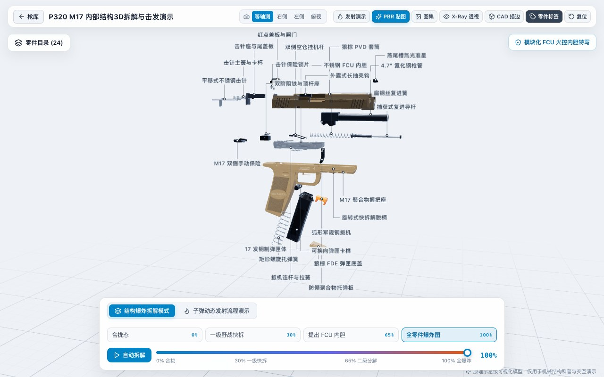

# Digital Armory 3D · 枪械内部结构 3D 数字仓库

> 基于 **React 18 + TypeScript + Three.js (`@react-three/fiber` / `three-bvh-csg`)** 构建的浏览器端交互式 **十大世界经典名枪 3D 机械内构爆炸拆解与动态发射循环可视化系统**。
>
> An interactive WebGL 3D Digital Armory featuring **10 iconic world firearms**, **253 procedurally & CSG-modeled internal mechanical parts**, **58 procedural 2K PBR texture maps**, zero-overlap editorial 3D callout labels, X-Ray shell cutaway inspection, and 7-stage caliber-accurate firing/ballistics simulations.


---

## 核心特性 | Key Features

- **10 展位 3D 数字枪库（10-Bay Digital Armory）**：支持按「全部馆藏 / 突击·卡宾·无托 / 冲锋枪 / 狙击·反器材 / 半自动手枪」分类筛选、展台 360° 自动旋转、实时 X-Ray 外壳透视预览与一键进入拆解工作台。
- **253 个无依赖程序化 CSG 机械零件**：全部枪机突笋、螺旋复进簧/缓冲簧（支持随行程实时压缩/拉伸形变）、导气活塞、双闭锁滚柱、可拆卸火控内胆（FCU）、栓动防冰槽枪机、瞄准镜组与弧形弹匣均由纯代码 + `three-bvh-csg` 布尔运算实时构建，零外部 `.glb/.gltf` 黑盒模型依赖。
- **分阶段爆炸拆解与零重叠引线标注**：支持 `0% -> 100%` 连续无级拆解、野战一级快拆 / 军械级全分解预设切换、BOM 零件目录树检索、单零件隔离检视（Isolate）以及自适应防碰撞排布的 3D 空间引线标签。
- **7 阶段真实运动学发射与 6 口径弹道特效**：完整模拟每把武器独特的自动与闭锁循环（气吹导气、长/短行程活塞、滚柱延迟、整管短后坐加速子、60° 手动抬柄拉栓、固定枪管膛底导气等），同步呈现 `7.62×39mm`、`5.56×45mm NATO`、`9×19mm`、`.50 BMG` 双侧 60° 箭头制退冲击波、`.338 Lapua` 侧向制退喷焰与 `.50 AE` 环形枪口焰。
- **58 张程序化 2K PBR 材质贴图与内置图集查看器**：通过 Python (`NumPy` + `Pillow`) 离线生成 Albedo / Normal / Roughness 通道贴图（俄式烤漆、柯尔特阳极氧化刻字、HK 红白子弹图标、比利时多色阶 FDE、铂银镜面镀铬、AUG 半透明琥珀华夫格弹匣、P320 激光防滑纹与不锈钢序列号铭牌），内置 PBR 图集检视弹窗。

---

## 界面预览 | Gallery

| Colt M4A1 军械级 100% 爆炸拆解与引线排布 | Barrett M82A1 `.50 BMG` 整管短后坐与箭头制退侧喷 |
| :---: | :---: |
|  |  |

| Steyr AUG A1 军绿无托枪身与半透明琥珀弹匣 | Desert Eagle Mark XIX `.50 AE` 铂银镀铬镜面 |
| :---: | :---: |
|  |  |

| SIG Sauer P320 M17 可整体拆出不锈钢火控内胆 (FCU) |
| :---: |
|  |

---

## 馆藏十款经典名枪一览 | 10-Weapon Roster

| 展位 | 型号 | 国家 / 类型 | 口径 | 核心自动与闭锁机构 | 零件数 |
| :--- | :--- | :--- | :--- | :--- | :---: |
| `BAY-01` | **Kalashnikov AK-15M1 (6П71М)** | 俄罗斯 · 突击步枪 | `7.62×39mm (M43)` | 长行程导气活塞 · 双突笋 35° 回转枪机闭锁 | 26 |
| `BAY-02` | **Colt M4A1 Carbine** | 美国 · 卡宾枪 | `5.56×45mm NATO` | 斯通纳气吹式导气 (DI) · 七突笋回转枪机 + 尾托缓冲簧 | 26 |
| `BAY-03` | **Heckler & Koch MP5A3** | 德国 · 冲锋枪 | `9×19mm Parabellum` | 双 Ø8mm 滚柱 + 45° 闭锁楔延迟半自由枪机 · 非随动拉机柄 | 26 |
| `BAY-04` | **Glock 17 Gen3** | 奥地利 · 半自动手枪 | `9×19mm Parabellum` | 枪管短后坐偏移闭锁 · Safe Action 三重被动保险平移击针 | 28 |
| `BAY-05` | **Barrett M82A1** | 美国 · 反器材步枪 | `.50 BMG (12.7×99mm)` | 29" 开槽重枪管短后坐 · 加速子撬动三突笋枪机 + 双室箭头制退器 | 24 |
| `BAY-06` | **Accuracy International AWM** | 英国 · 狙击步枪 | `.338 Lapua Magnum` | 手动 60° 六突笋防冰槽旋转后拉枪机 · 铝合金主梁拇指孔底盘 | 24 |
| `BAY-07` | **FN SCAR-L Mk 16 Mod 0** | 比利时 · 模块化步枪 | `5.56×45mm NATO` | 短行程导气活塞顶杆 · 七突笋回转枪机 + 一体铝挤 FDE 上机匣 | 26 |
| `BAY-08` | **Desert Eagle Mark XIX** | 以色列/美国 · 半自动手枪 | `.50 Action Express` | 三角形固定枪管膛底导气活塞 · 四突笋回转枪机 + 双联复进簧 | 24 |
| `BAY-09` | **Steyr AUG A1 (StG 77)** | 奥地利 · 无托步枪 | `5.56×45mm NATO` | 无托后置弹匣 · 短行程活塞双长导杆 + 贯通双连杆后置全塑击锤包 | 25 |
| `BAY-10` | **SIG Sauer P320 M17** | 美国/德国 · 半自动手枪 | `9×19mm Parabellum` | 可整体拆出序列号不锈钢 FCU 火控内胆 · 枪管偏移平移击针 | 24 |

---

## 快速启动 | Quick Start

### 环境要求 | Prerequisites
- **Node.js** `>= 18`
- （可选，仅在重新生成 PBR 贴图时需要）**Python** `>= 3.10` + `numpy` + `Pillow`

### 安装与运行 | Install & Run

```bash
# 1. 克隆仓库
git clone https://github.com/zhoujingkun1989-arch/digital-armory-3d.git
cd digital-armory-3d

# 2. 安装前端依赖
npm install

# 3. 启动本地开发服务器 (默认 http://localhost:5173)
npm run dev

# 4. 生产环境类型检查与打包构建
npm run build
```

### 重新生成程序化 2K PBR 贴图（可选）

仓库 `public/textures/` 目录已内置全部预生成的 58 张贴图，开箱即用。如需修改划痕、铭文或粗糙度并重新生成：

```bash
python3 scripts/generate_g17_pbr_textures.py
python3 scripts/generate_ak15_pbr_textures.py
for s in scripts/pbr/generate_*_pbr.py; do python3 "$s"; done
```

---

## 项目目录结构 | Project Structure

```text
digital-armory-3d/
├── public/
│   └── textures/              # 58 张 2K / Seamless 程序化 PBR 贴图 (Albedo / Normal / Roughness)
├── scripts/
│   ├── generate_ak15_pbr_textures.py
│   ├── generate_g17_pbr_textures.py
│   └── pbr/                   # M4A1 / MP5 / M82A1 / AWM / SCAR / Deagle / AUG / P320 贴图生成器
├── src/
│   ├── components/            # ArmoryView, G17Scene, ExplodablePart, FiringBallistics, CalloutOverlay 等
│   ├── data/
│   │   ├── armoryCatalog.ts   # 10 展位数字枪库目录与分类过滤器
│   │   ├── weaponRegistry.ts  # 多武器零件、视角、运动学与弹道统一注册中心
│   │   └── weapons/           # 各枪械零件拆解规格、7 阶段击发运动学与 PBR 绑定模块
│   ├── geometry/
│   │   ├── springHelper.ts    # 参数化螺旋压缩/拉伸弹簧网格生成器
│   │   ├── pbrTextures.ts     # Three.js PBR 材质加载、缓存与金属/聚合物细节混成
│   │   └── weapons/           # 各枪械 CSG 布尔运算与参数化零件几何构建器
│   └── store/
│       └── useExplodeStore.ts # Zustand 全局状态管理（枪库/拆解/击发/相机预设/透视开关）
└── docs/
    └── screenshots/           # README 实机渲染截图
```

---

## 声明 | Disclaimer

本项目所有三维模型均为**原理示意级（Schematic / Educational Level）**浏览器端机械科普与交互可视化作品，重点展示机械自动原理、闭锁方式与运动学配合关系，**不包含任何真实工业制造公差、CAD 加工图纸或可打印构件尺寸**。

---

## 开源协议 | License

本项目基于 [MIT License](LICENSE) 开源。
