<div align="center">

<p>
  <strong>English</strong>
  &nbsp;·&nbsp;
  <a href="README.zh-CN.md">简体中文</a>
  &nbsp;·&nbsp;
  <a href="CONTRIBUTING.md">Contributing Guide</a>
</p>

# Digital Armory 3D · v6.0 3D Physics Theaters, Modular Bench & Ten-Hall Legend Edition

**The World's First Browser-Native Open-Source 3D Firearms, Archery, Heavy Armor & Aero Ordnance Mechanical Museum · Interactive Engineering Encyclopedia**

[](https://github.com/zhoujingkun1989-arch/digital-armory-3d/actions/workflows/ci.yml)
[](https://zhoujingkun1989-arch.github.io/digital-armory-3d/showcase.html?lang=en)
[](https://www.typescriptlang.org/)
[](https://threejs.org/)
[](scripts/blender/)
[](LICENSE)

<h3>
  <a href="https://zhoujingkun1989-arch.github.io/digital-armory-3d/showcase.html?lang=en">✦ Interactive Live Showcase</a>
  &nbsp;·&nbsp;
  <a href="https://zhoujingkun1989-arch.github.io/digital-armory-3d/?screen=armory&lang=en">🚀 Enter 34-Bay 10-Hall Vault</a>
  &nbsp;·&nbsp;
  <a href="https://zhoujingkun1989-arch.github.io/digital-armory-3d/?weapon=gau8&screen=workbench&cut=1&lang=en">✈️ 1:1 GAU-8/A 30mm Cutaway</a>
  &nbsp;·&nbsp;
  <a href="https://zhoujingkun1989-arch.github.io/digital-armory-3d/?screen=split_showdown&weaponA=ztz99a&weaponB=m1a2&lang=en">⚔️ Live 3D Split-Screen</a>
  &nbsp;·&nbsp;
  <a href="https://zhoujingkun1989-arch.github.io/digital-armory-3d/?screen=ballistics&lang=en">🎯 3D 1,000m Range & Bullet-Cam</a>
  &nbsp;·&nbsp;
  <a href="https://zhoujingkun1989-arch.github.io/digital-armory-3d/?screen=cartridges&lang=en">🧪 17+4 Ordnance Cutaway Lab</a>
</h3>

</div>

---


> Built with **React 18 + TypeScript 5.6 + Three.js (`@react-three/fiber` / Dual-Track Blender 5.2 Draco `.glb` + Web Worker `three-bvh-csg` / Web Audio API)** — zero installs, instant browser launch, optional **KTX2 (`toktx`) + Heavy-Media CDN (`VITE_CDN_ASSET_BASE_URL`) + PWA Offline Museum**, and a **`<800 kB` zero-warning split bundle**.
>
> Explore **854 moving CAD components across 34 legendary exhibits and 10 curated halls** (**27 firearms** incl. **Colt M1911A1**, **MG 42**, **Mauser K98k**, **Thompson M1928A1**, Winchester Model 1894 & Remington Model 870 + **2 compound archery systems** + **4 1:1 Main Battle Tanks** in the **Heavy Armor Hall**: **ZTZ-99A**, **M1A2 SEP v3**, **Leopard 2A7V**, **Tiger I 131** + the **10th Hall — Heavy Aero Ordnance**: **1:1 GE GAU-8/A Avenger `30×173mm` 7-barrel rotary autocannon** with 1,150-rd helical drum), powered by our **34/34 (100%) Blender 5.2 Cycles-baked photorealistic Grand Slam** (**`775` watertight Draco `.glb` parts + `79` dynamic CSG `aSpringParam` GPU-deforming springs, recoil recuperators, quad-limbs & bowstrings = `854/854` parts**, `34/34` passing `npm run assets:audit <= 12 MB`), **414 2K/4K 5-channel Packed ORM & micro-detail WebP maps (`0` PNGs, `101` PBR suites incl. `24` 4K tank exterior maps + `512×512` seamless RHA/CARC detail maps)**, **4 Cycles 32-bit `.hdr` domes**, **3D Interactive Slow-Motion Composite Armor Penetration Theater (`5` kinetic penetrators incl. `30×173mm PGU-14/B API`)**, **3D 1,000m Interactive Firing Range & Slow-Motion Bullet-Cam (`[R]` across `23` RK4 profiles with AR500 steel pendulum, ballistic gel cavity & `d/343` acoustic return)**, **Physically Coupled Modular Optics & Muzzle Attachment Bench (`[O]` — live CT K-baffles/LPVO/FLIR cutaway, gas-vortex plumes, acoustic shift & recoil coupling)**, **Single-Canvas Live 3D Split-Screen Showdown (`?screen=split_showdown`)**, **Live-Coupled Mechanical Causality Sandbox**, **Tri-Axial CT Cutaway & 6-Plane 3D Slice Box (`[C]`)**, **Two-Tier Detail Strip, Armorer Mastery Passport & 1:1 Tank Crew FLIR FCS**, **1894–2026 Engineering History Timeline**, **1080p Browser-Native Director Reel Recorder**, **17+4 1:1 Ordnance Cutaway Lab (`[B]`)**, **9×9×9 Mechanism Showdown (`[S]`, `30` rivalries)**, **34/34 Cycles 340-Plate Monograph Print Studio (`[Ctrl/Cmd+P]`)**, and **1,980 Bilingual `Charon` (`gemini-3.8-flash-tts`) Voiceovers**.

---

## v6.0 3D Physics Theaters, Modular Attachment Bench & Ten-Hall Legend Expansion (`WP-26 ~ WP-30` · Live WebGL 2.0)

*Every V6.0 theater and new exhibit (`BAY-30 ~ BAY-34`) below runs 100% live in WebGL 2.0 at 60 FPS with Zero-GC physics and full mechanical/acoustic coupling — every frame is an unretouched `1920×1080` Chromium WebGL 2.0 capture.*

| **🛡️ 1:1 3D Composite Armor Penetration Cutaway Theater (`WP-27` · ERA / Spall Cone)** | **🎯 3D 1,000m Interactive Firing Range & Slow-Motion Bullet-Cam (`WP-28` · RK4 / Gel / AR500)** |
| :---: | :---: |
|  | 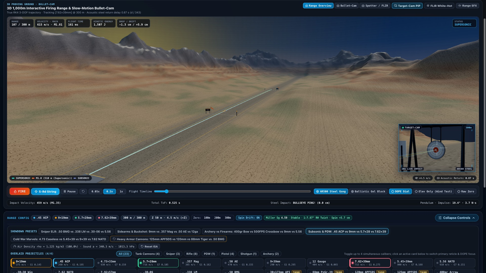 |

| **🔧 Physically Coupled Modular Optics & Muzzle Bench (`[O]` · `WP-29` · Live CT K-Baffles, 1–8× LPVO, Gas Vortices & -28 dB Acoustics)** |
| :---: |
|  |

| **✈️ 10th Hall (`ordnance`) · BAY-34 GE GAU-8/A "Avenger" (`30×173mm` · `6.06 m` 1:1 · 7-Barrel 3,900 RPM & 1,150-Rd Drum · `2.87 MB`)** |
| :---: |
| 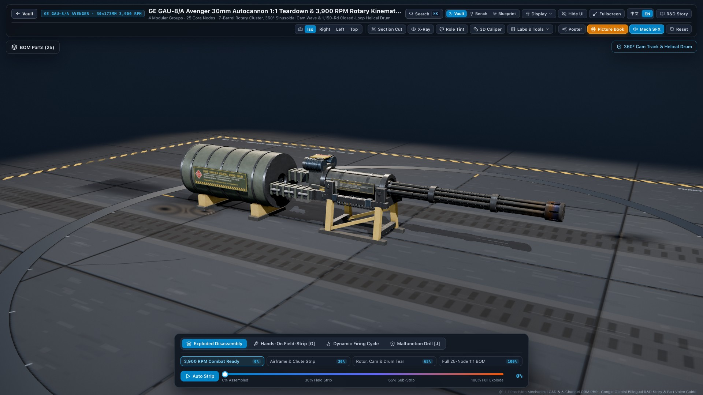 |

| **🇺🇸 BAY-30 Colt M1911A1 (`.45 ACP`) · *Browning 0.278" Single-Link Short-Recoil & Triple-Leaf Sear Spring (`1.88 MB`)*** | **🇩🇪 BAY-31 MG 42 (`7.92×57mm Mauser`) · *Twin-Roller 1,200 RPM Short-Recoil, 5-Sec Barrel Gate & S-Cam Feed (`1.88 MB`)*** |
| :---: | :---: |
|  | 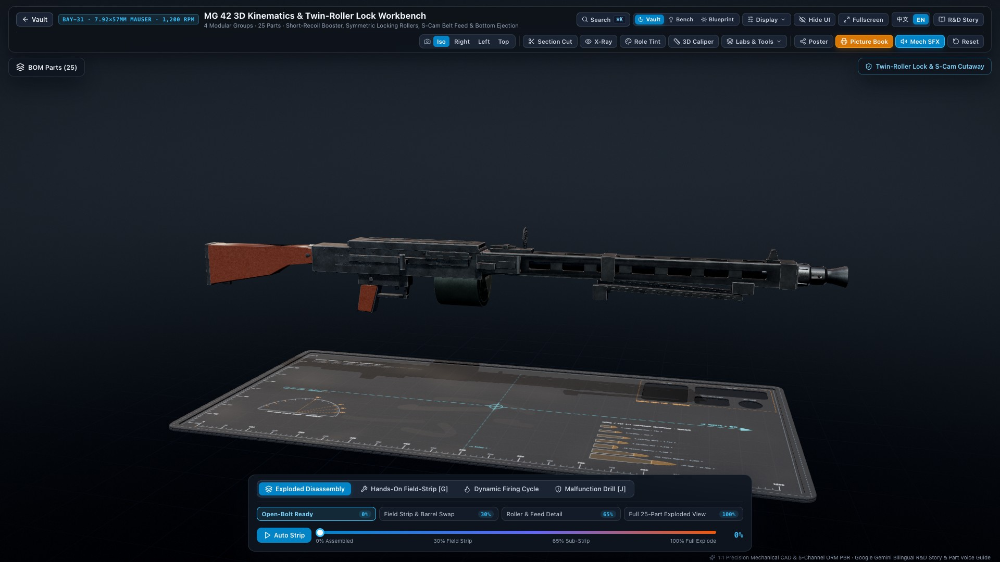 |

| **🇩🇪 BAY-32 Mauser Karabiner 98k (`7.92×57mm`) · *90° 3-Lug Safety Bolt, Non-Rotating Claw CRF & 3-Pos Flag Safety (`1.77 MB`)*** | **🇺🇸 BAY-33 Thompson M1928A1 (`.45 ACP`) · *45° Bronze H-Shaped Blish Lock, Finned Barrel & 50-Rd Type L Drum (`1.71 MB`)*** |
| :---: | :---: |
|  |  |

---

## v5.0 Flagship Split-Viewport, Armor Solver & Cross-Era Classics (`WP-19 ~ WP-25b` · Live WebGL 2.0)

| **⚔️ Live 3D Split-Screen Showdown (`?screen=split_showdown`) · ZTZ-99A vs M1A2 Cutaway** | **🛡️ 1:1 Composite Armor & Kinetic Penetrator Solver (`WP-20` Lanz-Odermatt / De Marre)** |
| :---: | :---: |
|  |  |

| **🤠 BAY-28 Winchester Model 1894 (`.30-30 Win`) vs 🦅 BAY-29 Remington Model 870 (`12 Ga`) · Dual-Screen Cutaway** |
| :---: |
|  |

---

## Heavy Armor Hall · 1:1 Main Battle Tanks (`BAY-24 ~ BAY-27` · Live WebGL 2.0)

*Strictly engineered at exact **`1 world unit = 1 cm = 10 mm`** full-scale dimensions (`8.45–10.97 m` OAL, `55–66.8 tonnes`) on our weathered, edge-feathered **`18 m × 12 m` Heavy Armor Concrete Hangar Floor** under a dedicated **`1:1` 32-bit Cycles Heavy Armor Hangar HDRI** & `4096×4096` Ultra shadows, with **`4096×4096` exterior Cycles PBR atlases**, **512px seamless RHA/CARC triplanar RNM micro-detail**, **individual articulated sagged track links** (`74–96` sculpted shoes/side), **Optical AR Fresnel lenses**, automatic `near = 2.0 / far = 9000` optics, hollow armored hulls & turrets sliced cleanly by our `±1,800 mm` Live CT-Scan Cutaway (`45° ISO 128` cross-hatching), and 7-stage cannon recoil/autoloader/blast-door firing physics. Every frame below is an unretouched live `1920×1080` Chromium WebGL 2.0 capture.*

| **🇨🇳 ZTZ-99A (`125mm ZPT-98 L/50`) · 4K Camo, 86-Link Tracks & FY-4 ERA (`10.27 MB`)** | **🇨🇳 ZTZ-99A Live CT Cutaway (`[C]`) · 22-Rd Carousel Autoloader & 150HB V12** |
| :---: | :---: |
| 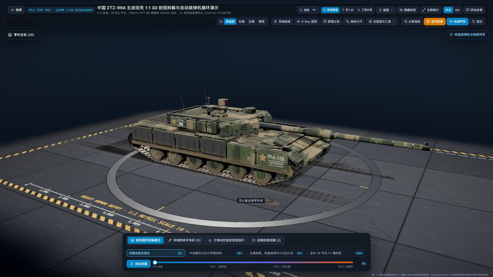 |  |

| **🇺🇸 M1A2 SEP v3 Abrams (`120mm M256 L/44`) · 4K Desert CARC, T158 Tracks & CITV/CROWS (`9.94 MB`)** | **🇺🇸 M1A2 SEP v3 Live CT Cutaway (`[C]`) · Blast Doors, Bustle & AGT1500 Turbine** |
| :---: | :---: |
| 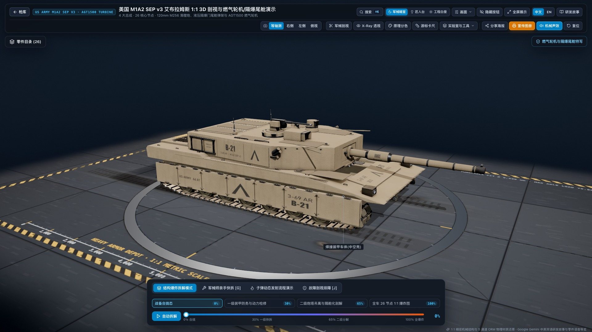 |  |

| **🇩🇪 KMW Leopard 2A7V (`120mm Rh-120 L/55A1`) · 4K NATO 3-Tone, Diehl 570FT Tracks & Wedges (`11.27 MB`)** | **🇩🇪 Leopard 2A7V Live CT Cutaway (`[C]`) · Hollow Wedges, Rh-120 Breech & MTU V12** |
| :---: | :---: |
|  |  |

| **🇩🇪 Tiger I Ausf. E "131" (`88mm KwK 36 L/56`) · 4K Zimmerit, 96-Link Kgs 63 Tracks & Feifel (`10.32 MB`)** | **🇩🇪 Tiger 131 Live CT Cutaway (`[C]`) · Krupp Horizontal Wedge Breech & Maybach HL230 V12** |
| :---: | :---: |
|  |  |

| **Heavy Armor Hall (`?screen=armory`) · 4 Bespoke MBT Silhouettes & Hangar Plaques** | **1:1 Tank Ordnance Cutaway Lab (`[B]`) · `88mm PzGr.39`, `120mm NATO APFSDS` & `125mm DTC10-125`** |
| :---: | :---: |
|  | 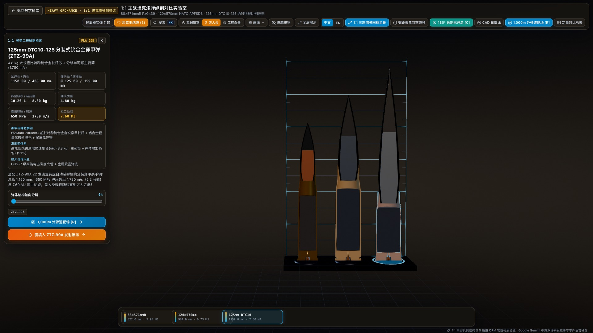 |

---

## Photorealistic Small-Arms & Archery Flagship Gallery (34/34 Blender 5.2 Grand Slam · 100% Live WebGL 2.0)

*Every image below is an unretouched real-time 1920×1080 Chromium WebGL 2.0 capture powered by our reproducible open-source **Blender 5.2 LTS headless Draco `.glb` + Cycles 2K Packed ORM** pipeline and **32-bit studio `.hdr`** lighting.*

| **Kalashnikov AK-15M1 (`7.62×39mm`)** · *Stamped Phosphate & Windowed 30-Rd Mag (`3.90 MB`)* | **DWM 1917 Luger P08 (`9×19mm`)** · *Knurled Toggle, `1917`/`B·R·S` Proofs, 240°C Straw-Gold & 20-LPI Walnut (`3.39 MB`)* |
| :---: | :---: |
| 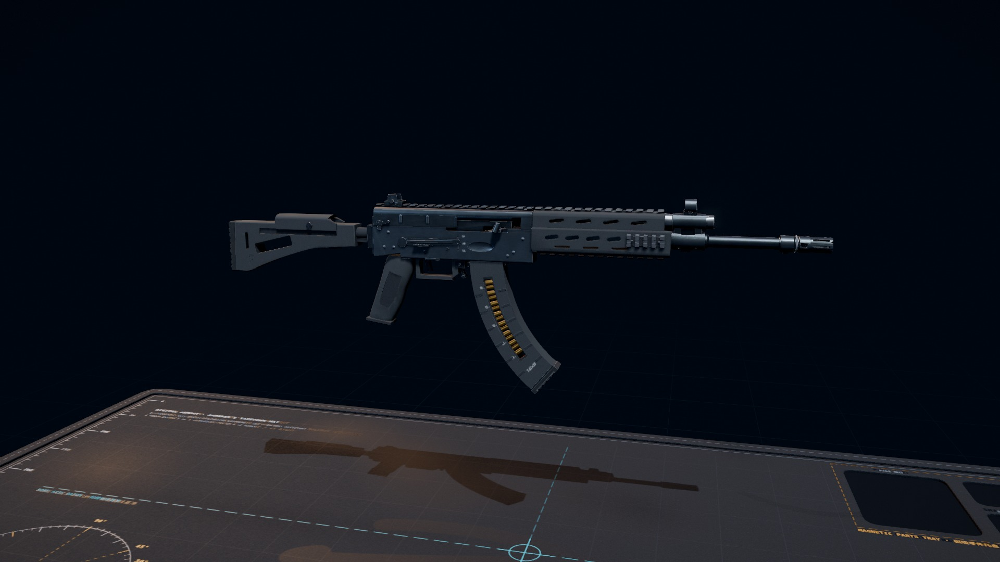 |  |

| **Desert Eagle Mark XIX (`.50 AE`)** · *Brushed Satin 416 Stainless, Slanted Serrations & 4-Lug Rotating Bolt (`7.05 MB`)* | **Colt M4A1 SOPMOD (`5.56 NATO`)** · *7075-T6 Upper/Lower Anodize, Rampant Pony, KAC RAS & STANAG (`3.53 MB`)* |
| :---: | :---: |
|  |  |

| **Colt Python 6" (`.357 Magnum`)** · *Liquid "Royal Blue" Steel, Cylinder Drag Line & 24K Gold Medallion Walnut (`2.13 MB`)* | **U.S. Rifle M1 Garand (`.30-06 Springfield`)** · *Linseed-Oil Black Walnut, `S.A./NFR` & Ordnance Wheel Cartouche, T105 Drum (`2.72 MB`)* |
| :---: | :---: |
|  |  |

| **Heckler & Koch MP5A3 (`9×19mm`)** · *Baked Black Enamel Receiver, Navy Bullet Pictograms, Tropical Forend & A3 Rails (`3.18 MB`)* | **Accuracy International AWM (`.338 Lapua Mag`)** · *British OD-Green Thumbhole Chassis, S&B PM II `5-25×56` & 6-Lug Chrome Bolt (`3.68 MB`)* |
| :---: | :---: |
|  |  |

| **Barrett M82A1 / M107 (`.50 BMG`)** · *Manganese-Parkerized Ribbed Receivers, Leupold Mark 4 Gold Ring & 10-Rd Mag (`3.49 MB`)* | **Glock 17 Gen 5 (`9×19mm`)** · *Satin nDLC Bullnose Slide, Ferlach Proofs, Sculpted RTF4 Frame & GMB Hood (`2.28 MB`)* |
| :---: | :---: |
|  |  |

| **FN SCAR-L Mk 16 Mod 0 (`5.56 NATO`)** · *Fifty Shades of FDE Monolithic Upper, SOCOM UID Matrix, Torx Crossbolts & Folding Stock (`3.41 MB`)* | **Steyr AUG A1 / StG 77 (`5.56 NATO`)** · *Alpine OD-Green PA66 Stock, Integral 1.5× Swarovski Optic & Smoked-Amber Waffle Mag (`3.62 MB`)* |
| :---: | :---: |
| 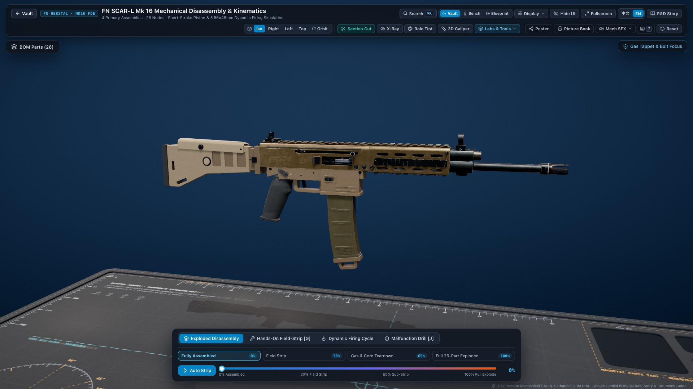 | 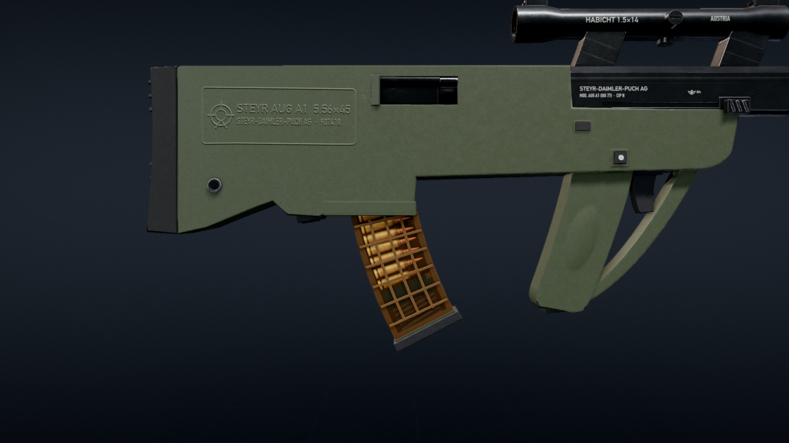 |

| **SIG Sauer P320 / U.S. Army M17 (`9×19mm`)** · *Two-Tone Coyote PVD Slide, MIL-STD-130 UID & Serialized Stainless FCU (`2.53 MB`)* | **FN Herstal P90 PDW (`5.7×28mm`)** · *Smoked-Amber 50-Rd Horizontal Mag, 90° Helical Ramp & MC-10-80 Ring Sight (`2.17 MB`)* |
| :---: | :---: |
|  |  |

| **Benelli M4 Super 90 / USMC M1014 (`12 Gauge`)** · *Type-III Charcoal Receiver, Gardone `PSF/CIP` Proofs, Twin ARGO Pistons & LPA Ghost-Ring (`2.47 MB`)* | **FN M249 SAW (`5.56×45mm NATO`)** · *Riveted Phosphate Steel Receiver, M855 Green-Tip / M856 Tracer M27 Belt & OD-Green 200-Rd Box (`3.64 MB`)* |
| :---: | :---: |
| 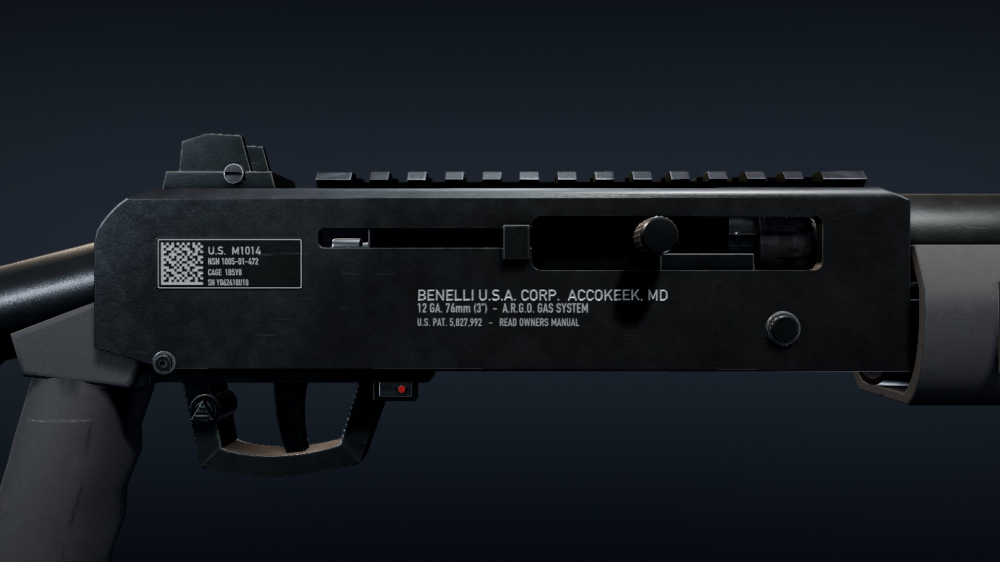 | 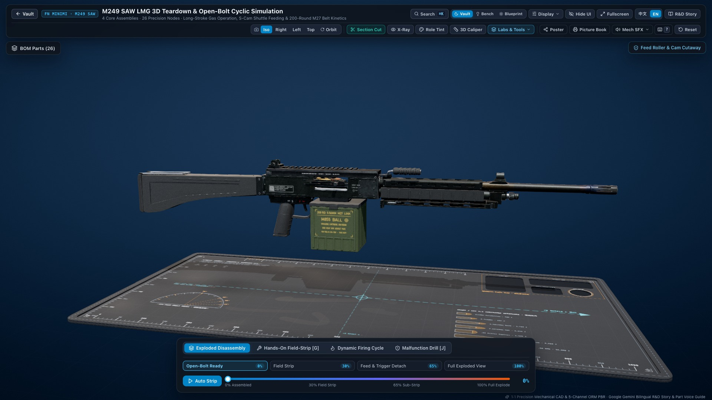 |

| **KRISS Vector SMG Gen II (`.45 ACP`)** · *Two-Tone Combat FDE / Charcoal Super V Chassis, CNC Slider & 66° MagEx2 25-Rd Mag (`2.18 MB`)* | **Mathews LIFT 33 Compound Bow (`348 FPS`)** · *SwitchWeight-X Bronze Binary Cams, Bridged Truss Riser, Harmonic Dampeners & CSG Quad-Limbs (`3.37 MB`)* |
| :---: | :---: |
|  |  |

| **Ravin R500 Crossbow (`500 FPS`)** · *360° Copper-Bronze HexCoil Helical Cams, VersaDrive Leadscrew & 1–8×24 Speed-Ring Scope (`3.53 MB`)* | **Luger P08 Two-Pass Stencil Solid Cutaway (`[C]`)** · *ISO 128 45° Metal Hatching, 8× 9mm Stack & Helical Springs* |
| :---: | :---: |
|  |  |

| **H&K G11 K2 (`4.73×33mm DM11` Caseless)** · *90° Chrome Rotary Breech, Swiss-Watch Clockwork Gears, 2,100 RPM Floating Action & Hensoldt Optic (`2.06 MB`)* | **VSS Vintorez (`9×39mm` Subsonic)** · *414mm Integral 6-Stage Baffle Suppressor, TOZ Cyrillic Receiver, PSO-1M2-1 Optic & Birchwood Stock (`2.23 MB`)* |
| :---: | :---: |
|  |  |

| **GE / Dillon Aero M134D Minigun (`7.62×51mm NATO`)** · *6-Barrel 3,000 RPM Rotary Cluster, 28V DC Motor, 360° Helical Cam Track & Delinker (`3.31 MB`)* | **Nikonov AN-94 "Abakan" (`5.45×39mm 7N6`)** · *Pulley-Cable 1,800 RPM Delayed-Recoil Hyperburst, 15°-Canted Plum Mag & Figure-8 Brake (`2.92 MB`)* |
| :---: | :---: |
| 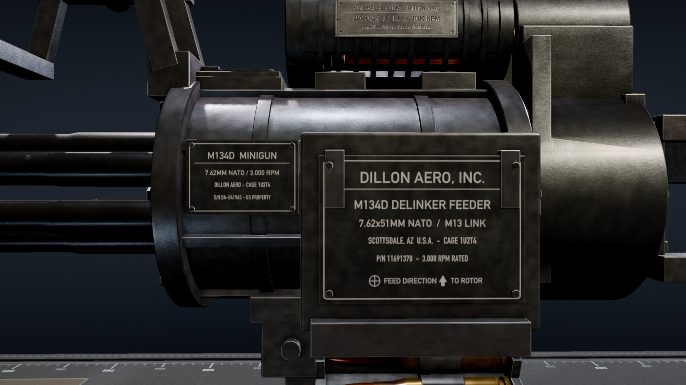 | 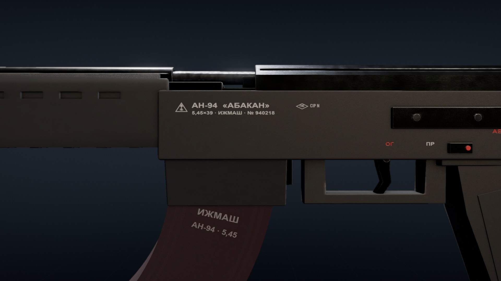 |

### 15-Caliber 1:1 SAAMI/CIP Cutaway Lab Panorama (`[B]`) · *`9×19mm` (`29.69 mm`) through Square `4.73×33mm DM11 Caseless` to `.50 BMG` (`138.43 mm`)*

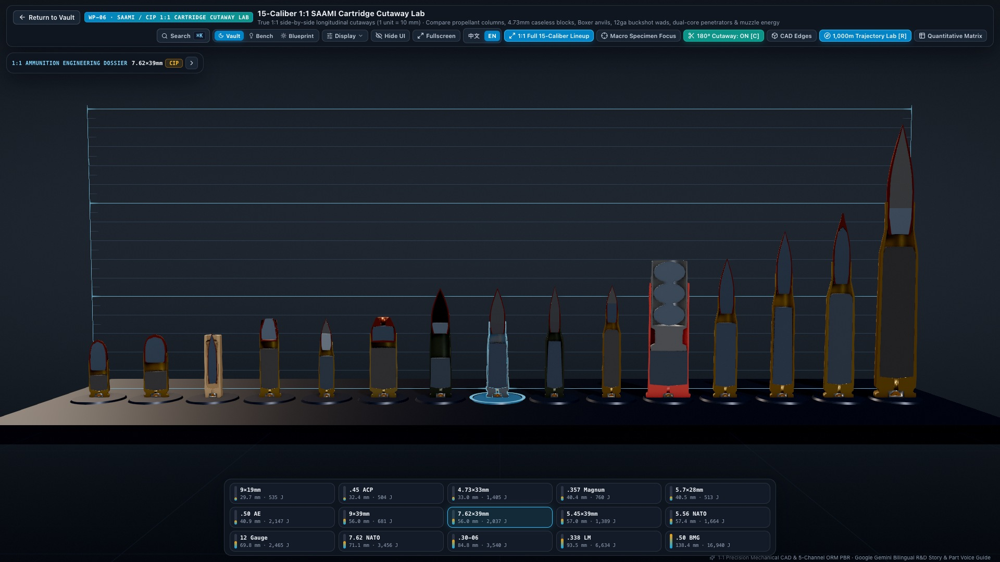

---

## v6.0 Flagship Architecture & UX Highlights

| **Global `Cmd+K` / `Ctrl+K` Bilingual Instant Command Palette** | **34-Bay 10-Hall Interactive 3D Digital Vault & Museum Showcase** |
| :---: | :---: |
|  |  |

- **✦ Dual-Track Blender 5.2 Draco `.glb` + Web Worker CSG Engine (`PR-02` ~ `PR-04`, `WP-17` ~ `WP-30`)**:
  - **34/34 (100%) Photorealistic Grand Slam across 10 Halls**: Every exhibit in the museum (`27` firearms, `2` compound archery systems, `4` 1:1 Main Battle Tanks, and `1` 1:1 `30×173mm` GE GAU-8/A Avenger rotary autocannon in the **10th Hall `ordnance`**) is procedurally sculpted and Cycles-baked via MIT-licensed headless Python scripts (`scripts/blender/build_*_photoreal.py`) into compact Draco `.glb` bundles (`775` watertight solid CAD meshes, `1.25–11.27 MB` total each, `34/34` passing `npm run assets:audit <= 12 MB`, `100%` manifold, exact `1u = 1cm` coordinates) backed by `414` 2K/4K 5-channel Packed ORM & detail WebP maps (`136` albedo / `139` normal / `139` ORM & detail roughness, `101` PBR suites with `24` 4K tank exterior maps + `512×512` seamless RHA/CARC detail maps, `0` PNGs).
  - **Zero-Compromise Dynamic Springs, Limbs & Bowstrings**: `79` helical recoil, buffer, sear, drum, tubular-magazine, cannon recuperator, breech, striker, and V-leaf springs plus flexing compound quad-limbs, cam axles, bowstrings, and power cables across all 34 exhibits remain on the procedural CSG Web Worker track so per-vertex `aSpringParam` GPU compression and elastic flex stay physically exact at 60 FPS.
  - **Production KTX2 (`toktx`), Heavy-Media CDN, Budget Audit & 1080p Visual QA Gate (`WP-25a`, `WP-26`)**: Real Khronos `toktx` UASTC+Zstd (linear) / ETC1S (sRGB) pipeline with automatic WebP decode and graceful runtime fallback (`scripts/build_ktx2_textures.mjs` + self-hosted `public/basis/`), `npm run assets:audit` enforcing `<= 12 MB` budgets across all 34 exhibits, optional `VITE_CDN_ASSET_BASE_URL` heavy-media offloading (`audio/`, `textures/`, `models/`, `plates/`, `hdri/`) with root/subpath safety, PWA Offline Museum Manager (`?panel=offline`), and zero-dependency `npm run qa:visual` 1920×1080 headless Chromium regression gate.
- **✦ 1:1 3D Slow-Motion Composite Armor Penetration Theater (`?panel=armor`, `WP-20` + `WP-27`)**: Lanz-Odermatt & De Marre penetration solver across **5 kinetic penetrators** (`125mm DTC10-125`, `120mm M829A4 / DM63`, `88mm PzGr.39`, `30×173mm GAU-8 PGU-14/B API`, `.50 BMG M2 AP`) × 4 MBTs × 4 zones, rendered live in `3D Cutaway Theater / 2D Schematic / Split` views with ERA twin flyer-plate shearing, molten cavity growth, behind-armor spall particle cones, and oblique ricochet deflection.
- **✦ 3D 1,000m Interactive Firing Range & Slow-Motion Bullet-Cam (`[R]`, `WP-14` + `WP-28`)**: Zero-GC RK4 3-DOF solver across all **23 projectile profiles** (`17` metallic/caseless/shotshell incl. `7.92×57mm Mauser` + `2` archery + `4` heavy/aero ordnance incl. `30×173mm PGU-14/B API`) driving a live 3D 1,000m proving ground with `Range Overview / Bullet-Cam / Spotter FLIR` cameras, AR500 steel gong pendulum & `d/343` acoustic return delay, 10% ballistic gel transient cavity pulse, wind flags, glowing Mach 1.0 transonic ring, FFP MIL reticle, and 7-row `MIL / MOA` DOPE drop cards.
- **✦ Physically Coupled Modular Optics & Muzzle Attachment Bench (`[O]`, `WP-29`)**: Flush 1:1 CAD mounts across all **34 exhibits** (4 muzzles: Factory / Titanium 7-Stage K-Baffle Suppressor / Dual-Chamber Brake / 3-Prong Flash Hider × 4 optics: Factory / Red Dot / 1–8×24 LPVO / Clip-On FLIR × 4 tactical presets) coupled live to 4 physics systems: CT `[C]` cutaway internal baffles/optics/FLIR PCB, `GasFlowVisualizer` K-baffle gas vortices & lateral brake plumes, `mechanicalSoundEngine` `-28 dB / +6 dB` acoustic shaping, and `armoryPhysics` recoil/velocity telemetry.
- **✦ Live 3D Split-Screen Showdown (`?screen=split_showdown`, `WP-19`), Causality Sandbox (`?panel=causality`, `WP-20`) & Tri-Axial CT Slicer + 6-Plane 3D Slice Box (`[C]`, `WP-21`)**: Single-canvas dual-scissor side-by-side 3D comparison with lockstep/independent orbits across any 2 of 34 exhibits; live-coupled gas-port/spring/mass causality physics; orthogonal `Z Long / X Cross / Y Top` CT sectioning (`±25 mm` small arms / `±1,800 mm` MBTs & GAU-8/A) plus 6-plane 3D Slice Box, blackbody barrel thermal emission (`1,100K`) & carbon fouling.
- **✦ Two-Tier Detail Strip (`[G]`), Armorer Mastery Passport (`?panel=passport`), Mystery Triage (`[J]`), 1:1 Tank Crew FLIR FCS (`?panel=crew`) & 1894–2026 Timeline (`?panel=timeline`)**: Guided & blind timed field-strip + full detail-strip DAGs across all **34 exhibits**, JSON export/import mastery ledger, 4-MBT interactive 360° turret/elevation/laser FCS with FLIR gunner optics, and an interactive 6-lineage historical genealogy timeline with curated tours.
- **✦ 17+4 1:1 Ordnance Cutaway Lab (`[B]`), 9×9×9 Mechanism Showdown (`[S]`) & 3D Vernier Caliper (`[K]`)**: Side-by-side `1:1` cross-sections across **17 small-arms calibers** (adding `7.92×57mm Mauser`) plus **4 heavy/aero ordnance rounds** (`30×173mm PGU-14/B API`, `88mm PzGr.39`, `120mm NATO APFSDS`, `125mm DTC10-125`), **30 classic mechanical rivalries** (adding `M1911 vs P08`, `K98k vs Garand`, `MG 42 vs M249`, `Thompson vs Vector`, `GAU-8 vs M134D`, `GAU-8 vs ZTZ-99A`, etc.), and millimeter-accurate 3D point-to-point surface metrology.
- **✦ 1,980 `Charon` Voiceovers, 1080p Browser Director Reel Recorder (`?panel=reel`), HD Share Posters (`[U]`) & 34/34 Cycles 340-Plate Monographs (`[Ctrl/Cmd+P]`)**: Automated 3D Story Director choreography, 4-venue stereo convolution IR + Euler-Bernoulli waveguide acoustics (incl. MG 42 1,200 RPM buzz, Thompson drum burst, GAU-8/A 3,900 RPM `"BRRRT!"` roar), `16:9 / 9:16` WebM/MP4 video export, QR-linked share cards, and A4/Letter DK Encyclopedia & Kids picture book print studio backed by `340` Cycles-rendered 2880×1800 transparent master plates.

---

## Why Digital Armory 3D Stands Out

| Inspiration Benchmark | What We Synthesize & Advance |
| :--- | :--- |
| **Matt Rittman 3D Cutaway Animations** | Real-time **Live CT-Scan Section Plane (`[C]`)**, **6-role functional color-coding (`[T]`)**, dynamic propellant gas-flow streamlines, and automated 3D documentary choreography—pause, orbit, slice, or inspect any part at any millisecond. |
| **World of Guns: Gun Disassembly** | **Hands-on military field-strip DAGs & Timed Blind Qualification Exams (`[G]`)**, **Mystery Stoppage Triage (`[J]`)**, `SAFE / SEMI / AUTO` sear/disconnector physics, and `S / A / B / C` certification—100% open-source in the browser with zero downloads or paywalls. |
| **Bartosz Ciechanowski (`ciechanow.ski`)** | Instant web launch, direct 3D slide/bolt manipulation, **1,000m RK4 3-DOF external ballistics (`[R]`)**, and 1:1 coupling between **SAAMI/CIP internal ballistics curves ($P(t)$, $V(t)$)** and 7-stage kinematics at 60 FPS with zero React re-renders. |
| **Smithsonian 3D & Royal Armouries** | Bilingual (`EN / 中文`) 4-act R&D histories, factory `1:1` CAD metrology (`1u = 1cm`), museum-grade **Blender 5.2 Cycles PBR exhibits**, and MIT-licensed reproducible asset pipelines. |

---

## 34-Exhibit Collection Matrix (10 Halls · 854 Moving CAD Parts · 34/34 Blender 5.2 Grand Slam)

| Bay | Exhibit | Pipeline | Caliber / Projectile | Operating & Locking Mechanism | Parts | Live Bench |
| :--- | :--- | :---: | :--- | :--- | :---: | :---: |
| `BAY-01` | **Kalashnikov AK-15M1 (6P71M)** | `GLB v3` | `7.62×39mm (M43)` | Long-stroke gas piston · 2-lug 35° rotating bolt | 26 | [Inspect](https://zhoujingkun1989-arch.github.io/digital-armory-3d/?weapon=ak15&screen=workbench&lang=en) |
| `BAY-02` | **Colt M4A1 SOPMOD Carbine** | `GLB v3` | `5.56×45mm NATO` | Stoner direct impingement (internal BCG piston) · 7-lug bolt | 26 | [Inspect](https://zhoujingkun1989-arch.github.io/digital-armory-3d/?weapon=m4a1&screen=workbench&lang=en) |
| `BAY-03` | **Heckler & Koch MP5A3** | `GLB v3` | `9×19mm Parabellum` | Dual Ø8mm roller-delayed blowback (4:1 ratio) · Fluted chamber | 26 | [Inspect](https://zhoujingkun1989-arch.github.io/digital-armory-3d/?weapon=mp5&screen=workbench&lang=en) |
| `BAY-04` | **Glock 17 Gen 5** | `GLB v3` | `9×19mm Parabellum` | Browning short-recoil tilting barrel · Safe Action triple safety | 28 | [Inspect](https://zhoujingkun1989-arch.github.io/digital-armory-3d/?weapon=g17&screen=workbench&lang=en) |
| `BAY-05` | **Barrett M82A1** | `GLB v3` | `.50 BMG (12.7×99mm)` | Short-recoil 29" fluted barrel · Accelerator lever & 3-lug bolt | 24 | [Inspect](https://zhoujingkun1989-arch.github.io/digital-armory-3d/?weapon=m82a1&screen=workbench&lang=en) |
| `BAY-06` | **Accuracy International AWM** | `GLB v3` | `.338 Lapua Magnum` | Manual 60° 6-lug anti-icing bolt action · Bonded alloy chassis | 24 | [Inspect](https://zhoujingkun1989-arch.github.io/digital-armory-3d/?weapon=awm&screen=workbench&lang=en) |
| `BAY-07` | **FN SCAR-L Mk 16 Mod 0** | `GLB v3` | `5.56×45mm NATO` | Short-stroke gas tappet · 7-lug rotating bolt & monolithic upper | 26 | [Inspect](https://zhoujingkun1989-arch.github.io/digital-armory-3d/?weapon=scar&screen=workbench&lang=en) |
| `BAY-08` | **Desert Eagle Mark XIX** | `GLB v3` | `.50 Action Express` | Forward under-barrel gas piston · 4-lug rotating bolt & dual rods | 24 | [Inspect](https://zhoujingkun1989-arch.github.io/digital-armory-3d/?weapon=deagle&screen=workbench&lang=en) |
| `BAY-09` | **Steyr AUG A1 (StG 77)** | `GLB v3` | `5.56×45mm NATO` | Offset short-stroke piston · Twin guide rods & polymer hammer pack | 25 | [Inspect](https://zhoujingkun1989-arch.github.io/digital-armory-3d/?weapon=aug&screen=workbench&lang=en) |
| `BAY-10` | **SIG Sauer P320 M17** | `GLB v3` | `9×19mm Parabellum` | Serialized removable stainless FCU chassis · Tilting-barrel striker | 24 | [Inspect](https://zhoujingkun1989-arch.github.io/digital-armory-3d/?weapon=p320&screen=workbench&lang=en) |
| `BAY-11` | **FN P90 PDW** | `GLB v3` | `5.7×28mm FN SS190` | Top horizontal 50-rd magazine · 90° helical feed ramp & bottom eject | 25 | [Inspect](https://zhoujingkun1989-arch.github.io/digital-armory-3d/?weapon=p90&screen=workbench&lang=en) |
| `BAY-12` | **Mathews LIFT 33** | `GLB v3` | `400 gr Carbon Arrow (348 FPS)` | SwitchWeight-X binary cams · 85% let-off & QAD drop-away rest | 24 | [Inspect](https://zhoujingkun1989-arch.github.io/digital-armory-3d/?weapon=lift33&screen=workbench&lang=en) |
| `BAY-13` | **Ravin R500** | `GLB v3` | `400 gr Carbon Bolt (500 FPS)` | HexCoil 360° helical cams · VersaDrive screw crank & Trac-Trigger sled | 25 | [Inspect](https://zhoujingkun1989-arch.github.io/digital-armory-3d/?weapon=r500&screen=workbench&lang=en) |
| `BAY-14` | **Colt Python 6" (.357 Mag)** | `GLB v3` | `.357 Magnum (9×33mmR)` | DA/SA hand-tuned V-mainspring clockwork · 60° ratchet & stop-bolt | 25 | [Inspect](https://zhoujingkun1989-arch.github.io/digital-armory-3d/?weapon=python&screen=workbench&lang=en) |
| `BAY-15` | **Benelli M4 (M1014)** | `GLB v3` | `12 Gauge (00 Buckshot)` | Twin chamber-mounted ARGO short-stroke pistons · 2-lug bolt & elevator | 26 | [Inspect](https://zhoujingkun1989-arch.github.io/digital-armory-3d/?weapon=benellim4&screen=workbench&lang=en) |
| `BAY-16` | **U.S. Rifle M1 Garand** | `GLB v3` | `.30-06 Springfield M2` | Muzzle gas cylinder & curved long-stroke op-rod · 2-lug bolt & 8-rd clip | 26 | [Inspect](https://zhoujingkun1989-arch.github.io/digital-armory-3d/?weapon=garand&screen=workbench&lang=en) |
| `BAY-17` | **FN M249 SAW (Minimi PIP)** | `GLB v3` | `5.56×45mm NATO (M27 / STANAG)` | Open-bolt long-stroke gas piston · 2-lug bolt & dual-pawl M27 shuttle | 26 | [Inspect](https://zhoujingkun1989-arch.github.io/digital-armory-3d/?weapon=m249&screen=workbench&lang=en) |
| `BAY-18` | **DWM Luger P08 (1917)** | `GLB v3` | `9×19mm Parabellum` | 6.5mm short-recoil forked receiver · Over-center 2-bar knee-joint toggle | 25 | [Inspect](https://zhoujingkun1989-arch.github.io/digital-armory-3d/?weapon=p08&screen=workbench&lang=en) |
| `BAY-19` | **KRISS Vector SMG Gen II** | `GLB v3` | `.45 ACP (11.43×23mm)` | Patented Super V `-65°` off-axis tungsten slider delayed blowback | 25 | [Inspect](https://zhoujingkun1989-arch.github.io/digital-armory-3d/?weapon=vector&screen=workbench&lang=en) |
| `BAY-20` | **H&K G11 K2** | `GLB v3` | `4.73×33mm DM11 Caseless` | 90° rotary breech cylinder · Swiss clockwork gears & 2,100 RPM floating action | 24 | [Inspect](https://zhoujingkun1989-arch.github.io/digital-armory-3d/?weapon=g11&screen=workbench&lang=en) |
| `BAY-21` | **VSS Vintorez (6P29)** | `GLB v3` | `9×39mm SP-5/SP-6 Subsonic` | Radial-ported barrel + 6-stage slanted baffle suppressor · 6-lug bolt & linear striker | 24 | [Inspect](https://zhoujingkun1989-arch.github.io/digital-armory-3d/?weapon=vss&screen=workbench&lang=en) |
| `BAY-22` | **GE / Dillon Aero M134D Minigun** | `GLB v3` | `7.62×51mm NATO (M13 Belt)` | 28V DC electric 6-barrel rotary cluster · 360° sinusoidal cam track & delinker (3,000 RPM) | 25 | [Inspect](https://zhoujingkun1989-arch.github.io/digital-armory-3d/?weapon=m134&screen=workbench&lang=en) |
| `BAY-23` | **Nikonov AN-94 "Abakan" (6P33)** | `GLB v3` | `5.45×39mm 7N6` | Floating barreled action + internal steel pulley-cable · 1,800 RPM 2-rd hyperburst & 15° mag | 26 | [Inspect](https://zhoujingkun1989-arch.github.io/digital-armory-3d/?weapon=an94&screen=workbench&lang=en) |
| `BAY-24` | **🇨🇳 ZTZ-99A Main Battle Tank** | `GLB v3` | `125mm DTC10-125 APFSDS` | 125mm ZPT-98 L/50 smoothbore · 22-rd floor carousel autoloader, FY-4 ERA & 150HB 1,500 hp V12 | 26 | [Inspect](https://zhoujingkun1989-arch.github.io/digital-armory-3d/?weapon=ztz99a&screen=workbench&lang=en) |
| `BAY-25` | **🇺🇸 M1A2 SEP v3 Abrams MBT** | `GLB v3` | `120×570mm NATO M829A4` | 120mm M256 L/44 smoothbore · Sliding blast doors, 36-rd bustle blow-off panels & AGT1500 turbine | 26 | [Inspect](https://zhoujingkun1989-arch.github.io/digital-armory-3d/?weapon=m1a2&screen=workbench&lang=en) |
| `BAY-26` | **🇩🇪 KMW Leopard 2A7V MBT** | `GLB v3` | `120×570mm NATO DM63A1` | 6.6m Rh-120 L/55A1 smoothbore · Hollow spaced arrowhead wedges & MTU MB 873 V12 EuroPowerpack | 26 | [Inspect](https://zhoujingkun1989-arch.github.io/digital-armory-3d/?weapon=leopard2a7&screen=workbench&lang=en) |
| `BAY-27` | **🇩🇪 Tiger I Ausf. E "131" Heavy Tank** | `GLB v3` | `88×571mmR PzGr.39 APCBC` | 88mm KwK 36 L/56 rifled gun · Krupp horizontal wedge breech, 48 interleaved wheels & Maybach HL230 V12 | 26 | [Inspect](https://zhoujingkun1989-arch.github.io/digital-armory-3d/?weapon=tiger1&screen=workbench&lang=en) |
| `BAY-28` | **🇺🇸 Winchester Model 1894 Carbine** | `GLB v3` | `.30-30 Winchester (.30 WCF)` | Browning finger-lever 4-bar linkage · Rising/dropping locking bolt & vertical tubular cartridge elevator | 24 | [Inspect](https://zhoujingkun1989-arch.github.io/digital-armory-3d/?weapon=winchester1894&screen=workbench&lang=en) |
| `BAY-29` | **🇺🇸 Remington Model 870 Police Magnum** | `GLB v3` | `12 Gauge (2¾" / 3" Magnum)` | Billet-steel receiver & twin action bars · Tilting locking block & dual shell-latch carrier elevator | 24 | [Inspect](https://zhoujingkun1989-arch.github.io/digital-armory-3d/?weapon=rem870&screen=workbench&lang=en) |
| `BAY-30` | **🇺🇸 Colt M1911A1 U.S. Army** | `GLB v3` | `.45 ACP (11.43×23mm)` | Browning 0.278" single-link short-recoil tilting barrel · Straight-pull SA trigger & 3-leaf sear spring | 24 | [Inspect](https://zhoujingkun1989-arch.github.io/digital-armory-3d/?weapon=m1911&screen=workbench&lang=en) |
| `BAY-31` | **🇩🇪 MG 42 General-Purpose MG** | `GLB v3` | `7.92×57mm Mauser (8mm s.S.)` | Open-bolt muzzle-boosted short recoil · Symmetrical twin locking rollers (1,200 RPM) & S-cam belt feed | 25 | [Inspect](https://zhoujingkun1989-arch.github.io/digital-armory-3d/?weapon=mg42&screen=workbench&lang=en) |
| `BAY-32` | **🇩🇪 Mauser Karabiner 98k (byf 43)** | `GLB v3` | `7.92×57mm Mauser (8×57 IS)` | 90° 3-lug safety bolt action · Full-length non-rotating claw controlled-round feed & 3-pos flag safety | 24 | [Inspect](https://zhoujingkun1989-arch.github.io/digital-armory-3d/?weapon=k98k&screen=workbench&lang=en) |
| `BAY-33` | **🇺🇸 Thompson M1928A1 SMG** | `GLB v3` | `.45 ACP (11.43×23mm)` | Open-bolt 45° bronze H-shaped Blish lock · 28-fin barrel, Cutts compensator & 50-rd Type L clockwork drum | 25 | [Inspect](https://zhoujingkun1989-arch.github.io/digital-armory-3d/?weapon=thompson&screen=workbench&lang=en) |
| `BAY-34` | **🇺🇸 GE GAU-8/A "Avenger" (10th Hall)** | `GLB v3` | `30×173mm PGU-14/B API` | 1:1 `6.06 m` dual 38.5 HP hydraulic 7-barrel rotary cannon · 360° cam track & 1,150-rd closed-loop helical drum (3,900 RPM) | 25 | [Inspect](https://zhoujingkun1989-arch.github.io/digital-armory-3d/?weapon=gau8&screen=workbench&lang=en) |

---

## Keyboard Shortcuts & Deep Links

### URL Deep-Link Parameters
- Interactive Product Showcase: `/showcase.html?lang=en` or `/?screen=showcase&lang=en`
- 34-Bay 10-Hall Armory Turntable, Heavy Armor & Heavy Ordnance Halls: `/?screen=armory&weapon=gau8&lang=en`
- Live 3D Split-Screen Showdown: `/?screen=split_showdown&weaponA=ztz99a&weaponB=m1a2&lang=en`
- Live Cutaway Workbench (Small Arms / 1:1 MBTs / 1:1 GAU-8/A): `/?weapon=gau8&screen=workbench&cut=1&lang=en`
- 3D 1,000m Firing Range, Bullet-Cam & RK4 DOPE Lab: `/?screen=ballistics&caliber=30x173_gau8&lang=en`
- 17+4 1:1 Ordnance Cutaway Lab (Small Arms, Aero & Tank Cannon Rounds): `/?screen=cartridges&caliber=30x173_gau8&lang=en`
- Direct Physics & Museum Panels: `/?panel=armor` (3D Penetration Theater) · `/?panel=causality` (Causality Sandbox) · `/?panel=crew&optic=flir` (Tank Crew FLIR FCS) · `/?panel=timeline` (1894–2026 Timeline) · `/?panel=reel` (1080p Director Recorder) · `/?panel=passport` (Armorer Passport) · `/?panel=offline` (PWA Offline Museum)

### Global & Workbench Hotkeys
| Key | Action |
| :---: | :--- |
| `Cmd / Ctrl + K` | Open **Global Bilingual Instant Command Palette** (34 exhibits, 854 parts, 10 halls, 3D theaters & studio controls) |
| `Space` | Play / pause staged explosion or 7-phase live firing cycle |
| `C` | Toggle **Tri-Axial Live Draggable CT-Scan Cutaway & 6-Plane 3D Slice Box** (`Z / X / Y / 3D Box`, `±25 mm` small arms / `±1,800 mm` MBTs & GAU-8/A) |
| `O` | Toggle **Physically Coupled Modular Optics & Muzzle Attachment Bench** (Suppressor / Brake / Flash Hider · Red Dot / LPVO / FLIR) |
| `T` | Toggle **6-Role Engineering Functional Color-Coding** & cutaway cap tint (small-arms & heavy-armor/ordnance roles) |
| `G` | Toggle **Hands-On Guided Field-Strip, Full Detail-Strip & Blind Timed Exam (DAG)** |
| `J` | Toggle **Malfunction Cutaway & Mystery Stoppage Triage Exam** (`Stovepipe / Double-Feed / Light-Strike / OOB`) |
| `K` | Toggle **1:1 3D Armorer Vernier Caliper** (`mm`) & 3D envelope scale ruler |
| `R` | Open / return from **3D 1,000m Interactive Firing Range, Bullet-Cam & RK4 DOPE Lab** (23 profiles) |
| `U` | Open / close **Instant HD 3D Cutaway Social Poster Studio** (`16:9 / 4:5` + QR + Rank Seal) |
| `B` | Open / exit standalone **17+4 1:1 Small-Arms, Aero & Tank Ordnance Cutaway Lab** |
| `S` | Open / close **9×9×9 3-Axis Mechanism Showdown & Dual-Exhibit Comparison Lab** (30 rivalries + instant Split-Screen launch) |
| `X` | Toggle optical X-Ray translucent receiver / slide / magazine / drum housings |
| `P / V / F` | Armorer **Press-Check** (`P`) · Cycle `SAFE / SEMI / AUTO` selector (`V`) · Hold trigger (`F`) |
| `E / L / M / H` | CAD Hard-Edges (`E`) · 3D Callouts (`L`) · Web Audio Mute (`M`) · **Clean Fullscreen** (`H`) |
| `Ctrl/Cmd + P` | Open **34/34 Cycles 17-Plate Collector Monograph & Kids Picture Book Print Studio** |
| `Shift + R / Esc` | Reset to `0%` assembled state & default framing / Dismiss overlay or return to Vault |

---

## Quick Start & Quality Gates

### Prerequisites
- **Node.js** `>= 20`
- *(Optional — legacy PBR baker)* **Python** `>= 3.10` + `numpy` + `Pillow`
- *(Optional — photorealistic `.glb` rebuilds)* **Blender 5.2 LTS** (headless CLI)
- *(Optional — GPU-compressed KTX2 textures)* **Khronos `toktx`** (`brew install ktx`)

```bash
# 1. Install dependencies
npm ci

# 2. Start local Vite dev server (serves both / and /showcase.html)
npm run dev

# 3. Run all 5 automated engineering quality gates (0 errors, 0 warnings, all chunks < 800 kB)
npm run typecheck
npm run lint
npm test
npm run build
npm run assets:audit

# 4. Optional: automated 1920x1080 headless Chromium visual QA gate
npm run qa:visual -- --weapons gau8,m1911 --cut
```

### Optional: Rebuild Photorealistic Blender 5.2 `.glb`, KTX2 Maps, or Legacy PBR Maps

```bash
# Re-generate any Blender 5.2 Draco GLB + Cycles 2K/4K Packed ORM suite headlessly (all 34 exhibits):
blender --factory-startup --background --python scripts/blender/build_p08_photoreal.py
blender --factory-startup --background --python scripts/blender/build_ak15_photoreal.py
blender --factory-startup --background --python scripts/blender/build_deagle_photoreal.py
blender --factory-startup --background --python scripts/blender/build_m4a1_photoreal.py
blender --factory-startup --background --python scripts/blender/build_python_photoreal.py
blender --factory-startup --background --python scripts/blender/build_garand_photoreal.py
blender --factory-startup --background --python scripts/blender/build_mp5_photoreal.py
blender --factory-startup --background --python scripts/blender/build_awm_photoreal.py
blender --factory-startup --background --python scripts/blender/build_m82a1_photoreal.py
blender --factory-startup --background --python scripts/blender/build_g17_photoreal.py
blender --factory-startup --background --python scripts/blender/build_scar_photoreal.py
blender --factory-startup --background --python scripts/blender/build_aug_photoreal.py
blender --factory-startup --background --python scripts/blender/build_p320_photoreal.py
blender --factory-startup --background --python scripts/blender/build_p90_photoreal.py
blender --factory-startup --background --python scripts/blender/build_benellim4_photoreal.py
blender --factory-startup --background --python scripts/blender/build_m249_photoreal.py
blender --factory-startup --background --python scripts/blender/build_vector_photoreal.py
blender --factory-startup --background --python scripts/blender/build_lift33_photoreal.py
blender --factory-startup --background --python scripts/blender/build_r500_photoreal.py
blender --factory-startup --background --python scripts/blender/build_g11_photoreal.py
blender --factory-startup --background --python scripts/blender/build_vss_photoreal.py
blender --factory-startup --background --python scripts/blender/build_m134_photoreal.py
blender --factory-startup --background --python scripts/blender/build_an94_photoreal.py
blender --factory-startup --background --python scripts/blender/build_ztz99a_photoreal.py
blender --factory-startup --background --python scripts/blender/build_m1a2_photoreal.py
blender --factory-startup --background --python scripts/blender/build_leopard2a7_photoreal.py
blender --factory-startup --background --python scripts/blender/build_tiger1_photoreal.py
blender --factory-startup --background --python scripts/blender/build_winchester1894_photoreal.py
blender --factory-startup --background --python scripts/blender/build_rem870_photoreal.py
blender --factory-startup --background --python scripts/blender/build_m1911_photoreal.py
blender --factory-startup --background --python scripts/blender/build_mg42_photoreal.py
blender --factory-startup --background --python scripts/blender/build_k98k_photoreal.py
blender --factory-startup --background --python scripts/blender/build_thompson_photoreal.py
blender --factory-startup --background --python scripts/blender/build_gau8_photoreal.py

# Optional: dry-run or encode GPU-compressed KTX2 textures (UASTC linear / ETC1S sRGB):
node scripts/build_ktx2_textures.mjs --dry-run

# Or rebuild procedural legacy 2K Packed ORM WebP maps:
python3 -B -m scripts.pbr_core.selftest
npm run textures:build
```

---

## Architecture Overview

```text
digital-armory-3d/
├── index.html                     # Primary 3D Vault & Disassembly Workbench entry
├── showcase.html                  # Standalone interactive bilingual Showcase entry
├── public/
│   ├── audio/                     # 1,980 bilingual 4-act R&D & part voiceovers (Charon Gemini TTS MP3)
│   ├── basis/                     # Self-hosted Khronos Basis Universal WASM KTX2 transcoder
│   ├── draco/                     # Self-hosted Three.js WebAssembly Draco mesh decoders
│   ├── hdri/                      # 4 Cycles-rendered 32-bit .hdr domes (Vault / Bench / Daylight + 1:1 Heavy Armor Hangar)
│   ├── manifest.webmanifest & sw.js # Subpath-safe PWA manifest & offline museum Service Worker
│   ├── models/                    # All 34 Blender 5.2 Draco-compressed .glb exhibits (27 firearms + 2 archery + 4 1:1 MBTs + 1:1 GAU-8/A)
│   ├── narrations/                # 34 structured zh/en R&D documentaries & part engineering JSONs
│   ├── plates/                    # All 34/34 Blender 5.2 Cycles 2880×1800 transparent RGBA DK master plates (340 WebPs + manifest.json)
│   ├── showcase/                  # Live WebGL 2.0 showcase gallery captures (WebP)
│   └── textures/                  # 414 pre-baked 2K/4K 5-Channel Packed ORM & micro-detail WebP textures (136 albedo / 139 normal / 139 ORM & detail, 101 suites, 0 PNGs)
├── scripts/
│   ├── audit_asset_budget.mjs     # Automated <= 12 MB per-exhibit & 6-directory public/ budget auditor
│   ├── blender/                   # 34 MIT headless Blender 5.2 sculpt/Cycles bake scripts (build_*_photoreal.py) + HDRI & DK plate renderers
│   ├── build_ktx2_textures.mjs    # Production Khronos toktx UASTC/ETC1S texture compression & manifest CLI
│   ├── narrations/.cache/         # 34 SHA-256 content-addressed Charon TTS verification manifests
│   ├── pbr_core/ & pbr/           # Procedural Worley, knurling, 512px seamless RHA/CARC detail maps, normal-integrated AO & legacy PBR bakers
│   ├── qa_visual_gate.mjs         # Automated 1920×1080 headless Chromium zero-error visual QA gate
│   └── build_textures.py          # Batch texture baker & WebP encoder CLI
├── src/
│   ├── app/                       # Bidirectional URL sync (?cut=1 / ?screen=split_showdown / ?screen=ballistics / ?screen=cartridges / ?panel=*), hotkeys & ErrorBoundary
│   ├── engine/
│   │   ├── actors/                # PartActor, AttachmentActor, Tri-Axial StencilSectionCap + SectionBoxGuide, BallisticsSystem, GasFlowVisualizer
│   │   ├── attachments/           # 34-exhibit flush boreY/rail anchors, 4 muzzles × 4 optics × 4 presets & Zero-GC physics coupling
│   │   ├── audio/                 # 4-venue stereo convolution IR + waveguide gunsmith, rotary/mg42, archery, attachment acoustics & main-gun Web Audio engine
│   │   ├── callout/               # ResizeObserver HUD obstacle cache & 60fps hairline callouts
│   │   ├── canvas/                # ArmoryViewport, studioHdriManager, GunsmithStageMat (Mat + feathered 18×12m Armor Hangar & 4096 shadows) & GTAO/DOF/AgX PostFX
│   │   ├── caliper/               # 1:1 3D Vernier caliper (`1u = 10mm`) & envelope metrology
│   │   ├── cartridges/            # 21 exact 1:1 standing cutaway specs (17 small arms + 4 heavy/aero ordnance: 30mm/88mm/120mm/125mm)
│   │   ├── clock/                 # Transient 60Hz playbackClock (zero React re-renders)
│   │   ├── exam/                  # Armorer Blind Field-Strip, Detail-Strip & Triage grading + JSON Mastery Passport store
│   │   ├── fieldstrip/            # 34-exhibit two-tier Field-Strip & Detail-Strip DAG specs & Zero-GC runtime
│   │   ├── geometry/              # Dual-Track Draco GLB loader (glbAssetService) + Web Worker CSG & raycast
│   │   ├── interaction/           # Direct 3D slide/bolt/lever drag, Press-Check & SAFE/SEMI/AUTO FCG
│   │   ├── kinematics/            # Zero-GC keyframe & multi-stage pose evaluators
│   │   ├── malfunctions/          # 4-stoppage diagnostic profiles & clearing drill state machine (34 exhibits)
│   │   ├── materials/             # Custom GLSL armoryShader (Thermal Glow / Fouling / Micro-Shadowing / Jimenez AO / Lagarde SO / RNM / AR Fresnel / Specular AA / Patina), 6-role tint & KTX2 fallback
│   │   ├── offline/               # Per-exhibit PWA Offline Museum cache pinning & verification manager
│   │   ├── physics/               # Internal ballistics (17+4+2), Causality Sandbox, 1:1 Armor Penetration (5 penetrators) & 1,000m RK4 external ballistics (23 profiles)
│   │   ├── tank/                  # 4-MBT 360° turret traverse, gun trunnion elevation, laser FCS & FLIR gunner optic store
│   │   └── utils/                 # Subpath-safe VITE_BASE_PATH & optional VITE_CDN_ASSET_BASE_URL heavy-media resolvers
│   ├── features/                  # Modular UI views (showcase / armory / workbench / showdown3d / armorlab / ballistics / sandbox / video / passport / timeline / offline / share / monograph / cartridges / story / atlas)
│   ├── i18n/                      # Strictly parity-checked zh/en dictionaries (0 CJK leaks in EN)
│   ├── narration/                 # Audio queue, speechSynthesis fallback & 3D Story Director
│   ├── store/                     # Strongly typed Zustand store (useAppStore)
│   └── weapons/                   # 34 lazy-loaded self-contained exhibit plugins (27 firearms + 2 archery + 4 1:1 MBTs + 1:1 GAU-8/A)
└── tests/                         # 33 Vitest geometry, 3D armor/range/mods, split-viewport, GLB, Track A infra, UV, kinematics, Exam & i18n suites (257 tests)
```

---

## Contributing & Community

Contributions are welcome! Please read our bilingual [**Contributing Guide (`CONTRIBUTING.md`)**](CONTRIBUTING.md) before opening a PR — it covers local setup, the 4 mandatory quality gates, Blender 5.2 headless `.glb` pipeline contracts, and our strict educational safety policy.

---

## Educational Disclaimer

All 3D models in this repository are **schematic / educational visualizations** created strictly to illustrate mechanical engineering principles, operating systems, internal & external ballistics, and armorer safety procedures. They **do not contain manufacturing tolerances, chambering blueprints, or 3D-printable dimensions**.

---

## License

Released under the [MIT License](LICENSE).
