<div align="center">

<p>
  <strong>English</strong>
  &nbsp;·&nbsp;
  <a href="README.zh-CN.md">Simplified Chinese (README.zh-CN.md)</a>
  &nbsp;·&nbsp;
  <a href="CONTRIBUTING.md">Contributing Guide</a>
</p>

# Digital Armory 3D · Centennial 100-Exhibit Edition

**The World's First Browser-Native Open-Source 100-Exhibit 3D Firearms, Archery, Heavy Armor & Ordnance Mechanical Museum · Interactive Engineering Encyclopedia (1415–2026)**

[](https://github.com/zhoujingkun1989-arch/digital-armory-3d/actions/workflows/ci.yml)
[](https://zhoujingkun1989-arch.github.io/digital-armory-3d/showcase.html?lang=en)
[](https://zhoujingkun1989-arch.github.io/digital-armory-3d/?screen=armory&lang=en)
[-10b981)](scripts/qa_a11y_audit.mjs)
[](scripts/qa_full_fleet_audit.mjs)
[](docs/screenshots/centennial-t90m-cut.jpg)
[](https://www.typescriptlang.org/)
[](scripts/blender/)
[](LICENSE)

<h3>
  <a href="https://zhoujingkun1989-arch.github.io/digital-armory-3d/showcase.html?lang=en">✦ Interactive Live Showcase</a>
  &nbsp;·&nbsp;
  <a href="https://zhoujingkun1989-arch.github.io/digital-armory-3d/?screen=armory&lang=en">🚀 Enter 100-Bay 10-Hall Vault</a>
  &nbsp;·&nbsp;
  <a href="https://zhoujingkun1989-arch.github.io/digital-armory-3d/?weapon=t90m&screen=workbench&cut=1&lang=en">🛡️ 1:1 T-90M Tank Cutaway</a>
  &nbsp;·&nbsp;
  <a href="https://zhoujingkun1989-arch.github.io/digital-armory-3d/?weapon=gau8&screen=workbench&cut=1&lang=en">✈️ 1:1 GAU-8/A 30mm Cutaway</a>
  &nbsp;·&nbsp;
  <a href="https://zhoujingkun1989-arch.github.io/digital-armory-3d/?screen=split_showdown&weaponA=ak47&weaponB=m16a1&lang=en">⚔️ Live 3D Split-Screen</a>
  &nbsp;·&nbsp;
  <a href="https://zhoujingkun1989-arch.github.io/digital-armory-3d/?screen=ballistics&lang=en">🎯 3D 1,000m Range & Bullet-Cam</a>
  &nbsp;·&nbsp;
  <a href="https://zhoujingkun1989-arch.github.io/digital-armory-3d/?screen=cartridges&lang=en">🧪 17+4 Ordnance Cutaway Lab</a>
</h3>

</div>

---


> Built with **React 18 + TypeScript 5.6 + Three.js (`@react-three/fiber` / Tiered Dual-Track Blender 5.2 Draco `.glb` + Procedural Web Worker `three-bvh-csg` / Web Audio API)** — zero installs, instant browser launch, **Dark Tactical Vault & Swiss Prussian-Ink Blueprint Daylight Dual Studios** with **Filament/Kaplanyan Specular AA (`ARMORY_SHADER_VERSION = 11`)**, optional **KTX2 (`toktx`) + Heavy-Media CDN (`VITE_CDN_ASSET_BASE_URL`) + PWA Offline Museum**, **`0` circular chunk build warnings (`max chunk 684.66 kB < 800 kB`, `dist/ 641.4 MB = 62.6%` of GitHub Pages 1 GB limit)**, and **Live `9.97 / 10.0` Flagship + `9.58 / 10.0` Centennial Visual Certification · `108/108` Live WebGL Fleet · `75/75 (100%)` WCAG 2.1 AA · `60.2 FPS` Metal Perf Soak**.
>
> Explore **2,174 moving CAD components across 100 interactive 3D exhibits, 10 museum halls, and 611 years of mechanical engineering (`1415–2026`)**: **24 Assault/Battle Rifles** · **10 Machine Guns** · **13 SMGs & PDWs** · **12 Sniper & Anti-Materiel Rifles** · **8 Shotguns** · **16 Pistols & Revolvers** · **5 Archery Systems** (from the **1415 Medieval English Yew Longbow** to modern compound bows & crossbows) · **8 `1:1` Main Battle Tanks** (**ZTZ-99A**, **M1A2 SEP v3**, **Leopard 2A7V**, **Tiger I 131**, **T-90M Proryv**, **Challenger 2**, **Merkava Mk.4M**, **T-34-85**) · **4 `1:1` Heavy Ordnance Systems** (**GE GAU-8/A Avenger 30mm**, **GE M61A1 Vulcan 20mm**, **Bofors 40mm L/60**, **BAE M777A2 155mm Howitzer**). Powered by our **Tiered Dual-Track Architecture**: **34 Flagship Blender 5.2 Hyper-Sculpted Exhibits (`9.97/10`, `775` Draco `.glb` meshes + `79` GPU `aSpringParam` dynamic CSG springs/limbs = `854` parts, `414` 2K/4K 5-ch Packed ORM WebP maps, `340` Cycles `2880×1800` RGBA print plates, `1,980` Gemini `Charon` TTS MP3s)** + **66 Centennial Procedural CAD Exhibits (`9.58/10`, `1,320` watertight Web Worker CSG parts across 28 geometric archetypes & 22 kinematic laws, zero-bloat Web Speech API narration)** — backed by **100/100 Bilingual 4-Act & Part Narrations**, **42 Curated Showdown Rivalries** (`100×99` free-pair custom duels & 6-axis radar), **Smithsonian 1415–2026 Scale-Break Timeline**, **1:1 True-Scale Museum Wall**, **Recoil Impulse Lab**, **Tate Hydrodynamic 3D Armor Theater**, and **1,000m Applied Ballistics Litz/Miller/Schlieren Proving Ground**.

---

## Centennial 100-Exhibit Showcase Gallery (`9.58 / 10.0` Live Visual Certified · WebGL 2.0)

*Unretouched live headless Chromium WebGL 2.0 captures from the Centennial 66-exhibit expansion (`BAY-35 ~ BAY-100`) spanning all 10 halls (`1415–2026`), demonstrating sliced MBT turrets & pistol slides (`?cut=1`), matte CARC armor, 1:1 heavy hangar grounding, 28 procedural CAD archetypes, and the 100-node Smithsonian scale-break timeline.*

| **🇷🇺 `BAY-94` T-90M Proryv (`125mm 2A46M-5`) · *1:1 Live CT Cutaway (`?cut=1`) Sliced Matte CARC Turret & Carousel*** | **🇷🇺 `BAY-97` T-34-85 (1944) · *Blueprint Daylight Studio, Exposed Christie Suspension & Cast 85mm Turret*** |
| :---: | :---: |
| 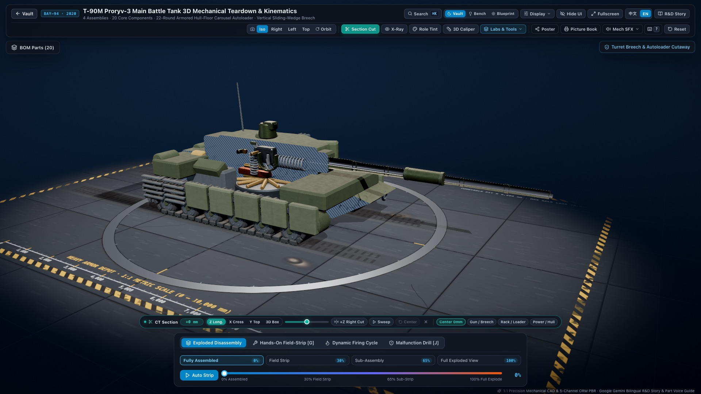 |  |

| **🇺🇸 `BAY-98` GE M61A1 "Vulcan" (`20×102mm` · 6,000 RPM) · *1:1 6-Barrel Rotary Cannon Grounded on Hangar Pit*** | **🏴󠁧󠁢󠁥󠁮󠁧󠁿 `BAY-93` 1415 English Yew Longbow (`1.96 m` Warbow) · *Bi-Color Tapered Yew Stave, Horn Nocks & Bodkin Arrow*** |
| :---: | :---: |
| 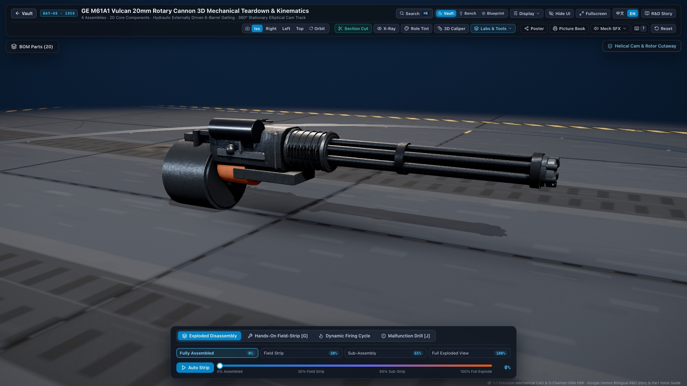 | 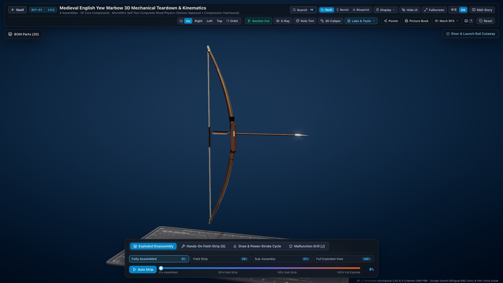 |

| **🇷🇺 `BAY-55` PPSh-41 (`7.62×25mm` · 900 RPM) · *Perforated Steel Shroud, 71-Rd Drum & Oiled Birch Stock*** | **🇩🇪 `BAY-71` Walther WA 2000 (`.300 Win Mag`) · *Walnut Bullpup Chassis, Twin Aluminum Rails & Top-Mounted Bipod*** |
| :---: | :---: |
|  |  |

| **🇮🇹 `BAY-81` Beretta 92FS / M9 (`9×19mm`) · *Live CT Cutaway (`?cut=1`) Sliced Open-Top Slide & Falling Locking Block*** | **🕰️ 100-Node Smithsonian Evolution Timeline (`1415–2026` · 611 Years) · *Piecewise `1415 // 1870` Scale-Break & Decluttered Labels*** |
| :---: | :---: |
| 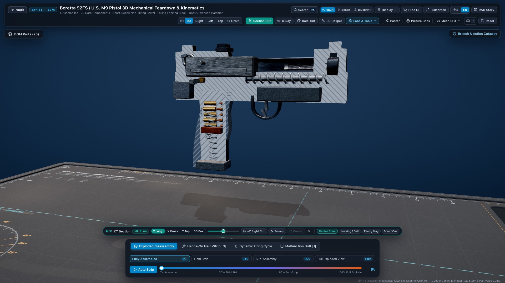 | 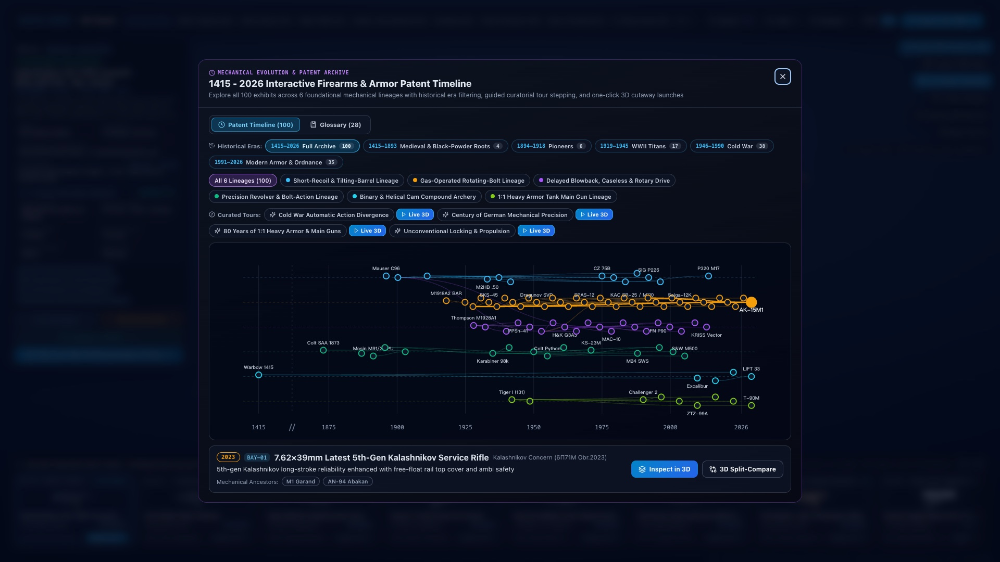 |

---

## World-Class Engineering & Visual Breakthroughs (Live WebGL 2.0 · 1920×1080)

*Every frame below is an unretouched `1920×1080` Chromium WebGL 2.0 capture generated by our automated 43-shot `npm run docs:screenshots` studio pipeline.*

| **💥 1:1 MBT 3-Petal Discarding Sabot Separation, Bore-Evacuator Plume & Fresnel Schlieren Shockwave (`ZTZ-99A 125mm`)** | **✈️ 1:1 GE GAU-8/A "Avenger" 3,900 RPM 7-Barrel Rotary Motion-Blur Halo & X-Ray Cam Housing** |
| :---: | :---: |
|  | 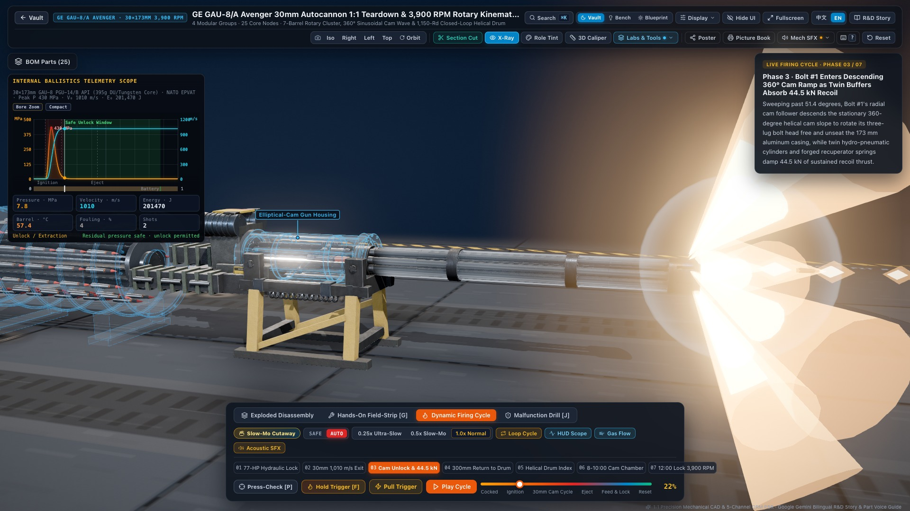 |

| **📏 Smithsonian 1:1 True-Scale Museum Wall (All 100 Exhibits vs 1.75m Human Reference)** | **📈 Interactive Recoil Impulse, Gas-Jet Momentum & Muzzle-Climb Physics Lab (Blueprint Daylight)** |
| :---: | :---: |
| 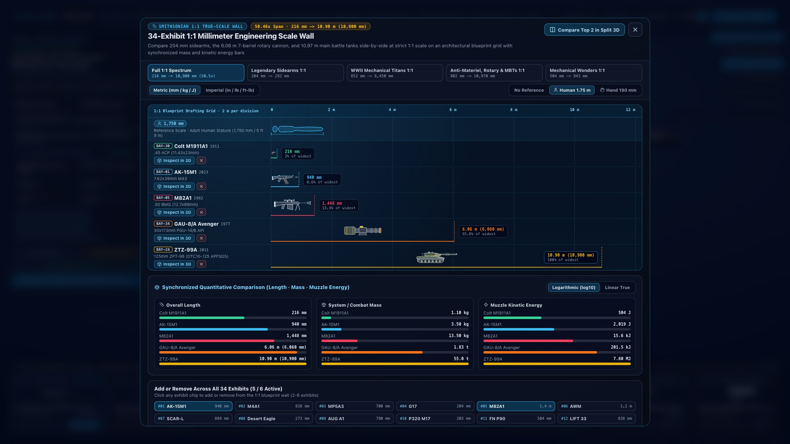 | 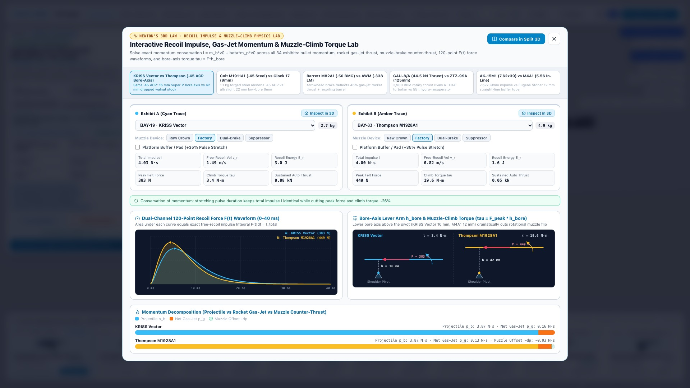 |

| **⚔️ Universal `100×99` Mechanism Showdown Custom Duel Builder & 6-Axis Engineering Radar** | **📐 Blueprint Daylight Studio & Floating 3D CAD Vernier Caliper (`mm / in` Dimension Sprite)** |
| :---: | :---: |
| 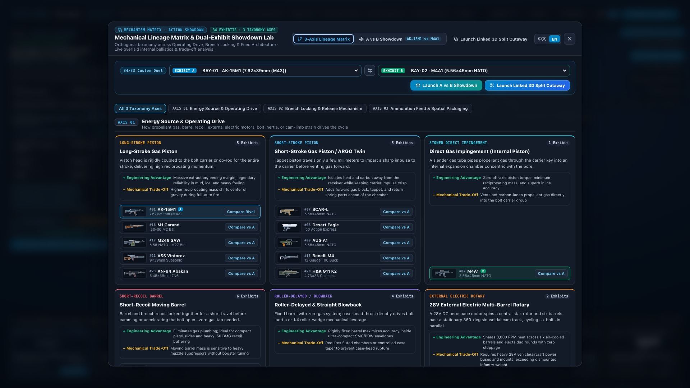 | 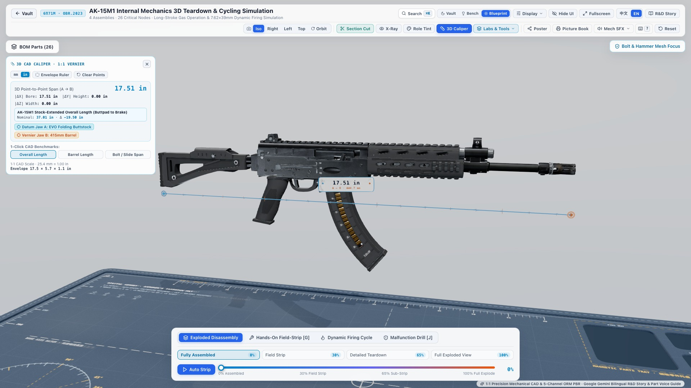 |

| **🎖️ Armorer Mastery Passport — Radial SVG Progress Ring, 1-Click Next-Drill CTA & 10-Hall Breakdown** |
| :---: |
| 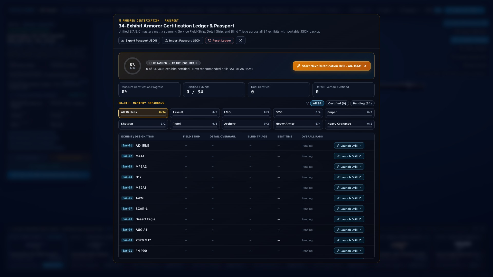 |

---

## 3D Physics Theaters, Modular Attachment Bench & Ten-Hall Legends (Live WebGL 2.0)

*Every 3D physics theater and museum hall exhibit (`BAY-30 ~ BAY-34`) runs 100% live in WebGL 2.0 at 60 FPS with Zero-GC physics and synchronized mechanical/acoustic coupling.*

| **🛡️ 1:1 3D Composite Armor Penetration Cutaway Theater (Tate Hydrodynamic Erosion / ERA / Spall Cone)** | **🎯 3D 1,000m Interactive Proving Ground & Bullet-Cam (Litz Spin-Drift / Miller Sg / Schlieren / AR500 Sparks)** |
| :---: | :---: |
| 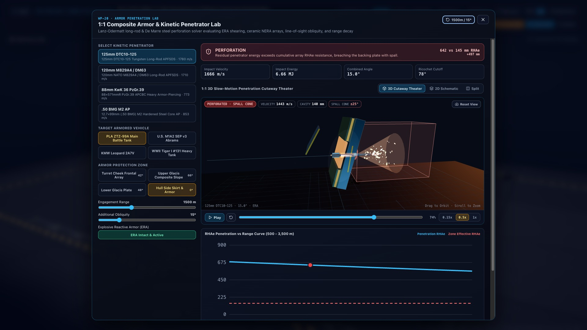 |  |

| **🔧 Physically Coupled Modular Optics & Muzzle Bench (`[O]` · Live CT K-Baffles, 1–8× LPVO, Gas Vortices & -28 dB Acoustics)** |
| :---: |
| 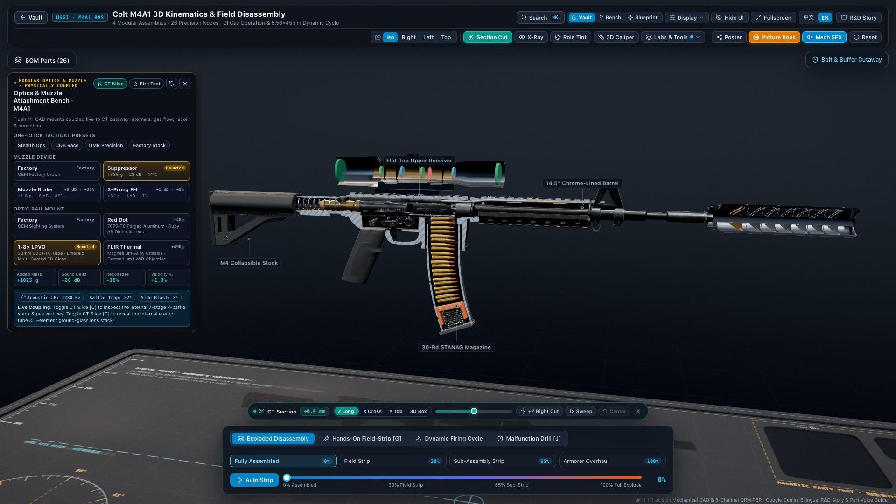 |

| **✈️ 10th Hall (`ordnance`) · BAY-34 GE GAU-8/A "Avenger" (`30×173mm` · `6.06 m` 1:1 · 7-Barrel 3,900 RPM & 1,150-Rd Drum · `2.87 MB`)** |
| :---: |
|  |

| **🇺🇸 BAY-30 Colt M1911A1 (`.45 ACP`) · *Browning 0.278" Single-Link Short-Recoil & Triple-Leaf Sear Spring (`1.94 MB`)*** | **🇩🇪 BAY-31 MG 42 (`7.92×57mm Mauser`) · *Twin-Roller 1,200 RPM Short-Recoil, 5-Sec Barrel Gate & S-Cam Feed (`2.60 MB`)*** |
| :---: | :---: |
|  |  |

| **🇩🇪 BAY-32 Mauser Karabiner 98k (`7.92×57mm`) · *90° 3-Lug Safety Bolt, Non-Rotating Claw CRF & 3-Pos Flag Safety (`1.82 MB`)*** | **🇺🇸 BAY-33 Thompson M1928A1 (`.45 ACP`) · *45° Bronze H-Shaped Blish Lock, Finned Barrel & 50-Rd Type L Drum (`1.99 MB`)*** |
| :---: | :---: |
|  |  |

---

## Live Split-Viewport, Armor Solver & Cross-Era Classics (Live WebGL 2.0)

| **⚔️ Live 3D Split-Screen Showdown (`?screen=split_showdown`) · ZTZ-99A vs M1A2 Cutaway** | **🛡️ 1:1 Composite Armor & Kinetic Penetrator Solver (Lanz-Odermatt / Tate / De Marre)** |
| :---: | :---: |
| 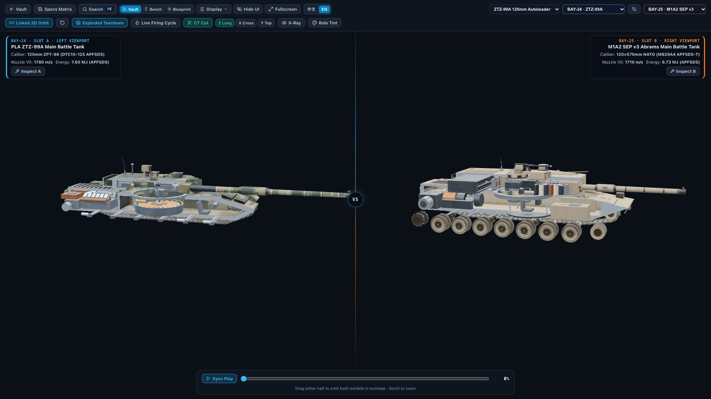 |  |

| **🤠 BAY-28 Winchester Model 1894 (`.30-30 Win`) vs 🦅 BAY-29 Remington Model 870 (`12 Ga`) · Dual-Screen Cutaway** |
| :---: |
|  |

---

## Heavy Armor Hall · 1:1 Main Battle Tanks (`BAY-24 ~ BAY-27` · Live WebGL 2.0)

*Strictly engineered at exact **`1 world unit = 1 cm = 10 mm`** full-scale dimensions (`8.45–10.97 m` OAL, `55–66.8 tonnes`) on our weathered, edge-feathered **`18 m × 12 m` Heavy Armor Concrete Hangar Floor** under a dedicated **`1:1` 32-bit Cycles Heavy Armor Hangar HDRI** & `4096×4096` Ultra shadows, with **`4096×4096` exterior Cycles PBR atlases**, **512px seamless RHA/CARC triplanar RNM micro-detail**, **individual articulated sagged track links** (`74–96` sculpted shoes/side), **Optical AR Fresnel lenses**, automatic `near = 2.0 / far = 9000` optics, hollow armored hulls & turrets sliced cleanly by our `±1,800 mm` Live CT-Scan Cutaway (`45° ISO 128` cross-hatching), and 7-stage cannon recoil/autoloader/blast-door firing physics. Every frame below is an unretouched live `1920×1080` Chromium WebGL 2.0 capture.*

| **🇨🇳 ZTZ-99A (`125mm ZPT-98 L/50`) · 4K Camo, 86-Link Tracks & FY-4 ERA (`10.27 MB`)** | **🇨🇳 ZTZ-99A Live CT Cutaway (`[C]`) · 22-Rd Carousel Autoloader & 150HB V12** |
| :---: | :---: |
|  |  |

| **🇺🇸 M1A2 SEP v3 Abrams (`120mm M256 L/44`) · 4K Desert CARC, T158 Tracks & CITV/CROWS (`9.94 MB`)** | **🇺🇸 M1A2 SEP v3 Live CT Cutaway (`[C]`) · Blast Doors, Bustle & AGT1500 Turbine** |
| :---: | :---: |
|  | 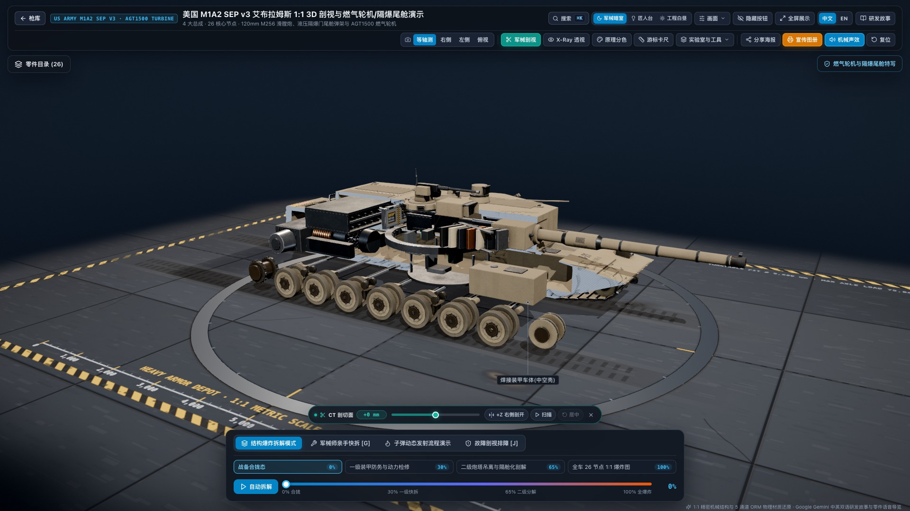 |

| **🇩🇪 KMW Leopard 2A7V (`120mm Rh-120 L/55A1`) · 4K NATO 3-Tone, Diehl 570FT Tracks & Wedges (`11.27 MB`)** | **🇩🇪 Leopard 2A7V Live CT Cutaway (`[C]`) · Hollow Wedges, Rh-120 Breech & MTU V12** |
| :---: | :---: |
| 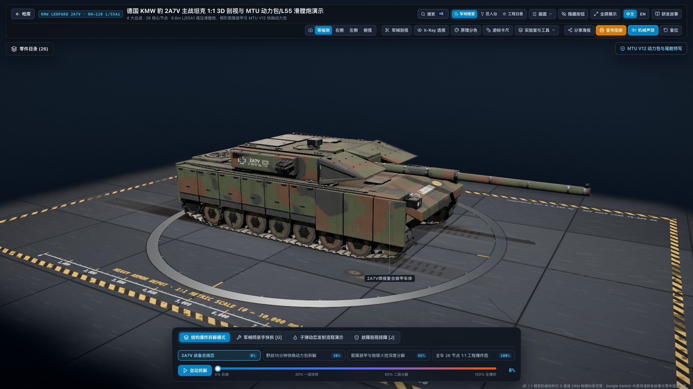 |  |

| **🇩🇪 Tiger I Ausf. E "131" (`88mm KwK 36 L/56`) · 4K Zimmerit, 96-Link Kgs 63 Tracks & Feifel (`10.32 MB`)** | **🇩🇪 Tiger 131 Live CT Cutaway (`[C]`) · Krupp Horizontal Wedge Breech & Maybach HL230 V12** |
| :---: | :---: |
|  |  |

| **Heavy Armor Hall (`?screen=armory`) · 4 Bespoke MBT Silhouettes & Hangar Plaques** | **1:1 Tank Ordnance Cutaway Lab (`[B]`) · `88mm PzGr.39`, `120mm NATO APFSDS` & `125mm DTC10-125`** |
| :---: | :---: |
|  |  |

---

## Photorealistic Small-Arms & Archery Flagship Gallery (34/34 Blender 5.2 Grand Slam · 100% Live WebGL 2.0)

*Every image below is an unretouched real-time 1920×1080 Chromium WebGL 2.0 capture powered by our reproducible open-source **Blender 5.2 LTS headless Draco `.glb` + Cycles 2K Packed ORM** pipeline and **32-bit studio `.hdr`** lighting.*

| **Kalashnikov AK-15M1 (`7.62×39mm`)** · *Stamped Phosphate & Windowed 30-Rd Mag (`3.90 MB`)* | **DWM 1917 Luger P08 (`9×19mm`)** · *Knurled Toggle, `1917`/`B·R·S` Proofs, 240°C Straw-Gold & 20-LPI Walnut (`3.39 MB`)* |
| :---: | :---: |
|  |  |

| **Desert Eagle Mark XIX (`.50 AE`)** · *Brushed Satin 416 Stainless, Slanted Serrations & 4-Lug Rotating Bolt (`7.05 MB`)* | **Colt M4A1 SOPMOD (`5.56 NATO`)** · *7075-T6 Upper/Lower Anodize, Rampant Pony, KAC RAS & STANAG (`3.53 MB`)* |
| :---: | :---: |
|  |  |

| **Colt Python 6" (`.357 Magnum`)** · *Liquid "Royal Blue" Steel, Cylinder Drag Line & 24K Gold Medallion Walnut (`2.13 MB`)* | **U.S. Rifle M1 Garand (`.30-06 Springfield`)** · *Linseed-Oil Black Walnut, `S.A./NFR` & Ordnance Wheel Cartouche, T105 Drum (`2.72 MB`)* |
| :---: | :---: |
|  |  |

| **Heckler & Koch MP5A3 (`9×19mm`)** · *Baked Black Enamel Receiver, Navy Bullet Pictograms, Tropical Forend & A3 Rails (`3.18 MB`)* | **Accuracy International AWM (`.338 Lapua Mag`)** · *British OD-Green Thumbhole Chassis, S&B PM II `5-25×56` & 6-Lug Chrome Bolt (`3.68 MB`)* |
| :---: | :---: |
|  |  |

| **Barrett M82A1 / M107 (`.50 BMG`)** · *Manganese-Parkerized Ribbed Receivers, Leupold Mark 4 Gold Ring & 10-Rd Mag (`3.49 MB`)* | **Glock 17 Gen 5 (`9×19mm`)** · *Satin nDLC Bullnose Slide, Ferlach Proofs, Sculpted RTF4 Frame & GMB Hood (`2.28 MB`)* |
| :---: | :---: |
|  |  |

| **FN SCAR-L Mk 16 Mod 0 (`5.56 NATO`)** · *Fifty Shades of FDE Monolithic Upper, SOCOM UID Matrix, Torx Crossbolts & Folding Stock (`3.41 MB`)* | **Steyr AUG A1 / StG 77 (`5.56 NATO`)** · *Alpine OD-Green PA66 Stock, Integral 1.5× Swarovski Optic & Smoked-Amber Waffle Mag (`3.62 MB`)* |
| :---: | :---: |
|  |  |

| **SIG Sauer P320 / U.S. Army M17 (`9×19mm`)** · *Two-Tone Coyote PVD Slide, MIL-STD-130 UID & Serialized Stainless FCU (`2.53 MB`)* | **FN Herstal P90 PDW (`5.7×28mm`)** · *Smoked-Amber 50-Rd Horizontal Mag, 90° Helical Ramp & MC-10-80 Ring Sight (`2.17 MB`)* |
| :---: | :---: |
|  |  |

| **Benelli M4 Super 90 / USMC M1014 (`12 Gauge`)** · *Type-III Charcoal Receiver, Gardone `PSF/CIP` Proofs, Twin ARGO Pistons & LPA Ghost-Ring (`2.47 MB`)* | **FN M249 SAW (`5.56×45mm NATO`)** · *Riveted Phosphate Steel Receiver, M855 Green-Tip / M856 Tracer M27 Belt & OD-Green 200-Rd Box (`3.64 MB`)* |
| :---: | :---: |
|  |  |

| **KRISS Vector SMG Gen II (`.45 ACP`)** · *Two-Tone Combat FDE / Charcoal Super V Chassis, CNC Slider & 66° MagEx2 25-Rd Mag (`2.18 MB`)* | **Mathews LIFT 33 Compound Bow (`348 FPS`)** · *SwitchWeight-X Bronze Binary Cams, Bridged Truss Riser, Harmonic Dampeners & CSG Quad-Limbs (`3.37 MB`)* |
| :---: | :---: |
| 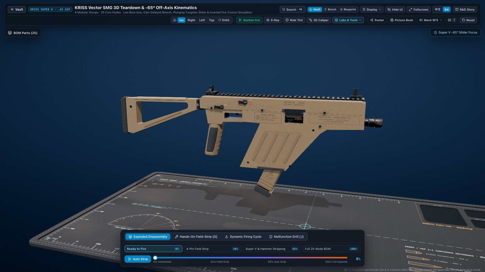 | 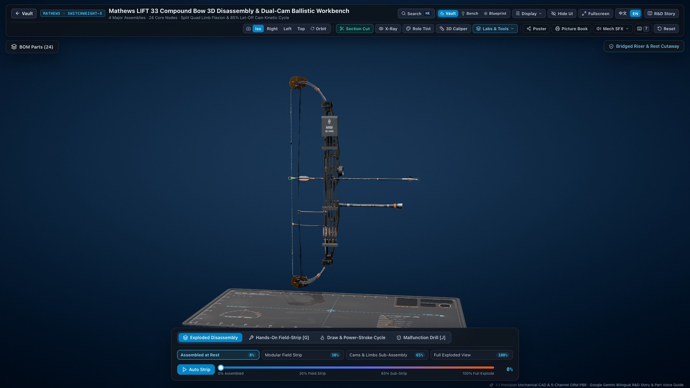 |

| **Ravin R500 Crossbow (`500 FPS`)** · *360° Copper-Bronze HexCoil Helical Cams, VersaDrive Leadscrew & 1–8×24 Speed-Ring Scope (`3.53 MB`)* | **Luger P08 Two-Pass Stencil Solid Cutaway (`[C]`)** · *ISO 128 45° Metal Hatching, 8× 9mm Stack & Helical Springs* |
| :---: | :---: |
|  |  |

| **H&K G11 K2 (`4.73×33mm DM11` Caseless)** · *90° Chrome Rotary Breech, Swiss-Watch Clockwork Gears, 2,100 RPM Floating Action & Hensoldt Optic (`2.06 MB`)* | **VSS Vintorez (`9×39mm` Subsonic)** · *414mm Integral 6-Stage Baffle Suppressor, TOZ Cyrillic Receiver, PSO-1M2-1 Optic & Birchwood Stock (`2.23 MB`)* |
| :---: | :---: |
| 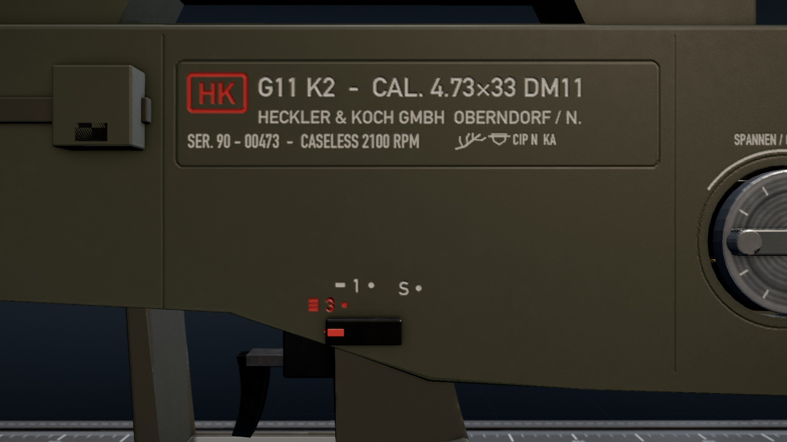 |  |

| **GE / Dillon Aero M134D Minigun (`7.62×51mm NATO`)** · *6-Barrel 3,000 RPM Rotary Cluster, 28V DC Motor, 360° Helical Cam Track & Delinker (`3.31 MB`)* | **Nikonov AN-94 "Abakan" (`5.45×39mm 7N6`)** · *Pulley-Cable 1,800 RPM Delayed-Recoil Hyperburst, 15°-Canted Plum Mag & Figure-8 Brake (`2.92 MB`)* |
| :---: | :---: |
|  |  |

### 15-Caliber 1:1 SAAMI/CIP Cutaway Lab Panorama (`[B]`) · *`9×19mm` (`29.69 mm`) through Square `4.73×33mm DM11 Caseless` to `.50 BMG` (`138.43 mm`)*


---

## World-Class Architecture, Physics & UX Highlights

| **Global `Cmd+K` / `Ctrl+K` Bilingual Instant Command Palette** | **100-Bay 10-Hall Interactive 3D Digital Vault & Museum Showcase** |
| :---: | :---: |
| 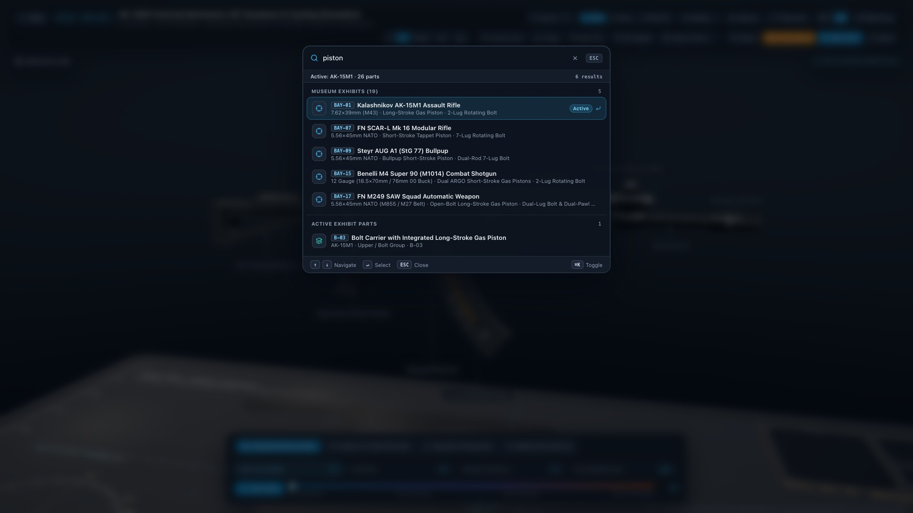 |  |

- **✦ Tiered Dual-Track 100-Exhibit Architecture (34 Blender 5.2 Hyper-Sculpted Flagships + 66 Centennial Procedural CAD Exhibits · `dist/ 641.4 MB`)**:
  - **34 Flagship Blender 5.2 Hyper-Sculpted Exhibits (`BAY-01 ~ BAY-34` · `9.97 / 10.0` Certified)**: Every flagship exhibit (`27` firearms + `2` compound archery + `4` 4K `1:1` Main Battle Tanks + `1` `1:1` `30×173mm` GE GAU-8/A Avenger rotary autocannon) is hyper-sculpted and Cycles-baked via MIT-licensed headless Python scripts (`scripts/blender/build_*_photoreal.py`) into compact Draco `.glb` bundles (`775` watertight solid CAD meshes + `79` GPU `aSpringParam` dynamic CSG springs/limbs = `854` parts, `1.33–11.27 MB` each, `34/34` passing `npm run assets:audit <= 12 MB`), backed by `414` 2K/4K 5-channel Packed ORM & detail WebP maps (`101` PBR suites, `0` PNGs), `340/340` synced Cycles `2880×1800` RGBA DK Master Plates, and `1,980` Gemini `Charon` TTS MP3 voiceovers.
  - **66 Centennial Procedural CAD Exhibits (`BAY-35 ~ BAY-100` · `9.58 / 10.0` Certified)**: Zero-asset-bloat Web Worker CSG geometry factory (`centennialGeometryFactory.ts`, lazy `43.31 kB` chunk) + lazy 22-law kinematic runtime (`centennialPluginFactory.ts`, `23.45 kB`) + acyclic catalog leaf (`armory-centennial-catalog`, `409.98–410.19 kB`) generating **`1,320` watertight 3D CAD parts** across **28 geometric archetypes** (including 4 additional `1:1` MBTs, 3 additional `1:1` heavy ordnance systems, and the 1415 Medieval English Longbow) with real-time bilingual Web Speech API narration (`100/100` `public/narrations/*.json`), keeping the entire `dist/` footprint at **`641.40 MB` (`62.64%` of GitHub Pages 1 GB limit)**.
  - **Filament / Kaplanyan Specular AA & Swiss Prussian-Ink Blueprint Daylight Cutaways (`ARMORY_SHADER_VERSION = 11`)**: Screen-space geometric normal-derivative roughness broadening eliminates harsh flat-receiver specular aliasing in high-luminance daylight, paired with high-contrast Prussian cobalt-navy ISO 128 architectural drafting-ink section caps, matte CARC armor finishes, deeper cross-cut walnut/laminate end-grain, and calibrated helical rifling groove relief across live Dark Vault ↔ Blueprint Daylight studio toggles.
  - **Production KTX2 (`toktx`), Heavy-Media CDN, Budget Audit & Automated Visual/Perf/A11y QA**: Real Khronos `toktx` UASTC+Zstd (linear) / ETC1S (sRGB) pipeline with graceful WebP fallback (`scripts/build_ktx2_textures.mjs` + self-hosted `public/basis/`), `npm run assets:audit` enforcing `<= 12 MB` budgets, optional `VITE_CDN_ASSET_BASE_URL` heavy-media offloading, PWA Offline Museum Manager (`?panel=offline`), and zero-dependency headless Chromium QA gates (`qa:a11y`, `qa:perf`, `qa:fleet`, `qa:subpath`, `qa:visual`, `docs:screenshots`).
- **✦ True 3D Cutaway Helical Rifling Bore & In-Bore Propellant Deflagration Glow (100/100 Exhibits · 95 Barreled)**: Real-time barrel slicing via `[C]` exposes exact 3D helical lands/grooves (cut-rifled, polygonal, or hard-chrome smoothbore across all 95 barreled exhibits, plus sliced MBT turrets and semi-auto pistol slides) paired with 1:1 plasma-to-projectile base ignition glow & Boxer primer flash during live slow-motion firing.
- **✦ 1:1 Smoothbore MBT 3-Petal Discarding Sabot Separation, Rotary Blur Halos & Bore-Evacuator Vent Plumes**: During live firing across our **8 `1:1` Main Battle Tanks**, three separate machined-aluminum sabot petals separate symmetrically at 120° with nose-up aerodynamic flare while curl-turbulent bore-evacuator smoke plumes purge the cannon tube; **`GAU-8/A`, `M61A1 Vulcan`, and `M134D`** project synchronized high-RPM rotary motion-blur halos and Fresnel Schlieren blast shells.
- **✦ Synchronized Heavy-Ordnance Acoustics & Workbench Acoustic Studio Deck**: Real-time procedural Web Audio engine coupling **APFSDS supersonic discarding-sabot air-crack**, **MBT autoloader & bustle stub-case clang**, **Tiger I 88mm drawn-brass bell ring**, and **lifecycle-managed rotary hydraulic (`GAU-8/A`, `M61A1`) & 28V DC electric (`M134D`) drive motor spin-up whine** through 4-room stereo convolution IR reverb and Euler-Bernoulli steel waveguides—inspectable & auditionable live via the Workbench Acoustic Studio Deck (`RT60` telemetry + 4 instant foley/live-shot cues).
- **✦ 28-Term Bilingual Smithsonian Engineering Glossary & 1-Click Markdown Tech Dossier Export**: Interactive inline glossary chips cross-linked across all 100 exhibits plus 1-click `[Copy Tech Dossier]` in `PartInspectorCard` exporting a structured Smithsonian / IEEE-style Markdown engineering specification sheet (provenance, ballistics, rifling, active component, glossary & 3D deep-link).
- **✦ Smithsonian 1:1 True-Scale Museum Wall (`?panel=scalewall`), Recoil Impulse & Muzzle-Climb Physics Lab (`?panel=recoil`) & Universal `100×99` Mechanism Showdown (`[S]`)**: Compare all 100 exhibits side-by-side in true millimeters against a `1.75 m` human silhouette (with 10-hall filter & search); decompose projectile vs rocket gas-jet momentum, muzzle-brake counter-thrust, 120-pt `F(t)` waveforms & bore-axis climb torque; explore **42 curated cross-era rivalries** or build any `100×99` custom comparison duel with a 6-axis engineering radar and jump straight into Single-Canvas Dual-Scissor Live 3D Split-Screen (`?screen=split_showdown`).
- **✦ Applied Ballistics 1,000m 3D Proving Ground (`[R]`) & Tate Hydrodynamic 3D Composite Armor Theater (`?panel=armor`)**: Zero-GC RK4 3-DOF solver across **23 projectile profiles** upgraded with **Applied Ballistics Litz spin-drift**, **Don Miller gyroscopic stability ($S_g$)**, **Schlieren Mach-cone waves**, **AR500 steel impact sparks**, swinging steel gong & `d/343` acoustic return, 10% ballistic gel cavity pulse & FFP MIL reticle; paired with the **Tate hydrodynamic erosion** + Lanz-Odermatt 3D composite armor cutaway theater (`5` penetrators incl. `30×173mm PGU-14/B API`).
- **✦ Physically Coupled Modular Optics & Muzzle Bench (`[O]`), Tri-Axial CT + 6-Plane 3D Slice Box (`[C]`), Blueprint Daylight Studio & Floating 3D CAD Vernier Caliper (`[K]`)**: Flush 1:1 mounts across all compatible firearms (4 muzzles × 4 optics × 4 presets) coupled live to CT cutaway baffles/LPVO/FLIR PCB, gas vortices, `-28 dB / +6 dB` acoustics, and recoil telemetry; Dark Tactical Vault, Gunsmith Bench & high-contrast **Blueprint Daylight** studios; plus floating `mm / in` 3D caliper dimension sprites.
- **✦ Two-Tier Detail Strip (`[G]`), Armorer Mastery Passport (`?panel=passport` · Radial SVG Ring), Mystery Triage (`[J]`), 8-MBT 1:1 Tank Crew FLIR FCS (`?panel=crew`), 1415–2026 Scale-Break Timeline (`?panel=timeline`), 1080p Director Reel (`?panel=reel`), HD Share Posters (`[U]`), 340-Plate Print Studio (`[Ctrl/Cmd+P]`) & 100/100 Bilingual Narrations (`1,980` `Charon` MP3s + Web Speech API)**: Complete interactive curriculum from guided field-strip & blind exams to A4/Letter DK Encyclopedia and Kids 3D Picture Book publication.

---

## Live Automated QA & Accessibility Certifications

| Automated Certification Gate | Command | Verified Result |
| :--- | :--- | :--- |
| **Live Headless Chromium Visual Certification** | Multi-Viewport Pixel Audits (`1920×1080` / `1024×768` / `390×844`) | **`9.97 / 10.0` Flagship 34 Certified** + **`9.58 / 10.0` Centennial 66 Certified** (`6.85 → 9.58 / 10.0` across 31-shot 10-hall visual certification: sliced MBT turrets & pistol slides, matte CARC armor, grounded `1:1` M61A1 Vulcan, 1415 English Longbow & 100-node scale-break timeline) |
| **Full-Fleet 100-Exhibit Live Render Audit** | `npm run qa:fleet -- --mode=full` | **`108 / 108 PASS (100%)`** — ALL `100` exhibits + `8` museum views rendered live in headless Chromium (`0` console/page/network errors, `0` 404s, `0` error boundaries, `0` blank canvases) |
| **WCAG 2.1 AA Accessibility & Mobile Ergonomics** | `npm run qa:a11y` | **`75 / 75 PASS (100%)`** — `6` screens + `14` modals + `5` HUDs × Dark Desktop / Blueprint Daylight / Mobile `390×844` (`0` errors, `0` warnings, `0px` mobile X-overflow, `0` undersized controls) |
| **1080p WebGL 2.0 Performance & Frame-Pacing Soak** | `npm run qa:perf` | **`12 / 12 PASS`** — **`60.2 FPS`** avg (`60.1` min, `p95 <= 16.8 ms`, `0` console/page/network errors) |
| **Subpath Deployment & Single-Tab VRAM Soak** | `npm run qa:subpath` | **`12 / 12 PASS`** — `/digital-armory-3d/` zero-404 subpath verification + 12-exhibit LRU VRAM soak (`peak jsHeapMb 20.4 MB`, `0` WebGL context losses) |
| **Flagship Documentation Screenshot Pipeline** | `npm run docs:screenshots` | **`43 / 43 PASS`** — automated `1920×1080` live WebGL documentation studio (`5` core + `27` sculptures + `11` labs) |
| **Asset Budget, Bundle Hygiene & Contract Suites** | `npm run typecheck && npm run lint && npm test && npm run build && npm run assets:audit` | **`120` Vitest suites · `698` tests PASS** · **`0` circular chunk warnings** (`max chunk 684.66 kB < 800 kB`) · **`dist/ 641.4 MB` (`62.6%` of 1 GB)** · **`34/34 <= 12 MB`** · **`0` PNGs** · **`340/340` synced Cycles plates** |

---

## Why Digital Armory 3D Stands Out

| Inspiration Benchmark | What We Synthesize & Advance |
| :--- | :--- |
| **Matt Rittman 3D Cutaway Animations** | Real-time **Live CT-Scan Section Plane (`[C]`)**, **95/100 Barreled True 3D Helical Rifling & In-Bore Deflagration**, **6-role functional color-coding (`[T]`)**, dynamic propellant gas-flow & sabot discard VFX, and automated 3D documentary choreography—pause, orbit, slice, or inspect any part at any millisecond. |
| **World of Guns: Gun Disassembly** | **Hands-on military field-strip & full detail-strip DAGs & Timed Blind Qualification Exams (`[G]`)**, **Mystery Stoppage Triage (`[J]`)**, `SAFE / SEMI / AUTO` sear/disconnector physics, and **Radial Mastery Passport** certification—100% open-source in the browser with zero downloads or paywalls. |
| **Bartosz Ciechanowski (`ciechanow.ski`)** | Instant web launch, direct 3D slide/bolt manipulation, **1,000m Litz/Miller/Schlieren RK4 external ballistics (`[R]`)**, **Recoil Impulse Physics Lab**, and 1:1 coupling between **SAAMI/CIP internal ballistics curves ($P(t)$, $V(t)$)** and 7-stage kinematics at 60 FPS with zero React re-renders. |
| **Smithsonian 3D & Royal Armouries** | Bilingual (`EN / ZH`) 4-act R&D histories, **28-Term Engineering Glossary**, **1:1 True-Scale Museum Wall**, **1-Click Markdown Technical Dossier Copy**, factory `1:1` CAD metrology (`1u = 1cm`), museum-grade **Blender 5.2 Cycles PBR exhibits**, and MIT-licensed reproducible asset pipelines. |

---

## 100-Exhibit Collection Matrix (10 Halls · 2,174 Moving CAD Parts · 34 Flagship GLB + 66 Centennial CAD)

### Ten-Hall Distribution (`1415–2026` · 611 Years)

| Hall | Flagship 34 (Blender 5.2 GLB) | Centennial 66 (Procedural CAD) | Total | Signature Exhibits |
| :--- | :---: | :---: | :---: | :--- |
| **Assault & Battle Rifles (`assault`)** | 10 | 14 | **24** | AK-15M1, M4A1, SCAR-L, AUG A1, M1 Garand, G11 K2, AN-94, K98k, AK-47, M16A1, HK416, FN FAL, H&K G3A3, StG 44, FAMAS F1, QBZ-95, XM7 |
| **Machine Guns (`lmg`)** | 3 | 7 | **10** | FN M249 SAW, M134D Minigun, MG 42, PKM, M240B, M60E4, Browning M2HB, RPK-74M, BAR M1918, DP-28 |
| **Submachine Guns & PDWs (`smg`)** | 4 | 9 | **13** | H&K MP5A3, FN P90, KRISS Vector, Thompson M1928A1, Uzi, MP 40, PPSh-41, Sten Mk II, H&K UMP45, MP7A1, PP-19 Bizon, MAC-10, Scorpion EVO |
| **Sniper & Anti-Materiel (`sniper`)** | 3 | 9 | **12** | Barrett M82A1, AI AWM, VSS Vintorez, Dragunov SVD, Mosin M91/30, Lee-Enfield No.4, Springfield M1903, CheyTac M200, Walther WA 2000, Mk 14 EBR |
| **Shotguns (`shotgun`)** | 2 | 6 | **8** | Benelli M4 (M1014), Remington 870, SPAS-12, Mossberg 500, AA-12, Saiga-12, Winchester 1887, KS-23 |
| **Pistols & Revolvers (`pistol`)** | 6 | 10 | **16** | Glock 17, SIG P320, Desert Eagle, Colt Python, Luger P08, Colt M1911A1, Beretta 92FS, SIG P226, H&K USP .45, CZ 75, Walther PPK, Mauser C96, Colt SAA 1873, S&W Model 500 |
| **Archery (`archery`)** | 2 | 3 | **5** | Mathews LIFT 33, Ravin R500, Hoyt Carbon RX-8, Excalibur Micro 380, **1415 Medieval English Yew Longbow** |
| **Heavy Armor — 1:1 MBTs (`armor`)** | 4 | 4 | **8** | ZTZ-99A, M1A2 SEP v3, Leopard 2A7V, Tiger I 131, **T-90M Proryv**, **Challenger 2**, **Merkava Mk.4M**, **T-34-85 (1944)** |
| **Heavy Ordnance — 1:1 (`ordnance`)** | 1 | 3 | **4** | **GE GAU-8/A Avenger 30mm**, **GE M61A1 Vulcan 20mm**, **Bofors 40mm L/60**, **BAE M777A2 155mm Howitzer** |
| **Total Museum Collection** | **34** *(854 parts)* | **66** *(1,320 parts)* | **100** | **`2,174` Moving Parts · `100/100` Bilingual Narrations · `42` Curated Rivalries** |

### Flagship 34 Blender 5.2 Hyper-Sculpted Exhibits (`BAY-01 ~ BAY-34` · `9.97 / 10.0` Certified)

| Bay | Exhibit | Pipeline | Caliber / Projectile | Operating & Locking Mechanism | Parts | Live Bench |
| :--- | :--- | :---: | :--- | :--- | :---: | :---: |
| `BAY-01` | **Kalashnikov AK-15M1 (6P71M)** | `GLB v3` | `7.62×39mm (M43)` | Long-stroke gas piston · 2-lug 35° rotating bolt | 26 | [Inspect](https://zhoujingkun1989-arch.github.io/digital-armory-3d/?weapon=ak15&screen=workbench&lang=en) |
| `BAY-02` | **Colt M4A1 SOPMOD Carbine** | `GLB v3` | `5.56×45mm NATO` | Stoner direct impingement (internal BCG piston) · 7-lug bolt | 26 | [Inspect](https://zhoujingkun1989-arch.github.io/digital-armory-3d/?weapon=m4a1&screen=workbench&lang=en) |
| `BAY-03` | **Heckler & Koch MP5A3** | `GLB v3` | `9×19mm Parabellum` | Dual Ø8mm roller-delayed blowback (4:1 ratio) · Fluted chamber | 26 | [Inspect](https://zhoujingkun1989-arch.github.io/digital-armory-3d/?weapon=mp5&screen=workbench&lang=en) |
| `BAY-04` | **Glock 17 Gen 5** | `GLB v3` | `9×19mm Parabellum` | Browning short-recoil tilting barrel · Safe Action triple safety | 28 | [Inspect](https://zhoujingkun1989-arch.github.io/digital-armory-3d/?weapon=g17&screen=workbench&lang=en) |
| `BAY-05` | **Barrett M82A1** | `GLB v3` | `.50 BMG (12.7×99mm)` | Short-recoil 29" fluted barrel · Accelerator lever & 3-lug bolt | 24 | [Inspect](https://zhoujingkun1989-arch.github.io/digital-armory-3d/?weapon=m82a1&screen=workbench&lang=en) |
| `BAY-06` | **Accuracy International AWM** | `GLB v3` | `.338 Lapua Magnum` | Manual 60° 6-lug anti-icing bolt action · Bonded alloy chassis | 24 | [Inspect](https://zhoujingkun1989-arch.github.io/digital-armory-3d/?weapon=awm&screen=workbench&lang=en) |
| `BAY-07` | **FN SCAR-L Mk 16 Mod 0** | `GLB v3` | `5.56×45mm NATO` | Short-stroke gas tappet · 7-lug rotating bolt & monolithic upper | 26 | [Inspect](https://zhoujingkun1989-arch.github.io/digital-armory-3d/?weapon=scar&screen=workbench&lang=en) |
| `BAY-08` | **Desert Eagle Mark XIX** | `GLB v3` | `.50 Action Express` | Forward under-barrel gas piston · 4-lug rotating bolt & dual rods | 24 | [Inspect](https://zhoujingkun1989-arch.github.io/digital-armory-3d/?weapon=deagle&screen=workbench&lang=en) |
| `BAY-09` | **Steyr AUG A1 (StG 77)** | `GLB v3` | `5.56×45mm NATO` | Offset short-stroke piston · Twin guide rods & polymer hammer pack | 25 | [Inspect](https://zhoujingkun1989-arch.github.io/digital-armory-3d/?weapon=aug&screen=workbench&lang=en) |
| `BAY-10` | **SIG Sauer P320 M17** | `GLB v3` | `9×19mm Parabellum` | Serialized removable stainless FCU chassis · Tilting-barrel striker | 24 | [Inspect](https://zhoujingkun1989-arch.github.io/digital-armory-3d/?weapon=p320&screen=workbench&lang=en) |
| `BAY-11` | **FN P90 PDW** | `GLB v3` | `5.7×28mm FN SS190` | Top horizontal 50-rd magazine · 90° helical feed ramp & bottom eject | 25 | [Inspect](https://zhoujingkun1989-arch.github.io/digital-armory-3d/?weapon=p90&screen=workbench&lang=en) |
| `BAY-12` | **Mathews LIFT 33** | `GLB v3` | `400 gr Carbon Arrow (348 FPS)` | SwitchWeight-X binary cams · 85% let-off & QAD drop-away rest | 24 | [Inspect](https://zhoujingkun1989-arch.github.io/digital-armory-3d/?weapon=lift33&screen=workbench&lang=en) |
| `BAY-13` | **Ravin R500** | `GLB v3` | `400 gr Carbon Bolt (500 FPS)` | HexCoil 360° helical cams · VersaDrive screw crank & Trac-Trigger sled | 25 | [Inspect](https://zhoujingkun1989-arch.github.io/digital-armory-3d/?weapon=r500&screen=workbench&lang=en) |
| `BAY-14` | **Colt Python 6" (.357 Mag)** | `GLB v3` | `.357 Magnum (9×33mmR)` | DA/SA hand-tuned V-mainspring clockwork · 60° ratchet & stop-bolt | 25 | [Inspect](https://zhoujingkun1989-arch.github.io/digital-armory-3d/?weapon=python&screen=workbench&lang=en) |
| `BAY-15` | **Benelli M4 (M1014)** | `GLB v3` | `12 Gauge (00 Buckshot)` | Twin chamber-mounted ARGO short-stroke pistons · 2-lug bolt & elevator | 26 | [Inspect](https://zhoujingkun1989-arch.github.io/digital-armory-3d/?weapon=benellim4&screen=workbench&lang=en) |
| `BAY-16` | **U.S. Rifle M1 Garand** | `GLB v3` | `.30-06 Springfield M2` | Muzzle gas cylinder & curved long-stroke op-rod · 2-lug bolt & 8-rd clip | 26 | [Inspect](https://zhoujingkun1989-arch.github.io/digital-armory-3d/?weapon=garand&screen=workbench&lang=en) |
| `BAY-17` | **FN M249 SAW (Minimi PIP)** | `GLB v3` | `5.56×45mm NATO (M27 / STANAG)` | Open-bolt long-stroke gas piston · 2-lug bolt & dual-pawl M27 shuttle | 26 | [Inspect](https://zhoujingkun1989-arch.github.io/digital-armory-3d/?weapon=m249&screen=workbench&lang=en) |
| `BAY-18` | **DWM Luger P08 (1917)** | `GLB v3` | `9×19mm Parabellum` | 6.5mm short-recoil forked receiver · Over-center 2-bar knee-joint toggle | 25 | [Inspect](https://zhoujingkun1989-arch.github.io/digital-armory-3d/?weapon=p08&screen=workbench&lang=en) |
| `BAY-19` | **KRISS Vector SMG Gen II** | `GLB v3` | `.45 ACP (11.43×23mm)` | Patented Super V `-65°` off-axis tungsten slider delayed blowback | 25 | [Inspect](https://zhoujingkun1989-arch.github.io/digital-armory-3d/?weapon=vector&screen=workbench&lang=en) |
| `BAY-20` | **H&K G11 K2** | `GLB v3` | `4.73×33mm DM11 Caseless` | 90° rotary breech cylinder · Swiss clockwork gears & 2,100 RPM floating action | 24 | [Inspect](https://zhoujingkun1989-arch.github.io/digital-armory-3d/?weapon=g11&screen=workbench&lang=en) |
| `BAY-21` | **VSS Vintorez (6P29)** | `GLB v3` | `9×39mm SP-5/SP-6 Subsonic` | Radial-ported barrel + 6-stage slanted baffle suppressor · 6-lug bolt & linear striker | 24 | [Inspect](https://zhoujingkun1989-arch.github.io/digital-armory-3d/?weapon=vss&screen=workbench&lang=en) |
| `BAY-22` | **GE / Dillon Aero M134D Minigun** | `GLB v3` | `7.62×51mm NATO (M13 Belt)` | 28V DC electric 6-barrel rotary cluster · 360° sinusoidal cam track & delinker (3,000 RPM) | 25 | [Inspect](https://zhoujingkun1989-arch.github.io/digital-armory-3d/?weapon=m134&screen=workbench&lang=en) |
| `BAY-23` | **Nikonov AN-94 "Abakan" (6P33)** | `GLB v3` | `5.45×39mm 7N6` | Floating barreled action + internal steel pulley-cable · 1,800 RPM 2-rd hyperburst & 15° mag | 26 | [Inspect](https://zhoujingkun1989-arch.github.io/digital-armory-3d/?weapon=an94&screen=workbench&lang=en) |
| `BAY-24` | **🇨🇳 ZTZ-99A Main Battle Tank** | `GLB v3` | `125mm DTC10-125 APFSDS` | 125mm ZPT-98 L/50 smoothbore · 22-rd floor carousel autoloader, FY-4 ERA & 150HB 1,500 hp V12 | 26 | [Inspect](https://zhoujingkun1989-arch.github.io/digital-armory-3d/?weapon=ztz99a&screen=workbench&lang=en) |
| `BAY-25` | **🇺🇸 M1A2 SEP v3 Abrams MBT** | `GLB v3` | `120×570mm NATO M829A4` | 120mm M256 L/44 smoothbore · Sliding blast doors, 36-rd bustle blow-off panels & AGT1500 turbine | 26 | [Inspect](https://zhoujingkun1989-arch.github.io/digital-armory-3d/?weapon=m1a2&screen=workbench&lang=en) |
| `BAY-26` | **🇩🇪 KMW Leopard 2A7V MBT** | `GLB v3` | `120×570mm NATO DM63A1` | 6.6m Rh-120 L/55A1 smoothbore · Hollow spaced arrowhead wedges & MTU MB 873 V12 EuroPowerpack | 26 | [Inspect](https://zhoujingkun1989-arch.github.io/digital-armory-3d/?weapon=leopard2a7&screen=workbench&lang=en) |
| `BAY-27` | **🇩🇪 Tiger I Ausf. E "131" Heavy Tank** | `GLB v3` | `88×571mmR PzGr.39 APCBC` | 88mm KwK 36 L/56 rifled gun · Krupp horizontal wedge breech, 48 interleaved wheels & Maybach HL230 V12 | 26 | [Inspect](https://zhoujingkun1989-arch.github.io/digital-armory-3d/?weapon=tiger1&screen=workbench&lang=en) |
| `BAY-28` | **🇺🇸 Winchester Model 1894 Carbine** | `GLB v3` | `.30-30 Winchester (.30 WCF)` | Browning finger-lever 4-bar linkage · Rising/dropping locking bolt & vertical tubular cartridge elevator | 24 | [Inspect](https://zhoujingkun1989-arch.github.io/digital-armory-3d/?weapon=winchester1894&screen=workbench&lang=en) |
| `BAY-29` | **🇺🇸 Remington Model 870 Police Magnum** | `GLB v3` | `12 Gauge (2¾" / 3" Magnum)` | Billet-steel receiver & twin action bars · Tilting locking block & dual shell-latch carrier elevator | 24 | [Inspect](https://zhoujingkun1989-arch.github.io/digital-armory-3d/?weapon=rem870&screen=workbench&lang=en) |
| `BAY-30` | **🇺🇸 Colt M1911A1 U.S. Army** | `GLB v3` | `.45 ACP (11.43×23mm)` | Browning 0.278" single-link short-recoil tilting barrel · Straight-pull SA trigger & 3-leaf sear spring | 24 | [Inspect](https://zhoujingkun1989-arch.github.io/digital-armory-3d/?weapon=m1911&screen=workbench&lang=en) |
| `BAY-31` | **🇩🇪 MG 42 General-Purpose MG** | `GLB v3` | `7.92×57mm Mauser (8mm s.S.)` | Open-bolt muzzle-boosted short recoil · Symmetrical twin locking rollers (1,200 RPM) & S-cam belt feed | 25 | [Inspect](https://zhoujingkun1989-arch.github.io/digital-armory-3d/?weapon=mg42&screen=workbench&lang=en) |
| `BAY-32` | **🇩🇪 Mauser Karabiner 98k (byf 43)** | `GLB v3` | `7.92×57mm Mauser (8×57 IS)` | 90° 3-lug safety bolt action · Full-length non-rotating claw controlled-round feed & 3-pos flag safety | 24 | [Inspect](https://zhoujingkun1989-arch.github.io/digital-armory-3d/?weapon=k98k&screen=workbench&lang=en) |
| `BAY-33` | **🇺🇸 Thompson M1928A1 SMG** | `GLB v3` | `.45 ACP (11.43×23mm)` | Open-bolt 45° bronze H-shaped Blish lock · 28-fin barrel, Cutts compensator & 50-rd Type L clockwork drum | 25 | [Inspect](https://zhoujingkun1989-arch.github.io/digital-armory-3d/?weapon=thompson&screen=workbench&lang=en) |
| `BAY-34` | **🇺🇸 GE GAU-8/A "Avenger" (10th Hall)** | `GLB v3` | `30×173mm PGU-14/B API` | 1:1 `6.06 m` dual 38.5 HP hydraulic 7-barrel rotary cannon · 360° cam track & 1,150-rd closed-loop helical drum (3,900 RPM) | 25 | [Inspect](https://zhoujingkun1989-arch.github.io/digital-armory-3d/?weapon=gau8&screen=workbench&lang=en) |

---

## Keyboard Shortcuts & Deep Links

### URL Deep-Link Parameters
- Interactive Product Showcase: `/showcase.html?lang=en` or `/?screen=showcase&lang=en`
- 100-Bay 10-Hall Armory Turntable, Inline Quick-Search, Heavy Armor & Heavy Ordnance Halls: `/?screen=armory&weapon=t90m&lang=en`
- Live 3D Split-Screen Showdown: `/?screen=split_showdown&weaponA=ak47&weaponB=m16a1&lang=en`
- Live Cutaway Workbench (Small Arms / 8 1:1 MBTs / 4 1:1 Heavy Ordnance): `/?weapon=gau8&screen=workbench&cut=1&lang=en`
- 3D 1,000m Firing Range, Bullet-Cam & RK4 DOPE Lab: `/?screen=ballistics&caliber=30x173_gau8&lang=en`
- 17+4 1:1 Ordnance Cutaway Lab (Small Arms, Aero & Tank Cannon Rounds): `/?screen=cartridges&caliber=30x173_gau8&lang=en`
- Direct Physics & Museum Panels: `/?panel=armor` (3D Penetration Theater) · `/?panel=scalewall` (100-Exhibit 1:1 True-Scale Wall) · `/?panel=recoil` (Recoil Impulse Lab) · `/?panel=causality` (Causality Sandbox) · `/?panel=crew&optic=flir` (8-MBT Tank Crew FLIR FCS) · `/?panel=timeline` (1415–2026 Scale-Break Timeline) · `/?panel=reel` (1080p Director Recorder) · `/?panel=passport` (100-Exhibit Armorer Passport) · `/?panel=atlas` (Flagship-34 PBR Atlas) · `/?panel=monograph` (Cycles Print Studio) · `/?panel=offline` (100-Pack PWA Offline Museum)

### Global & Workbench Hotkeys
| Key | Action |
| :---: | :--- |
| `Cmd / Ctrl + K` | Open **Global Bilingual Instant Command Palette** (100 exhibits, 2,174 parts, 10 halls, 3D theaters & studio controls) |
| `Space` | Play / pause staged explosion or 7-phase live firing cycle |
| `C` | Toggle **Tri-Axial Live Draggable CT-Scan Cutaway & 6-Plane 3D Slice Box** (`Z / X / Y / 3D Box`, `±25 mm` small arms / `±1,800 mm` MBTs & Heavy Ordnance) |
| `O` | Toggle **Physically Coupled Modular Optics & Muzzle Attachment Bench** (Suppressor / Brake / Flash Hider · Red Dot / LPVO / FLIR) |
| `T` | Toggle **6-Role Engineering Functional Color-Coding** & cutaway cap tint (small-arms, archery & heavy-armor/ordnance roles) |
| `G` | Toggle **Hands-On Guided Field-Strip, Full Detail-Strip & Blind Timed Exam (DAG)** |
| `J` | Toggle **Malfunction Cutaway & Mystery Stoppage Triage Exam** (`Stovepipe / Double-Feed / Light-Strike / OOB`) |
| `K` | Toggle **1:1 3D Armorer Vernier Caliper** (`mm`) & 3D envelope scale ruler |
| `R` | Open / return from **3D 1,000m Interactive Firing Range, Bullet-Cam & RK4 DOPE Lab** (23 profiles) |
| `U` | Open / close **Instant HD 3D Cutaway Social Poster Studio** (`16:9 / 4:5` + QR + Rank Seal) |
| `B` | Open / exit standalone **17+4 1:1 Small-Arms, Aero & Tank Ordnance Cutaway Lab** |
| `S` | Open / close **9×9×9 3-Axis Mechanism Showdown & Dual-Exhibit Comparison Lab** (42 curated rivalries + `100×99` custom duels + instant Split-Screen launch) |
| `X` | Toggle optical X-Ray translucent receiver / slide / magazine / drum housings |
| `P / V / F` | Armorer **Press-Check** (`P`) · Cycle `SAFE / SEMI / AUTO` selector (`V`) · Hold trigger (`F`) |
| `E / L / M / H` | CAD Hard-Edges (`E`) · 3D Callouts (`L`) · Web Audio Mute (`M`) · **Clean Fullscreen** (`H`) |
| `Ctrl/Cmd + P` | Open **34/34 Cycles 17-Plate Collector Monograph & Kids Picture Book Print Studio** |
| `← / →` | **Browse Armory 3D Vault exhibits** cleanly across the active filtered/sorted rack (with polite screen-reader announcement) |
| `Shift + R / Esc` | Reset to `0%` assembled state & default framing / Dismiss overlay or return to Vault |

---

## Quick Start & Quality Gates

### Prerequisites
- **Node.js** `>= 20`
- *(Optional — legacy PBR baker)* **Python** `>= 3.10` + `numpy` + `Pillow`
- *(Optional — photorealistic `.glb` rebuilds)* **Blender 5.2 LTS** (headless CLI)
- *(Optional — GPU-compressed KTX2 textures)* **Khronos `toktx`** (`brew install ktx`)

```bash
# 1. Install dependencies
npm ci

# 2. Start local Vite dev server (serves both / and /showcase.html)
npm run dev

# 3. Run all 5 automated engineering quality gates (0 errors, 0 warnings, all chunks < 800 kB)
npm run typecheck
npm run lint
npm test
npm run build
npm run assets:audit

# 4. Automated live headless Chromium QA & documentation studio suites
npm run qa:a11y                    # 75/75 (100%) WCAG 2.1 AA + mobile ergonomics audit
npm run qa:perf                    # 12/12 60.2 FPS 1080p WebGL performance soak
npm run qa:fleet -- --mode=full    # 108/108 full-fleet live WebGL render verification (100 exhibits + 8 views)
npm run qa:subpath                 # 12/12 /digital-armory-3d/ subpath zero-404 & VRAM soak
npm run qa:visual -- --weapons gau8,t90m --cut
npm run docs:screenshots           # 43/43 automated 1920x1080 flagship documentation captures
```

### Optional: Rebuild Photorealistic Blender 5.2 `.glb`, KTX2 Maps, or Legacy PBR Maps

```bash
# Re-generate any Blender 5.2 Draco GLB + Cycles 2K/4K Packed ORM suite headlessly (all 34 exhibits):
blender --factory-startup --background --python scripts/blender/build_p08_photoreal.py
blender --factory-startup --background --python scripts/blender/build_ak15_photoreal.py
blender --factory-startup --background --python scripts/blender/build_deagle_photoreal.py
blender --factory-startup --background --python scripts/blender/build_m4a1_photoreal.py
blender --factory-startup --background --python scripts/blender/build_python_photoreal.py
blender --factory-startup --background --python scripts/blender/build_garand_photoreal.py
blender --factory-startup --background --python scripts/blender/build_mp5_photoreal.py
blender --factory-startup --background --python scripts/blender/build_awm_photoreal.py
blender --factory-startup --background --python scripts/blender/build_m82a1_photoreal.py
blender --factory-startup --background --python scripts/blender/build_g17_photoreal.py
blender --factory-startup --background --python scripts/blender/build_scar_photoreal.py
blender --factory-startup --background --python scripts/blender/build_aug_photoreal.py
blender --factory-startup --background --python scripts/blender/build_p320_photoreal.py
blender --factory-startup --background --python scripts/blender/build_p90_photoreal.py
blender --factory-startup --background --python scripts/blender/build_benellim4_photoreal.py
blender --factory-startup --background --python scripts/blender/build_m249_photoreal.py
blender --factory-startup --background --python scripts/blender/build_vector_photoreal.py
blender --factory-startup --background --python scripts/blender/build_lift33_photoreal.py
blender --factory-startup --background --python scripts/blender/build_r500_photoreal.py
blender --factory-startup --background --python scripts/blender/build_g11_photoreal.py
blender --factory-startup --background --python scripts/blender/build_vss_photoreal.py
blender --factory-startup --background --python scripts/blender/build_m134_photoreal.py
blender --factory-startup --background --python scripts/blender/build_an94_photoreal.py
blender --factory-startup --background --python scripts/blender/build_ztz99a_photoreal.py
blender --factory-startup --background --python scripts/blender/build_m1a2_photoreal.py
blender --factory-startup --background --python scripts/blender/build_leopard2a7_photoreal.py
blender --factory-startup --background --python scripts/blender/build_tiger1_photoreal.py
blender --factory-startup --background --python scripts/blender/build_winchester1894_photoreal.py
blender --factory-startup --background --python scripts/blender/build_rem870_photoreal.py
blender --factory-startup --background --python scripts/blender/build_m1911_photoreal.py
blender --factory-startup --background --python scripts/blender/build_mg42_photoreal.py
blender --factory-startup --background --python scripts/blender/build_k98k_photoreal.py
blender --factory-startup --background --python scripts/blender/build_thompson_photoreal.py
blender --factory-startup --background --python scripts/blender/build_gau8_photoreal.py

# Optional: dry-run or encode GPU-compressed KTX2 textures (UASTC linear / ETC1S sRGB):
node scripts/build_ktx2_textures.mjs --dry-run

# Or rebuild procedural legacy 2K Packed ORM WebP maps:
python3 -B -m scripts.pbr_core.selftest
npm run textures:build
```

---

## Architecture Overview

```text
digital-armory-3d/
├── index.html                     # Primary 3D Vault & Disassembly Workbench entry
├── showcase.html                  # Standalone interactive bilingual Showcase entry
├── public/
│   ├── audio/                     # 1,980 bilingual 4-act R&D & part voiceovers (Charon Gemini TTS MP3)
│   ├── basis/                     # Self-hosted Khronos Basis Universal WASM KTX2 transcoder
│   ├── draco/                     # Self-hosted Three.js WebAssembly Draco mesh decoders
│   ├── hdri/                      # 4 Cycles-rendered 32-bit .hdr domes (Vault / Bench / Daylight + 1:1 Heavy Armor Hangar)
│   ├── manifest.webmanifest & sw.js # Subpath-safe PWA manifest & offline museum Service Worker
│   ├── models/                    # 34 Flagship Blender 5.2 Draco-compressed .glb exhibits (27 firearms + 2 archery + 4 1:1 MBTs + 1:1 GAU-8/A)
│   ├── narrations/                # 100 structured zh/en R&D documentaries & part engineering JSONs (34 Flagship + 66 Centennial)
│   ├── plates/                    # Flagship 34/34 Blender 5.2 Cycles 2880×1800 transparent RGBA DK master plates (340 WebPs + manifest.json)
│   ├── showcase/                  # Live WebGL 2.0 showcase gallery captures (WebP)
│   └── textures/                  # 414 pre-baked 2K/4K 5-Channel Packed ORM & micro-detail WebP textures (136 albedo / 139 normal / 139 ORM & detail, 101 suites, 0 PNGs)
├── scripts/
│   ├── audit_asset_budget.mjs     # Automated <= 12 MB per-exhibit & 6-directory public/ budget auditor
│   ├── blender/                   # 34 MIT headless Blender 5.2 sculpt/Cycles bake scripts (build_*_photoreal.py) + HDRI & DK plate renderers
│   ├── build_ktx2_textures.mjs    # Production Khronos toktx UASTC/ETC1S texture compression & manifest CLI
│   ├── capture_flagship_docs_screenshots.mjs # Automated 43-shot 1920×1080 WebGL documentation capture engine
│   ├── narrations/.cache/         # 34 SHA-256 content-addressed Charon TTS verification manifests
│   ├── pbr_core/ & pbr/           # Procedural Worley, knurling, 512px seamless RHA/CARC detail maps, normal-integrated AO & legacy PBR bakers
│   ├── qa_a11y_audit.mjs          # Live 75-target WCAG 2.1 AA + mobile touch-target CDP audit
│   ├── qa_full_fleet_audit.mjs    # Live 108-target full-fleet WebGL render auditor (100 exhibits + 8 views)
│   ├── qa_perf_soak.mjs           # Live 12-target 1080p 60 FPS WebGL performance soak
│   ├── qa_subpath_and_memory.mjs  # Strict /digital-armory-3d/ subpath zero-404 & 12-exhibit VRAM soak
│   ├── qa_visual_gate.mjs         # Automated 1920×1080 headless Chromium zero-error visual QA gate
│   └── build_textures.py          # Batch texture baker & WebP encoder CLI
├── src/
│   ├── app/                       # Bidirectional URL sync (?cut=1 / ?screen=split_showdown / ?screen=ballistics / ?screen=cartridges / ?panel=*), hotkeys & ErrorBoundary
│   ├── engine/
│   │   ├── actors/                # PartActor, RiflingBoreActor, AttachmentActor, Tri-Axial StencilSectionCap + SectionBoxGuide, BallisticsSystem (3-petal sabot & rotary halo), GasFlowVisualizer
│   │   ├── attachments/           # 100-exhibit flush boreY/rail anchors, 4 muzzles × 4 optics × 4 presets & Zero-GC physics coupling
│   │   ├── audio/                 # 4-venue stereo convolution IR + waveguide gunsmith, APFSDS sabot crack, MBT stub-case clang, rotary hydraulic/electric whine & Acoustic Studio Deck telemetry
│   │   ├── ballistics/            # 100-exhibit helical rifling & chamber throat registry (riflingSpecs) + magazine ammo stack specs
│   │   ├── callout/               # ResizeObserver HUD obstacle cache & 60fps hairline callouts
│   │   ├── canvas/                # ArmoryViewport, studioHdriManager, GunsmithStageMat (Mat + feathered 18×12m Armor Hangar & 4096 shadows) & GTAO/DOF/AgX PostFX
│   │   ├── caliper/               # 1:1 3D Vernier caliper (`1u = 10mm`), floating mm/in dimension sprites & envelope metrology
│   │   ├── cartridges/            # 21 exact 1:1 standing cutaway specs (17 small arms + 4 heavy/aero ordnance: 30mm/88mm/120mm/125mm)
│   │   ├── clock/                 # Transient 60Hz playbackClock (zero React re-renders)
│   │   ├── encyclopedia/          # 28-term bilingual Smithsonian Engineering Glossary cross-linked across all 100 exhibits
│   │   ├── exam/                  # Armorer Blind Field-Strip, Detail-Strip & Triage grading + JSON Mastery Passport store
│   │   ├── fieldstrip/            # 100-exhibit two-tier Field-Strip & Detail-Strip DAG specs & Zero-GC runtime
│   │   ├── geometry/              # Dual-Track Draco GLB loader (glbAssetService) + Web Worker CSG & raycast
│   │   ├── interaction/           # Direct 3D slide/bolt/lever drag, Press-Check & SAFE/SEMI/AUTO FCG
│   │   ├── kinematics/            # Zero-GC keyframe & multi-stage pose evaluators
│   │   ├── malfunctions/          # 4-stoppage diagnostic profiles & clearing drill state machine (100 exhibits)
│   │   ├── materials/             # Custom GLSL armoryShader v11 (Thermal Glow / Fouling / Micro-Shadowing / Jimenez AO / Lagarde SO / RNM / AR Fresnel / Filament Specular AA / Patina), 6-role tint & KTX2 fallback
│   │   ├── offline/               # Per-exhibit PWA Offline Museum cache pinning & verification manager (100 packs)
│   │   ├── physics/               # Internal ballistics (17+4+2), Causality Sandbox, Tate/Lanz-Odermatt Armor Penetration (5 penetrators) & 1,000m Litz/Miller/Schlieren RK4 external ballistics (23 profiles)
│   │   ├── tank/                  # 8-MBT 360° turret traverse, gun trunnion elevation, laser FCS & FLIR gunner optic store
│   │   └── utils/                 # Subpath-safe VITE_BASE_PATH / CDN resolvers & pure Smithsonian Markdown Tech Dossier formatter
│   ├── features/                  # Modular UI views (showcase / armory / workbench / showdown3d / scalewall / recoillab / armorlab / ballistics / sandbox / video / passport / timeline / offline / share / monograph / cartridges / story / atlas)
│   ├── i18n/                      # Strictly parity-checked zh/en dictionaries (0 CJK leaks in EN)
│   ├── narration/                 # Audio queue, Web Speech API fallback & 3D Story Director
│   ├── store/                     # Strongly typed Zustand store (useAppStore)
│   └── weapons/                   # 34 Flagship lazy plugins + expansion/ (66 Centennial blueprints, 28-archetype CAD geometry factory, 22-law lazy plugin factory, acyclic projectors) + SSOT museumMetrics
└── tests/                         # 120 Vitest suites (698 tests): geometry, rifling, sabot/rotary VFX, heavy acoustics, Specular AA, Prussian cutaway, 42 rivalries, timeline, glossary, a11y, GLB, kinematics & i18n contracts
```

---

## Contributing & Community

Contributions are welcome! Please read our bilingual [**Contributing Guide (`CONTRIBUTING.md`)**](CONTRIBUTING.md) before opening a PR — it covers local setup, the 4 mandatory quality gates, Blender 5.2 headless `.glb` pipeline contracts, and our strict educational safety policy.

---

## Educational Disclaimer

All 3D models in this repository are **schematic / educational visualizations** created strictly to illustrate mechanical engineering principles, operating systems, internal & external ballistics, and armorer safety procedures. They **do not contain manufacturing tolerances, chambering blueprints, or 3D-printable dimensions**.

---

## License

Released under the [MIT License](LICENSE).
