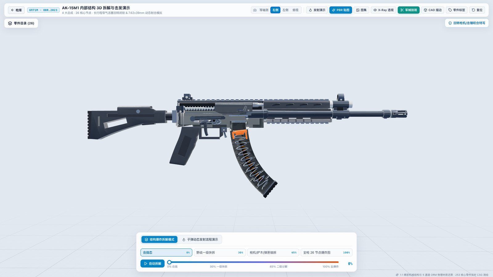
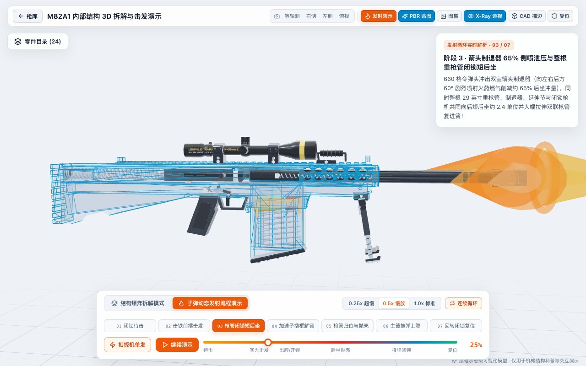
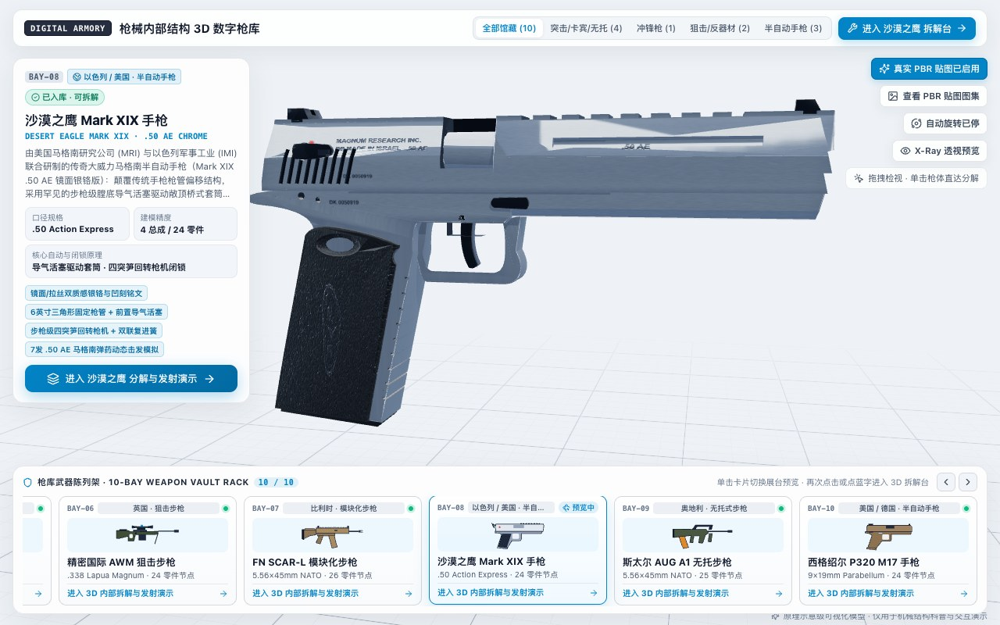
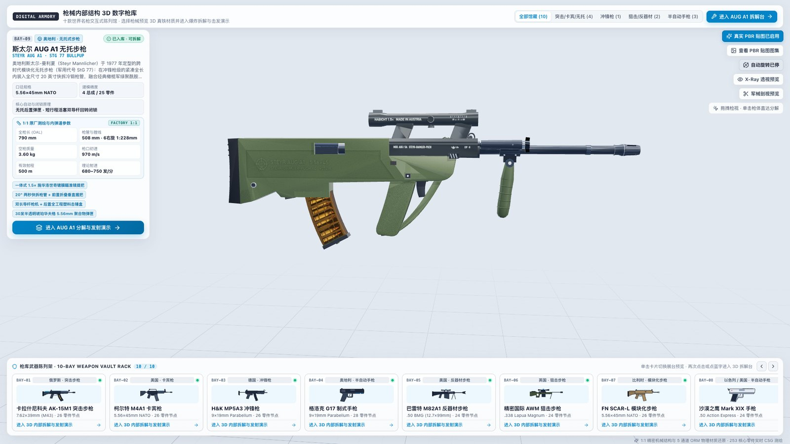

<div align="center">

<p>
  <a href="README.md">English</a>
  &nbsp;·&nbsp;
  <strong>简体中文</strong>
</p>

# Digital Armory 3D v2.0 · 枪械与弓弩内部结构 3D 数字博物馆

**浏览器原生秒开 · 零外部网格 · 十九款传奇名枪与复合弓弩 1:1 机械内构、千米内外弹道与军械师盲测百科全书**

[](https://github.com/zhoujingkun1989-arch/digital-armory-3d/actions/workflows/ci.yml)
[](https://zhoujingkun1989-arch.github.io/digital-armory-3d/showcase.html)
[](https://www.typescriptlang.org/)
[](https://threejs.org/)
[](LICENSE)

<h3>
  <a href="https://zhoujingkun1989-arch.github.io/digital-armory-3d/showcase.html?lang=zh">✦ 官方交互式宣传主页 (Showcase)</a>
  &nbsp;·&nbsp;
  <a href="https://zhoujingkun1989-arch.github.io/digital-armory-3d/?screen=armory&lang=zh">🚀 进入 19 槽 3D 数字枪库</a>
  &nbsp;·&nbsp;
  <a href="https://zhoujingkun1989-arch.github.io/digital-armory-3d/?screen=ballistics&lang=zh">🎯 1,000m 千米外弹道靶场</a>
  &nbsp;·&nbsp;
  <a href="https://zhoujingkun1989-arch.github.io/digital-armory-3d/?screen=cartridges&lang=zh">🧪 11 口径 1:1 实弹纵剖馆</a>
  &nbsp;·&nbsp;
  <a href="https://zhoujingkun1989-arch.github.io/digital-armory-3d/?weapon=ak15&screen=workbench&lang=zh">🔧 直达 AK-15M1 军械拆解台</a>
</h3>

</div>

---

> 基于 **React 18 + TypeScript + Three.js (`@react-three/fiber` / Web Worker `three-bvh-csg` / Web Audio API)** 构建的浏览器端开源 **3D 轻武器与复合弓弩机械博物馆与交互式工程百科全书（`<800 kB` 零告警精准代码分包）**。
>
> 全站 **零外部 `.glb` / `.gltf` 静态模型**——全部 **19 款世界经典名枪与复合弓弩（17 款传奇名枪含 FN M249 SAW 班用机枪、德国鲁格 P08 肘节手枪、KRISS Vector `.45 ACP` 冲锋枪、柯尔特蟒蛇 `.357`、伯奈利 M4 `M1014`、M1 加兰德 `.30-06` + 2 款复合弓弩 Mathews LIFT 33 / Ravin R500）、480 个可动机械零件** 均由纯代码参数化与布尔 CSG 在后台 Web Worker 实时生成，配套 **112 张 2K 5 通道 Packed ORM WebP 物理贴图**、**1,000m RK4 外弹道与光学分划板 DOPE 靶场 (`R`)**、**军械师限时盲拆与未知故障盲考认证 (`G / J`)**、**即时高清 3D 剖视社交分享海报工坊 (`U`)**、**自动原理流派对照矩阵 (`S`)**、**11 口径实弹与霰弹 1:1 纵剖馆 (`B`)**、**双通道 Stencil 实心金属纵剖面 (`C`)**、**6 大机械职能分色与 60fps 高压燃气导流 (`T`)**、**SAAMI/CIP 膛压 $P(t)$ 与初速 $V(t)$ 实时示波器**、**快慢机多档位火控手操 (`P / V / F`)**、**17 图版收藏图鉴与儿童 3D 绘本打印工坊 (`Ctrl/Cmd+P`)**、**iPad/移动端大触控热区适配** 以及 **1,112 段 Google Gemini `Charon` 中英双语语音导览与 3D 导演自动运镜纪录片**。


---

## 核心工程能力 (v2.0) | Engineering Highlights

- **✦ 1,000m RK4 千米外弹道、横风偏流与第一像面分划板 DOPE 实验室 (`[R]` / `?screen=ballistics`, `WP-14`)**：纯 TypeScript 零 GC 四阶龙格-库塔（RK4）3-DOF 质点外弹道解算器，完整预置 **13 套弹头/箭矢气动档案**（含新增 `.45 ACP 230gr FMJ` 亚音速重弹、`12 Gauge` 9 粒鹿弹锥形散布及 `400 gr` 复合弓箭/弩箭）。支持 ICAO 标准大气海拔/温度密度修正、单调三次样条 BRL G1/G7 跨音速激波阻力曲线、精确归零仰角求解器（误差 `< 0.02 cm`）、Mach 1.0 跨音速失稳边界检测、第一像面（FFP）MIL 圣诞树光学分划板实时风偏/下坠预览及 7 档距离 `MIL / MOA` 狙击手 DOPE 射表生成。
- **✦ 军械师限时盲拆考证 & 随机未知故障盲考诊断 (`[G] / [J]`, `WP-13`)**：从「引导教学」跃升为硬核实操考证！在 **限时盲拆考核 (`[G]`)** 中完全屏蔽步骤提示与一键代拆，计时考核 `0 → N → 0` 完整拓扑拆解与逆序复装（干涉误点每次扣 `75` 分并红光警示，绝不剧透前置零件名）；在 **未知故障盲考 (`[J]`)** 中随机定格 3D 卡阻姿态并隐藏高亮，先考眼力定性故障类别（猜错扣 `120` 分），再按打乱选项逐步排障（乱序扣 `60` 分），成绩（`S / A / B / C` 级认证星章）持久化写入本地档案并联动枪库徽章与分享海报。
- **✦ 即时高清 3D 剖视社交分享海报工坊 (`[U]`) & 平板/手机触控增强 (`WP-16`)**：一键截取当前实时 WebGL 剖视/拆解视口，在浏览器 Canvas 2D 内高清合成 `1920×1080`（`16:9`）或 `1080×1350`（`4:5`）三款博物馆主题海报（黑曜石战术金 / 工程蓝图白 / 赛博青剖视），集成双语铭牌、4 格 `1:1` 测绘参数、$P(t)/V(t)$ 特征曲线、`S/A/B/C` 军械师认证印章、收藏家呼号及可扫码直达同款剖视台的 ISO 18004 二维码（`?screen=workbench&weapon=<id>&cut=1`）；同步针对 `@media (pointer: coarse)` 触屏设备全面升级 44×44 px 触控热区与响应式抽屉布局。
- **✦ 自动原理流派谱系矩阵与双展品同屏对照实验室 (`[S]`, `WP-11`)**：按 **7 类自动机能量驱动、7 类弹膛闭锁泄压（含双连杆屈膝肘节闭锁与 Super V 轴外凸轮延迟）、7 类空间供弹排布（含 M27 可散弹链双拨爪梭动供弹）** 三大正交谱系完整归类全馆 **19 款展品**，内置 13 组跨时代经典对决预设（含 `M249 SAW vs M4A1`、`鲁格 P08 vs Glock 17`、`KRISS Vector vs MP5A3`、`AK-15 vs M1 加兰德` 等）与双枪膛压/初速同屏叠加曲线。
- **✦ 机械职能语义分色 (`[T]`) & 60fps 高压火药燃气导流流线 (`WP-05`)**：一键将全库 **480 个零件** 按 **闭锁承压、导气驱动、自动机框、火控击发、弹性储能、机匣供弹** 6 大机械职能赋予高辨识度语义色（零着色器重编译，且与 Stencil 实心纵剖面斜线同步换色），实时绘制膛内膨胀柱及 AK/M249/SCAR/AUG/Benelli M4 ARGO 活塞、M1 加兰德枪口导气筒、M4A1 气吹内腔与沙漠之鹰膛底前导气轨迹。
- **✦ 11 大口径 SAAMI / CIP 实弹与霰弹 1:1 纵剖对比实验室 (`[B]` / `?screen=cartridges`, `WP-06`)**：独立弹药展厅将 `9×19mm`、`.45 ACP`、`5.7×28mm`、`.357 Magnum`、`.50 AE`、`12 Gauge (00 鹿弹)`、`7.62×39mm`、`5.56 NATO`、`.30-06 Springfield`、`.338 Lapua`、`.50 BMG` 按 `1:1` 绝对物理比例（`29.69 mm` 至 `138.43 mm`）同台 `180°` 纵剖陈列，支持轴向分解滑块与定量参数矩阵对照。
- **✦ 17 图版收藏图鉴与儿童 3D 绘本打印工坊 (`[Ctrl/Cmd+P]`)、1:1 3D 军械游标卡尺 (`[K]`) & 双通道 Stencil 实心纵剖面 (`[C]`)**：支持穿透 `±45°` ISO 128 金属剖切面直接拾取内部零件测量毫米级距离，或一键离屏抓拍 17 幅高清 3D 图版排版输出双语绘本与收藏工程图鉴。
- **✦ AI 四幕研发史纪录片、1,112 段 `Charon` 双语配音 & 频散波导声场 (`WP-01 ~ WP-03`)**：19 套双语四幕研发史与 **1,112 条** `gemini-3.8-flash-tts`（`Charon` 统一音色 + SHA-256 哈希锁死）MP3 语音，配合 3D 导演自动运镜、欧拉-伯努利钢材频散波导（含加兰德末发漏夹「PING!」共鸣、M249 铁链节剥离、鲁格肘节折起清响与 Vector 1,200 RPM `.45` 连射）及三档立体声卷积混响。

---

## 实机渲染画廊 | Live WebGL 2.0 Gallery

| AK-15M1 纵向中轴军械剖视 (`C`) 与内部供弹/击发咬合 | Barrett M82A1 `.50 BMG` 整管短后坐与 60° 箭头制退冲击波 |
| :---: | :---: |
|  |  |

| Colt M4A1 军械级 100% 全零件爆炸图与防遮挡引线 | Desert Eagle Mark XIX `.50 AE` 拉丝硬铬与膛底正向导气活塞 |
| :---: | :---: |
|  |  |

| Steyr AUG A1 施华洛世奇瞄具与半透明琥珀弹匣 | 内置 2K 5 通道 PBR 贴图图集检视器 (Albedo / Normal / ORM) |
| :---: | :---: |
|  |  |

---

## 馆藏十九款名枪与复合弓弩矩阵 | 19-Exhibit Roster (480 Moving CSG Parts)

| 展位 | 型号 | 国家 / 类型 | 口径 / 箭矢 | 核心自动与闭锁机构 | 零件数 | 在线直达 |
| :--- | :--- | :--- | :--- | :--- | :---: | :---: |
| `BAY-01` | **Kalashnikov AK-15M1 (6П71М)** | 俄罗斯 · 突击步枪 | `7.62×39mm (M43)` | 长行程导气活塞 · 双突笋 35° 回转枪机闭锁 | 26 | [拆解](https://zhoujingkun1989-arch.github.io/digital-armory-3d/?weapon=ak15&screen=workbench&lang=zh) |
| `BAY-02` | **Colt M4A1 Carbine** | 美国 · 卡宾枪 | `5.56×45mm NATO` | 斯通纳直接气吹 (DI) · 机框内膨胀室 + 七突笋回转闭锁 | 26 | [拆解](https://zhoujingkun1989-arch.github.io/digital-armory-3d/?weapon=m4a1&screen=workbench&lang=zh) |
| `BAY-03` | **Heckler & Koch MP5A3** | 德国 · 冲锋枪 | `9×19mm Parabellum` | 双 Ø8mm 滚柱 + 45° 楔铁 4:1 延迟半自由枪机 · 浮置槽弹膛 | 26 | [拆解](https://zhoujingkun1989-arch.github.io/digital-armory-3d/?weapon=mp5&screen=workbench&lang=zh) |
| `BAY-04` | **Glock 17 Gen3** | 奥地利 · 半自动手枪 | `9×19mm Parabellum` | 布朗宁枪管短后坐偏移下倾闭锁 · Safe Action 三重保险击针 | 28 | [拆解](https://zhoujingkun1989-arch.github.io/digital-armory-3d/?weapon=g17&screen=workbench&lang=zh) |
| `BAY-05` | **Barrett M82A1** | 美国 · 反器材步枪 | `.50 BMG (12.7×99mm)` | 29" 开槽重枪管短后坐 · 加速子杠杆三突笋闭锁 + 双室箭头制退 | 24 | [拆解](https://zhoujingkun1989-arch.github.io/digital-armory-3d/?weapon=m82a1&screen=workbench&lang=zh) |
| `BAY-06` | **Accuracy International AWM** | 英国 · 狙击步枪 | `.338 Lapua Magnum` | 手动 60° 六突笋防冰槽刚性闭膛栓动 · 铝合金贯穿底盘 | 24 | [拆解](https://zhoujingkun1989-arch.github.io/digital-armory-3d/?weapon=awm&screen=workbench&lang=zh) |
| `BAY-07` | **FN SCAR-L Mk 16 Mod 0** | 比利时 · 模块化步枪 | `5.56×45mm NATO` | 短行程导气活塞顶杆 (Tappet) · 七突笋回转枪机 + 铝挤上机匣 | 26 | [拆解](https://zhoujingkun1989-arch.github.io/digital-armory-3d/?weapon=scar&screen=workbench&lang=zh) |
| `BAY-08` | **Desert Eagle Mark XIX** | 以色列/美国 · 手枪 | `.50 Action Express` | 固定枪管膛底正向导气活塞 · 四突笋回转枪机 + 双复进簧 | 24 | [拆解](https://zhoujingkun1989-arch.github.io/digital-armory-3d/?weapon=deagle&screen=workbench&lang=zh) |
| `BAY-09` | **Steyr AUG A1 (StG 77)** | 奥地利 · 无托步枪 | `5.56×45mm NATO` | 无托右偏置短行程活塞双长导杆 · 快拆枪管 + 全塑双连杆火控包 | 25 | [拆解](https://zhoujingkun1989-arch.github.io/digital-armory-3d/?weapon=aug&screen=workbench&lang=zh) |
| `BAY-10` | **SIG Sauer P320 M17** | 美国/德国 · 手枪 | `9×19mm Parabellum` | 模块化可拆不锈钢 FCU 火控内胆 · 布朗宁闭锁下倾平移击针 | 24 | [拆解](https://zhoujingkun1989-arch.github.io/digital-armory-3d/?weapon=p320&screen=workbench&lang=zh) |
| `BAY-11` | **FN P90 PDW** | 比利时 · 个人防卫武器 | `5.7×28mm FN SS190` | 顶置 50 发透明水平弹匣 · 90° 螺旋坡道供弹 + 自由枪机下抛壳 | 25 | [拆解](https://zhoujingkun1989-arch.github.io/digital-armory-3d/?weapon=p90&screen=workbench&lang=zh) |
| `BAY-12` | **Mathews LIFT 33** | 美国 · 双凸轮复合弓 | `400 gr 碳纤维猎箭 (348 FPS)` | SwitchWeight-X 同步双偏心凸轮 · 85% 省力谷 + QAD 落箭台 | 24 | [拆解](https://zhoujingkun1989-arch.github.io/digital-armory-3d/?weapon=lift33&screen=workbench&lang=zh) |
| `BAY-13` | **Ravin R500** | 美国 · 螺旋凸轮复合弩 | `400 gr 碳素弩箭 (500 FPS)` | HexCoil 360° 多层螺旋凸轮 · VersaDrive 丝杠上弦 + 悬浮滑台 | 25 | [拆解](https://zhoujingkun1989-arch.github.io/digital-armory-3d/?weapon=r500&screen=workbench&lang=zh) |
| `BAY-14` | **Colt Python 6" (.357 Mag)** | 美国 · 双动转轮手枪 | `.357 Magnum (9×33mmR)` | 双动/单动 V 形片簧精密钟表火控 · 60° 棘轮星盘分度与止转笋满锁 | 25 | [拆解](https://zhoujingkun1989-arch.github.io/digital-armory-3d/?weapon=python&screen=workbench&lang=zh) |
| `BAY-15` | **Benelli M4 (M1014)** | 意大利 · 战术霰弹枪 | `12 Gauge (00 鹿弹)` | 近膛双对称 ARGO 短行程自调导气活塞 · 双突笋枪机 + 管仓升降托弹板 | 26 | [拆解](https://zhoujingkun1989-arch.github.io/digital-armory-3d/?weapon=benellim4&screen=workbench&lang=zh) |
| `BAY-16` | **U.S. Rifle M1 Garand** | 美国 · 半自动步枪 | `.30-06 Springfield M2` | 枪口导气筒 + 右侧全长弯曲操作拉杆 · 双突笋枪机 + 8 发漏夹末发弹射 | 26 | [拆解](https://zhoujingkun1989-arch.github.io/digital-armory-3d/?weapon=garand&screen=workbench&lang=zh) |
| `BAY-17` | **FN M249 SAW 班用轻机枪** | 比利时/美国 · 班用机枪 | `5.56×45mm NATO (M27弹链/STANAG)` | 下置长行程活塞 · 开膛待击双突笋回转闭锁 + M27 双拨爪弹链/弹匣双供 | 26 | [拆解](https://zhoujingkun1989-arch.github.io/digital-armory-3d/?weapon=m249&screen=workbench&lang=zh) |
| `BAY-18` | **DWM 鲁格 P08 (1917)** | 德国 · 半自动手枪 | `9×19mm Parabellum` | 6.5mm 叉形节套管退短后坐 · 双连杆过死点向上屈膝肘节闭锁 | 25 | [拆解](https://zhoujingkun1989-arch.github.io/digital-armory-3d/?weapon=p08&screen=workbench&lang=zh) |
| `BAY-19` | **KRISS Vector 短剑 Gen II** | 美国/瑞士 · 冲锋枪 | `.45 ACP (11.43×23mm)` | Super V `-65°` 轴外钨钢配重滑块凸轮延迟半自由枪机 · 虎口下低膛轴线 | 25 | [拆解](https://zhoujingkun1989-arch.github.io/digital-armory-3d/?weapon=vector&screen=workbench&lang=zh) |

---

## 键盘快捷键与深度链接 | Shortcuts & Deep Links

### 深度链接参数
- 官方双语宣传页：`/showcase.html`、`/?screen=showcase` 或 `/?screen=showcase&lang=zh`
- 19 槽数字枪库：`/?screen=armory&weapon=m249&lang=zh`
- 1,000m 千米外弹道与分划板 DOPE 靶场：`/?screen=ballistics&caliber=338_lapua&lang=zh`
- 11 大口径 1:1 实弹与霰弹纵剖馆：`/?screen=cartridges&caliber=45_acp&lang=zh`
- 直达纵剖 / 击发工作台：`/?weapon=vector&screen=workbench&cut=1&lang=zh`

### 全局工程快捷键
| 按键 | 功能说明 |
| :---: | :--- |
| `Space` | 播放 / 暂停自动拆解或 7 阶段实弹击发循环演示 |
| `C` | 开启 / 关闭双通道 Stencil 实心金属纵向军械剖视切面 |
| `T` | 开启 / 关闭 **6 大机械职能语义分色模式**（支持按角色聚光与剖切面同步换色） |
| `G` | 开启 / 退出 **军械师引导式快拆与限时盲拆考证（Field-Strip DAG 模式）** |
| `J` | 开启 / 退出 **经典故障剖视排障室与随机未知故障盲考**（烟囱卡壳 / 双进弹 / 轻敲拒发 / 未闭锁阻断） |
| `K` | 开启 / 退出 **1:1 3D 军械游标卡尺**（`mm` 级两点拾取）与三维包络标尺 |
| `R` | 进入 / 返回 **1,000m RK4 千米外弹道、横风偏流与第一像面分划板 DOPE 靶场** |
| `U` | 打开 / 关闭 **即时高清 3D 剖视社交分享海报工坊**（`16:9 / 4:5` + 二维码 + 军械师认证章） |
| `B` | 进入 / 退出 **11 大口径 SAAMI/CIP 实弹与霰弹 1:1 纵剖对比实验室** |
| `S` | 打开 / 关闭 **自动原理流派谱系矩阵与双展品同屏对照实验室**（数字枪库） |
| `X` | 开启 / 关闭机匣、套筒与弹匣外壳 X-Ray 光学透视 |
| `P` | 微拉套筒 / 拉机柄 28% 执行军械露铜验膛（Press-Check） |
| `V` | 循环切换快慢机火控档位（`SAFE` → `SEMI` → `AUTO`） |
| `F` | 按住扣动扳机，松开释放断连器复位 |
| `E` | 开启 / 关闭工业 CAD 硬边轮廓线 |
| `L` | 显示 / 隐藏 3D 空间零件引线标签（拆解模式） |
| `M` | 开启 / 静音 Web Audio 军械机械咬合声与分口径 / 弓弩声场 |
| `H` | 隐藏 / 恢复全部界面按钮，进入 **纯净全屏 3D 展示** |
| `Ctrl/Cmd + P` | 打开 **17 图版收藏图鉴与儿童 3D 绘本打印工坊** |
| `Shift + R` | 一键重置回 0% 合拢态与标准等轴测视角 |
| `Esc` | 依次收起抽屉为迷你字幕条 → 取消选中零件 → 返回 3D 数字枪库 |

---

## 快速启动与质量门禁 | Quick Start & Quality Gates

### 环境要求
- **Node.js** `>= 20`
- （可选，仅离线重新烘焙贴图时需要）**Python** `>= 3.10` + `numpy` + `Pillow`

### 常用命令

```bash
# 1. 安装依赖
npm install

# 2. 启动本地开发服务器 (同时支持 / 与 /showcase.html)
npm run dev

# 3. 执行四项工程质量门禁 (TypeScript + ESLint + Vitest 全量 19 展品契约测试 + <800 kB 多入口分包构建)
npm run typecheck
npm run lint
npm test
npm run build
```

---

## 声明 | Disclaimer

本项目所有三维模型均为**原理示意级（Schematic / Educational Level）**浏览器端机械科普与交互可视化开源作品，重点展示自动原理、闭锁机构、内外弹道物理与勤务拆装拓扑关系，**不包含任何工业制造公差、CAD 加工图纸或可打印构件尺寸**。

---

## 开源协议 | License

本项目基于 [MIT License](LICENSE) 开源。
