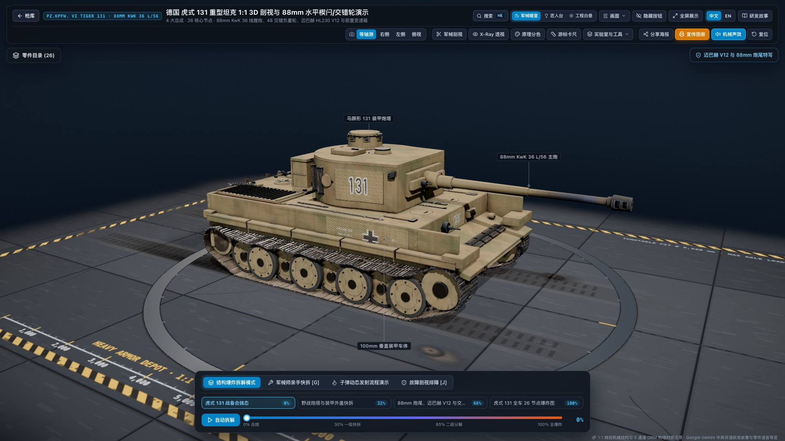
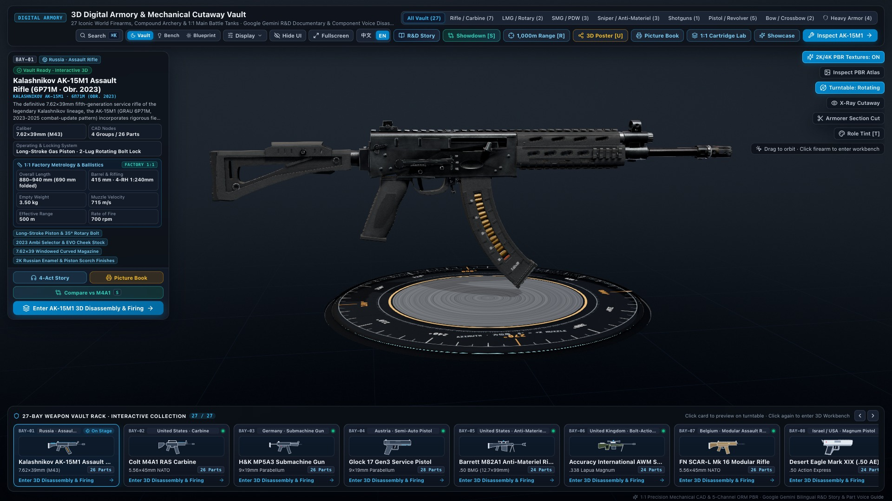

<div align="center">

<p>
  <a href="README.md">English</a>
  &nbsp;·&nbsp;
  <strong>简体中文</strong>
  &nbsp;·&nbsp;
  <a href="CONTRIBUTING.md#-简体中文指南">参与贡献指南</a>
</p>

# Digital Armory 3D · v4.0 重装装甲展厅旗舰版

**全球首个浏览器端开源 3D 轻武器、复合弓弩与 1:1 主战坦克机械博物馆 · 交互式工程百科全书**

[](https://github.com/zhoujingkun1989-arch/digital-armory-3d/actions/workflows/ci.yml)
[](https://zhoujingkun1989-arch.github.io/digital-armory-3d/showcase.html?lang=zh)
[](https://www.typescriptlang.org/)
[](https://threejs.org/)
[](scripts/blender/)
[](LICENSE)

<h3>
  <a href="https://zhoujingkun1989-arch.github.io/digital-armory-3d/showcase.html?lang=zh">✦ 官方交互式宣传主页 (Showcase)</a>
  &nbsp;·&nbsp;
  <a href="https://zhoujingkun1989-arch.github.io/digital-armory-3d/?screen=armory&lang=zh">🚀 进入 27 槽 3D 数字兵器库</a>
  &nbsp;·&nbsp;
  <a href="https://zhoujingkun1989-arch.github.io/digital-armory-3d/?weapon=ztz99a&screen=workbench&cut=1&lang=zh">🛡️ 1:1 重装甲纵剖工作台</a>
  &nbsp;·&nbsp;
  <a href="https://zhoujingkun1989-arch.github.io/digital-armory-3d/?screen=ballistics&lang=zh">🎯 1,000m 千米外弹道靶场</a>
  &nbsp;·&nbsp;
  <a href="https://zhoujingkun1989-arch.github.io/digital-armory-3d/?screen=cartridges&lang=zh">🧪 15+3 实弹与炮弹纵剖馆</a>
</h3>

</div>

---


> 基于 **React 18 + TypeScript 5.6 + Three.js (`@react-three/fiber` / 双轨 Blender 5.2 Draco `.glb` + Web Worker `three-bvh-csg` / Web Audio API)** 构建——零客户端安装、原生秒开，全站生产分包严格 **`<800 kB` 零警告**。
>
> 实时检视 **27 款传奇展品、683 个可动 CAD 零件**（**21 款传奇名枪 + 2 款复合弓弩 + 4 款 1:1 真实尺度主战坦克**：**中国 ZTZ-99A**、**美国 M1A2 SEP v3 艾布拉姆斯**、**德国 KMW 豹 2A7V** 与 **德国虎式 I 131 号**），由 **27/27（100%）Blender 5.2 Cycles 照片级大满贯**驱动（**`625` 个水密精模 Draco `.glb` 零件 + `58` 个保留 `aSpringParam` GPU 实时形变的动态 CSG 弹簧/主炮复进簧/弓片/弓弦 = `683/683` 全零件**，单款轻武器 `2.06–7.05 MB`、4K 主战坦克 `9.94–11.27 MB` 且单侧配备 `74–96` 块独立铰接下垂履带板）、**351 张 2K/4K 5 通道 Packed ORM 与微表面细节 WebP 贴图（`0` 张 PNG，`80` 套 PBR 图集含 `24` 张 4K 坦克外观图与 `512×512` 无缝 RHA/CARC 装甲微细节图）**、**4 套 Cycles 32-bit `.hdr` 环境光**（3 档桌面影棚 + 专用 `1:1` **重装装配机库 HDRI**）、**直射光微阴影 / Lagarde 镜面遮蔽 / 光学 AR 多层镀膜菲涅耳虹彩**、**`18 m × 12 m` 边缘羽化做旧混凝土地坪**（`1u = 1cm`，Ultra `4096×4096` 主光阴影）、**全局 `Cmd+K` 中英双语瞬搜指令面板**、**实时可拖拽 CT 扫描纵剖面（`[C]`，轻武器 `±25 mm` / 主战坦克 `±1,800 mm`）**、**1,000m RK4 G1/G7 外弹道与 FFP 分划板靶场（`[R]`，20 套弹道档案）**、**军械师盲拆与未知故障盲考（`[G] / [J]`）**、**15+3 口径实弹与坦克主炮弹 1:1 纵剖实验室（`[B]`）**、**9×9×9 三轴原理流派对照矩阵（`[S]`，19 组对决）**、**高清 3D 分享海报工坊（`[U]`）**、**全馆 27/27 Cycles 17 图版收藏图鉴与儿童 3D 绘本打印工坊（`[Ctrl/Cmd+P]`）**，以及 **1,582 段中英双语 `Charon`（`gemini-3.8-flash-tts`）语音导览与 3D 导演自动运镜纪录片**。

---

## v4.0 重装装甲展厅 · 1:1 真实尺度主战坦克（`BAY-24 ~ BAY-27` · WebGL 2.0 实机直拍）

*严格遵循 **`1 world unit = 1 cm = 10 mm`** 实车 `1:1` 尺寸（全长 `8.45–10.97 m`，战斗全重 `55–66.8 吨`），陈列于带 C2 五次方边缘羽化与暗色油渍的 **`18 m × 12 m` 做旧混凝土地坪** 之上，匹配 **`1:1` 32-bit Cycles 重装装配机库 HDRI** 与 `4096×4096` Ultra 主光阴影；全车配备 **`4096×4096` Cycles 4K 外观贴图**、**512px 三平面 RNM 装甲钢与 CARC 微表面细节**、**单侧 `74–96` 块独立下垂履带板**、**光学 AR 镀膜镜片**、`near = 2.0 / far = 9000` 光学视锥、可被 `±1,800 mm` 活体 CT 纵剖面（`45° ISO 128` 金属剖面线）干净劈开的中空装甲车体/炮塔，以及 7 阶段主炮后坐、自动装弹机与隔爆门装填运动学。以下画面均为 `1920×1080` Chromium 实时渲染未修直出。*

| **🇨🇳 ZTZ-99A (`125mm ZPT-98 L/50`) · 4K 数码迷彩、86 块履带板与 FY-4 爆反 (`10.27 MB`)** | **🇨🇳 ZTZ-99A 实时 CT 纵剖 (`[C]`) · 22 发底置转盘装弹机与 150HB V12 引擎** |
| :---: | :---: |
|  |  |

| **🇺🇸 M1A2 SEP v3 艾布拉姆斯 (`120mm M256 L/44`) · 4K 沙漠 CARC 与 T158 履带 (`9.94 MB`)** | **🇺🇸 M1A2 SEP v3 实时 CT 纵剖 (`[C]`) · 隔爆门尾舱弹药与 AGT1500 燃气轮机** |
| :---: | :---: |
|  |  |

| **🇩🇪 KMW 豹 2A7V (`120mm Rh-120 L/55A1`) · 4K 北约三色与箭簇楔形装甲 (`11.27 MB`)** | **🇩🇪 豹 2A7V 实时 CT 纵剖 (`[C]`) · 中空箭簇楔块、Rh-120 炮闩与 MTU V12 动力包** |
| :---: | :---: |
|  |  |

| **🇩🇪 虎式 I 131 号重型坦克 (`88mm KwK 36 L/56`) · 4K 锯齿防磁装甲与交错轮 (`10.32 MB`)** | **🇩🇪 虎式 131 实时 CT 纵剖 (`[C]`) · 克虏伯 88mm 横楔炮闩与迈巴赫 HL230 V12** |
| :---: | :---: |
|  |  |

| **重装甲大厅 (`?screen=armory`) · 4 款主战坦克专属矢量轮廓与参数铭牌** | **1:1 坦克主炮弹纵剖实验室 (`[B]`) · `88mm PzGr.39`、`120mm NATO APFSDS` 与 `125mm DTC10-125`** |
| :---: | :---: |
|  |  |

---

## v4.0 照片级轻武器与复合弓弩旗舰画廊（27/27 Blender 5.2 大满贯 · 100% WebGL 2.0 实机直拍）

*以下每一帧均由开源 **Blender 5.2 LTS 无头 Draco `.glb` + Cycles 2K Packed ORM** 管线与 **32-bit 摄影棚 `.hdr`** 在 Chromium 1920×1080 实时渲染输出。*

| **卡拉什尼科夫 AK-15M1 (`7.62×39mm`)** · *冲压磷化钢与透视窗弹匣 (`3.90 MB`)* | **DWM 1917 鲁格 P08 (`9×19mm`)** · *滚花肘节、`1917`/`B·R·S` 戳记、240°C 麦秆黄回火与胡桃木 (`3.39 MB`)* |
| :---: | :---: |
|  |  |

| **沙漠之鹰 Mark XIX (`.50 AE`)** · *416 拉丝不锈钢、斜向防滑齿与四突笋回转枪机 (`7.05 MB`)* | **Colt M4A1 SOPMOD (`5.56 NATO`)** · *7075-T6 硬质阳极氧化上下机匣、奔马铭文与 KAC RAS (`3.53 MB`)* |
| :---: | :---: |
|  |  |

| **柯尔特蟒蛇 6 英寸 (`.357 Magnum`)** · *液态“皇家烤蓝”、弹巢曳痕与 24K 金徽黑胡桃 (`2.13 MB`)* | **美国 M1 加兰德步枪 (`.30-06 Springfield`)** · *亚麻籽油黑胡桃、`S.A./NFR` 兵工厂木章与 T105 瞄具 (`2.72 MB`)* |
| :---: | :---: |
|  |  |

| **H&K MP5A3 (`9×19mm`)** · *烤漆黑冲压机匣、海军三发图标、热带护木与伸缩托 (`3.18 MB`)* | **精密国际 AWM (`.338 Lapua Mag`)** · *英军 OD 绿拇指孔底盘、S&B PM II `5-25×56` 与防冰槽枪机 (`3.68 MB`)* |
| :---: | :---: |
|  |  |

| **巴雷特 M82A1 / M107 (`.50 BMG`)** · *锰系磷化加强筋机匣、Leupold Mark 4 金环瞄具 (`3.49 MB`)* | **Glock 17 Gen 5 (`9×19mm`)** · *缎面 nDLC 牛鼻套筒、奥地利 Ferlach 试枪戳与 RTF4 握把 (`2.28 MB`)* |
| :---: | :---: |
|  |  |

| **FN SCAR-L Mk 16 Mod 0 (`5.56 NATO`)** · *FDE 多色阶整体铝上机匣、SOCOM UID 二维码与折叠托 (`3.41 MB`)* | **Steyr AUG A1 / StG 77 (`5.56 NATO`)** · *奥地利军绿 PA66 枪身、内置施华洛世奇 1.5× 镜与琥珀华夫弹匣 (`3.62 MB`)* |
| :---: | :---: |
|  |  |

| **SIG Sauer P320 / 美军 M17 (`9×19mm`)** · *双色沙金 PVD 套筒、UID 铭牌与可拆不锈钢 FCU 内胆 (`2.53 MB`)* | **FN Herstal P90 PDW (`5.7×28mm`)** · *半透明琥珀 50 发水平弹匣、90° 螺旋供弹坡道与 MC-10-80 环视镜 (`2.17 MB`)* |
| :---: | :---: |
|  |  |

| **伯奈利 M4 Super 90 / USMC M1014 (`12 Gauge`)** · *III 型碳灰机匣、Gardone `PSF/CIP` 试枪戳与双 ARGO 活塞 (`2.47 MB`)* | **FN M249 SAW (`5.56×45mm NATO`)** · *铆接磷化钢机匣、M855 绿尖/M856 曳光弹链与 200 发弹药箱 (`3.64 MB`)* |
| :---: | :---: |
|  |  |

| **KRISS Vector SMG Gen II (`.45 ACP`)** · *沙黑双色 Super V 下潜机匣、CNC 配重滑块与 25 发长弹匣 (`2.18 MB`)* | **Mathews LIFT 33 复合弓 (`348 FPS`)** · *SwitchWeight-X 青铜双凸轮、桁架镂空弓把与四片弓片 (`3.37 MB`)* |
| :---: | :---: |
|  |  |

| **Ravin R500 复合弩 (`500 FPS`)** · *360° 铜金色 HexCoil 螺旋凸轮、VersaDrive 丝杠与 1–8×24 瞄具 (`3.53 MB`)* | **鲁格 P08 双通道 Stencil 实心纵剖 (`[C]`)** · *ISO 128 45° 金属剖面线、8 发 9mm 弹柱与螺旋复进簧* |
| :---: | :---: |
|  |  |

| **H&K G11 K2 (`4.73×33mm DM11` 无壳弹)** · *90° 镀铬旋转弹膛、钟表级齿轮连杆与 Hensoldt 光学镜 (`2.06 MB`)* | **VSS Vintorez (`9×39mm` 亚音速微声弹)** · *414mm 多孔 6 级斜挡板消音器、TOZ 铭文机匣与 PSO-1M2-1 瞄具 (`2.23 MB`)* |
| :---: | :---: |
|  |  |

| **GE / Dillon Aero M134D 加特林 (`7.62×51mm NATO`)** · *6 管 3,000 RPM 旋转枪管簇、28V 电机与 360° 螺旋凸轮 (`3.31 MB`)* | **Nikonov AN-94 “阿巴坎” (`5.45×39mm 7N6`)** · *钢索滑轮 1,800 RPM 延迟双发、15° 右倾紫红弹匣与 8 字制退器 (`2.92 MB`)* |
| :---: | :---: |
|  |  |

### 15 口径轻武器实弹 1:1 SAAMI/CIP 纵剖对比实验室（`[B]`）· *从 `9×19mm`（`29.69 mm`）、方形 `4.73×33mm DM11` 无壳弹到 `.50 BMG`（`138.43 mm`）*


---

## v4.0 旗舰工程架构与核心能力

| **全局 `Cmd+K` / `Ctrl+K` 中英双语瞬搜指令面板** | **27 槽交互式 3D 数字兵器库与重装甲展厅** |
| :---: | :---: |
|  |  |

- **✦ 双轨 Blender 5.2 Draco `.glb` + Web Worker CSG 建模引擎（`PR-02` ~ `PR-04`, `WP-17` ~ `WP-18`）**：
  - **27/27（100%）照片级大满贯**：全馆全部 **27 款展品**（21 款枪械 + 2 款复合弓弩 + 4 款 1:1 主战坦克）均由仓储内 MIT 开源无头 Python 脚本（`scripts/blender/build_*_photoreal.py`）程序化雕塑并 Cycles GPU 烘焙为紧凑 Draco `.glb`（`625` 个水密精模 CAD 零件，单展品总包 `2.06–11.27 MB`，含单侧 `74–96` 块独立下垂履带板的 4K 主战坦克包，`100%` 流形、严格 `1u = 1cm`），配套 `351` 张 2K/4K 5 通道 Packed ORM 与微表面细节 WebP 贴图（`115` Albedo / `118` Normal / `118` ORM 与细节图，`80` 套图集含 `24` 张 4K 坦克外观图与 `512×512` 无缝 RHA/CARC 细节图，`0` 张 PNG）。
  - **零妥协 GPU 实时形变弹簧、弓片与弓弦**：全馆 `58` 个螺旋复进簧、主炮复进/炮闩弹簧、V 形主簧与复合弓弩四片弓片/凸轮轴/弓弦缆绳继续保留在 Web Worker CSG 轨道，确保逐顶点 `aSpringParam` 在 60 FPS 下精确压缩弯曲（并保留完整 CSG 离线兜底）。
  - **影棚光学与重装装配机库（`PR-01`, `WP-18`）**：内置 4 套 Cycles 32-bit `.hdr`（3 档轻武器影棚 + 专用 `1:1` `heavy_armor_hangar.hdr`）、带 `2.6 m` C2 五次方圆角边缘羽化溶解与油渍/履带压痕的 `18 m × 12 m` 做旧混凝土地坪（`Y = -120.0 cm`、`4096×4096` Ultra 紧凑主光阴影与 `near=2.0/far=9000` 远景光学）、直射光微阴影 + Jimenez 多重反弹 AO + Lagarde 镜面遮蔽、512px 三平面 RNM 微表面法线、光学 AR 镀膜菲涅耳虹彩、GGX Specular AA、实时服役磨损（`出厂 / 微油 / 沧桑`）、微距景深、半分辨率 GTAO + AgX 色调映射及三档自适配画质（`Ultra / Balanced / Eco`）。
- **✦ 实时可拖拽 CT 扫描纵剖面（`[C]`，`PR-04`, `WP-18`）**：支持轻武器 `±25 mm` 与主战坦克 `±1,800 mm` 实时滑动切片、`+Z / -Z` 翻转、倾斜局部 Z 剖切（如 AN-94 `15°` 右倾弹匣中轴剖切）与 60 FPS 自动扫描（零着色器重编译，同步 Two-Pass WebGL Stencil 45° ISO 128 金属剖面线与 `sectionAwareMeshRaycast` 穿透拾取）。
- **✦ 全局 `Cmd+K` / `Ctrl+K` 指令面板与极简玻璃态工作台（`PR-04`）**：在全站任意页面一键呼出多关键词中英瞬搜，直达全部 **27 款展品**、**683 个零件**、**重装甲大厅**、**1:1 坦克炮弹实验室**、各大实验室与视觉开关。
- **✦ 1,000m RK4 G1/G7 外弹道、横风偏流与第一像面分划板 DOPE 靶场（`[R]`）**：Zero-GC 四阶龙格-库塔（RK4）3-DOF 引擎实时解算全部 **20 套弹头/箭矢/坦克炮弹气动档案**（含 `armor` 重装甲炮弹筛选与预设），支持 ICAO 海拔/温度大气修正、BRL G1/G7 跨音速阻力曲线、精准归零仰角求解（`< 0.02 cm`）、Mach 1.0 失稳检测、FFP MIL 圣诞树分划板与 7 档距离 `MIL / MOA` DOPE 射表。
- **✦ 军械师限时盲拆考证（`[G]`）与未知故障盲考诊断（`[J]`）**：覆盖全馆 **27 款展品** 真实有向拆装依赖图（DAG）与 4 类典型卡阻/阻断（烟囱卡壳、双进弹、轻敲拒发、未闭锁击发阻断），支持 `0 → N → 0` 无提示限时盲拆复装与随机故障定性排障，评定持久化 `S / A / B / C` 认证星章。
- **✦ 6 大机械职能分色（`[T]`）、火药燃气流线 & SAAMI/CIP/STANAG/GJB 遥测**：零重编译语义分色与 60fps 膛压 $P(t)$（`MPa`）/ 初速 $V(t)$（`m/s`）/ 动能（`J / MJ`）示波器，配套 `SAFE / SEMI / AUTO` 快慢机（`[V]`）、验膛（`[P]`）与两道火扳机（`[F]`）手操。
- **✦ 15+3 口径实弹与炮弹纵剖馆（`[B]`）、9×9×9 流派对照矩阵（`[S]`）与 3D 游标卡尺（`[K]`）**：涵盖 **15 款轻武器实弹**（`9×19mm` 至 `.50 BMG`）+ **3 款坦克主炮弹**（`88mm PzGr.39`、`120mm NATO APFSDS`、`125mm DTC10-125`）、**19 组跨时代机械对决预设**（含 `ZTZ-99A vs M1A2`、`豹 2A7V vs ZTZ-99A`、`M1A2 vs 虎式 131`）与 `1u = 10mm` 空间卡尺量测。
- **✦ 四幕双语纪录片、1,582 段 `Charon` 语音、分享海报（`[U]`）与 27/27 Cycles 17 图版绘本打印（`[Ctrl/Cmd+P]`）**：3D 导演自动运镜、立体声卷积 IR + 欧拉-伯努利钢材频散波导（M1 加兰德 `"PING!"`、M134D 3,000 RPM 电锯蜂鸣、VSS 微声与 125/120/88mm 主炮冲击波/涡轮/V12/转盘声效）、`16:9 / 4:5` 二维码海报及 **27/27 展品 Blender 5.2 Cycles 2880×1800 透明底印刷主图** 驱动的 A4/Letter DK 百科与儿童 3D 绘本打印。

---

## 27 款殿堂级馆藏全览矩阵（683 运动零件 · 27/27 Blender 5.2 大满贯）

| 展位 | 展品名称 | 管线 | 口径 / 弹药 | 核心自动、闭锁与装填机构 | 零件数 | 在线直达 |
| :--- | :--- | :---: | :--- | :--- | :---: | :---: |
| `BAY-01` | **Kalashnikov AK-15M1 (6П71М)** | `GLB v3` | `7.62×39mm (M43)` | 长行程导气活塞 · 双突笋 35° 回转枪机闭锁 | 26 | [拆解](https://zhoujingkun1989-arch.github.io/digital-armory-3d/?weapon=ak15&screen=workbench&lang=zh) |
| `BAY-02` | **Colt M4A1 SOPMOD 卡宾枪** | `GLB v3` | `5.56×45mm NATO` | 斯通纳直接气吹 (DI) · 机框内膨胀室 + 七突笋闭锁 | 26 | [拆解](https://zhoujingkun1989-arch.github.io/digital-armory-3d/?weapon=m4a1&screen=workbench&lang=zh) |
| `BAY-03` | **Heckler & Koch MP5A3** | `GLB v3` | `9×19mm Parabellum` | 双 Ø8mm 滚柱 + 45° 楔铁 4:1 延迟半自由枪机 · 浮置槽弹膛 | 26 | [拆解](https://zhoujingkun1989-arch.github.io/digital-armory-3d/?weapon=mp5&screen=workbench&lang=zh) |
| `BAY-04` | **Glock 17 Gen 5** | `GLB v3` | `9×19mm Parabellum` | 布朗宁枪管短后坐偏移下倾闭锁 · Safe Action 三重保险击针 | 28 | [拆解](https://zhoujingkun1989-arch.github.io/digital-armory-3d/?weapon=g17&screen=workbench&lang=zh) |
| `BAY-05` | **Barrett M82A1 / M107** | `GLB v3` | `.50 BMG (12.7×99mm)` | 29" 开槽重枪管短后坐 · 加速子杠杆三突笋闭锁 + 双室箭头制退 | 24 | [拆解](https://zhoujingkun1989-arch.github.io/digital-armory-3d/?weapon=m82a1&screen=workbench&lang=zh) |
| `BAY-06` | **Accuracy International AWM** | `GLB v3` | `.338 Lapua Magnum` | 手动 60° 六突笋防冰槽刚性闭膛栓动 · 铝合金贯穿底盘 | 24 | [拆解](https://zhoujingkun1989-arch.github.io/digital-armory-3d/?weapon=awm&screen=workbench&lang=zh) |
| `BAY-07` | **FN SCAR-L Mk 16 Mod 0** | `GLB v3` | `5.56×45mm NATO` | 短行程导气活塞顶杆 (Tappet) · 七突笋回转枪机 + 整体铝上机匣 | 26 | [拆解](https://zhoujingkun1989-arch.github.io/digital-armory-3d/?weapon=scar&screen=workbench&lang=zh) |
| `BAY-08` | **Desert Eagle Mark XIX** | `GLB v3` | `.50 Action Express` | 固定枪管膛底正向导气活塞 · 四突笋回转枪机 + 双复进簧 | 24 | [拆解](https://zhoujingkun1989-arch.github.io/digital-armory-3d/?weapon=deagle&screen=workbench&lang=zh) |
| `BAY-09` | **Steyr AUG A1 (StG 77)** | `GLB v3` | `5.56×45mm NATO` | 无托右偏置短行程活塞双长导杆 · 快拆枪管 + 全塑双连杆火控包 | 25 | [拆解](https://zhoujingkun1989-arch.github.io/digital-armory-3d/?weapon=aug&screen=workbench&lang=zh) |
| `BAY-10` | **SIG Sauer P320 M17** | `GLB v3` | `9×19mm Parabellum` | 模块化可拆不锈钢 FCU 火控内胆 · 布朗宁下倾平移击针 | 24 | [拆解](https://zhoujingkun1989-arch.github.io/digital-armory-3d/?weapon=p320&screen=workbench&lang=zh) |
| `BAY-11` | **FN P90 PDW** | `GLB v3` | `5.7×28mm FN SS190` | 顶置 50 发透明水平弹匣 · 90° 螺旋坡道供弹 + 自由枪机下抛壳 | 25 | [拆解](https://zhoujingkun1989-arch.github.io/digital-armory-3d/?weapon=p90&screen=workbench&lang=zh) |
| `BAY-12` | **Mathews LIFT 33 复合弓** | `GLB v3` | `400 gr 碳纤维猎箭 (348 FPS)` | SwitchWeight-X 同步双偏心凸轮 · 85% 省力谷 + QAD 落箭台 | 24 | [拆解](https://zhoujingkun1989-arch.github.io/digital-armory-3d/?weapon=lift33&screen=workbench&lang=zh) |
| `BAY-13` | **Ravin R500 复合弩** | `GLB v3` | `400 gr 碳素弩箭 (500 FPS)` | HexCoil 360° 螺旋凸轮 · VersaDrive 丝杠上弦 + 悬浮滑台 | 25 | [拆解](https://zhoujingkun1989-arch.github.io/digital-armory-3d/?weapon=r500&screen=workbench&lang=zh) |
| `BAY-14` | **Colt Python 6" (.357 Mag)** | `GLB v3` | `.357 Magnum (9×33mmR)` | 双动/单动 V 形片簧精密钟表火控 · 60° 棘轮星盘分度与止转笋 | 25 | [拆解](https://zhoujingkun1989-arch.github.io/digital-armory-3d/?weapon=python&screen=workbench&lang=zh) |
| `BAY-15` | **Benelli M4 (M1014)** | `GLB v3` | `12 Gauge (00 鹿弹)` | 近膛双对称 ARGO 短行程自调活塞 · 双突笋枪机 + 管仓托弹板 | 26 | [拆解](https://zhoujingkun1989-arch.github.io/digital-armory-3d/?weapon=benellim4&screen=workbench&lang=zh) |
| `BAY-16` | **U.S. Rifle M1 Garand** | `GLB v3` | `.30-06 Springfield M2` | 枪口导气筒 + 右侧弯曲长行程操作拉杆 · 8 发漏夹末发弹射 | 26 | [拆解](https://zhoujingkun1989-arch.github.io/digital-armory-3d/?weapon=garand&screen=workbench&lang=zh) |
| `BAY-17` | **FN M249 SAW 班用轻机枪** | `GLB v3` | `5.56×45mm NATO (M27/STANAG)` | 下置长行程活塞 · 开膛待击双突笋闭锁 + M27 弹链/弹匣双供 | 26 | [拆解](https://zhoujingkun1989-arch.github.io/digital-armory-3d/?weapon=m249&screen=workbench&lang=zh) |
| `BAY-18` | **DWM 鲁格 P08 (1917)** | `GLB v3` | `9×19mm Parabellum` | 6.5mm 叉形节套管退短后坐 · 过死点双连杆屈膝肘节闭锁 | 25 | [拆解](https://zhoujingkun1989-arch.github.io/digital-armory-3d/?weapon=p08&screen=workbench&lang=zh) |
| `BAY-19` | **KRISS Vector SMG Gen II** | `GLB v3` | `.45 ACP (11.43×23mm)` | Super V `-65°` 轴外钨钢滑块下潜延迟半自由枪机 · 低膛轴线 | 25 | [拆解](https://zhoujingkun1989-arch.github.io/digital-armory-3d/?weapon=vector&screen=workbench&lang=zh) |
| `BAY-20` | **H&K G11 K2** | `GLB v3` | `4.73×33mm DM11 无壳弹` | 90° 旋转圆柱弹膛 · 钟表级齿轮连杆 & 2,100 RPM 浮置三连发 | 24 | [拆解](https://zhoujingkun1989-arch.github.io/digital-armory-3d/?weapon=g11&screen=workbench&lang=zh) |
| `BAY-21` | **VSS Vintorez (6P29)** | `GLB v3` | `9×39mm SP-5/SP-6 亚音速` | 三排多孔泄气枪管 + 6 级斜挡板消音器 · 6 突笋枪机 + 直线击锤 | 24 | [拆解](https://zhoujingkun1989-arch.github.io/digital-armory-3d/?weapon=vss&screen=workbench&lang=zh) |
| `BAY-22` | **GE / Dillon Aero M134D 加特林** | `GLB v3` | `7.62×51mm NATO (M13 弹链)` | 28V DC 电动 6 管旋转枪管簇 · 360° 正弦凸轮轨道 + 无链供弹器 | 25 | [拆解](https://zhoujingkun1989-arch.github.io/digital-armory-3d/?weapon=m134&screen=workbench&lang=zh) |
| `BAY-23` | **Nikonov AN-94 “阿巴坎” (6P33)** | `GLB v3` | `5.45×39mm 7N6` | 浮置枪管机匣 + 内部钢索滑轮 · 1,800 RPM 延迟双发 + 15° 弹匣 | 26 | [拆解](https://zhoujingkun1989-arch.github.io/digital-armory-3d/?weapon=an94&screen=workbench&lang=zh) |
| `BAY-24` | **🇨🇳 ZTZ-99A 主战坦克** | `GLB v3` | `125mm DTC10-125 APFSDS` | 125mm ZPT-98 L/50 滑膛炮 · 22 发转盘自动装弹机 + FY-4 爆反 + 150HB V12 | 26 | [拆解](https://zhoujingkun1989-arch.github.io/digital-armory-3d/?weapon=ztz99a&screen=workbench&lang=zh) |
| `BAY-25` | **🇺🇸 M1A2 SEP v3 艾布拉姆斯** | `GLB v3` | `120×570mm NATO M829A4` | 120mm M256 L/44 滑膛炮 · 滑动隔爆门尾舱 + 泄压盖板 + AGT1500 燃气轮机 | 26 | [拆解](https://zhoujingkun1989-arch.github.io/digital-armory-3d/?weapon=m1a2&screen=workbench&lang=zh) |
| `BAY-26` | **🇩🇪 KMW 豹 2A7V 主战坦克** | `GLB v3` | `120×570mm NATO DM63A1` | 6.6m Rh-120 L/55A1 滑膛炮 · 中空箭簇楔形装甲 + MTU MB 873 V12 动力包 | 26 | [拆解](https://zhoujingkun1989-arch.github.io/digital-armory-3d/?weapon=leopard2a7&screen=workbench&lang=zh) |
| `BAY-27` | **🇩🇪 虎式 I 131 号重型坦克** | `GLB v3` | `88×571mmR PzGr.39 APCBC` | 88mm KwK 36 L/56 线膛炮 · 克虏伯横楔炮闩 + 48 交错负重轮 + HL230 V12 | 26 | [拆解](https://zhoujingkun1989-arch.github.io/digital-armory-3d/?weapon=tiger1&screen=workbench&lang=zh) |

---

## 键盘快捷键与深度链接

### URL 深度链接参数
- 官方中英双语宣传页：`/showcase.html?lang=zh` 或 `/?screen=showcase&lang=zh`
- 27 槽数字兵器库与重装甲大厅：`/?screen=armory&weapon=ztz99a&lang=zh`
- 实时纵剖工作台（轻武器 / 1:1 主战坦克）：`/?weapon=ztz99a&screen=workbench&cut=1&lang=zh`
- 1,000m RK4 外弹道与分划板 DOPE 实验室：`/?screen=ballistics&caliber=125mm_apfsds&lang=zh`
- 15+3 1:1 实弹与坦克主炮弹纵剖对比馆：`/?screen=cartridges&caliber=125mm_apfsds&lang=zh`

### 全局工程快捷键
| 按键 | 功能说明 |
| :---: | :--- |
| `Cmd / Ctrl + K` | 打开 **全局中英双语瞬搜指令面板**（27 展品、683 零件、重装甲大厅、实验室与视觉开关） |
| `Space` | 播放 / 暂停三级爆炸拆解或 7 阶段实弹击发循环 |
| `C` | 开启 / 关闭 **实时可拖拽 CT 扫描实心纵剖面**（轻武器 `±25 mm` / 坦克 `±1,800 mm`，`+Z/-Z` 翻转，ISO 128 剖面线） |
| `T` | 开启 / 关闭 **6 大机械职能语义分色** 与剖切面同步换色（自适应轻武器/重装甲词条） |
| `G` | 进入 / 退出 **军械师引导式野战快拆与限时盲拆考证（DAG）** |
| `J` | 开启 / 退出 **经典故障剖视排障室与随机未知故障盲考**（烟囱卡壳 / 双进弹 / 轻敲拒发 / 未闭锁阻断） |
| `K` | 开启 / 退出 **1:1 3D 军械游标卡尺**（`mm`）与全车/全枪三维包络标尺 |
| `R` | 进入 / 返回 **1,000m RK4 外弹道、横风偏流与第一像面分划板 DOPE 靶场**（20 套档案） |
| `U` | 打开 / 关闭 **即时高清 3D 剖视社交分享海报工坊**（`16:9 / 4:5` + 二维码 + 认证印章） |
| `B` | 进入 / 退出独立 **15+3 口径轻武器实弹与坦克主炮弹 1:1 纵剖对比实验室** |
| `S` | 打开 / 关闭 **9×9×9 三轴自动原理谱系矩阵与双展品同屏对照实验室**（19 组对决） |
| `X` | 开启 / 关闭外层机匣、套筒或装甲壳体 X-Ray 光学透视 |
| `P / V / F` | 半拉验膛（`P`） · 切换 `SAFE / SEMI / AUTO` 快慢机（`V`） · 按住扣动扳机（`F`） |
| `E / L / M / H` | CAD 硬边描边（`E`） · 3D 空间编号标签（`L`） · Web Audio 静音（`M`） · **纯净全屏展示**（`H`） |
| `Ctrl/Cmd + P` | 打开 **17 图版收藏图鉴与儿童 3D 绘本打印工坊**（全馆 27/27 Cycles 印刷主图加持） |
| `Shift + R / Esc` | 一键复位至 0% 合拢态与默认视角 / 收起弹窗或返回 3D 兵器库 |

---

## 快速启动与质量门禁

### 环境要求
- **Node.js** `>= 20`
- *（可选 — 传统纹理烘焙）* **Python** `>= 3.10` + `numpy` + `Pillow`
- *（可选 — 照片级 `.glb` 与 Cycles 图鉴主图渲染）* **Blender 5.2 LTS**（无头命令行）

```bash
# 1. 安装依赖
npm ci

# 2. 启动本地 Vite 开发服务器（同时服务 / 与 /showcase.html）
npm run dev

# 3. 运行四道强制工程质量门禁（0 错误、0 警告、全部 chunk < 800 kB）
npm run typecheck
npm run lint
npm test
npm run build
```

### 可选：离线重建 Blender 5.2 照片级 `.glb` 或 27/27 Cycles DK 印刷主图

```bash
# 无头重建任意一款旗舰 Draco GLB + Cycles 2K/4K Packed ORM 贴图套件（全馆 27 款均提供对应脚本）：
blender --factory-startup --background --python scripts/blender/build_<id>_photoreal.py

# 批量渲染全馆 27/27 展品 2880×1800 Cycles 32-bit RGBA 透明底印刷主图（public/plates/）：
blender --factory-startup --background --python scripts/blender/render_dk_plates.py -- --weapons all --fast
```

---

## 系统架构概览

```text
digital-armory-3d/
├── index.html                     # 3D 数字兵器库与拆解工作台主入口
├── showcase.html                  # 中英双语产品宣传展示主页入口
├── public/
│   ├── audio/                     # 1,582 段中英双语四幕研发史与零件语音 (Charon Gemini TTS MP3)
│   ├── draco/                     # 自托管 Three.js WebAssembly Draco 网格解码器
│   ├── hdri/                      # 4 套 Cycles 32-bit .hdr 环境贴图 (3 影棚 + 1:1 重装装配机库)
│   ├── models/                    # 27 款 Blender 5.2 Draco 压缩 .glb 展品 (21 名枪 + 2 弓弩 + 4 主战坦克)
│   ├── narrations/                # 27 套结构化中英双语四幕研发史与零件工程 JSON
│   ├── plates/                    # 全馆 27/27 Cycles 2880×1800 RGBA 透明底 DK 印刷主图 (270 张 WebP)
│   ├── showcase/                  # 宣传主页实机 WebGL 2.0 高清展示图 (WebP)
│   └── textures/                  # 351 张 2K/4K 5 通道 Packed ORM 与装甲微细节 WebP (80 套图集，0 张 PNG)
├── scripts/
│   ├── blender/                   # 27 套 MIT 无头 Blender 5.2 雕塑脚本 + HDRI 与 DK 印刷主图渲染器
│   ├── narrations/.cache/         # 27 份 SHA-256 Charon TTS 语音校验清单
│   ├── pbr_core/ & pbr/           # Worley / 滚花 / 512px 无缝 RHA/CARC 细节图与 PBR 烘焙工具链
│   └── export_dk_pdf.mjs          # 离线 300 DPI Pre-Press PDF 批量出版脚本
├── src/
│   ├── app/                       # 双向 URL 状态同步 (?cut=1 / ?screen=ballistics / ?screen=cartridges)、快捷键与错误边界
│   ├── engine/
│   │   ├── actors/                # PartActor、StencilSectionCap 纵剖、BallisticsSystem、GasFlowVisualizer
│   │   ├── audio/                 # 立体声卷积 IR + 钢材频散波导、弓弩弦响与 125/120/88mm 主炮声场引擎
│   │   ├── callout/               # ResizeObserver HUD 避障缓存与 60fps 零回流引出线
│   │   ├── canvas/                # ArmoryViewport、studioHdriManager、GunsmithStageMat (18×12m 机库地坪) 与 GTAO/AgX 后处理
│   │   ├── caliper/               # 1:1 3D 游标卡尺 (`1u = 10mm`) 与三维包络标尺
│   │   ├── cartridges/            # 18 口径 1:1 实弹与坦克主炮弹纵剖规范 (15 轻武器 + 3 坦克主炮弹)
│   │   ├── clock/                 # 60Hz 零 React 重渲染瞬态时钟
│   │   ├── exam/                  # 军械师限时盲拆与随机未知故障盲考评分系统
│   │   ├── fieldstrip/            # 全馆 27 展品野战勤务拆装有向依赖图 (DAG)
│   │   ├── geometry/              # 双轨 Draco GLB 加载器 (glbAssetService) + Web Worker CSG 与穿透拾取
│   │   ├── interaction/           # 3D 视口直接手操拉机柄、验膛与 SAFE/SEMI/AUTO 火控交互
│   │   ├── kinematics/            # Zero-GC 关键帧插值与 7 阶段运动学求解
│   │   ├── malfunctions/          # 4 类经典故障剖视定位与标准排障演练 (27 展品)
│   │   ├── materials/             # 定制 GLSL armoryShader (微阴影 / Lagarde SO / RNM 细节 / AR 镀膜 / 磨损)、6 职能分色与 PBR LRU
│   │   ├── physics/               # 15+3+2 口径内弹道物理 + 1,000m RK4 G1/G7 外弹道实验室 (20 套档案)
│   │   └── utils/                 # 兼容 / 与 /digital-armory-3d/ 子路径的静态资源路径解析器
│   ├── features/                  # 模块化界面 (showcase / armory / workbench / Cmd+K / ballistics / share / monograph / cartridges / story / atlas)
│   ├── i18n/                      # 100% 对等中英双语词典 (英文零 CJK 字符漏出)
│   ├── narration/                 # 音频队列、speechSynthesis 兜底与 3D 导演运镜器
│   ├── store/                     # 强类型 Zustand 状态仓库
│   └── weapons/                   # 27 套按需懒加载自包含展品插件
└── tests/                         # 25 套 Vitest 几何、GLB、Cmd+K、CT 剖面、UV、运动学、弹道、考核与双语契约测试
```

---

## 参与贡献与社区

欢迎参与共建！提交 PR 前请先阅读双语[**参与贡献指南 (`CONTRIBUTING.md`)**](CONTRIBUTING.md)，了解本地环境配置、四道强制 CI 质量门禁、Blender 5.2 无头 `.glb` 管线规范以及严格的科普安全红线。

---

## 免责声明

本项目所有三维模型均为**原理示意级（Schematic / Educational Level）**浏览器端机械科普与交互可视化开源作品，重点展示自动原理、闭锁机构、内外弹道物理与勤务拆装拓扑关系，**不包含任何工业制造公差、CAD 加工图纸或可 3D 打印构件尺寸**。

---

## 开源协议

本项目基于 [MIT License](LICENSE) 开源。
