<div align="center">

<p>
  <a href="README.md">English</a>
  &nbsp;·&nbsp;
  <strong>简体中文</strong>
  &nbsp;·&nbsp;
  <a href="CONTRIBUTING.md#-简体中文指南">参与贡献指南</a>
</p>

# Digital Armory 3D · v6.0 三维物理剧场、模块化改装与十殿堂传奇旗舰版

**全球首个浏览器端开源 3D 轻武器、复合弓弩、1:1 主战坦克与航空重武机械博物馆 · 交互式工程百科全书**

[](https://github.com/zhoujingkun1989-arch/digital-armory-3d/actions/workflows/ci.yml)
[](https://zhoujingkun1989-arch.github.io/digital-armory-3d/showcase.html?lang=zh)
[](https://www.typescriptlang.org/)
[](https://threejs.org/)
[](scripts/blender/)
[](LICENSE)

<h3>
  <a href="https://zhoujingkun1989-arch.github.io/digital-armory-3d/showcase.html?lang=zh">✦ 官方交互式宣传主页 (Showcase)</a>
  &nbsp;·&nbsp;
  <a href="https://zhoujingkun1989-arch.github.io/digital-armory-3d/?screen=armory&lang=zh">🚀 进入 34 槽 10 大展厅兵器库</a>
  &nbsp;·&nbsp;
  <a href="https://zhoujingkun1989-arch.github.io/digital-armory-3d/?weapon=gau8&screen=workbench&cut=1&lang=zh">✈️ 1:1 GAU-8/A 30mm 航炮纵剖</a>
  &nbsp;·&nbsp;
  <a href="https://zhoujingkun1989-arch.github.io/digital-armory-3d/?screen=split_showdown&weaponA=ztz99a&weaponB=m1a2&lang=zh">⚔️ 实时 3D 分屏对决</a>
  &nbsp;·&nbsp;
  <a href="https://zhoujingkun1989-arch.github.io/digital-armory-3d/?screen=ballistics&lang=zh">🎯 3D 千米靶场与子弹镜头</a>
  &nbsp;·&nbsp;
  <a href="https://zhoujingkun1989-arch.github.io/digital-armory-3d/?screen=cartridges&lang=zh">🧪 17+4 实弹与炮弹纵剖馆</a>
</h3>

</div>

---


> 基于 **React 18 + TypeScript 5.6 + Three.js (`@react-three/fiber` / 双轨 Blender 5.2 Draco `.glb` + Web Worker `three-bvh-csg` / Web Audio API)** 构建——零客户端安装、原生秒开，配套 **生产级 KTX2 (`toktx`) + 重媒体 CDN 路由（`VITE_CDN_ASSET_BASE_URL`）+ PWA 离线博物馆**，全站生产分包严格 **`<800 kB` 零警告**。
>
> 实时检视 **34 款传奇展品、10 大展厅、854 个可动 CAD 零件**（**27 款传奇名枪**含 **柯尔特 M1911A1**、**MG 42**、**毛瑟 K98k**、**汤姆逊 M1928A1**、温彻斯特 M1894 与雷明顿 M870 + **2 款复合弓弩** + **4 款 1:1 真实尺度主战坦克**：**ZTZ-99A**、**M1A2 SEP v3**、**豹 2A7V**、**虎式 131** + **第十展厅「航空重武」**：**1:1 通用电气 GAU-8/A「复仇者」`30×173mm` 七管旋转机炮与 1,150 发螺旋弹鼓**），由 **34/34（100%）Blender 5.2 Cycles 照片级大满贯**驱动（**`775` 个水密精模 Draco `.glb` 零件 + `79` 个保留 `aSpringParam` GPU 实时形变的动态 CSG 弹簧/弓片/弓弦 = `854/854` 全零件**，`34/34` 通过 `npm run assets:audit <= 12 MB`）、**414 张 2K/4K 5 通道 Packed ORM 与微表面细节 WebP 贴图（`0` 张 PNG，`101` 套 PBR 图集含 `24` 张 4K 坦克外观图与 `512×512` 无缝 RHA/CARC 装甲微细节图）**、**4 套 Cycles 32-bit `.hdr` 环境光**、**1:1 复合装甲三维慢动作穿甲剖视剧场（`5` 款穿甲弹含 `30×173mm PGU-14/B API`）**、**1,000m 三维交互实弹靶场与子弹时间追踪镜头（`[R]`，`23` 套 RK4 档案，AR500 钢靶单摆、弹道明胶瞬态空腔与 `d/343` 声速回传）**、**物理耦合模块化光学与枪口改装工作台（`[O]` — CT 切开 K 挡板/LPVO/FLIR 内构、挡板燃气涡旋、声学衰减与后坐联动）**、**单画布实时 3D 分屏对决（`?screen=split_showdown`）**、**实时耦合机械因果沙盒**、**三轴 CT 纵剖与 6 面 3D 剖切盒（`[C]`）**、**两级精拆 DAG、军械师精通护照与 1:1 坦克乘员 FLIR 火控**、**1894–2026 百年演化时间线**、**1080p 导演录屏**、**17+4 口径实弹/航炮与坦克主炮弹 1:1 纵剖馆（`[B]`）**、**9×9×9 流派对照矩阵（`[S]`，`30` 组对决）**、**34/34 Cycles 340 图版绘本与图鉴打印（`[Ctrl/Cmd+P]`）**，以及 **1,980 段中英双语 `Charon`（`gemini-3.8-flash-tts`）语音导览**。

---

## v6.0 三维物理剧场、模块化改装台与十殿堂传奇扩馆（`WP-26 ~ WP-30` · WebGL 2.0 实机直拍）

*以下三维剧场均在浏览器 WebGL 2.0 内以 60 FPS Zero-GC 实时渲染与物理耦合运行；下方五款 V6.0 新增展品（`BAY-30 ~ BAY-34`）展示自开源 MIT Blender 5.2 Cycles 印刷级主图。*

| **🛡️ 1:1 复合装甲三维慢动作穿甲剖视剧场 (`WP-27` · ERA 双飞板 / 崩落粒子锥)** | **🎯 1,000m 三维交互实弹靶场与子弹时间镜头 (`WP-28` · RK4 / 明胶空腔 / AR500)** |
| :---: | :---: |
|  |  |

| **🔧 物理耦合模块化光学与枪口改装台 (`[O]` · `WP-29` · 实时 CT 切开 7 级 K 挡板消音器与 1–8× LPVO 镜组)** |
| :---: |
|  |

<!-- Wave 3C archival swap: replace the 5 public/plates/{gau8,m1911,mg42,k98k,thompson}/cover_hero.webp links below with docs/screenshots/{gau8,m1911,mg42,k98k,thompson}-v6-hero.jpg once archived from 1080p visual QA -->

| **✈️ 第十展厅 (`ordnance`) · BAY-34 GE GAU-8/A「复仇者」(`30×173mm` · 1:1 全长 `6.06 m` · 7 管 3,900 RPM 与 1,150 发螺旋弹鼓 · `2.87 MB`)** |
| :---: |
| 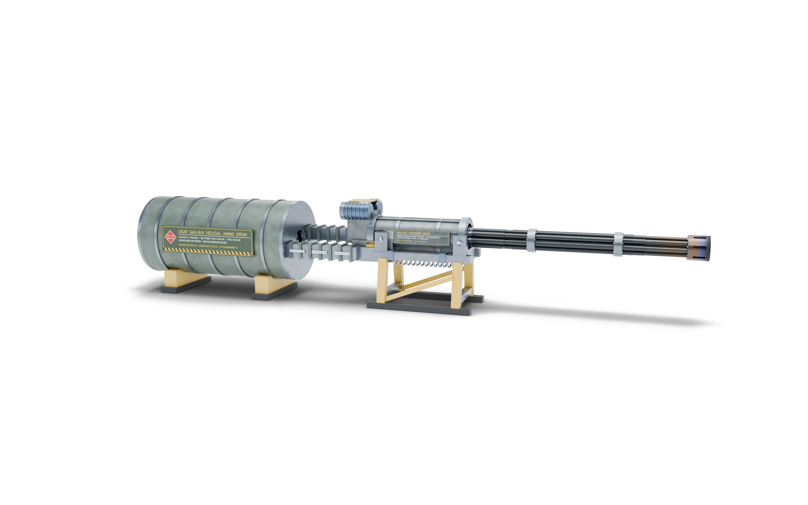 |

| **🇺🇸 BAY-30 柯尔特 M1911A1 (`.45 ACP`) · *勃朗宁 0.278" 单绞链短后坐与三叉板簧 (`1.88 MB`)*** | **🇩🇪 BAY-31 MG 42 (`7.92×57mm`) · *对称双滚柱 1,200 RPM 短后坐、5 秒快换枪管门与 S 槽拨弹 (`1.88 MB`)*** |
| :---: | :---: |
| 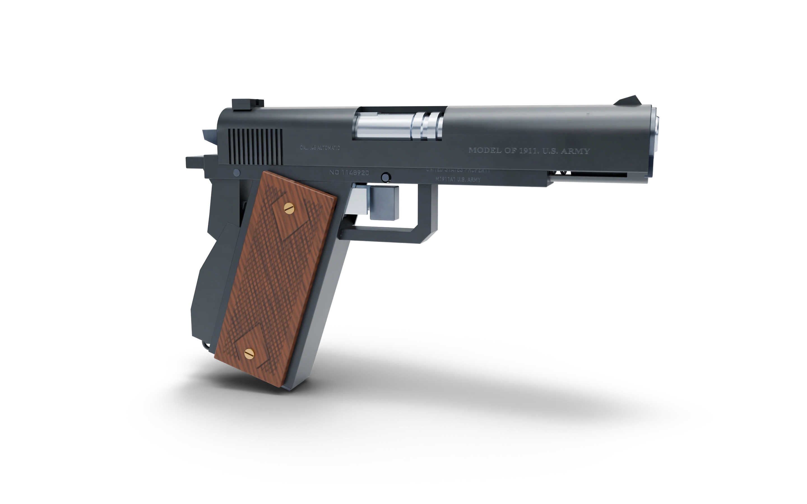 | 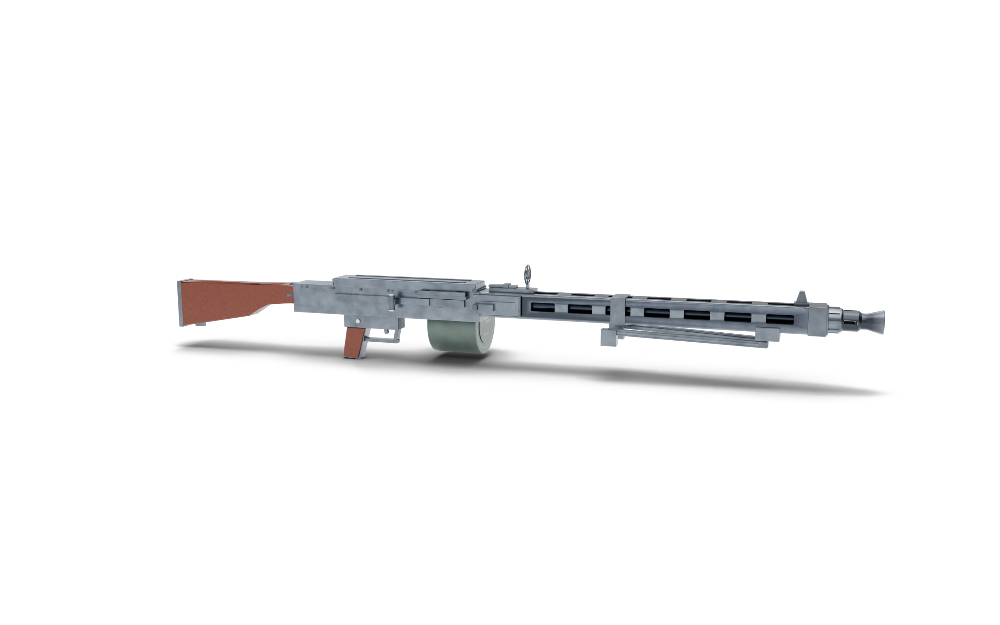 |

| **🇩🇪 BAY-32 毛瑟 Karabiner 98k (`7.92×57mm`) · *90° 三突笋防爆栓动、全长不旋转大抓钩受控供弹 (`1.77 MB`)*** | **🇺🇸 BAY-33 汤姆逊 M1928A1 (`.45 ACP`) · *45° 青铜 H 型布利什锁、散热鳍枪管与 50 发发条圆鼓 (`1.71 MB`)*** |
| :---: | :---: |
| 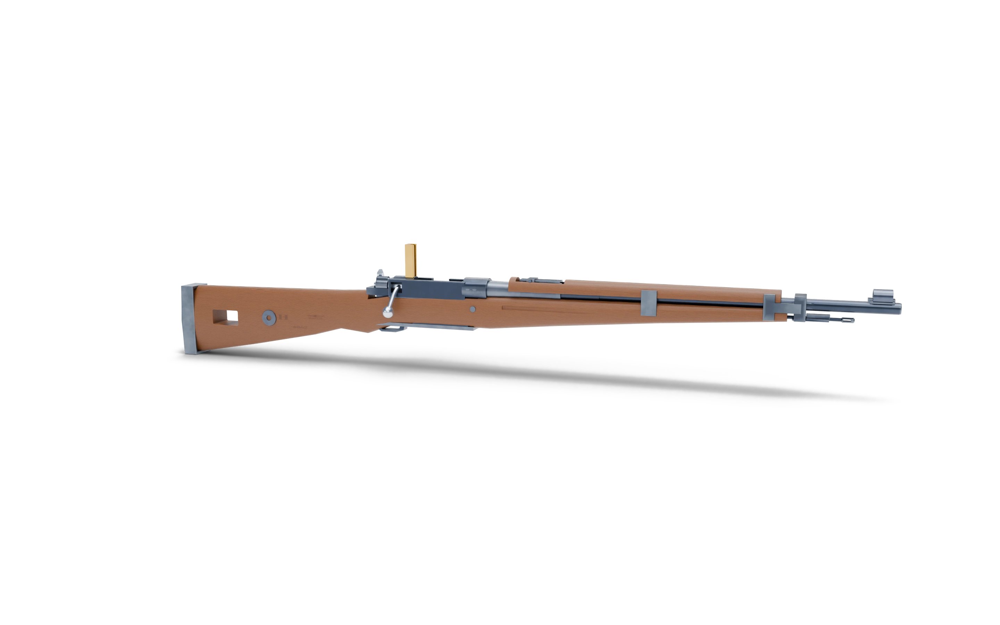 | 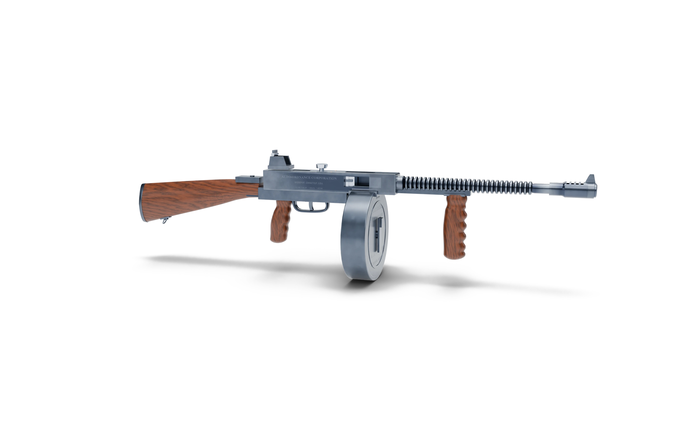 |

---

## v5.0 物理对比巅峰与跨世代经典展品（`WP-19 ~ WP-25b` · WebGL 2.0 实机直拍）

| **⚔️ 单画布实时 3D 分屏对决 (`?screen=split_showdown`) · ZTZ-99A vs M1A2 纵剖同屏** | **🛡️ 1:1 复合装甲与穿甲弹侵彻实验室 (`WP-20` Lanz-Odermatt / De Marre)** |
| :---: | :---: |
|  |  |

| **🤠 BAY-28 温彻斯特 M1894 (`.30-30 Win`) vs 🦅 BAY-29 雷明顿 M870 (`12 Ga`) · 双经典机械结构同台纵剖** |
| :---: |
|  |

---

## 重装装甲展厅 · 1:1 真实尺度主战坦克（`BAY-24 ~ BAY-27` · WebGL 2.0 实机直拍）

*严格遵循 **`1 world unit = 1 cm = 10 mm`** 实车 `1:1` 尺寸（全长 `8.45–10.97 m`，战斗全重 `55–66.8 吨`），陈列于带 C2 五次方边缘羽化与暗色油渍的 **`18 m × 12 m` 做旧混凝土地坪** 之上，匹配 **`1:1` 32-bit Cycles 重装装配机库 HDRI** 与 `4096×4096` Ultra 主光阴影；全车配备 **`4096×4096` Cycles 4K 外观贴图**、**512px 三平面 RNM 装甲钢与 CARC 微表面细节**、**单侧 `74–96` 块独立下垂履带板**、**光学 AR 镀膜镜片**、`near = 2.0 / far = 9000` 光学视锥、可被 `±1,800 mm` 活体 CT 纵剖面（`45° ISO 128` 金属剖面线）干净劈开的中空装甲车体/炮塔，以及 7 阶段主炮后坐、自动装弹机与隔爆门装填运动学。以下画面均为 `1920×1080` Chromium 实时渲染未修直出。*

| **🇨🇳 ZTZ-99A (`125mm ZPT-98 L/50`) · 4K 数码迷彩、86 块履带板与 FY-4 爆反 (`10.27 MB`)** | **🇨🇳 ZTZ-99A 实时 CT 纵剖 (`[C]`) · 22 发底置转盘装弹机与 150HB V12 引擎** |
| :---: | :---: |
|  |  |

| **🇺🇸 M1A2 SEP v3 艾布拉姆斯 (`120mm M256 L/44`) · 4K 沙漠 CARC 与 T158 履带 (`9.94 MB`)** | **🇺🇸 M1A2 SEP v3 实时 CT 纵剖 (`[C]`) · 隔爆门尾舱弹药与 AGT1500 燃气轮机** |
| :---: | :---: |
|  |  |

| **🇩🇪 KMW 豹 2A7V (`120mm Rh-120 L/55A1`) · 4K 北约三色与箭簇楔形装甲 (`11.27 MB`)** | **🇩🇪 豹 2A7V 实时 CT 纵剖 (`[C]`) · 中空箭簇楔块、Rh-120 炮闩与 MTU V12 动力包** |
| :---: | :---: |
|  |  |

| **🇩🇪 虎式 I 131 号重型坦克 (`88mm KwK 36 L/56`) · 4K 锯齿防磁装甲与交错轮 (`10.32 MB`)** | **🇩🇪 虎式 131 实时 CT 纵剖 (`[C]`) · 克虏伯 88mm 横楔炮闩与迈巴赫 HL230 V12** |
| :---: | :---: |
|  | 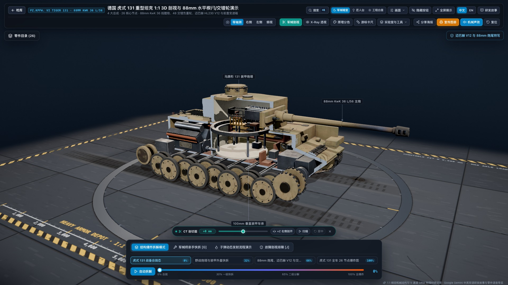 |

| **重装甲大厅 (`?screen=armory`) · 4 款主战坦克专属矢量轮廓与参数铭牌** | **1:1 坦克主炮弹纵剖实验室 (`[B]`) · `88mm PzGr.39`、`120mm NATO APFSDS` 与 `125mm DTC10-125`** |
| :---: | :---: |
|  |  |

---

## 照片级轻武器与复合弓弩旗舰画廊（34/34 Blender 5.2 大满贯 · 100% WebGL 2.0 实机直拍）

*以下每一帧均由开源 **Blender 5.2 LTS 无头 Draco `.glb` + Cycles 2K Packed ORM** 管线与 **32-bit 摄影棚 `.hdr`** 在 Chromium 1920×1080 实时渲染输出。*

| **卡拉什尼科夫 AK-15M1 (`7.62×39mm`)** · *冲压磷化钢与透视窗弹匣 (`3.90 MB`)* | **DWM 1917 鲁格 P08 (`9×19mm`)** · *滚花肘节、`1917`/`B·R·S` 戳记、240°C 麦秆黄回火与胡桃木 (`3.39 MB`)* |
| :---: | :---: |
|  |  |

| **沙漠之鹰 Mark XIX (`.50 AE`)** · *416 拉丝不锈钢、斜向防滑齿与四突笋回转枪机 (`7.05 MB`)* | **Colt M4A1 SOPMOD (`5.56 NATO`)** · *7075-T6 硬质阳极氧化上下机匣、奔马铭文与 KAC RAS (`3.53 MB`)* |
| :---: | :---: |
|  |  |

| **柯尔特蟒蛇 6 英寸 (`.357 Magnum`)** · *液态“皇家烤蓝”、弹巢曳痕与 24K 金徽黑胡桃 (`2.13 MB`)* | **美国 M1 加兰德步枪 (`.30-06 Springfield`)** · *亚麻籽油黑胡桃、`S.A./NFR` 兵工厂木章与 T105 瞄具 (`2.72 MB`)* |
| :---: | :---: |
| 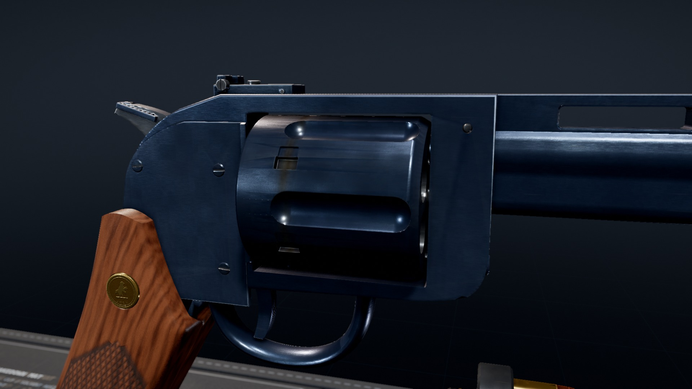 |  |

| **H&K MP5A3 (`9×19mm`)** · *烤漆黑冲压机匣、海军三发图标、热带护木与伸缩托 (`3.18 MB`)* | **精密国际 AWM (`.338 Lapua Mag`)** · *英军 OD 绿拇指孔底盘、S&B PM II `5-25×56` 与防冰槽枪机 (`3.68 MB`)* |
| :---: | :---: |
| 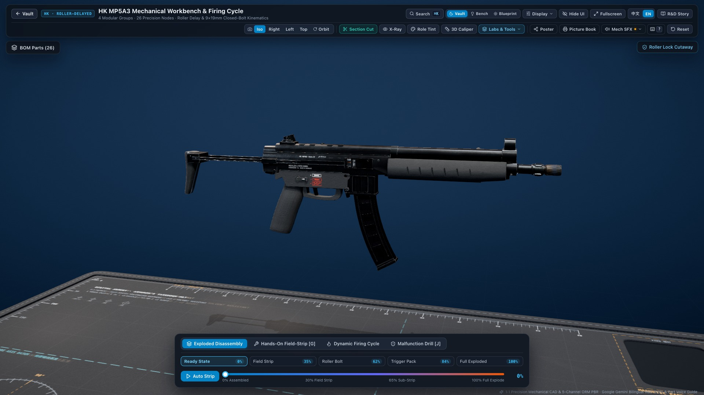 |  |

| **巴雷特 M82A1 / M107 (`.50 BMG`)** · *锰系磷化加强筋机匣、Leupold Mark 4 金环瞄具 (`3.49 MB`)* | **Glock 17 Gen 5 (`9×19mm`)** · *缎面 nDLC 牛鼻套筒、奥地利 Ferlach 试枪戳与 RTF4 握把 (`2.28 MB`)* |
| :---: | :---: |
|  |  |

| **FN SCAR-L Mk 16 Mod 0 (`5.56 NATO`)** · *FDE 多色阶整体铝上机匣、SOCOM UID 二维码与折叠托 (`3.41 MB`)* | **Steyr AUG A1 / StG 77 (`5.56 NATO`)** · *奥地利军绿 PA66 枪身、内置施华洛世奇 1.5× 镜与琥珀华夫弹匣 (`3.62 MB`)* |
| :---: | :---: |
|  |  |

| **SIG Sauer P320 / 美军 M17 (`9×19mm`)** · *双色沙金 PVD 套筒、UID 铭牌与可拆不锈钢 FCU 内胆 (`2.53 MB`)* | **FN Herstal P90 PDW (`5.7×28mm`)** · *半透明琥珀 50 发水平弹匣、90° 螺旋供弹坡道与 MC-10-80 环视镜 (`2.17 MB`)* |
| :---: | :---: |
|  | 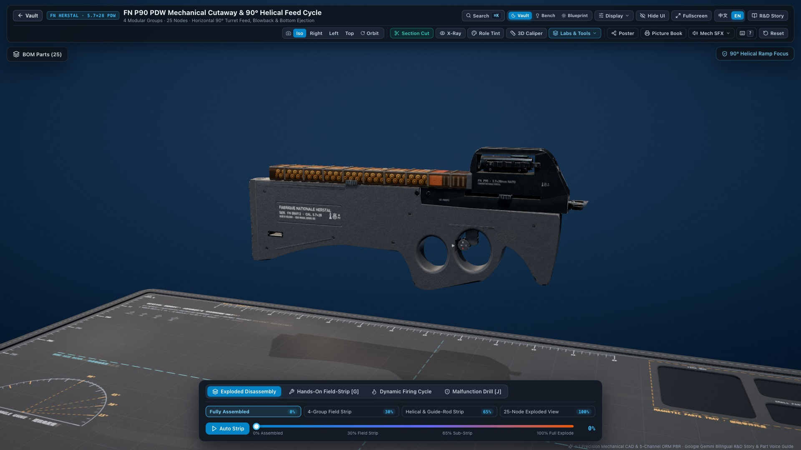 |

| **伯奈利 M4 Super 90 / USMC M1014 (`12 Gauge`)** · *III 型碳灰机匣、Gardone `PSF/CIP` 试枪戳与双 ARGO 活塞 (`2.47 MB`)* | **FN M249 SAW (`5.56×45mm NATO`)** · *铆接磷化钢机匣、M855 绿尖/M856 曳光弹链与 200 发弹药箱 (`3.64 MB`)* |
| :---: | :---: |
|  |  |

| **KRISS Vector SMG Gen II (`.45 ACP`)** · *沙黑双色 Super V 下潜机匣、CNC 配重滑块与 25 发长弹匣 (`2.18 MB`)* | **Mathews LIFT 33 复合弓 (`348 FPS`)** · *SwitchWeight-X 青铜双凸轮、桁架镂空弓把与四片弓片 (`3.37 MB`)* |
| :---: | :---: |
|  |  |

| **Ravin R500 复合弩 (`500 FPS`)** · *360° 铜金色 HexCoil 螺旋凸轮、VersaDrive 丝杠与 1–8×24 瞄具 (`3.53 MB`)* | **鲁格 P08 双通道 Stencil 实心纵剖 (`[C]`)** · *ISO 128 45° 金属剖面线、8 发 9mm 弹柱与螺旋复进簧* |
| :---: | :---: |
| 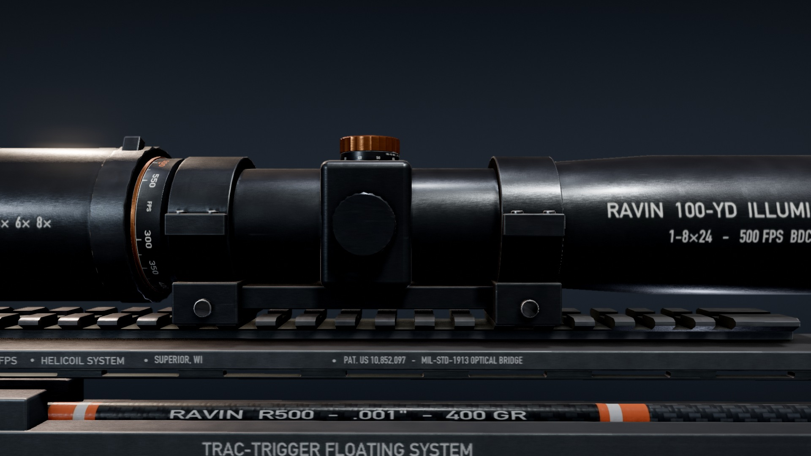 |  |

| **H&K G11 K2 (`4.73×33mm DM11` 无壳弹)** · *90° 镀铬旋转弹膛、钟表级齿轮连杆与 Hensoldt 光学镜 (`2.06 MB`)* | **VSS Vintorez (`9×39mm` 亚音速微声弹)** · *414mm 多孔 6 级斜挡板消音器、TOZ 铭文机匣与 PSO-1M2-1 瞄具 (`2.23 MB`)* |
| :---: | :---: |
|  | 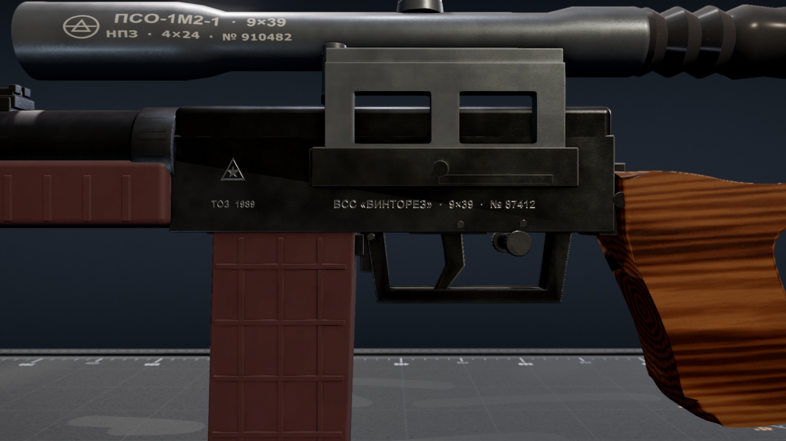 |

| **GE / Dillon Aero M134D 加特林 (`7.62×51mm NATO`)** · *6 管 3,000 RPM 旋转枪管簇、28V 电机与 360° 螺旋凸轮 (`3.31 MB`)* | **Nikonov AN-94 “阿巴坎” (`5.45×39mm 7N6`)** · *钢索滑轮 1,800 RPM 延迟双发、15° 右倾紫红弹匣与 8 字制退器 (`2.92 MB`)* |
| :---: | :---: |
|  |  |

### 15 口径轻武器实弹 1:1 SAAMI/CIP 纵剖对比实验室（`[B]`）· *从 `9×19mm`（`29.69 mm`）、方形 `4.73×33mm DM11` 无壳弹到 `.50 BMG`（`138.43 mm`）*


---

## v6.0 旗舰工程架构与核心能力

| **全局 `Cmd+K` / `Ctrl+K` 中英双语瞬搜指令面板** | **34 槽 10 大展厅交互式 3D 数字兵器库** |
| :---: | :---: |
|  |  |

- **✦ 双轨 Blender 5.2 Draco `.glb` + Web Worker CSG 建模引擎（`PR-02` ~ `PR-04`, `WP-17` ~ `WP-30`）**：
  - **34/34（100%）十殿堂照片级大满贯**：全馆全部 **34 款展品 / 10 大展厅**（27 款传奇名枪 + 2 款复合弓弩 + 4 款 1:1 主战坦克 + 第十展厅 `ordnance` 1:1 30mm 七管航炮 `gau8`）均由仓储内 MIT 开源无头 Python 脚本（`scripts/blender/build_*_photoreal.py`）程序化雕塑并 Cycles GPU 烘焙为紧凑 Draco `.glb`（`775` 个水密精模 CAD 零件，单展品总包 `1.25–11.27 MB`，`34/34` 通过 `npm run assets:audit <= 12 MB`），配套 `414` 张 2K/4K 5 通道 Packed ORM 与微表面细节 WebP 贴图（`136` Albedo / `139` Normal / `139` ORM 与细节图，`101` 套图集，`0` 张 PNG）。
  - **零妥协 GPU 实时形变弹簧、弓片与弓弦**：全馆 `79` 个螺旋复进簧、缓冲簧、发条弹鼓簧、主炮复进/炮闩弹簧、V 形主簧与复合弓弩四片弓片/凸轮轴/弓弦缆绳保留在 Web Worker CSG 轨道，确保逐顶点 `aSpringParam` 在 60 FPS 下精确压缩弯曲（并保留完整 CSG 离线兜底）。
  - **生产级 KTX2 (`toktx`)、可选 CDN 路由、资产预算审计与 1080p 视觉门禁（`WP-25a`, `WP-26`）**：真实 Khronos `toktx` UASTC+Zstd（线性）/ ETC1S（sRGB）纹理编码流水线（自动 WebP 解码、缺 `toktx` 零破坏回退 WebP，配套 `public/basis/`）、`npm run assets:audit` 自动体积门禁、`VITE_CDN_ASSET_BASE_URL` 重媒体 CDN 路由（`audio/textures/models/plates/hdri` 无缝切流且保持根路径与子路径幂等）、PWA 离线博物馆管理器（`?panel=offline`）以及零依赖 `npm run qa:visual` 1080p 无头 Chromium 视觉回归门禁。
- **✦ 1:1 复合装甲三维慢动作穿甲剖视剧场（`?panel=armor`，`WP-20` + `WP-27`）**：覆盖 **5 款动能穿甲弹**（`125mm DTC10-125`、`120mm M829A4 / DM63`、`88mm PzGr.39`、`30×173mm GAU-8 PGU-14/B API`、`.50 BMG M2 AP`）× 4 款主战坦克 × 4 防区，支持 `3D 剖视剧场 / 2D 原理剖图 / 3D+2D 双屏` 切换，以 `0.15x / 0.5x / 1x` 实时演绎 ERA 双飞板爆轰剪切、高温侵彻空腔、车内高速崩落粒子锥与大倾角跳弹。
- **✦ 1,000m 三维交互实弹靶场与子弹时间追踪镜头（`[R]`，`WP-14` + `WP-28`）**：Zero-GC RK4 3-DOF 引擎实时解算全部 **23 套弹道档案**（新增 `7.92×57mm Mauser` 与 `30×173mm PGU-14/B API`），驱动 1,000m 3D 靶场，提供 `Range Overview / Bullet-Cam / Spotter FLIR` 三机位、AR500 钢靶单摆与 `d/343` 声速回传、弹道明胶瞬态空腔、风旗阵列、发光 Mach 1.0 跨音速环、FFP MIL 圣诞树分划板与 7 档 `MIL / MOA` DOPE 射表。
- **✦ 物理耦合模块化光学与枪口改装工作台（`[O]`，`WP-29`）**：全馆 **34 展品** 世界空间 `boreY` 齐平锚点（4 枪口 × 4 光学 × 4 战术预设），实时打通 **四维物理耦合**：CT `[C]` 纵剖直视消音器 7 级 K 挡板/LPVO 5 片式镜组/FLIR 传感器 PCB、`GasFlowVisualizer` 挡板涡流与制退器侧喷流、`mechanicalSoundEngine` `-28 dB / +6 dB` 声谱衰减及后坐/初速遥测联动。
- **✦ 单画布实时 3D 分屏对决（`?screen=split_showdown`，`WP-19`）、因果沙盒（`?panel=causality`，`WP-20`）与三轴 CT 纵剖 + 6 面 3D 剖切盒（`[C]`，`WP-21`）**：单画布双裁剪任意两款展品并行对决；装药/导气/质量/簧力因果沙盒；`Z / X / Y` 三轴正交与 6 平面 3D 剖切盒、身管黑体热辐射（`1,100K`）与膛口积碳。
- **✦ 两级全枪精拆 DAG（`[G]`）、军械师精通护照（`?panel=passport`）、未知故障盲考（`[J]`）、1:1 坦克乘员 FLIR 火控（`?panel=crew`）与百年时间线（`?panel=timeline`）**：全馆 **34 款展品** 野战快拆与全枪精拆两级 DAG、可导入/导出 JSON 认证护照、4 款主战坦克 360° 炮塔/俯仰/激光火控与炮长 FLIR 瞄镜，以及 1894–2026 六大谱系交互时间线。
- **✦ 17+4 口径实弹与炮弹纵剖馆（`[B]`）、9×9×9 流派对照矩阵（`[S]`）与 3D 游标卡尺（`[K]`）**：涵盖 **17 款轻武器实弹**（新增 `7.92×57mm Mauser`）+ **4 款重型航炮与坦克主炮弹**（`30×173mm PGU-14/B API`、`88mm PzGr.39`、`120mm NATO APFSDS`、`125mm DTC10-125`）、**30 组跨时代经典对决预设**（含 `M1911 vs P08`、`K98k vs Garand`、`MG 42 vs M249`、`Thompson vs Vector`、`GAU-8 vs M134D`、`GAU-8 vs ZTZ-99A`）与 `1u = 10mm` 空间卡尺量测。
- **✦ 1,980 段 `Charon` 语音、1080p 导演录屏（`?panel=reel`）、分享海报（`[U]`）与 34/34 Cycles 340 图版绘本打印（`[Ctrl/Cmd+P]`）**：3D 导演自动运镜、4 场所立体声卷积 IR + 欧拉-伯努利波导声场（含 MG 42 1,200 RPM 撕布声、Thompson 50 发圆鼓连射、GAU-8/A 3,900 RPM `"BRRRT!"` 低频咆哮）、浏览器原生 `16:9 / 9:16` 导演短片录制、二维码海报及全馆 **34/34 Cycles 2880×1800 透明底印刷主图（340 张 WebP）** 驱动的 DK 百科与儿童 3D 绘本打印。

---

## 34 款殿堂级馆藏全览矩阵（10 大展厅 · 854 运动零件 · 34/34 Blender 5.2 大满贯）

| 展位 | 展品名称 | 管线 | 口径 / 弹药 | 核心自动、闭锁与装填机构 | 零件数 | 在线直达 |
| :--- | :--- | :---: | :--- | :--- | :---: | :---: |
| `BAY-01` | **Kalashnikov AK-15M1 (6П71М)** | `GLB v3` | `7.62×39mm (M43)` | 长行程导气活塞 · 双突笋 35° 回转枪机闭锁 | 26 | [拆解](https://zhoujingkun1989-arch.github.io/digital-armory-3d/?weapon=ak15&screen=workbench&lang=zh) |
| `BAY-02` | **Colt M4A1 SOPMOD 卡宾枪** | `GLB v3` | `5.56×45mm NATO` | 斯通纳直接气吹 (DI) · 机框内膨胀室 + 七突笋闭锁 | 26 | [拆解](https://zhoujingkun1989-arch.github.io/digital-armory-3d/?weapon=m4a1&screen=workbench&lang=zh) |
| `BAY-03` | **Heckler & Koch MP5A3** | `GLB v3` | `9×19mm Parabellum` | 双 Ø8mm 滚柱 + 45° 楔铁 4:1 延迟半自由枪机 · 浮置槽弹膛 | 26 | [拆解](https://zhoujingkun1989-arch.github.io/digital-armory-3d/?weapon=mp5&screen=workbench&lang=zh) |
| `BAY-04` | **Glock 17 Gen 5** | `GLB v3` | `9×19mm Parabellum` | 布朗宁枪管短后坐偏移下倾闭锁 · Safe Action 三重保险击针 | 28 | [拆解](https://zhoujingkun1989-arch.github.io/digital-armory-3d/?weapon=g17&screen=workbench&lang=zh) |
| `BAY-05` | **Barrett M82A1 / M107** | `GLB v3` | `.50 BMG (12.7×99mm)` | 29" 开槽重枪管短后坐 · 加速子杠杆三突笋闭锁 + 双室箭头制退 | 24 | [拆解](https://zhoujingkun1989-arch.github.io/digital-armory-3d/?weapon=m82a1&screen=workbench&lang=zh) |
| `BAY-06` | **Accuracy International AWM** | `GLB v3` | `.338 Lapua Magnum` | 手动 60° 六突笋防冰槽刚性闭膛栓动 · 铝合金贯穿底盘 | 24 | [拆解](https://zhoujingkun1989-arch.github.io/digital-armory-3d/?weapon=awm&screen=workbench&lang=zh) |
| `BAY-07` | **FN SCAR-L Mk 16 Mod 0** | `GLB v3` | `5.56×45mm NATO` | 短行程导气活塞顶杆 (Tappet) · 七突笋回转枪机 + 整体铝上机匣 | 26 | [拆解](https://zhoujingkun1989-arch.github.io/digital-armory-3d/?weapon=scar&screen=workbench&lang=zh) |
| `BAY-08` | **Desert Eagle Mark XIX** | `GLB v3` | `.50 Action Express` | 固定枪管膛底正向导气活塞 · 四突笋回转枪机 + 双复进簧 | 24 | [拆解](https://zhoujingkun1989-arch.github.io/digital-armory-3d/?weapon=deagle&screen=workbench&lang=zh) |
| `BAY-09` | **Steyr AUG A1 (StG 77)** | `GLB v3` | `5.56×45mm NATO` | 无托右偏置短行程活塞双长导杆 · 快拆枪管 + 全塑双连杆火控包 | 25 | [拆解](https://zhoujingkun1989-arch.github.io/digital-armory-3d/?weapon=aug&screen=workbench&lang=zh) |
| `BAY-10` | **SIG Sauer P320 M17** | `GLB v3` | `9×19mm Parabellum` | 模块化可拆不锈钢 FCU 火控内胆 · 布朗宁下倾平移击针 | 24 | [拆解](https://zhoujingkun1989-arch.github.io/digital-armory-3d/?weapon=p320&screen=workbench&lang=zh) |
| `BAY-11` | **FN P90 PDW** | `GLB v3` | `5.7×28mm FN SS190` | 顶置 50 发透明水平弹匣 · 90° 螺旋坡道供弹 + 自由枪机下抛壳 | 25 | [拆解](https://zhoujingkun1989-arch.github.io/digital-armory-3d/?weapon=p90&screen=workbench&lang=zh) |
| `BAY-12` | **Mathews LIFT 33 复合弓** | `GLB v3` | `400 gr 碳纤维猎箭 (348 FPS)` | SwitchWeight-X 同步双偏心凸轮 · 85% 省力谷 + QAD 落箭台 | 24 | [拆解](https://zhoujingkun1989-arch.github.io/digital-armory-3d/?weapon=lift33&screen=workbench&lang=zh) |
| `BAY-13` | **Ravin R500 复合弩** | `GLB v3` | `400 gr 碳素弩箭 (500 FPS)` | HexCoil 360° 螺旋凸轮 · VersaDrive 丝杠上弦 + 悬浮滑台 | 25 | [拆解](https://zhoujingkun1989-arch.github.io/digital-armory-3d/?weapon=r500&screen=workbench&lang=zh) |
| `BAY-14` | **Colt Python 6" (.357 Mag)** | `GLB v3` | `.357 Magnum (9×33mmR)` | 双动/单动 V 形片簧精密钟表火控 · 60° 棘轮星盘分度与止转笋 | 25 | [拆解](https://zhoujingkun1989-arch.github.io/digital-armory-3d/?weapon=python&screen=workbench&lang=zh) |
| `BAY-15` | **Benelli M4 (M1014)** | `GLB v3` | `12 Gauge (00 鹿弹)` | 近膛双对称 ARGO 短行程自调活塞 · 双突笋枪机 + 管仓托弹板 | 26 | [拆解](https://zhoujingkun1989-arch.github.io/digital-armory-3d/?weapon=benellim4&screen=workbench&lang=zh) |
| `BAY-16` | **U.S. Rifle M1 Garand** | `GLB v3` | `.30-06 Springfield M2` | 枪口导气筒 + 右侧弯曲长行程操作拉杆 · 8 发漏夹末发弹射 | 26 | [拆解](https://zhoujingkun1989-arch.github.io/digital-armory-3d/?weapon=garand&screen=workbench&lang=zh) |
| `BAY-17` | **FN M249 SAW 班用轻机枪** | `GLB v3` | `5.56×45mm NATO (M27/STANAG)` | 下置长行程活塞 · 开膛待击双突笋闭锁 + M27 弹链/弹匣双供 | 26 | [拆解](https://zhoujingkun1989-arch.github.io/digital-armory-3d/?weapon=m249&screen=workbench&lang=zh) |
| `BAY-18` | **DWM 鲁格 P08 (1917)** | `GLB v3` | `9×19mm Parabellum` | 6.5mm 叉形节套管退短后坐 · 过死点双连杆屈膝肘节闭锁 | 25 | [拆解](https://zhoujingkun1989-arch.github.io/digital-armory-3d/?weapon=p08&screen=workbench&lang=zh) |
| `BAY-19` | **KRISS Vector SMG Gen II** | `GLB v3` | `.45 ACP (11.43×23mm)` | Super V `-65°` 轴外钨钢滑块下潜延迟半自由枪机 · 低膛轴线 | 25 | [拆解](https://zhoujingkun1989-arch.github.io/digital-armory-3d/?weapon=vector&screen=workbench&lang=zh) |
| `BAY-20` | **H&K G11 K2** | `GLB v3` | `4.73×33mm DM11 无壳弹` | 90° 旋转圆柱弹膛 · 钟表级齿轮连杆 & 2,100 RPM 浮置三连发 | 24 | [拆解](https://zhoujingkun1989-arch.github.io/digital-armory-3d/?weapon=g11&screen=workbench&lang=zh) |
| `BAY-21` | **VSS Vintorez (6P29)** | `GLB v3` | `9×39mm SP-5/SP-6 亚音速` | 三排多孔泄气枪管 + 6 级斜挡板消音器 · 6 突笋枪机 + 直线击锤 | 24 | [拆解](https://zhoujingkun1989-arch.github.io/digital-armory-3d/?weapon=vss&screen=workbench&lang=zh) |
| `BAY-22` | **GE / Dillon Aero M134D 加特林** | `GLB v3` | `7.62×51mm NATO (M13 弹链)` | 28V DC 电动 6 管旋转枪管簇 · 360° 正弦凸轮轨道 + 无链供弹器 | 25 | [拆解](https://zhoujingkun1989-arch.github.io/digital-armory-3d/?weapon=m134&screen=workbench&lang=zh) |
| `BAY-23` | **Nikonov AN-94 “阿巴坎” (6P33)** | `GLB v3` | `5.45×39mm 7N6` | 浮置枪管机匣 + 内部钢索滑轮 · 1,800 RPM 延迟双发 + 15° 弹匣 | 26 | [拆解](https://zhoujingkun1989-arch.github.io/digital-armory-3d/?weapon=an94&screen=workbench&lang=zh) |
| `BAY-24` | **🇨🇳 ZTZ-99A 主战坦克** | `GLB v3` | `125mm DTC10-125 APFSDS` | 125mm ZPT-98 L/50 滑膛炮 · 22 发转盘自动装弹机 + FY-4 爆反 + 150HB V12 | 26 | [拆解](https://zhoujingkun1989-arch.github.io/digital-armory-3d/?weapon=ztz99a&screen=workbench&lang=zh) |
| `BAY-25` | **🇺🇸 M1A2 SEP v3 艾布拉姆斯** | `GLB v3` | `120×570mm NATO M829A4` | 120mm M256 L/44 滑膛炮 · 滑动隔爆门尾舱 + 泄压盖板 + AGT1500 燃气轮机 | 26 | [拆解](https://zhoujingkun1989-arch.github.io/digital-armory-3d/?weapon=m1a2&screen=workbench&lang=zh) |
| `BAY-26` | **🇩🇪 KMW 豹 2A7V 主战坦克** | `GLB v3` | `120×570mm NATO DM63A1` | 6.6m Rh-120 L/55A1 滑膛炮 · 中空箭簇楔形装甲 + MTU MB 873 V12 动力包 | 26 | [拆解](https://zhoujingkun1989-arch.github.io/digital-armory-3d/?weapon=leopard2a7&screen=workbench&lang=zh) |
| `BAY-27` | **🇩🇪 虎式 I 131 号重型坦克** | `GLB v3` | `88×571mmR PzGr.39 APCBC` | 88mm KwK 36 L/56 线膛炮 · 克虏伯横楔炮闩 + 48 交错负重轮 + HL230 V12 | 26 | [拆解](https://zhoujingkun1989-arch.github.io/digital-armory-3d/?weapon=tiger1&screen=workbench&lang=zh) |
| `BAY-28` | **🇺🇸 温彻斯特 M1894 卡宾枪** | `GLB v3` | `.30-30 Winchester (.30 WCF)` | 勃朗宁下压指环杠杆四连杆 · 下垂闭锁楔块 + 管仓垂直供弹托板 | 24 | [拆解](https://zhoujingkun1989-arch.github.io/digital-armory-3d/?weapon=winchester1894&screen=workbench&lang=zh) |
| `BAY-29` | **🇺🇸 雷明顿 M870 Police Magnum** | `GLB v3` | `12 Gauge (2¾" / 3" Magnum)` | 整锻机匣罗纹泵动 · 双连杆 + 上倾闭锁块 + 双阻铁托弹板供弹 | 24 | [拆解](https://zhoujingkun1989-arch.github.io/digital-armory-3d/?weapon=rem870&screen=workbench&lang=zh) |
| `BAY-30` | **🇺🇸 柯尔特 M1911A1 军用自动手枪** | `GLB v3` | `.45 ACP (11.43×23mm)` | 勃朗宁 0.278" 单绞链短后坐偏移枪管 · 直推单动扳机框 + 一簧三用三叉板簧 | 24 | [拆解](https://zhoujingkun1989-arch.github.io/digital-armory-3d/?weapon=m1911&screen=workbench&lang=zh) |
| `BAY-31` | **🇩🇪 MG 42 通用机枪** | `GLB v3` | `7.92×57mm Mauser (8mm s.S.)` | 开膛枪口助退 8.5mm 短后坐 · 对称双滚柱闭锁（1,200 RPM）+ 5 秒快换枪管门与 S 槽拨弹 | 25 | [拆解](https://zhoujingkun1989-arch.github.io/digital-armory-3d/?weapon=mg42&screen=workbench&lang=zh) |
| `BAY-32` | **🇩🇪 毛瑟 Karabiner 98k (byf 43)** | `GLB v3` | `7.92×57mm Mauser (8×57 IS)` | 90° 三突笋防爆栓动 · 全长不旋转大抓钩受控供弹 + 三档翼形旗式保险 | 24 | [拆解](https://zhoujingkun1989-arch.github.io/digital-armory-3d/?weapon=k98k&screen=workbench&lang=zh) |
| `BAY-33` | **🇺🇸 汤姆逊 M1928A1 冲锋枪** | `GLB v3` | `.45 ACP (11.43×23mm)` | 开膛 45° 磷青铜 H 型布利什延迟锁 · 28 鳍枪管 + 卡茨防跳器 + 50 发发条螺旋圆鼓 | 25 | [拆解](https://zhoujingkun1989-arch.github.io/digital-armory-3d/?weapon=thompson&screen=workbench&lang=zh) |
| `BAY-34` | **🇺🇸 GE GAU-8/A「复仇者」(第十展厅)** | `GLB v3` | `30×173mm PGU-14/B API` | 1:1 全长 `6.06 m` 双 38.5 马力液压七管航炮 · 360° 正弦凸轮槽 + 1,150 发闭环螺旋弹鼓（3,900 RPM） | 25 | [拆解](https://zhoujingkun1989-arch.github.io/digital-armory-3d/?weapon=gau8&screen=workbench&lang=zh) |

---

## 键盘快捷键与深度链接

### URL 深度链接参数
- 官方中英双语宣传页：`/showcase.html?lang=zh` 或 `/?screen=showcase&lang=zh`
- 34 槽 10 大展厅兵器库、重装甲大厅与航空重武展厅：`/?screen=armory&weapon=gau8&lang=zh`
- 单画布实时 3D 分屏对决：`/?screen=split_showdown&weaponA=ztz99a&weaponB=m1a2&lang=zh`
- 实时纵剖工作台（轻武器 / 1:1 主战坦克 / 1:1 GAU-8/A）：`/?weapon=gau8&screen=workbench&cut=1&lang=zh`
- 3D 1,000m 交互靶场、Bullet-Cam 与外弹道 DOPE 实验室：`/?screen=ballistics&caliber=30x173_gau8&lang=zh`
- 17+4 口径实弹、航炮与坦克主炮弹纵剖对比馆：`/?screen=cartridges&caliber=30x173_gau8&lang=zh`
- 专题实验与博物馆面板直达：`/?panel=armor`（3D 穿甲剧场）· `/?panel=causality`（因果沙盒）· `/?panel=crew&optic=flir`（坦克乘员 FLIR 火控）· `/?panel=timeline`（1894–2026 时间线）· `/?panel=reel`（1080p 导演录屏）· `/?panel=passport`（军械师护照）· `/?panel=offline`（离线博物馆）

### 全局工程快捷键
| 按键 | 功能说明 |
| :---: | :--- |
| `Cmd / Ctrl + K` | 打开 **全局中英双语瞬搜指令面板**（34 展品、854 零件、10 大展厅、三维物理剧场与视觉开关） |
| `Space` | 播放 / 暂停三级爆炸拆解或 7 阶段实弹击发循环 |
| `C` | 开启 / 关闭 **三轴实时可拖拽 CT 扫描实心纵剖面与 6 面 3D 剖切盒**（`Z / X / Y / 3D Box`，轻武器 `±25 mm` / 坦克与航炮 `±1,800 mm`） |
| `O` | 打开 / 关闭 **物理耦合模块化光学与枪口改装工作台**（消音器 / 制退器 / 消焰器 · 红点 / LPVO / FLIR 热成像） |
| `T` | 开启 / 关闭 **6 大机械职能语义分色** 与剖切面同步换色（自适应轻武器/重装甲/航炮词条） |
| `G` | 进入 / 退出 **军械师引导式野战快拆、全枪精拆与限时盲拆考证（两级 DAG）** |
| `J` | 开启 / 退出 **经典故障剖视排障室与随机未知故障盲考**（烟囱卡壳 / 双进弹 / 轻敲拒发 / 未闭锁阻断） |
| `K` | 开启 / 退出 **1:1 3D 军械游标卡尺**（`mm`）与全车/全枪三维包络标尺 |
| `R` | 进入 / 返回 **3D 1,000m 交互实弹靶场、子弹时间镜头与 RK4 DOPE 实验室**（23 套档案） |
| `U` | 打开 / 关闭 **即时高清 3D 剖视社交分享海报工坊**（`16:9 / 4:5` + 二维码 + 认证印章） |
| `B` | 进入 / 退出独立 **17+4 口径轻武器实弹、航炮与坦克主炮弹 1:1 纵剖对比实验室** |
| `S` | 打开 / 关闭 **9×9×9 三轴自动原理谱系矩阵与双展品同屏对照实验室**（30 组对决，支持一键进 3D 分屏） |
| `X` | 开启 / 关闭外层机匣、套筒、弹鼓或装甲壳体 X-Ray 光学透视 |
| `P / V / F` | 半拉验膛（`P`） · 切换 `SAFE / SEMI / AUTO` 快慢机（`V`） · 按住扣动扳机（`F`） |
| `E / L / M / H` | CAD 硬边描边（`E`） · 3D 空间编号标签（`L`） · Web Audio 静音（`M`） · **纯净全屏展示**（`H`） |
| `Ctrl/Cmd + P` | 打开 **34/34 Cycles 17 图版收藏图鉴与儿童 3D 绘本打印工坊**（340 张透明底印刷主图加持） |
| `Shift + R / Esc` | 一键复位至 0% 合拢态与默认视角 / 收起弹窗或返回 3D 兵器库 |

---

## 快速启动与质量门禁

### 环境要求
- **Node.js** `>= 20`
- *（可选 — 传统纹理烘焙）* **Python** `>= 3.10` + `numpy` + `Pillow`
- *（可选 — 照片级 `.glb` 与 Cycles 图鉴主图渲染）* **Blender 5.2 LTS**（无头命令行）
- *（可选 — GPU 压缩 KTX2 贴图编码）* **Khronos `toktx`**（`brew install ktx`）

```bash
# 1. 安装依赖
npm ci

# 2. 启动本地 Vite 开发服务器（同时服务 / 与 /showcase.html）
npm run dev

# 3. 运行五道强制自动化工程质量门禁（0 错误、0 警告、全部 chunk < 800 kB）
npm run typecheck
npm run lint
npm test
npm run build
npm run assets:audit

# 4. 可选：运行 1920x1080 无头 Chromium 自动化视觉回归门禁
npm run qa:visual -- --weapons gau8,m1911 --cut
```

### 可选：离线重建 Blender 5.2 照片级 `.glb`、KTX2 贴图或 34/34 Cycles DK 印刷主图

```bash
# 无头重建任意一款旗舰 Draco GLB + Cycles 2K/4K Packed ORM 贴图套件（全馆 34 款均提供对应脚本）：
blender --factory-startup --background --python scripts/blender/build_<id>_photoreal.py

# 批量渲染全馆 34/34 展品 2880×1800 Cycles 32-bit RGBA 透明底印刷主图（public/plates/）：
blender --factory-startup --background --python scripts/blender/render_dk_plates.py -- --weapons all --fast

# 试运行或编码 GPU 压缩 KTX2 纹理（法线/ORM 走 UASTC 线性、反照率走 ETC1S sRGB）：
node scripts/build_ktx2_textures.mjs --dry-run
```

---

## 系统架构概览

```text
digital-armory-3d/
├── index.html                     # 3D 数字兵器库与拆解工作台主入口
├── showcase.html                  # 中英双语产品宣传展示主页入口
├── public/
│   ├── audio/                     # 1,980 段中英双语四幕研发史与零件语音 (Charon Gemini TTS MP3)
│   ├── basis/                     # 自托管 Khronos Basis Universal WASM KTX2 解码器
│   ├── draco/                     # 自托管 Three.js WebAssembly Draco 网格解码器
│   ├── hdri/                      # 4 套 Cycles 32-bit .hdr 环境贴图 (3 影棚 + 1:1 重装装配机库)
│   ├── manifest.webmanifest & sw.js # 子路径安全 PWA 清单与离线博物馆 Service Worker
│   ├── models/                    # 34 款 Blender 5.2 Draco 压缩 .glb 展品 (27 名枪 + 2 弓弩 + 4 主战坦克 + 1:1 GAU-8/A)
│   ├── narrations/                # 34 套结构化中英双语四幕研发史与零件工程 JSON
│   ├── plates/                    # 全馆 34/34 Cycles 2880×1800 RGBA 透明底 DK 印刷主图 (340 张 WebP)
│   ├── showcase/                  # 宣传主页实机 WebGL 2.0 高清展示图 (WebP)
│   └── textures/                  # 414 张 2K/4K 5 通道 Packed ORM 与装甲微细节 WebP (101 套图集，0 张 PNG)
├── scripts/
│   ├── audit_asset_budget.mjs     # 全馆 34/34 展品 <= 12 MB 与 6 大 public/ 目录体积自动审计器
│   ├── blender/                   # 34 套 MIT 无头 Blender 5.2 雕塑脚本 + HDRI 与 DK 印刷主图渲染器
│   ├── build_ktx2_textures.mjs    # 生产级 Khronos toktx UASTC/ETC1S 纹理压缩与清单生成器
│   ├── narrations/.cache/         # 34 份 SHA-256 Charon TTS 语音校验清单
│   ├── pbr_core/ & pbr/           # Worley / 滚花 / 512px 无缝 RHA/CARC 细节图与 PBR 烘焙工具链
│   ├── qa_visual_gate.mjs         # 1920×1080 无头 Chromium 零错误自动化视觉回归门禁
│   └── export_dk_pdf.mjs          # 离线 300 DPI Pre-Press PDF 批量出版脚本
├── src/
│   ├── app/                       # 双向 URL 状态同步 (?cut=1 / ?screen=split_showdown / ?screen=ballistics / ?screen=cartridges / ?panel=*)、快捷键与错误边界
│   ├── engine/
│   │   ├── actors/                # PartActor、AttachmentActor、三轴 StencilSectionCap + SectionBoxGuide、BallisticsSystem、GasFlowVisualizer
│   │   ├── attachments/           # 34 展品齐平锚点、4 枪口 × 4 光学 × 4 预设与 Zero-GC 四维物理耦合
│   │   ├── audio/                 # 4 场所立体声卷积 IR + 钢材频散波导、弓弩弦响、改装声学、MG 42/GAU-8 与主炮声场引擎
│   │   ├── callout/               # ResizeObserver HUD 避障缓存与 60fps 零回流引出线
│   │   ├── canvas/                # ArmoryViewport、studioHdriManager、GunsmithStageMat (18×12m 机库地坪) 与 GTAO/AgX 后处理
│   │   ├── caliper/               # 1:1 3D 游标卡尺 (`1u = 10mm`) 与三维包络标尺
│   │   ├── cartridges/            # 21 口径 1:1 实弹、航炮与坦克主炮弹纵剖规范 (17 轻武器 + 4 重型火炮/航炮弹)
│   │   ├── clock/                 # 60Hz 零 React 重渲染瞬态时钟
│   │   ├── exam/                  # 军械师限时盲拆、全枪精拆与未知故障盲考评分 + JSON 精通护照仓库
│   │   ├── fieldstrip/            # 全馆 34 展品野战快拆与全枪精拆两级无环依赖图 (DAG)
│   │   ├── geometry/              # 双轨 Draco GLB 加载器 (glbAssetService) + Web Worker CSG 与穿透拾取
│   │   ├── interaction/           # 3D 视口直接手操拉机柄/杠杆/拉栓、验膛与 SAFE/SEMI/AUTO 火控交互
│   │   ├── kinematics/            # Zero-GC 关键帧插值与 7 阶段运动学求解
│   │   ├── malfunctions/          # 4 类经典故障剖视定位与标准排障演练 (34 展品)
│   │   ├── materials/             # 定制 GLSL armoryShader (黑体热辐射/积碳/微阴影/Lagarde SO/RNM/AR 镀膜/磨损)、6 职能分色与 KTX2 回退
│   │   ├── offline/               # 按展品粒度离线缓存固定与校验管理器 (PWA Offline Museum)
│   │   ├── physics/               # 17+4+2 内弹道物理 + 因果沙盒 + 1:1 复合装甲侵彻 (5 穿甲弹) + 1,000m RK4 外弹道 (23 档案)
│   │   ├── tank/                  # 4 款 1:1 主战坦克 360° 炮塔、耳轴俯仰、激光火控与炮长 FLIR 瞄镜仓库
│   │   └── utils/                 # 兼容 /、/digital-armory-3d/ 与可选 VITE_CDN_ASSET_BASE_URL 的静态资源路径解析器
│   ├── features/                  # 模块化界面 (showcase / armory / workbench / showdown3d / armorlab / ballistics / sandbox / video / passport / timeline / offline / share / monograph / cartridges / story / atlas)
│   ├── i18n/                      # 100% 对等中英双语词典 (英文零 CJK 字符漏出)
│   ├── narration/                 # 音频队列、speechSynthesis 兜底与 3D 导演运镜器
│   ├── store/                     # 强类型 Zustand 状态仓库
│   └── weapons/                   # 34 套按需懒加载自包含展品插件 (27 名枪 + 2 弓弩 + 4 主战坦克 + 1:1 GAU-8/A)
└── tests/                         # 33 套 Vitest 几何、GLB、3D 穿甲/靶场/改装、Track A 基建、分屏、运动学、考核与双语契约测试 (257 项)
```

---

## 参与贡献与社区

欢迎参与共建！提交 PR 前请先阅读双语[**参与贡献指南 (`CONTRIBUTING.md`)**](CONTRIBUTING.md)，了解本地环境配置、四道强制 CI 质量门禁、Blender 5.2 无头 `.glb` 管线规范以及严格的科普安全红线。

---

## 免责声明

本项目所有三维模型均为**原理示意级（Schematic / Educational Level）**浏览器端机械科普与交互可视化开源作品，重点展示自动原理、闭锁机构、内外弹道物理与勤务拆装拓扑关系，**不包含任何工业制造公差、CAD 加工图纸或可 3D 打印构件尺寸**。

---

## 开源协议

本项目基于 [MIT License](LICENSE) 开源。
