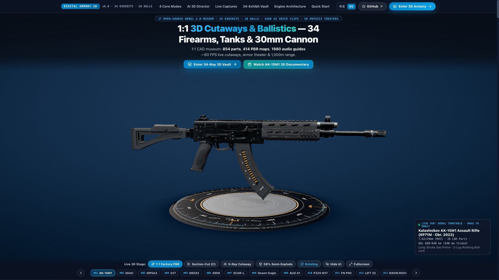
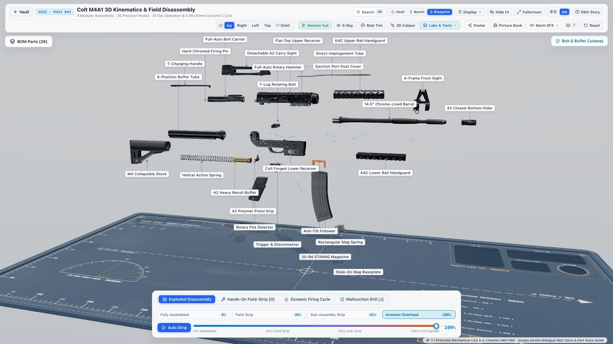

<div align="center">

<p>
  <a href="README.md">English</a>
  &nbsp;·&nbsp;
  <strong>简体中文</strong>
</p>

# Digital Armory 3D · 枪械与弓弩内部结构 3D 数字博物馆

**浏览器原生秒开 · 零外部网格 · 十三款传奇名枪与复合弓弩 1:1 机械内构、内弹道物理与勤务拆装百科全书**

[](https://github.com/zhoujingkun1989-arch/digital-armory-3d/actions/workflows/ci.yml)
[](https://zhoujingkun1989-arch.github.io/digital-armory-3d/showcase.html)
[](https://www.typescriptlang.org/)
[](https://threejs.org/)
[](LICENSE)

<h3>
  <a href="https://zhoujingkun1989-arch.github.io/digital-armory-3d/showcase.html?lang=zh">✦ 官方交互式宣传主页 (Showcase)</a>
  &nbsp;·&nbsp;
  <a href="https://zhoujingkun1989-arch.github.io/digital-armory-3d/?screen=armory&lang=zh">🚀 进入 13 槽 3D 数字枪库</a>
  &nbsp;·&nbsp;
  <a href="https://zhoujingkun1989-arch.github.io/digital-armory-3d/?screen=cartridges&lang=zh">🧪 1:1 实弹纵剖实验室</a>
  &nbsp;·&nbsp;
  <a href="https://zhoujingkun1989-arch.github.io/digital-armory-3d/?weapon=ak15&screen=workbench&lang=zh">🔧 直达 AK-15M1 军械拆解台</a>
</h3>

</div>

---

> 基于 **React 18 + TypeScript + Three.js (`@react-three/fiber` / Web Worker `three-bvh-csg` / Web Audio API)** 构建的浏览器端开源 **3D 轻武器与复合弓弩机械博物馆与交互式工程百科全书**。
>
> 全站 **零外部 `.glb` / `.gltf` 静态模型**——全部 **13 款世界经典名枪与复合弓弩（含 Mathews LIFT 33 与 Ravin R500）、327 个可动机械零件** 均由纯代码参数化与布尔 CSG 在后台 Web Worker 实时生成，配套 **76 张 2K 5 通道 Packed ORM WebP 物理贴图**、**双通道 Stencil 实心金属纵剖面 (`C`)**、**6 大机械职能语义分色与 60fps 高压燃气导流可视化 (`T`)**、**军械教范有向图引导拆装实操 (`G`)**、**SAAMI/CIP 膛压 $P(t)$ 与初速 $V(t)$ 实时示波器**、**快慢机多档位火控手操 (`P / V / F`)**、**17 图版收藏图鉴与儿童 3D 绘本打印工坊 (`Ctrl/Cmd+P`)**、**纯净全屏展示 (`H`)** 以及 **758 段 Google Gemini 中英双语语音导览与 3D 导演自动运镜纪录片**。




---

## 核心工程能力 | Engineering Highlights

- **✦ 机械职能语义分色 (`[T]`) & 60fps 高压火药燃气导流流线 (`WP-05`)**：一键将全库 327 个零件按 **闭锁承压、导气驱动、自动机框、火控击发、弹性储能、机匣供弹** 6 大机械职能赋予高辨识度工程语义色（零 WebGL 着色器重编译，且与 Stencil 实心纵剖面斜线同步换色），支持点击图例单独聚光某类机构；在发射模式下实时绘制高压膛内燃气膨胀柱、导气孔分流立管、长/短行程活塞冲击、斯通纳气匙内腔膨胀泄压及膛底前导气路径。
- **✦ 军械师级野战勤务拆装实操 (`[G]`, `WP-07`)**：为全部 13 款馆藏（11 款名枪 + Mathews LIFT 33 复合弓 & Ravin R500 复合弩）建立符合真实军械教范的有向无环拆装依赖图（DAG，如 `卸弹匣 → 拆机匣盖 → 取复进簧 → 抽枪机框 → 35° 旋出枪机 → 拆导气管`）。支持直接在 3D 视口点击零件完成逐步拆解（`0 → 100%`）与逆序拓扑复装（`100% → 0%`）；若顺序错误，实时触发赤红脉冲高亮干涉前置件、阻铁干涩卡阻音效与军械规范排障提示。
- **✦ 经典枪械与弓弩故障剖视排障室 (`[J]`, `WP-09`)**：内置 **烟囱卡壳 (`Stovepipe`)**、**双进弹卡阻 (`Type-3 Double Feed`)**、**底火轻敲拒发 (`Light Strike`)** 与 **未闭锁击发阻断 (`Out-of-Battery Safety`)** 4 类典型故障与安全保护定格，覆盖全部 13 款馆藏（含 P90 顶置弹匣上拔与下抛壳道适配，以及 LIFT 33 / Ravin R500 的箭羽偏擦、箭尾脱弦、弦钩与防空放排障），支持一键剖视定位卡阻成因零件并亲手演练标准排障步骤。
- **✦ 17 图版收藏图鉴与儿童 3D 绘本打印工坊 (`[Ctrl/Cmd+P]`) & 纯净全屏 (`[H]`)**：内置离屏 WebGL 渲染抓拍管线，一键抓拍 **封面展台、三视图、X-Ray、Stencil 纵剖、6 色职能图、100% 爆炸引出编码图、四大总成分区特写、四格击发/撒放连环画与闭锁特写** 共 17 幅高清图版，支持切换 **儿童 3D 机械科普绘本**（8 页精装 / 4 页紧凑模式）或 **军械收藏工程图鉴**（黑曜石 / 蓝图版）矢量排版并直接导出打印。按 `H` 或点击全屏按钮即可隐藏全部界面按钮进入纯净 3D 全屏展示。
- **✦ 1:1 3D 军械游标卡尺与包络标尺 (`[K]`, `WP-10`)**：严格遵循 `1 world unit = 1 cm = 10 mm` 工程基准，支持穿透纵剖切面直接拾取任意两处 3D 零件表面点测量毫米级跨度与正交 `|ΔX| / |ΔY| / |ΔZ|` 分量，内置 60fps 悬停橡皮筋预览、一键 CAD 基准量测（全枪包络总长、枪管实长、枪机/套筒纵向跨度）与三维空间包络标尺。
- **✦ 7 大口径 SAAMI / CIP 实弹 1:1 纵剖对比实验室 (`[B]` / `?screen=cartridges`, `WP-06`)**：独立博物馆弹药展厅将 `9×19mm`、`5.7×28mm`、`.50 AE`、`7.62×39mm`、`5.56 NATO`、`.338 Lapua`、`.50 BMG` 按 `1:1` 绝对物理比例（`29.69 mm` 至 `138.43 mm`，枪口动能 `518 J` 至 `18,050 J`）同台 `180°` 纵剖陈列，支持轴向分解检视黄铜弹壳壁厚与传火孔、底火杯、砧座、无烟发射药柱、被甲及双核硬化钢穿甲锥/铅芯，并配备响应式定量参数对照矩阵。
- **✦ SAAMI / CIP 定量内弹道示波器 & 刚体抛壳微物理 (`WP-04`)**：内置 7 口径真实内弹道积分表（`9×19mm`、`5.7×28mm`、`5.56 NATO`、`7.62×39mm`、`.50 AE`、`.338 Lapua`、`.50 BMG`）与复合弓/弩拉距做功储能曲线，60fps 零重绘同步显示膛压 $P(t)$（`MPa`）、弹头初速 $V(t)$（`m/s`）与安全开锁泄压窗口，支持拖拽曲线反向操控击发相位；耦合二阶弹簧阻尼枪身后坐上跳、220Hz 枪管谐振鞭动、桌面碰撞弹跳黄铜抛壳与枪管黑体热辐射红热演化。
- **✦ 直接 3D 手操拉栓、露铜验膛 (`[P]`) 与快慢机火控交互 (`[V] / [F]`, `WP-08`)**：支持在视口直接拖拽套筒/拉机柄感受复进簧张力，按 `P` 微拉 28% 执行军械验膛（Press-Check），按 `V` 切换 `SAFE / SEMI / AUTO` 快慢机档位，按住 `F` 体验两道火扳机行程、保险机械锁死、单发断连器截获复位与全自动不到位保险联动差异。
- **✦ 双通道 WebGL Stencil 实心金属纵剖面 (`[C]`) & 穿透拾取**：通过模板缓冲双遍封口渲染带 `±45°` ISO 128 工程剖面斜线的实心金属/聚合物壁厚，配合 `sectionAwareMeshRaycast` 鼠标直接穿透切面点选内部击针、滚柱、阻铁与供弹坡道。
- **✦ AI 四幕研发史纪录片、758 段双语配音 & 3D 导演自动运镜 (`WP-01 ~ WP-03`)**：全站自动识别浏览器语言（支持 `?lang=zh|en` 一键切换），内置四幕自动镜头编排与逐句点击跳转字幕；配合欧拉-伯努利钢材频散波导 + 复合弓弦阻尼合成 + 三档立体声卷积混响（暗室靶场 / 匠人台 / 展厅）Web Audio 声学引擎与人声自动闪避（Audio Ducking）。
- **✦ Web Worker 零拷贝 CSG 流式建模 & 60Hz Zero-GC 瞬态时钟**：重度 `three-bvh-csg` 布尔运算隔离在后台 Worker 并通过 `Transferable Float32Array` 零拷贝流式回传主线程；高频插值完全经由 `playbackClock.ts` 在 `useFrame` 原地更新矩阵，零 React 组件重渲染。

---

## 实机渲染画廊 | Live WebGL 2.0 Gallery

| AK-15M1 纵向中轴军械剖视 (`C`) 与内部供弹/击发咬合 | Barrett M82A1 `.50 BMG` 整管短后坐与 60° 箭头制退冲击波 |
| :---: | :---: |
|  |  |

| Colt M4A1 军械级 100% 全零件爆炸图与防遮挡引线 | Desert Eagle Mark XIX `.50 AE` 拉丝硬铬与膛底正向导气活塞 |
| :---: | :---: |
|  |  |

| Steyr AUG A1 施华洛世奇瞄具与半透明琥珀弹匣 | 内置 2K 5 通道 PBR 贴图图集检视器 (Albedo / Normal / ORM) |
| :---: | :---: |
|  |  |

---

## 馆藏十三款名枪与复合弓弩矩阵 | 13-Exhibit Roster (327 Moving CSG Parts)

| 展位 | 型号 | 国家 / 类型 | 口径 / 箭矢 | 核心自动与闭锁机构 | 零件数 | 在线直达 |
| :--- | :--- | :--- | :--- | :--- | :---: | :---: |
| `BAY-01` | **Kalashnikov AK-15M1 (6П71М)** | 俄罗斯 · 突击步枪 | `7.62×39mm (M43)` | 长行程导气活塞 · 双突笋 35° 回转枪机闭锁 | 26 | [拆解](https://zhoujingkun1989-arch.github.io/digital-armory-3d/?weapon=ak15&screen=workbench&lang=zh) |
| `BAY-02` | **Colt M4A1 Carbine** | 美国 · 卡宾枪 | `5.56×45mm NATO` | 斯通纳直接气吹 (DI) · 机框内膨胀室 + 七突笋回转闭锁 | 26 | [拆解](https://zhoujingkun1989-arch.github.io/digital-armory-3d/?weapon=m4a1&screen=workbench&lang=zh) |
| `BAY-03` | **Heckler & Koch MP5A3** | 德国 · 冲锋枪 | `9×19mm Parabellum` | 双 Ø8mm 滚柱 + 45° 楔铁 4:1 延迟半自由枪机 · 浮置槽弹膛 | 26 | [拆解](https://zhoujingkun1989-arch.github.io/digital-armory-3d/?weapon=mp5&screen=workbench&lang=zh) |
| `BAY-04` | **Glock 17 Gen3** | 奥地利 · 半自动手枪 | `9×19mm Parabellum` | 布朗宁枪管短后坐偏移下倾闭锁 · Safe Action 三重保险击针 | 28 | [拆解](https://zhoujingkun1989-arch.github.io/digital-armory-3d/?weapon=g17&screen=workbench&lang=zh) |
| `BAY-05` | **Barrett M82A1** | 美国 · 反器材步枪 | `.50 BMG (12.7×99mm)` | 29" 开槽重枪管短后坐 · 加速子杠杆三突笋闭锁 + 双室箭头制退 | 24 | [拆解](https://zhoujingkun1989-arch.github.io/digital-armory-3d/?weapon=m82a1&screen=workbench&lang=zh) |
| `BAY-06` | **Accuracy International AWM** | 英国 · 狙击步枪 | `.338 Lapua Magnum` | 手动 60° 六突笋防冰槽刚性闭膛栓动 · 铝合金贯穿底盘 | 24 | [拆解](https://zhoujingkun1989-arch.github.io/digital-armory-3d/?weapon=awm&screen=workbench&lang=zh) |
| `BAY-07` | **FN SCAR-L Mk 16 Mod 0** | 比利时 · 模块化步枪 | `5.56×45mm NATO` | 短行程导气活塞顶杆 (Tappet) · 七突笋回转枪机 + 铝挤上机匣 | 26 | [拆解](https://zhoujingkun1989-arch.github.io/digital-armory-3d/?weapon=scar&screen=workbench&lang=zh) |
| `BAY-08` | **Desert Eagle Mark XIX** | 以色列/美国 · 手枪 | `.50 Action Express` | 固定枪管膛底正向导气活塞 · 四突笋回转枪机 + 双复进簧 | 24 | [拆解](https://zhoujingkun1989-arch.github.io/digital-armory-3d/?weapon=deagle&screen=workbench&lang=zh) |
| `BAY-09` | **Steyr AUG A1 (StG 77)** | 奥地利 · 无托步枪 | `5.56×45mm NATO` | 无托右偏置短行程活塞双长导杆 · 快拆枪管 + 全塑双连杆火控包 | 25 | [拆解](https://zhoujingkun1989-arch.github.io/digital-armory-3d/?weapon=aug&screen=workbench&lang=zh) |
| `BAY-10` | **SIG Sauer P320 M17** | 美国/德国 · 手枪 | `9×19mm Parabellum` | 模块化可拆不锈钢 FCU 火控内胆 · 布朗宁闭锁下倾平移击针 | 24 | [拆解](https://zhoujingkun1989-arch.github.io/digital-armory-3d/?weapon=p320&screen=workbench&lang=zh) |
| `BAY-11` | **FN P90 PDW** | 比利时 · 个人防卫武器 | `5.7×28mm FN SS190` | 顶置 50 发透明水平弹匣 · 90° 螺旋坡道供弹 + 自由枪机下抛壳 | 25 | [拆解](https://zhoujingkun1989-arch.github.io/digital-armory-3d/?weapon=p90&screen=workbench&lang=zh) |
| `BAY-12` | **Mathews LIFT 33** | 美国 · 双凸轮复合弓 | `400 gr 碳纤维猎箭 (348 FPS)` | SwitchWeight-X 同步双偏心凸轮 · 85% 省力谷 + QAD 落箭台 | 24 | [拆解](https://zhoujingkun1989-arch.github.io/digital-armory-3d/?weapon=lift33&screen=workbench&lang=zh) |
| `BAY-13` | **Ravin R500** | 美国 · 螺旋凸轮复合弩 | `400 gr 碳素弩箭 (500 FPS)` | HexCoil 360° 多层螺旋凸轮 · VersaDrive 丝杠上弦 + 悬浮滑台 | 25 | [拆解](https://zhoujingkun1989-arch.github.io/digital-armory-3d/?weapon=r500&screen=workbench&lang=zh) |

---

## 键盘快捷键与深度链接 | Shortcuts & Deep Links

### 深度链接参数
- 官方双语宣传页：`/showcase.html`、`/?screen=showcase` 或 `/?screen=showcase&lang=zh`
- 13 槽数字枪库：`/?screen=armory&weapon=p90&lang=zh`
- 7 大口径 1:1 实弹纵剖实验室：`/?screen=cartridges&lang=zh`（或聚焦单发 `/?screen=cartridges&caliber=50_bmg&lang=zh`）
- 直达拆解 / 击发工作台：`/?weapon=m82a1&screen=workbench&mode=firing&lang=zh`

### 全局工程快捷键
| 按键 | 功能说明 |
| :---: | :--- |
| `Space` | 播放 / 暂停自动拆解或 7 阶段实弹击发循环演示 |
| `C` | 开启 / 关闭双通道 Stencil 实心金属纵向军械剖视切面 |
| `T` | 开启 / 关闭 **6 大机械职能语义分色模式**（支持按角色聚光与剖切面同步换色） |
| `G` | 开启 / 退出 **军械师引导式野战勤务拆装实操（Field-Strip DAG 模式）** |
| `J` | 开启 / 退出 **经典枪械与弓弩故障剖视排障室**（烟囱卡壳 / 双进弹 / 轻敲拒发 / 未闭锁阻断） |
| `K` | 开启 / 退出 **1:1 3D 军械游标卡尺**（`mm` 级两点拾取）与三维包络标尺 |
| `B` | 进入 / 退出 **7 大口径 SAAMI/CIP 实弹 1:1 纵剖对比实验室** |
| `X` | 开启 / 关闭机匣、套筒与弹匣外壳 X-Ray 光学透视 |
| `P` | 微拉套筒 / 拉机柄 28% 执行军械露铜验膛（Press-Check） |
| `V` | 循环切换快慢机火控档位（`SAFE` → `SEMI` → `AUTO`） |
| `F` | 按住扣动扳机，松开释放断连器复位 |
| `E` | 开启 / 关闭工业 CAD 硬边轮廓线 |
| `L` | 显示 / 隐藏 3D 空间零件引线标签（拆解模式） |
| `M` | 开启 / 静音 Web Audio 军械机械咬合声与分口径 / 弓弩声场 |
| `H` | 隐藏 / 恢复全部界面按钮，进入 **纯净全屏 3D 展示** |
| `Ctrl/Cmd + P` | 打开 **17 图版收藏图鉴与儿童 3D 绘本打印工坊** |
| `R` | 一键重置回 0% 合拢态与标准等轴测视角 |
| `Esc` | 依次收起抽屉为迷你字幕条 → 取消选中零件 → 返回 3D 数字枪库 |

---

## 快速启动与质量门禁 | Quick Start & Quality Gates

### 环境要求
- **Node.js** `>= 20`
- （可选，仅离线重新烘焙贴图时需要）**Python** `>= 3.10` + `numpy` + `Pillow`

### 常用命令

```bash
# 1. 安装依赖
npm install

# 2. 启动本地开发服务器 (同时支持 / 与 /showcase.html)
npm run dev

# 3. 执行四项工程质量门禁 (TypeScript + ESLint + Vitest 全量契约测试 + 多入口构建)
npm run typecheck
npm run lint
npm test
npm run build
```

---

## 声明 | Disclaimer

本项目所有三维模型均为**原理示意级（Schematic / Educational Level）**浏览器端机械科普与交互可视化开源作品，重点展示自动原理、闭锁机构、内弹道物理与勤务拆装拓扑关系，**不包含任何工业制造公差、CAD 加工图纸或可打印构件尺寸**。

---

## 开源协议 | License

本项目基于 [MIT License](LICENSE) 开源。
